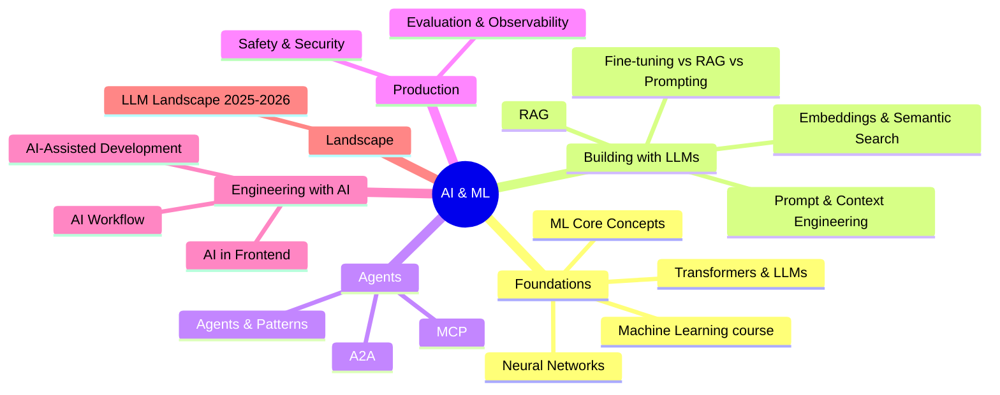

# AI & ML Index

> [!tldr] Start here
> The entry point to all AI and machine learning notes: from classic ML (the AWS DeepRacer and DeepLearning.AI course notes) through neural networks and transformers, to building LLM applications (prompting, context engineering, RAG, agents, MCP), running them safely in production (evals, observability, security), and working with AI coding agents. Every topic note has worked examples, a 🆕 2025–2026 box where things changed, and interview questions.

## 🧭 Quick links
- 🆕 [[LLM Landscape 2025-2026]]: dated model releases, agent SDKs, MCP vs A2A
- 🤖 [[AI Agents & Agentic Patterns]] + [[MCP]]: the core of modern LLM apps
- 🛡️ [[AI Safety, Security & Guardrails for Apps]]: OWASP LLM and Agentic Top 10s
- 🧑‍💻 [[AI-Assisted Software Development]]: coding agents, AGENTS.md, reviewing AI code

## 1. Beginner: machine learning foundations
Course notes: [[Machine Learning]] (AWS DeepRacer "Introduction to machine learning" + Coursera/DeepLearning.AI)

| Concepts | The ML process | Case studies |
|---|---|---|
| [[Introduction to Machine Learning]] | [[Major steps in ML]] | [[Case Studies that use ML]] |
| [[Components of ML]] | [[Step 1 Define The problem]] | [[Example 1 Predicting Home Prices]] |
| [[Supervised vs Unsupervised Machine learning]] | [[Step 2 Building Dataset]] | [[Example 2 Micro-genre Book Genre]] |
| [[ML Core Concepts]] | [[Step 3 Train the model]] | [[Example 3 Detecting Spills]] |
| | [[Step 4 Evaluate the model]] | |
| | [[Step 5 Use the model]] | |

## 2. Intermediate: how modern AI works and how to build with it
1. [[Neural Networks & Deep Learning Basics]]: perceptron, backprop, activations, CNN/RNN, overfitting
2. [[Transformers & How LLMs Work]]: tokens, attention, training stages, reasoning models, sampling
3. [[Prompt & Context Engineering]]: system prompts, few-shot, structured outputs, context engineering, prompt caching
4. [[Embeddings & Semantic Search]]: vectors, similarity, ANN indexes, hybrid search
5. [[Retrieval-Augmented Generation (RAG)]]: chunking, retrieval, reranking, agentic RAG, evaluation
   - Storage: [[Vector Databases & pgvector]] (Databases domain)
6. [[Fine-tuning vs RAG vs Prompting]]: decision guide, LoRA/QLoRA

## 3. Senior: agents, production and engineering practice
- [[AI Agents & Agentic Patterns]]: agent loop, tools, memory, workflow patterns, multi-agent, failure modes
- [[MCP]]: Model Context Protocol, building servers, spec history, security
- [[LLM Evaluation & Observability]]: golden sets, graders, LLM-as-judge, tracing
- [[AI Safety, Security & Guardrails for Apps]]: prompt injection, OWASP Top 10s, tool permissioning
- [[AI-Assisted Software Development]]: coding agents, spec-driven development, AGENTS.md, the senior role
- [[AI Workflow]]: my scope → architect → develop → check → test → review workflow
- [[LLM Landscape 2025-2026]]: models, SDKs, MCP vs A2A
- Frontend side: [[AI in Frontend - MCP, WebMCP & Built-in AI]] (MCP in dev tooling, WebMCP, Chrome built-in AI, streaming UI)

## Suggested study paths
> [!example]- 🔁 Beginner to senior (in order)
> 1. [[Machine Learning]] course notes in order, with [[ML Core Concepts]] alongside
> 2. [[Neural Networks & Deep Learning Basics]] → [[Transformers & How LLMs Work]]
> 3. [[Prompt & Context Engineering]] → [[Embeddings & Semantic Search]] → [[Retrieval-Augmented Generation (RAG)]] → [[Fine-tuning vs RAG vs Prompting]]
> 4. [[AI Agents & Agentic Patterns]] → [[MCP]]
> 5. [[LLM Evaluation & Observability]] → [[AI Safety, Security & Guardrails for Apps]]
> 6. [[AI-Assisted Software Development]] → [[AI Workflow]] → [[LLM Landscape 2025-2026]]

> [!example]- ⚡ Building an LLM feature next week
> [[Prompt & Context Engineering]] → [[Retrieval-Augmented Generation (RAG)]] → [[LLM Evaluation & Observability]] → [[AI Safety, Security & Guardrails for Apps]] → [[AI in Frontend - MCP, WebMCP & Built-in AI]] (streaming UI)

> [!example]- 🎯 AI engineering interview prep
> Interview questions in [[Transformers & How LLMs Work]], [[Retrieval-Augmented Generation (RAG)]], [[AI Agents & Agentic Patterns]], [[LLM Evaluation & Observability]], [[AI Safety, Security & Guardrails for Apps]], [[Fine-tuning vs RAG vs Prompting]] and [[Step 4 Evaluate the model]] (classic ML metrics)

## 🆕 2025–2026 in this area
- **Reasoning models** go mainstream: DeepSeek-R1 (2025-01-20, open), Claude 3.7 Sonnet hybrid reasoning (2025-02-24), o3 (2025-04-16), GPT-5 (2025-08-07) → [[Transformers & How LLMs Work]], [[LLM Landscape 2025-2026]]
- **Model releases** through Claude Opus 5.5 (2026-09-22), GPT-5.6 (2026-07), Gemini 3.x, DeepSeek V4 (2026-04-24), Mistral 3, Qwen3/3.5 → [[LLM Landscape 2025-2026]]
- **Agent SDKs**: OpenAI Agents SDK (2025-03-11), Google ADK (2025-04-09), Claude Agent SDK (2025-09-29) → [[AI Agents & Agentic Patterns]]
- **MCP** spec revisions 2025-03-26, 2025-06-18, 2025-11-25 and the stateless **2026-07-28**; MCP Registry (2025-09-08); MCP Apps (2026-01-26); TypeScript SDK v2 (2026-07) → [[MCP]]
- **Agentic AI Foundation** (Linux Foundation, 2025-12-09) with MCP, goose, AGENTS.md; A2A joined 2026-08-27; A2A v1.0 (2026-03-12) → [[MCP]], [[LLM Landscape 2025-2026]]
- **Context engineering** as a discipline (June 2025; Anthropic guide 2025-09-29) → [[Prompt & Context Engineering]]
- **Structured outputs** GA on Claude (2026-02-04); Gemini implicit caching (2025-05-08) → [[Prompt & Context Engineering]]
- **Agent evals**: Anthropic "Demystifying evals for AI agents" (2026-01-09); OpenTelemetry GenAI conventions (still in development) → [[LLM Evaluation & Observability]]
- **Security**: lethal trifecta (2025-06-16), CaMeL (2025-03), OWASP Top 10 for Agentic Applications (2025-12-09) → [[AI Safety, Security & Guardrails for Apps]]
- **Coding agents**: Claude Code GA (2025-05-22), Copilot coding agent GA (2025-09-25), Codex GA (2025-10-06), Cursor 2.0/3, Kiro, Spec Kit, AGENTS.md; METR study (2025-07-10) → [[AI-Assisted Software Development]]
- **AWS Panorama** end of support (2026-05-31) → [[Example 3 Detecting Spills]]

## Related
- [[Software Engineering]], the vault root
- [[Frontend Home]] · [[AI in Frontend - MCP, WebMCP & Built-in AI]]
- [[Vector Databases & pgvector]]
