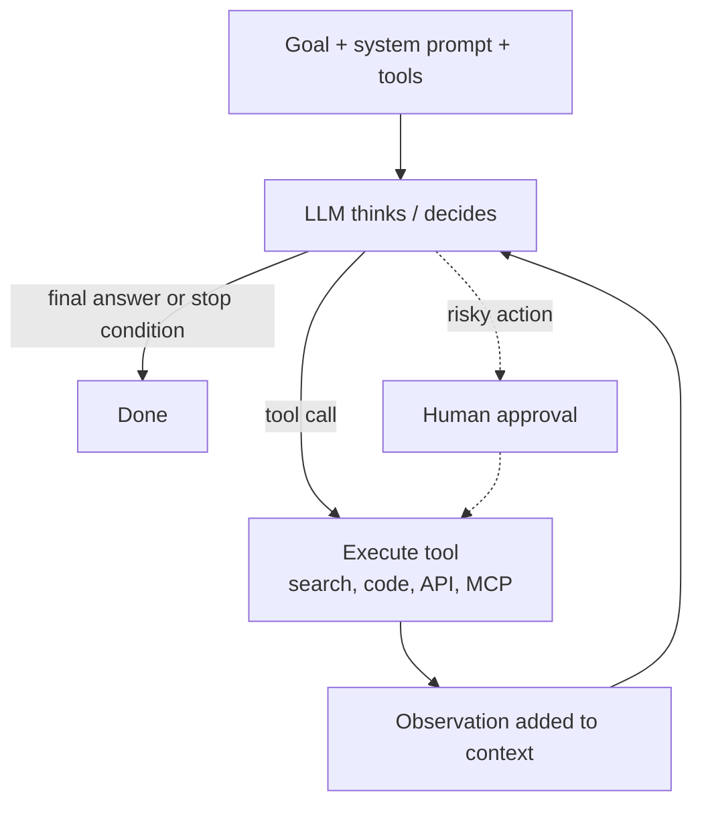
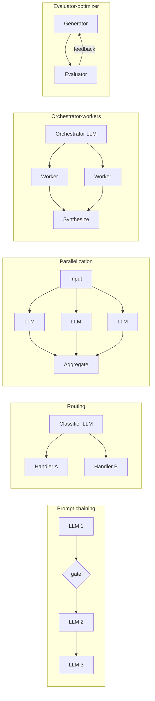

# AI Agents & Agentic Patterns

<Note>
**TL;DR**

An **AI agent** is an LLM running in a **loop**: it looks at the goal and context, decides on an action (usually a **tool call**), observes the result, and repeats until done. Anthropic draws a useful line: **workflows** run LLMs and tools along **predefined code paths**, while **agents** let the LLM **direct its own process**. Start with the simplest thing that works (one well-prompted call with retrieval), then add workflow patterns, and only reach for autonomous agents when the task is open-ended and the extra cost, latency and risk are worth it.
</Note>

## The idea

An AI agent is a software system that uses AI (usually LLMs) to pursue a goal on the user's behalf, choosing its own steps based on the inputs and tools available to it.

Commonly cited agent features, with a reality check:

| Feature | What it means in practice |
|---|---|
| **Autonomous action** | Performs multi-step tasks with little human intervention, *within the permissions you grant*. |
| **Reasoning and planning** | Uses the model to break a goal into steps and adapt when a step fails. |
| **Learning over time** | Today's agents don't update their weights as they work. "Learning" comes from **memory** (notes, files, databases fed back into context) and from humans improving prompts, tools and evals. |

**Multi-agent collaboration** lets agents split a large task, work in parallel with their own contexts and combine the results, which helps for broad tasks a single context window can't hold. It costs many more tokens and adds coordination failures, so it's a tool, not a default.

## The agent loop



The same loop in code (provider-agnostic pseudocode):

```python
messages = [{"role": "user", "content": goal}]
for step in range(MAX_STEPS):                       # always cap iterations
    reply = llm(system=SYSTEM_PROMPT, messages=messages, tools=TOOLS)
    messages.append(reply)
    if not reply.tool_calls:                         # model says it's done
        return reply.text
    for call in reply.tool_calls:
        if call.name in NEEDS_APPROVAL and not ask_human(call):
            result = "User denied this action."
        else:
            try:
                result = TOOLS_IMPL[call.name](**call.args)
            except Exception as e:
                result = f"Error: {e}"               # let the model recover
        messages.append(tool_result(call.id, result))
raise StepLimitExceeded()
```

Everything else (frameworks, SDKs) is a variation on this loop: better context management, parallel tool calls, sub-agents, persistence, tracing.

## The four ingredients

### 1. Tools
Tools are functions the model can request: search, read file, run SQL, call an API, run code, control a browser. They are described by a name, a description and a JSON Schema. **MCP** standardises how tools are packaged and shared across apps ([MCP](/Software%20Engineering/AI%20%26%20ML/MCP)).

Tool design matters as much as prompts. Anthropic's guidance on the **agent-computer interface (ACI)**:
- write tool descriptions like docs for a new colleague, with examples and edge cases;
- make arguments hard to get wrong ("poka-yoke": absolute paths instead of relative, enums instead of free text);
- prefer a few high-level tools (`schedule_meeting`) over many thin ones (`list_users`, `list_events`, `create_event`);
- return concise, meaningful, token-efficient results (paginate, truncate, filter);
- test tools by watching how the model actually uses them.

### 2. Planning and reasoning
- **ReAct** (reason + act): interleave "thought → action → observation" steps. The pattern behind most agents.
- **Plan-then-execute**: write a plan (often a todo list) first, then work through it, re-planning when reality differs.
- **Reasoning models** think before answering (extended thinking / reasoning effort), which improves multi-step planning. See [Transformers & How LLMs Work](/Software%20Engineering/AI%20%26%20ML/Transformers%20%26%20How%20LLMs%20Work).
- **Reflection / self-critique**: check work against the goal or tests before finishing.

### 3. Memory
| Kind | Where it lives | Example |
|---|---|---|
| **Working (short-term)** | the context window | the conversation, recent tool results |
| **Long-term** | files, databases, vector stores, fed back when relevant | `NOTES.md`, user preferences, past decisions |
| **Procedural** | instructions and skills loaded on demand | `CLAUDE.md` / `AGENTS.md`, skill files |

Context windows are finite and quality degrades as they fill ("context rot"), so long-running agents use **compaction** (summarise old history), **structured note-taking** and **sub-agents** that return condensed summaries. See [Prompt & Context Engineering](/Software%20Engineering/AI%20%26%20ML/Prompt%20%26%20Context%20Engineering).

### 4. Guardrails
Step limits, budgets, timeouts, permission tiers for tools, human approval for irreversible actions, sandboxes for code execution, and output validation. See [AI Safety, Security & Guardrails for Apps](/Software%20Engineering/AI%20%26%20ML/AI%20Safety%2C%20Security%20%26%20Guardrails%20for%20Apps).

## Workflows vs agents (Anthropic, "Building effective agents")

Anthropic's post (2024-12-19) is the standard reference. Its core advice: find the **simplest** solution; many use cases are solved by one LLM call with retrieval and good examples. Add complexity only when it demonstrably improves outcomes.

### Workflow patterns (predefined code paths)



| Pattern | How it works | Use when | Example |
|---|---|---|---|
| **Prompt chaining** | fixed sequence of calls, each using the previous output, with programmatic checks ("gates") between | the task splits cleanly into steps; trade latency for accuracy | outline → check outline → write document |
| **Routing** | classify the input, send it to a specialised prompt/model | distinct categories handled better separately | support tickets: refunds vs tech issues; easy queries to a small model |
| **Parallelization: sectioning** | independent subtasks run in parallel | speed, or separate concerns | one call answers, another screens for policy violations |
| **Parallelization: voting** | same task several times, combine answers | you want confidence or diverse views | several reviewers look for vulnerabilities |
| **Orchestrator-workers** | a central LLM decides subtasks dynamically and delegates, then synthesises | you can't predict the subtasks up front | coding change touching an unknown number of files |
| **Evaluator-optimizer** | one LLM generates, another critiques, loop | clear evaluation criteria, iteration helps | literary translation, complex search |

### Agents
Use an autonomous agent when the problem is **open-ended**, the number of steps can't be predicted, and you can trust the model's decisions in a **controlled environment** with good feedback (tests, tool results). Coding agents are the best-known success because code can be verified by running tests. Cost: higher token usage, latency and compounding errors, so sandbox and test extensively.

## Multi-agent patterns

| Pattern | Shape | Notes |
|---|---|---|
| **Orchestrator + sub-agents** | a lead agent spawns workers with narrow tasks and fresh contexts, gets summaries back | Anthropic's research system: an Opus 4 lead with Sonnet 4 sub-agents beat single-agent Opus 4 by 90.2% on an internal research eval, but multi-agent runs used ~15× the tokens of chat (single agents ~4×) |
| **Handoffs** | agents pass the conversation to a specialist (triage → billing agent) | OpenAI Agents SDK's core primitive |
| **Pipeline** | fixed chain of specialised agents | really a workflow with agentic steps |
| **Debate / critic** | agents argue or review each other | improves quality on judgement tasks, costs more |
| **Agent-to-agent across vendors** | agents discover and call each other over a protocol | **A2A** protocol (see [LLM Landscape 2025-2026](/Software%20Engineering/AI%20%26%20ML/LLM%20Landscape%202025-2026)) |

When multi-agent helps: breadth-first tasks (research across many sources) that parallelise and exceed one context window. When it hurts: tightly coupled tasks (most coding), where agents need shared context and make conflicting decisions.

## Failure modes

| Failure | What it looks like | Mitigation |
|---|---|---|
| **Compounding errors** | a small early mistake snowballs over 30 steps | checkpoints, verification steps, tests as feedback |
| **Infinite / runaway loops** | repeats the same failing tool call | step and budget limits, loop detection |
| **Hallucinated tool calls or arguments** | calls tools that don't exist, invents IDs | strict schemas, validation, clear tool docs |
| **Context rot** | forgets instructions as context fills | compaction, notes, sub-agents, shorter tool outputs |
| **Premature "done"** | claims success without checking | require evidence: tests pass, screenshot, diff |
| **Prompt injection** | a web page or document instructs the agent to exfiltrate data | treat tool output as untrusted, least privilege, human approval, no private-data + untrusted-content + outbound-channel combo |
| **Excessive agency** | deletes prod data "to fix" a bug | read-only by default, sandboxing, approval tiers |
| **Cost blowups** | multi-agent run burns $$$ | budgets, cheaper models for sub-tasks, caching |
| **Multi-agent coordination** | duplicate work, conflicting edits | clear task boundaries, one writer per resource |

## Building agents: SDKs and frameworks

<Info>
**🆕 2025–2026**

- **OpenAI Responses API and Agents SDK**: 2025-03-11 (agents, handoffs, guardrails, tracing; SDK open source). **AgentKit**: DevDay, 2025-10-06.
- **Google Agent Development Kit (ADK)**: 2025-04-09, open source.
- **Claude Agent SDK**: the Claude Code SDK was renamed on 2025-09-29, exposing the harness that powers Claude Code (context compaction, tools, sub-agents, permissions).
- **Agent Skills**: Anthropic, 2025-10-16; folders of instructions and scripts an agent loads only when relevant (procedural memory).
- **Anthropic, "Effective context engineering for AI agents"**: 2025-09-29; **"Demystifying evals for AI agents"**: 2026-01-09.
- **A2A** protocol v1.0: 2026-03-12; joined the Agentic AI Foundation 2026-08-27. **MCP** joined AAIF 2025-12-09.
- **OWASP Top 10 for Agentic Applications**: 2025-12-09.
Details and sources: [LLM Landscape 2025-2026](/Software%20Engineering/AI%20%26%20ML/LLM%20Landscape%202025-2026), [MCP](/Software%20Engineering/AI%20%26%20ML/MCP), [AI Safety, Security & Guardrails for Apps](/Software%20Engineering/AI%20%26%20ML/AI%20Safety%2C%20Security%20%26%20Guardrails%20for%20Apps).
</Info>

Framework advice from "Building effective agents": frameworks help you start, but they add abstraction that can hide prompts and responses. Many patterns take a few lines of code with the raw API; if you use a framework, make sure you understand what it does underneath.

## Senior perspective
- **Is an agent needed?** Ask whether a deterministic workflow with one or two LLM steps would do. It's cheaper, faster, testable and predictable.
- **Evaluate before scaling**: build a task set with verifiable outcomes, track success rate, cost and steps per task, and watch **pass^k** (succeeds on all k tries) for reliability, not just pass@k. See [LLM Evaluation & Observability](/Software%20Engineering/AI%20%26%20ML/LLM%20Evaluation%20%26%20Observability).
- **Trace everything**: every prompt, tool call, result and token count, so failures can be replayed.
- **Permission design**: least privilege, scoped credentials per tool, sandboxed execution, approval gates for irreversible or outbound actions, and an audit log.
- **Idempotency and recovery**: agents retry; make tools idempotent or detect duplicates. Checkpoint long runs so they can resume.
- **Cost and latency budgets** per task, with graceful fallback (hand off to a human).
- **Reviewers ask**: what's the stop condition? What happens on tool failure? Which actions need approval? How is untrusted content isolated? How do we know it worked?

## Interview questions

<Accordion title="What's the difference between a workflow and an agent?">
In a workflow, your code decides the sequence of LLM calls and tool uses (predefined paths). In an agent, the LLM decides dynamically what to do next and when it's done. Workflows are more predictable and cheaper; agents handle open-ended tasks with unknown steps.
</Accordion>

<Accordion title="Describe the agent loop.">
Send the goal, context and tool definitions to the model; if it returns tool calls, execute them, append the results, and call the model again; stop when it answers without tool calls or a limit is hit. Add approval for risky tools, error results the model can recover from, and step/cost limits.
</Accordion>

<Accordion title="Name the workflow patterns from &quot;Building effective agents&quot;.">
Prompt chaining, routing, parallelization (sectioning and voting), orchestrator-workers and evaluator-optimizer. Plus the augmented LLM (model with retrieval, tools, memory) as the building block, and fully autonomous agents.
</Accordion>

<Accordion title="When would you use a multi-agent system?">
For broad, parallelisable tasks where sub-tasks need separate contexts, like research across many sources. Avoid for tightly coupled tasks where agents need shared state. Budget for much higher token usage.
</Accordion>

<Accordion title="How do agents &quot;remember&quot; things?">
Short-term via the context window; long-term via external stores (files, DBs, vector search) that are written to and retrieved back into context; procedural memory via instruction files and skills. Models don't learn from individual runs.
</Accordion>

<Accordion title="What are the biggest risks of deploying an agent, and how do you mitigate them?">
Prompt injection, excessive agency, runaway costs and silent failures. Mitigate with least-privilege tools, sandboxing, human approval for irreversible actions, step and budget limits, full tracing, and evals with verifiable outcomes.
</Accordion>

## Related
- [AI & ML Index](/Software%20Engineering/AI%20%26%20ML/AI%20%26%20ML%20Index)
- [MCP](/Software%20Engineering/AI%20%26%20ML/MCP) · [Prompt & Context Engineering](/Software%20Engineering/AI%20%26%20ML/Prompt%20%26%20Context%20Engineering) · [Retrieval-Augmented Generation (RAG)](/Software%20Engineering/AI%20%26%20ML/Retrieval-Augmented%20Generation%20(RAG))
- [LLM Evaluation & Observability](/Software%20Engineering/AI%20%26%20ML/LLM%20Evaluation%20%26%20Observability) · [AI Safety, Security & Guardrails for Apps](/Software%20Engineering/AI%20%26%20ML/AI%20Safety%2C%20Security%20%26%20Guardrails%20for%20Apps)
- [AI-Assisted Software Development](/Software%20Engineering/AI%20%26%20ML/AI-Assisted%20Software%20Development) · [AI Workflow](/Software%20Engineering/AI%20%26%20ML/AI%20Workflow) · [LLM Landscape 2025-2026](/Software%20Engineering/AI%20%26%20ML/LLM%20Landscape%202025-2026)
- [AI in Frontend - MCP, WebMCP & Built-in AI](/Software%20Engineering/Frontend/16%20AI%20in%20Frontend/AI%20in%20Frontend%20-%20MCP%2C%20WebMCP%20%26%20Built-in%20AI)

## Sources
- Anthropic, [Building effective agents](https://www.anthropic.com/engineering/building-effective-agents) (2024-12-19)
- Anthropic, [How we built our multi-agent research system](https://www.anthropic.com/engineering/multi-agent-research-system) (2025-06-13)
- Anthropic, [Writing effective tools for AI agents](https://www.anthropic.com/engineering/writing-tools-for-agents) (2025-09-11)
- Anthropic, [Effective context engineering for AI agents](https://www.anthropic.com/engineering/effective-context-engineering-for-ai-agents) (2025-09-29)
- Anthropic, [Demystifying evals for AI agents](https://www.anthropic.com/engineering/demystifying-evals-for-ai-agents) (2026-01-09)
- Anthropic, [Introducing Claude Sonnet 4.5 (Claude Agent SDK rename)](https://www.anthropic.com/news/claude-sonnet-4-5) · [Agent SDK migration guide](https://platform.claude.com/docs/en/agent-sdk/migration-guide) · [Agent Skills](https://claude.com/blog/skills)
- OpenAI, [API changelog (Responses API and Agents SDK, 2025-03-11)](https://developers.openai.com/api/docs/changelog) · [OpenAI Agents SDK](https://openai.github.io/openai-agents-python/)
- Google, [Agent Development Kit](https://developers.googleblog.com/en/agent-development-kit-easy-to-build-multi-agent-applications/) (2025-04-09)
- Yao et al. (2022), [ReAct: Synergizing Reasoning and Acting in Language Models](https://arxiv.org/abs/2210.03629)
