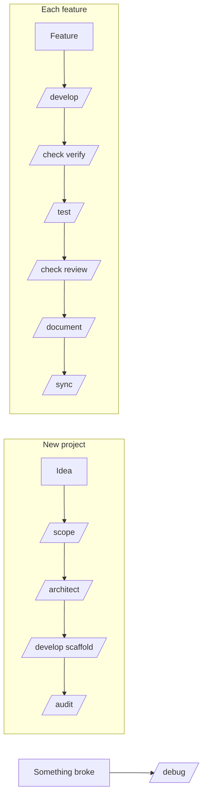

# AI Workflow

<Note>
**TL;DR**

My skill-based workflow for building software with a coding agent. A new idea goes `/scope → /architect → /develop (scaffold) → /audit`; each new feature goes `/develop → /check verify → /test → /check review → /document → /sync`, with `/debug` whenever something breaks. `/scope` makes two decisions explicit: the **build approach** (Tracer Bullet, Skateboard, Facade, Journey) and the **workflow tier** (Prototype, Alpha, Beta, GA), which sets how much proof a feature needs before it counts as done.
</Note>

- **New project**: Idea → `/scope` → `/architect` → `/develop` (scaffold) → `/audit`
- **New feature**: `/develop` → `/check verify` → `/test` → `/check review` → `/document` → `/sync`
- `/debug` if anything breaks

## Decision one: the build approach

`/scope` makes the choice explicit. Four approaches, all long-standing engineering ideas rather than invented workflow settings.

| Approach          | Pick it when                                                                    |
| ----------------- | ------------------------------------------------------------------------------- |
| **Tracer Bullet** | The integration risk is the scary part and you need it proven early             |
| **Skateboard**    | You need real users on it fast, to learn whether it's worth continuing          |
| **Facade**        | It has to be seen and approved before the backend is worth building             |
| **Journey**       | One flow has to feel finished, edge cases included, before anything else starts |

**Tracer Bullet** is the walking skeleton, associated with Alistair Cockburn, and the "tracer bullet" approach from *The Pragmatic Programmer*. You build one narrow path through the entire system, from the interface through the application to the database. It does very little at first, but it works end to end. Then you thicken it: another action, another state, another behaviour. Instead of building disconnected layers and hoping they meet, you start with one real path and grow from something already proven.

**Skateboard** is the MVP approach, from Henrik Kniberg's "skateboard → bicycle → car" illustration. The smallest version a real person could genuinely use. Not a collection of unfinished systems, and not half of every planned feature. One useful product, kept as small as possible, then expanded.

**Facade** builds the interface with temporary data before committing to the backend underneath. Right when the product needs to be seen, tested or approved before deeper infrastructure is worth paying for. You explore layout, interaction and feel while those decisions are still cheap to change.

**Journey** takes one complete user path and finishes every part of it before starting the next: the happy path, loading state, empty state, failures and edge cases. That journey isn't merely connected. It feels finished.

## Decision two: the workflow tier

The second default is how much proof a feature needs before it's finished.

You wouldn't treat a weekend experiment the way you treat a payment flow. A throwaway script might only need to run once. A login system needs stronger evidence. A compliance feature might need verification, tests, independent review and documentation before anyone should trust it.

Good teams have always matched process to risk. `/scope` turns that into one explicit setting instead of reopening the argument for every feature.

Four tiers, each adding to the last.

| Tier          | /develop | /check verify | /test | /check review |
| ------------- | -------- | ------------- | ----- | ------------- |
| **Prototype** | ✓        |               |       |               |
| **Alpha**     | ✓        | ✓             |       |               |
| **Beta**      | ✓        | ✓             | ✓     |               |
| **GA**        | ✓        | ✓             | ✓     | ✓             |

**Prototype** is `/develop` implementing the feature, checking its own work and marking it complete. Experiments, spikes, personal tools, anything that costs almost nothing if it fails.

**Alpha** adds `/check verify`. The feature has to run inside the real application, and it's only marked complete once the expected behaviour has actually been demonstrated. For low-risk work that still deserves better evidence than the agent that built it saying "should work".

**Beta** adds `/test`: a real suite before it closes. The right level for most production products: the feature works today, and the tests protect it from tomorrow's changes.

**GA** adds `/check review` run on a **different model** from the one that wrote the code, then `/document`. For work that hurts when it breaks: payments, auth, permissions, compliance, anything a team shares.

At GA, the agent that wrote the implementation is not allowed to be the only agent deciding whether that implementation is safe.

## It's a recommendation, not a track

Worth being plain about this, because it's easy to read the above as a system that boxes you in.

`/scope` reads your idea, recommends an approach and a tier from the risk and size of the feature mix, and records what you choose. Every box it writes is a suggestion. You can run any of them, skip any of them, and mark a feature done when you decide it's done. The workflow records what you actually did, including what you skipped.

The plan isn't written once and abandoned. As features ship, `/sync` reconciles the scope against what's actually in the repo, updating statuses and flagging what the change made stale.

## Why this works with coding agents
- **Specs before code**: `/scope` and `/architect` are a form of spec-driven development; the agent builds against written decisions instead of guessing. See [AI-Assisted Software Development](/Software%20Engineering/AI%20%26%20ML/AI-Assisted%20Software%20Development).
- **Evidence over claims**: agents often report "done" too early; `/check verify` and `/test` demand proof (a failure mode listed in [AI Agents & Agentic Patterns](/Software%20Engineering/AI%20%26%20ML/AI%20Agents%20%26%20Agentic%20Patterns)).
- **Independent review**: a different model reviewing at GA reduces the "grading your own homework" problem.
- **Durable context**: `/audit` and `/sync` keep `AGENTS.md` files current so every future session starts with accurate project context ([Prompt & Context Engineering](/Software%20Engineering/AI%20%26%20ML/Prompt%20%26%20Context%20Engineering)).

## Interview questions

<Accordion title="How do you decide how much verification an AI-written feature needs?">
Match process to risk. A spike needs only to run; a user-facing feature needs to be demonstrated working in the real app; production code needs tests; anything touching money, auth, permissions or compliance needs independent review and documentation too.
</Accordion>

<Accordion title="What is a tracer bullet / walking skeleton and why use it?">
A thin, end-to-end implementation through every layer (UI → API → DB) that does very little but works. It proves integration early and gives you something real to grow, instead of building layers separately and discovering at the end that they don't fit.
</Accordion>

## Related
- [AI & ML Index](/Software%20Engineering/AI%20%26%20ML/AI%20%26%20ML%20Index)
- [AI-Assisted Software Development](/Software%20Engineering/AI%20%26%20ML/AI-Assisted%20Software%20Development) · [AI Agents & Agentic Patterns](/Software%20Engineering/AI%20%26%20ML/AI%20Agents%20%26%20Agentic%20Patterns) · [Prompt & Context Engineering](/Software%20Engineering/AI%20%26%20ML/Prompt%20%26%20Context%20Engineering)

## Sources
- Andrew Hunt & David Thomas, *The Pragmatic Programmer* (20th anniversary ed., 2019), "Tracer Bullets"
- Alistair Cockburn, *Crystal Clear* (2004), "Walking Skeleton"
- Henrik Kniberg, [Making sense of MVP](https://blog.crisp.se/2016/01/25/henrikkniberg/making-sense-of-mvp) (2016)
