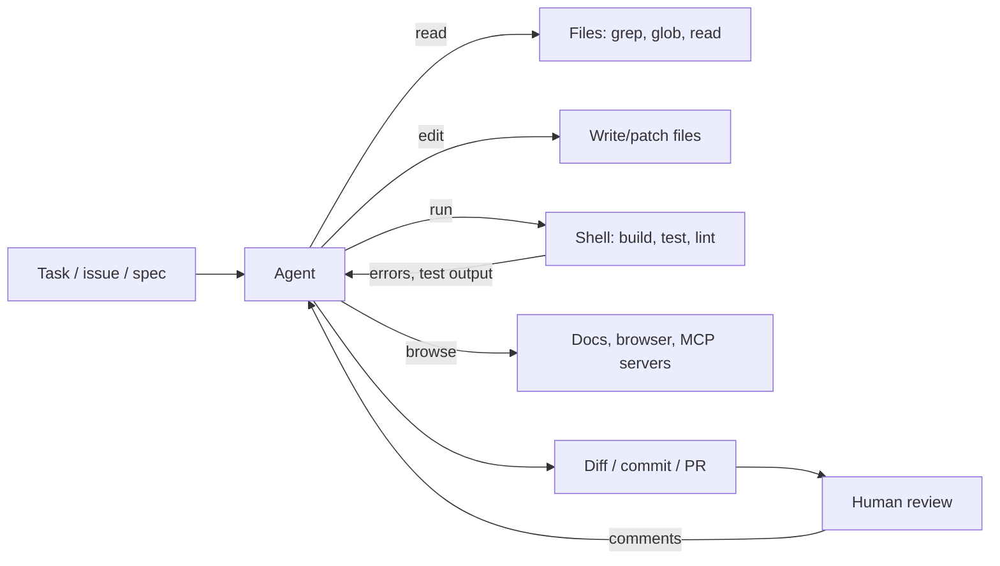

# AI-Assisted Software Development

> [!tldr] TL;DR
> In 2025 AI coding moved from autocomplete to **agents** that read the codebase, run commands and tests, and open pull requests: Claude Code, GitHub Copilot's agent mode and coding agent, OpenAI Codex, Cursor's agents, Gemini CLI and others. They work best with **clear specs**, **fast feedback loops** (tests, types, linters) and **project instructions** in files like **`AGENTS.md`**. The engineer's job shifts toward **specifying, reviewing, verifying and designing systems**; the evidence on productivity is mixed, and AI-written code still needs the same review bar as human code, arguably higher.

## The spectrum of AI assistance

| Level | What the AI does | Human role | Examples |
|---|---|---|---|
| 1. **Autocomplete** | predicts the next lines | writes and accepts | inline completions |
| 2. **Chat** | answers questions, writes snippets | copies, adapts | chat panels, web chat |
| 3. **In-IDE agent** | edits many files, runs commands and tests in a loop, you watch | steer, approve, review | Copilot agent mode, Cursor agent, Claude Code, Codex CLI, Gemini CLI |
| 4. **Background / cloud agent** | takes an issue, works asynchronously in a sandbox, opens a PR | write the task, review the PR | Copilot coding agent, Codex cloud, Claude Code on the web, Jules, Cursor cloud agents |
| 5. **Multi-agent orchestration** | several agents in parallel on separate branches/worktrees | plan, split work, integrate | Cursor 3 agents view, GitHub Agent HQ, Claude Code subagents |

## How a coding agent works
It's the agent loop from [[AI Agents & Agentic Patterns]] with developer tools:



What makes it work well: tests and type checks give the agent **ground truth**, so it can iterate until green. Code is one of the few domains where an agent's output is cheaply **verifiable**, which is why coding agents took off first.

## The tools (2025–2026)

> [!info]+ 🆕 2025–2026 timeline (verified dates)
> **Anthropic Claude Code**
> - 2025-02-24: research preview, launched with Claude 3.7 Sonnet.
> - 2025-05-22: generally available alongside Claude 4; IDE integrations, GitHub Actions, Claude Code SDK.
> - Mid-2025: **hooks** (v1.0.38, June) and custom **subagents** (July).
> - 2025-09-29: Claude Code 2.0; the SDK was renamed **Claude Agent SDK**.
> - October 2025: **plugins** (public beta), **Agent Skills** (2025-10-16), **Claude Code on the web** (2025-10-20, cloud sandboxes).
> - 2025-12-03: Anthropic reported a $1B run-rate for Claude Code about six months after GA, and acquired Bun.
> - 2026-02-20: **Claude Code Security** (limited research preview).
>
> **GitHub Copilot**
> - 2025-04-07: **agent mode** (with MCP) rolling out to all VS Code users (preview since February 2025).
> - 2025-05-19: **Copilot coding agent** public preview at Build: assign an issue, it works in GitHub Actions and opens a draft PR. **GA 2025-09-25**.
> - 2025-09-25: Copilot CLI public preview; **GA 2026-02-25**.
> - 2025-10-28 (GitHub Universe): **Agent HQ**, running agents from multiple vendors inside GitHub and VS Code.
> - 2026-06-17: Copilot desktop app GA. 2026-07-29: Copilot code review supports agent skills and MCP (GA).
>
> **OpenAI Codex**
> - April 2025: open-source **Codex CLI**.
> - 2025-05-16: **Codex** cloud agent research preview (codex-1, parallel sandboxes).
> - September 2025: GPT-5-Codex with IDE extension and code review. **2025-10-06: Codex GA**, with Slack integration and Codex SDK.
>
> **Cursor**
> - June 2025: Cursor 1.0 (BugBot PR review, Background Agents for all users, one-click MCP).
> - 2025-10-29: **Cursor 2.0** with its own model **Composer** and an agent-centric UI with up to 8 parallel agents.
> - 2026-04-02: **Cursor 3**, rebuilt around local, worktree, cloud and SSH agents.
>
> **Others**
> - 2025-06-25: **Gemini CLI**, open source (Apache 2.0).
> - 2025-07-14: **AWS Kiro** preview, a spec-driven IDE; **GA 2025-11-17**.
> - 2025-08-06: **Google Jules** out of beta.
> - 2025-09-02: **GitHub Spec Kit**, open-source toolkit for spec-driven development.
> - August 2025: **AGENTS.md** convention launched; 2025-12-09 it became a founding project of the Linux Foundation's Agentic AI Foundation.

Product names and features change monthly; check the vendor changelog before relying on a detail.

## Project instructions: AGENTS.md and friends

**`AGENTS.md`** is a plain Markdown file at the repo root, a "README for agents": how to build, test, lint, the conventions, what not to touch. It was launched in August 2025 by OpenAI Codex, Amp, Google Jules, Cursor and Factory, is read by many agents (Codex, Copilot, Cursor, Gemini CLI, Jules, VS Code and others), is used by 60,000+ open-source projects, and is now stewarded by the Agentic AI Foundation. Nested `AGENTS.md` files in sub-folders apply to that part of the tree.

Some tools have their own file too (e.g. `CLAUDE.md` for Claude Code, Copilot's `.github/copilot-instructions.md`); a common pattern is one tool-agnostic `AGENTS.md` with thin pointers from the tool-specific files.

```markdown
# AGENTS.md

## Setup
- Node 22, pnpm. Install: `pnpm install`

## Commands
- Test: `pnpm test` (Vitest). Run a single file: `pnpm test path/to/file.test.ts`
- Types: `pnpm typecheck`. Lint: `pnpm lint --fix`

## Conventions
- TypeScript strict; no `any`. Server code in `src/server`, never import it from `src/client`.
- DB access only through `src/server/db/repositories/*`.
- Every bug fix needs a regression test.

## Don't
- Don't edit generated files in `src/gen/`. Don't add dependencies without asking.
```

Keep it short, specific and **current**: stale instructions actively mislead agents. See [[Prompt & Context Engineering]].

## Spec-driven development
Instead of prompting ad hoc ("vibe coding"), you write down **what** and **why** first, then let the agent derive **how**.

GitHub **Spec Kit** (2025-09-02) formalises four phases:
1. **Specify**: you describe the what and why; the agent drafts a detailed spec (user journeys, acceptance criteria).
2. **Plan**: you give stack and architecture constraints; the agent writes a technical plan.
3. **Tasks**: the agent breaks spec + plan into small, reviewable tasks.
4. **Implement**: the agent works through tasks one by one while you verify each.

AWS **Kiro** follows a similar flow: requirements → design → tasks, plus event-driven hooks. The author's own version of this flow is [[AI Workflow]].

Why it works: specs give the agent stable context across sessions, make review easier (compare against acceptance criteria), and force the human to make the decisions that matter.

## A good task for an agent
- **Well scoped**: one feature or bug, clear acceptance criteria.
- **Verifiable**: tests exist or are part of the task; the agent can run them.
- **Context provided**: links to relevant files, examples of similar code, constraints.
- **Low blast radius**: works on a branch, in a sandbox, without production credentials.

Good fits: tests for existing code, bug fixes with a reproduction, migrations and refactors with a clear pattern, boilerplate, docs, prototypes, exploring an unfamiliar codebase. Poor fits: vague product decisions, subtle concurrency/security design, large cross-cutting architecture changes without a plan.

## Reviewing AI-generated code

AI code often **looks** right. Review it at least as strictly as a human PR:

| Check | What to look for |
|---|---|
| **Does it solve the actual problem?** | against the spec/acceptance criteria, not the agent's summary |
| **Tests** | were tests added? Do they test behaviour, or were they weakened/mocked to pass? Did the agent edit tests to match wrong code? |
| **Hallucinated APIs and packages** | methods that don't exist, wrong library versions, invented package names (a supply-chain risk known as "slopsquatting") |
| **Security** | injection, missing authz checks, secrets in code, unsafe deserialisation, overly broad permissions |
| **Scope creep** | unrelated changes, reformatting, "improvements" nobody asked for |
| **Duplication and fit** | re-implementing helpers that already exist; ignoring project conventions |
| **Error handling and edge cases** | happy path only; swallowed errors |
| **Performance** | N+1 queries, needless loops, unbounded memory |
| **Maintainability** | would the team understand and own this in six months? |

Practical habits: keep PRs small, ask the agent to explain its reasoning and list risks, run the code yourself, use a **different model or a human** for review on high-risk changes, and never merge code you don't understand.

## What the evidence says

| Source | Finding |
|---|---|
| **METR randomised trial** (2025-07-10) | 16 experienced open-source developers on their own repos were **19% slower** with AI tools (early-2025 tools), while believing they were ~20% faster |
| **METR follow-up** (2026-02-24) | 57 developers; estimated speed-up of roughly 4–18% depending on cohort, which METR calls only weak evidence due to selection effects |
| **Stack Overflow Developer Survey 2025** | 84% use or plan to use AI tools; 46% distrust AI output accuracy vs 33% who trust it; the top frustration (45%) is answers that are "almost right, but not quite" |
| **DORA 2025 State of AI-assisted Software Development** | ~90% use AI at work; most report higher productivity; ~30% have little or no trust in AI-generated code; the main finding is that AI **amplifies** a team's existing strengths and weaknesses |

Takeaway: gains are real for some tasks and teams but not automatic. Strong engineering practices (tests, CI, small batches, platform quality) decide whether AI speeds you up or just produces more code to review.

## How the senior engineer's role changes
- **From writing to specifying**: clear problem statements, acceptance criteria and architecture decisions become the leverage point.
- **From typing to reviewing and verifying**: reading diffs critically, designing tests that catch wrong behaviour, and insisting on evidence (tests, screenshots, traces) over the agent's "done".
- **Context curation**: maintaining `AGENTS.md`, docs, examples and tooling so agents (and new humans) do the right thing by default.
- **Guardrails and platform**: sandboxes, permissions, CI gates, secret scanning, dependency policies for agent-written code ([[AI Safety, Security & Guardrails for Apps]]).
- **Judgement stays human**: trade-offs, system design, security, what *not* to build, and accountability for what ships.
- **Mentoring changes**: juniors can produce more code sooner but need help building the understanding to review it; pair on reading and debugging, not just generating.
- **Cost awareness**: agent runs cost tokens; parallel agents multiply review load.

## Common pitfalls
- "Vibe coding" production features without a spec or tests.
- Accepting large diffs you haven't read.
- Letting agents run with production credentials or unrestricted network/shell access.
- Stale or bloated `AGENTS.md`/`CLAUDE.md` files that contradict the code.
- Measuring success by lines of code or PR count instead of outcomes and defect rates.
- Skipping review because "the tests pass" when the agent wrote (or edited) the tests.

## Interview questions

> [!question]- How do you use AI coding agents effectively on a team?
> Give them well-scoped, verifiable tasks with context; keep instructions in AGENTS.md; require tests and CI to pass; keep PRs small; review AI code with the same or higher bar; sandbox agents and limit credentials; measure outcomes (lead time, change failure rate), not lines of code.

> [!question]- What is spec-driven development?
> Writing the what and why (spec, acceptance criteria) and a technical plan before generating code, then breaking the work into small tasks the agent implements and a human verifies. It gives agents stable context and makes review objective. GitHub Spec Kit and AWS Kiro are examples.

> [!question]- What is AGENTS.md?
> A Markdown file in the repo that tells coding agents how to set up, build, test and follow the project's conventions, a README for agents. It's an open convention (launched August 2025, now under the Linux Foundation's Agentic AI Foundation) supported by many agents.

> [!question]- What do you look for when reviewing AI-generated code?
> Correctness against the requirements, meaningful tests (not weakened ones), hallucinated APIs or packages, security issues, unrelated changes, duplication of existing helpers, edge cases and error handling, performance, and whether the team can maintain it.

> [!question]- Does AI make developers faster?
> It depends. Surveys show near-universal adoption and perceived gains, but METR's 2025 randomised trial found experienced developers 19% slower on their own mature codebases, and DORA 2025 finds AI amplifies existing team strengths and weaknesses. Well-scoped, verifiable tasks and strong engineering practices see the most benefit.

> [!question]- How does the senior engineer's role change with coding agents?
> More time on problem definition, architecture, specs, review, verification and guardrails; curating context for agents; mentoring juniors on understanding code rather than producing it; and owning accountability for what ships.

## Related
- [[AI & ML Index]]
- [[AI Workflow]] · [[AI Agents & Agentic Patterns]] · [[Prompt & Context Engineering]] · [[MCP]]
- [[AI Safety, Security & Guardrails for Apps]] · [[LLM Evaluation & Observability]] · [[LLM Landscape 2025-2026]]
- Frontend: [[AI in Frontend - MCP, WebMCP & Built-in AI]] · [[Frontend Testing]] · [[Supply Chain Security]] · [[Monorepos]]

## Sources
- Anthropic: [Claude 3.7 Sonnet and Claude Code](https://www.anthropic.com/news/claude-3-7-sonnet) · [Claude 4](https://www.anthropic.com/news/claude-4) · [Claude Code changelog](https://code.claude.com/docs/en/changelog) · [Agent SDK migration guide](https://platform.claude.com/docs/en/agent-sdk/migration-guide) · [Agent Skills](https://claude.com/blog/skills) · [Claude Code on the web](https://www.anthropic.com/news/claude-code-on-the-web) · [Bun acquisition / $1B milestone](https://www.anthropic.com/news/anthropic-acquires-bun-as-claude-code-reaches-usd1b-milestone) · [Claude Code Security](https://www.anthropic.com/news/claude-code-security)
- GitHub: [Agent mode for all VS Code users](https://code.visualstudio.com/blogs/2025/04/07/agentMode) · [Coding agent public preview](https://github.blog/changelog/2025-05-19-github-copilot-coding-agent-in-public-preview/) · [Coding agent GA](https://github.blog/changelog/2025-09-25-copilot-coding-agent-is-now-generally-available/) · [Copilot CLI GA](https://github.blog/changelog/2026-02-25-github-copilot-cli-is-now-generally-available/) · [Agent HQ](https://github.blog/news-insights/company-news/welcome-home-agents/) · [Copilot app GA](https://github.blog/changelog/2026-06-17-github-copilot-app-generally-available/) · [Code review skills and MCP GA](https://github.blog/changelog/2026-07-29-copilot-code-review-agent-skills-and-mcp-now-generally-available/)
- GitHub, [Spec-driven development with AI: Spec Kit](https://github.blog/ai-and-ml/generative-ai/spec-driven-development-with-ai-get-started-with-a-new-open-source-toolkit/) · [github/spec-kit](https://github.com/github/spec-kit)
- OpenAI: [Codex CLI](https://github.com/openai/codex) · [Introducing Codex](https://openai.com/index/introducing-codex/) · [Upgrades to Codex (GPT-5-Codex)](https://openai.com/index/introducing-upgrades-to-codex/) · [Codex GA](https://openai.com/index/codex-now-generally-available/)
- Cursor: [1.0](https://cursor.com/changelog/1-0) · [2.0](https://cursor.com/blog/2-0) · [Cursor 3](https://cursor.com/blog/cursor-3)
- Google: [Gemini CLI](https://blog.google/technology/developers/introducing-gemini-cli-open-source-ai-agent/) · [Jules changelog 2025-08-06](https://jules.google/docs/changelog/2025-08-06/)
- AWS Kiro: [Introducing Kiro](https://kiro.dev/blog/introducing-kiro/) · [GA](https://kiro.dev/blog/general-availability/)
- [agents.md](https://agents.md/) · Linux Foundation, [Agentic AI Foundation](https://www.linuxfoundation.org/press/linux-foundation-announces-the-formation-of-the-agentic-ai-foundation)
- METR, [Early-2025 AI and experienced OS developer productivity](https://metr.org/blog/2025-07-10-early-2025-ai-experienced-os-dev-study/) · [Uplift update (2026-02-24)](https://metr.org/blog/2026-02-24-uplift-update/)
- [Stack Overflow Developer Survey 2025: AI](https://survey.stackoverflow.co/2025/ai) · [DORA 2025 report](https://dora.dev/dora-report-2025/)
