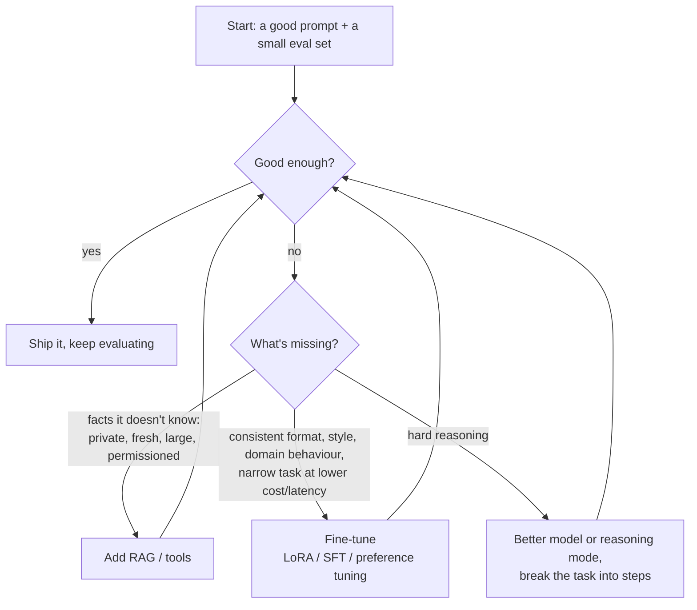

# Fine-tuning vs RAG vs Prompting

> [!tldr] TL;DR
> Three ways to adapt an LLM to your task, in the order you should try them: **prompting** (instructions and examples, minutes to iterate), **RAG** (inject the right *knowledge* at query time), and **fine-tuning** (change the model's weights to learn a *behaviour, style or format*). Rule of thumb: **RAG for knowledge, fine-tuning for behaviour**, prompting first for everything. When you do fine-tune, parameter-efficient methods like **LoRA** and **QLoRA** train small adapter weights instead of the whole model.

## The decision in one picture



## Comparison

| | Prompting | RAG | Fine-tuning |
|---|---|---|---|
| **Changes** | the input | the input (adds retrieved context) | the model weights |
| **Best for** | most tasks; format; reasoning steps | knowledge: private, fresh, large, per-user | behaviour: tone, format, domain style, narrow classification/extraction, distilling a big model into a small one |
| **Data needed** | a few examples | your documents | hundreds to thousands of high-quality examples |
| **Time to iterate** | minutes | days | days to weeks |
| **Freshness** | per request | update the index anytime | retrain to update |
| **Citations / traceability** | n/a | yes | no (knowledge is baked in, can't cite) |
| **Hallucination on facts** | high if not in context | lower (grounded) | still hallucinates; fine-tuning is poor at adding facts reliably |
| **Per-request cost** | long prompts cost tokens | retrieval + longer prompts | shorter prompts; can use a smaller model |
| **Ops burden** | low | index, pipelines, evals | training pipeline, model hosting/versioning, re-tune on base model updates |

They combine: a fine-tuned small model that follows your output format, fed by RAG, with a short prompt, is a common production pattern.

## When fine-tuning is the right call
- You need **consistent structure or style** that prompting can't hold reliably (brand voice, a complex report format, a DSL).
- A **narrow, high-volume task** (classification, extraction, routing) where a fine-tuned small model matches a big model's quality at a fraction of the cost and latency (**distillation**).
- The prompt has become huge with examples and rules; fine-tuning bakes them in.
- Domain language the base model handles poorly (specialised medical or legal phrasing), usually combined with RAG for facts.
- Teaching **tool-use patterns** or agent behaviour specific to your environment.

When it's the wrong call: to "teach the model our documentation" (use RAG), when you have little or low-quality data, or when requirements change weekly.

## Kinds of fine-tuning

| Method | What it trains on | Use |
|---|---|---|
| **Supervised fine-tuning (SFT)** | input → ideal output pairs | format, style, task behaviour |
| **Preference tuning (DPO, RLHF)** | pairs of better vs worse responses | tone, helpfulness, "which answer do we prefer" |
| **Reinforcement fine-tuning** | tasks with a grader/reward | reasoning on verifiable domain tasks (offered by some providers) |
| **Continued pretraining** | large raw domain corpus | new language/domain; expensive, rarely needed |

Hosted APIs (OpenAI, Google Vertex AI, Amazon Bedrock, Mistral and others) offer fine-tuning of some of their models; open-weight models (Llama, Qwen, Mistral, Gemma, gpt-oss) can be tuned yourself. Check each provider's current list of tunable models, since it changes often.

## Parameter-efficient fine-tuning: LoRA and QLoRA

Full fine-tuning updates every weight: for a large model that means huge GPU memory and a full copy of the model per task. **PEFT** methods freeze the base model and train a small number of new parameters.

### LoRA (Low-Rank Adaptation, 2021)
Instead of updating a big weight matrix `W` (d × d), learn a low-rank update `ΔW = B·A`, where `A` is r × d and `B` is d × r, with a small rank r (e.g. 8–64).

```text
W' = W (frozen) + (α/r) · B·A (trainable)
d = 4096, r = 16  →  full: 16.8M params per matrix;  LoRA: 2·4096·16 = 131k params (~0.8%)
```

- The paper reported, versus full fine-tuning of GPT-3 175B, about **10,000× fewer trainable parameters** and **3× less GPU memory**, with comparable or better quality and **no extra inference latency** (adapters can be merged into the weights).
- Adapters are small files (megabytes), so you can keep one base model and swap adapters per customer or task.

### QLoRA (2023)
LoRA on top of a base model **quantised to 4 bits**, using the **NF4** (4-bit NormalFloat) data type, double quantisation and paged optimisers. The paper fine-tuned a **65B model on a single 48 GB GPU** while matching 16-bit fine-tuning performance. It made fine-tuning large open models possible on one GPU.

```python
# Hugging Face PEFT + TRL sketch
from peft import LoraConfig
from trl import SFTTrainer, SFTConfig

lora = LoraConfig(r=16, lora_alpha=32, lora_dropout=0.05,
                  target_modules=["q_proj", "k_proj", "v_proj", "o_proj"], task_type="CAUSAL_LM")
trainer = SFTTrainer(model=base_model_id, train_dataset=ds, peft_config=lora,
                     args=SFTConfig(output_dir="out", num_train_epochs=2, learning_rate=2e-4))
trainer.train()
```

### A fine-tuning dataset
```json
{"messages": [
  {"role": "system", "content": "Extract invoice fields as JSON."},
  {"role": "user", "content": "Invoice #A-1043 from Contoso, due 2026-10-01, total €1,250.00"},
  {"role": "assistant", "content": "{\"invoice_id\":\"A-1043\",\"vendor\":\"Contoso\",\"due\":\"2026-10-01\",\"total\":1250.0,\"currency\":\"EUR\"}"}
]}
```
Quality beats quantity: a few hundred clean, diverse, correct examples beat thousands of noisy ones. Hold out a test split and compare against the prompted baseline.

## Pitfalls
- Fine-tuning to add **facts**: the model half-learns them and hallucinates confidently; use RAG.
- **Catastrophic forgetting**: narrow tuning can degrade general abilities or safety behaviour; evaluate broadly, not just on the target task.
- **Overfitting** small datasets: too many epochs, the model parrots training examples.
- **Data leakage of secrets/PII** into weights: anything in training data can come back out (OWASP LLM02).
- **Base model churn**: when the provider releases a better base model, your tune is stuck on the old one; budget for re-tuning, and compare against simply prompting the new model.
- Skipping the **baseline**: always show fine-tuning beats a well-prompted (and RAG-augmented) model on your evals.

## Senior perspective
- Treat it as an **eval-driven** decision: build the eval set first, measure prompting, then RAG, then tuning. Choose on quality, cost per request, latency and maintenance, not on hype.
- The biggest wins from fine-tuning in production are usually **cost and latency** (a small tuned model replacing a frontier model on one narrow task), not raw quality.
- Plan **model governance**: dataset lineage, versioned adapters, reproducible training, rollback, and licence checks on open-weight models.
- Revisit decisions each model generation: tasks that needed tuning a year ago often work with prompting on newer models.

## Interview questions

> [!question]- When would you choose RAG over fine-tuning?
> When the model needs knowledge that's private, changes often, is large, or must be permission-filtered and cited. RAG updates by re-indexing, grounds answers in sources and supports ACLs; fine-tuning bakes knowledge in poorly and can't cite.

> [!question]- When is fine-tuning the better choice?
> For behaviour rather than knowledge: consistent output formats or style, narrow high-volume tasks where a small tuned model can replace a large one (cost/latency), or when prompts become unwieldy with rules and examples.

> [!question]- Explain LoRA.
> Freeze the pretrained weights and learn a low-rank update ΔW = B·A for selected matrices (often attention projections). Only A and B are trained, a tiny fraction of the parameters, cutting memory and storage; the update can be merged into W for zero added inference latency.

> [!question]- What does QLoRA add?
> It quantises the frozen base model to 4-bit (NF4) and trains LoRA adapters on top, with double quantisation and paged optimisers, so very large models can be fine-tuned on a single GPU with little quality loss.

> [!question]- A PM asks to "fine-tune the model on our wiki so the chatbot knows everything". What do you say?
> Recommend RAG: the wiki changes, answers need citations and permission checks, and fine-tuning is unreliable for adding facts. Consider fine-tuning later only if there's a behaviour or format problem prompting can't fix, and prove it with evals.

## Related
- [[AI & ML Index]]
- [[Prompt & Context Engineering]] · [[Retrieval-Augmented Generation (RAG)]] · [[Transformers & How LLMs Work]]
- [[LLM Evaluation & Observability]] · [[LLM Landscape 2025-2026]] (open-weight models)

## Sources
- Hu et al. (2021), [LoRA: Low-Rank Adaptation of Large Language Models](https://arxiv.org/abs/2106.09685)
- Dettmers et al. (2023), [QLoRA: Efficient Finetuning of Quantized LLMs](https://arxiv.org/abs/2305.14314)
- Rafailov et al. (2023), [Direct Preference Optimization](https://arxiv.org/abs/2305.18290)
- OpenAI, [Model optimization / fine-tuning guide](https://platform.openai.com/docs/guides/model-optimization)
- Hugging Face, [PEFT documentation](https://huggingface.co/docs/peft) · [TRL SFTTrainer](https://huggingface.co/docs/trl/sft_trainer)
- Anthropic, [Introducing Contextual Retrieval](https://www.anthropic.com/news/contextual-retrieval) (on long context vs RAG)
