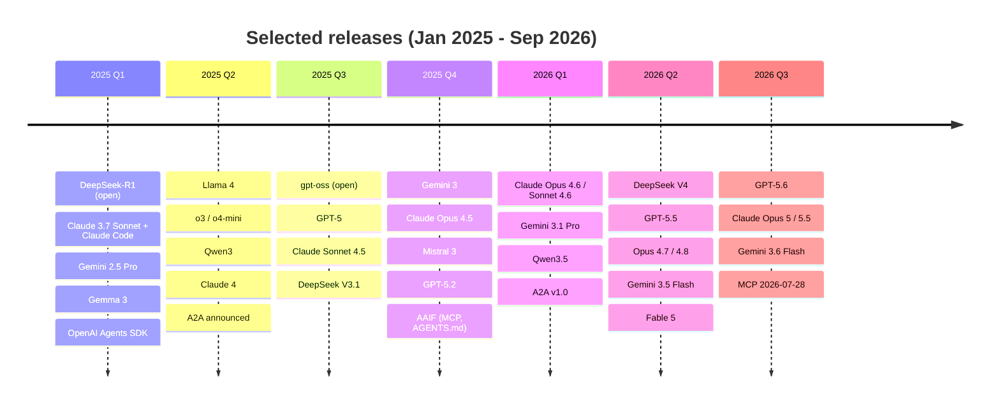
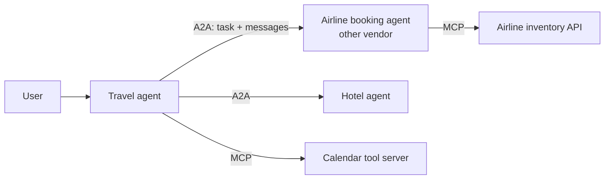

# LLM Landscape 2025-2026

> [!tldr] TL;DR
> A dated map of the major model families released from January 2025 to September 2026: **closed** frontier models from Anthropic (Claude), OpenAI (GPT) and Google (Gemini), and **open-weight** models from DeepSeek, Qwen, Mistral, Meta (Llama), Google (Gemma) and OpenAI (gpt-oss). Big themes: **reasoning models** became standard, **Mixture-of-Experts** open models closed much of the gap, context windows reached **1M tokens**, and the agent stack standardised around **agent SDKs**, **MCP** (agent-to-tool) and **A2A** (agent-to-agent), both now under the Linux Foundation's Agentic AI Foundation.

> [!warning] This changes fast
> Written 2026-09-27. New models ship almost monthly and names, prices and limits change. Treat this as a historical map and check each vendor's model page and release notes before choosing a model. Only items verified against vendor sources are listed; anything else was left out.

## How to read the landscape

| | Closed (API only) | Open weights |
|---|---|---|
| **What you get** | access through an API or app | downloadable weights you can run and fine-tune |
| **Vendors** | Anthropic, OpenAI (GPT), Google (Gemini) | DeepSeek (MIT), Qwen (mostly Apache 2.0), Mistral (mostly Apache 2.0), Meta Llama (custom community licence), Google Gemma (Gemma terms), OpenAI gpt-oss (Apache 2.0) |
| **Pros** | frontier quality, zero ops, fast updates | control, privacy, on-prem, fine-tuning, predictable cost at scale |
| **Cons** | vendor lock-in, data residency, price changes, deprecations | you run the GPUs; licences vary (not all are OSI "open source") |

"Open weights" is not the same as "open source": training data and code are usually not released, and some licences restrict use.

## Timeline

### Anthropic (closed)
| Date | Release | Notes |
|---|---|---|
| 2025-02-24 | Claude 3.7 Sonnet | first hybrid reasoning model (optional extended thinking); Claude Code research preview |
| 2025-05-22 | Claude Opus 4, Sonnet 4 | Claude Code GA |
| 2025-08-05 | Claude Opus 4.1 | |
| 2025-09-29 | Claude Sonnet 4.5 | Claude Code SDK renamed Claude Agent SDK |
| 2025-10-15 | Claude Haiku 4.5 | |
| 2025-11-24 | Claude Opus 4.5 | |
| 2026-02-05 | Claude Opus 4.6 | 1M-token context in beta |
| 2026-02-17 | Claude Sonnet 4.6 | |
| 2026-04-07 | Claude Mythos Preview | restricted to cyber-defence partners (Project Glasswing) |
| 2026-04-16 | Claude Opus 4.7 | |
| 2026-05-28 | Claude Opus 4.8 | |
| 2026-06-09 | Claude Fable 5 and Mythos 5 | Fable 5 generally available; Mythos 5 restricted |
| 2026-06-30 | Claude Sonnet 5 | |
| 2026-07-24 | Claude Opus 5 | |
| 2026-09-01 | Claude Fable 5.1 / Mythos 5.1 | |
| 2026-09-22 | Claude Opus 5.5 | 1M-token context |

### OpenAI (closed, plus gpt-oss open weights)
| Date | Release | Notes |
|---|---|---|
| 2025-01-31 | o3-mini | reasoning |
| 2025-02-27 | GPT-4.5 | |
| 2025-03-11 | Responses API + Agents SDK | open-source SDK |
| 2025-04-14 | GPT-4.1 | |
| 2025-04-16 | o3 and o4-mini | reasoning with tool use |
| 2025-08-05 | **gpt-oss-120b / gpt-oss-20b** | **open weights, Apache 2.0** |
| 2025-08-07 | GPT-5 | unified model with thinking |
| 2025-10-06 | AgentKit (DevDay) | agent-building toolkit |
| 2025-11-13 | GPT-5.1 (API) | |
| 2025-12-11 | GPT-5.2 | Instant, Thinking and Pro variants |
| 2026-04-24 | GPT-5.5 and GPT-5.5 Pro (API) | |
| 2026-07-09 | GPT-5.6 Sol / Terra / Luna | new naming: number = generation, Sol/Terra/Luna = capability tiers (system card date) |
| 2026-09-03 | GPT-6 Astra | system card published; public availability date not stated |

Releases between GPT-5.2 and GPT-5.5 (e.g. GPT-5.3-Codex, GPT-5.4) appear in OpenAI's changelog but were not independently verified here.

### Google (Gemini closed, Gemma open)
| Date | Release | Notes |
|---|---|---|
| 2025-02-05 | Gemini 2.0 Flash GA | |
| 2025-03-12 | **Gemma 3** (1B–27B) | open weights, Gemma terms of use |
| 2025-03-25 | Gemini 2.5 Pro (experimental) | thinking model |
| 2025-04-09 | Agent Development Kit (ADK) | open source; A2A announced the same day |
| 2025-11-18 | Gemini 3 Pro, Deep Think | with the Antigravity agentic dev platform |
| 2026-02-19 | Gemini 3.1 Pro | |
| 2026-05-19 | Gemini 3.5 Flash GA | |
| 2026-07-21 | Gemini 3.6 Flash, 3.5 Flash-Lite | Google says Gemini 4 pre-training has started |
| 2026-08 | Gemini 3.7 Flash | |

### Meta (open weights, custom licence)
| Date | Release | Notes |
|---|---|---|
| 2025-04-05 | **Llama 4 Scout and Maverick** | natively multimodal MoE; Llama 4 Community License; Behemoth not released |

No later Llama release was found as of this writing.

### DeepSeek (open weights, MIT)
| Date | Release | Notes |
|---|---|---|
| 2025-01-20 | **DeepSeek-R1** | open reasoning model, MIT; showed large-scale RL for reasoning |
| 2025-03-24 | V3-0324 | |
| 2025-05-28 | R1-0528 | |
| 2025-08-21 | V3.1 | hybrid thinking / non-thinking modes |
| 2025-09-29 | V3.2-Exp | |
| 2025-12-01 | V3.2, V3.2-Speciale | |
| 2026-04-24 | **V4 preview**: V4-Pro (1.6T total / 49B active), V4-Flash (284B / 13B) | 1M context, MIT |
| 2026-08-13 | V4-Pro GA | adjustable thinking effort |
| 2026-09-10 | V4.1-Flash | natively multimodal |

### Mistral (mostly Apache 2.0, some closed)
| Date | Release | Licence |
|---|---|---|
| 2025-01-30 | Mistral Small 3 | Apache 2.0 |
| 2025-05-07 | Mistral Medium 3 | closed |
| 2025-05-21 | Devstral (coding) | Apache 2.0 |
| 2025-06-10 | Magistral (reasoning) | Small open (Apache 2.0), Medium closed |
| 2025-12-02 | **Mistral 3**: Large 3 (675B total / 41B active MoE), Ministral 3 (3B/8B/14B) | Apache 2.0 |
| 2026-03-16 | Mistral Small 4 | Apache 2.0; unifies reasoning, vision, coding |

### Qwen / Alibaba (mostly Apache 2.0; flagships API-only)
| Date | Release | Notes |
|---|---|---|
| 2025-01-28 | Qwen2.5-Max | API only |
| 2025-04-29 | **Qwen3** (0.6B–235B, dense and MoE) | open, Apache 2.0; hybrid thinking |
| 2025-07-22 | Qwen3-Coder-480B-A35B | open |
| 2026-02-17 | Qwen3.5-397B-A17B | open weights |
| 2026-04-02 | Qwen3.6-Plus | API only |

## Agent SDKs and frameworks

| SDK | Vendor | Launched | Key ideas |
|---|---|---|---|
| **OpenAI Agents SDK** (+ Responses API) | OpenAI | 2025-03-11 | agents, handoffs, guardrails, tracing; AgentKit added 2025-10-06 |
| **Agent Development Kit (ADK)** | Google | 2025-04-09 | open source, multi-agent, A2A support |
| **Claude Agent SDK** | Anthropic | renamed from Claude Code SDK 2025-09-29 | the Claude Code harness: tools, context compaction, subagents, permissions, hooks, skills |
| Model-agnostic frameworks | community | ongoing | e.g. LangGraph, LlamaIndex, Vercel AI SDK, Pydantic AI, CrewAI |

Choosing: prefer the thinnest layer that does what you need; make sure you can see the raw prompts and tool calls; check MCP support. See [[AI Agents & Agentic Patterns]].

## Protocols: MCP and A2A

| | **MCP** (Model Context Protocol) | **A2A** (Agent2Agent) |
|---|---|---|
| Connects | an agent/app **to tools and data** | an agent **to other agents** |
| Origin | Anthropic, 2024-11 | Google, announced 2025-04-09 with 50+ partners |
| Key concepts | tools, resources, prompts; servers; stdio / Streamable HTTP | **Agent Card** (JSON capability advertisement), **tasks** with a lifecycle, **messages**, **artifacts** (outputs), parts |
| Governance | Agentic AI Foundation (Linux Foundation) since 2025-12-09 | Linux Foundation project 2025-06-23; **v1.0** 2026-03-12 (protobuf data model; JSON-RPC, gRPC and HTTP/REST bindings); joined the Agentic AI Foundation 2026-08-27 |
| Current version | spec **2026-07-28** (stateless) | v1.0 |

Details: [[MCP]].

> [!info]+ 🆕 Agentic AI Foundation (AAIF)
> Announced by the Linux Foundation on **2025-12-09**, co-founded by Anthropic, Block and OpenAI, with three founding projects: **MCP** (Anthropic), **goose** (Block) and **AGENTS.md** (OpenAI). Platinum members at launch included AWS, Anthropic, Block, Bloomberg, Cloudflare, Google, Microsoft and OpenAI. **A2A** joined on 2026-08-27.

## Trends worth knowing
- **Reasoning by default**: thinking modes and effort settings on most frontier models ([[Transformers & How LLMs Work]]).
- **MoE everywhere in open weights**: huge total parameters with modest active parameters (DeepSeek V4, Mistral Large 3, Qwen3, Llama 4).
- **Open-weight gap narrowed**: permissively licensed models (MIT, Apache 2.0) became viable for many production tasks.
- **Long context**: 1M-token windows on several frontier models, though curation still matters ([[Prompt & Context Engineering]]).
- **Coding agents as a flagship use case** ([[AI-Assisted Software Development]]).
- **Restricted-access models** for dual-use capabilities (e.g. Anthropic's Mythos tier for cyber defence).
- **Standardised agent plumbing**: MCP, A2A and AGENTS.md under neutral governance.

## Senior perspective
- **Don't hard-code a model**: route through an abstraction, pin versions, keep an eval suite so you can switch in days when a better or cheaper model ships ([[LLM Evaluation & Observability]]).
- **Plan for deprecations**: vendors retire models on a schedule; track notices and budget migration time.
- **Total cost** = price per token × tokens (including thinking and cached tokens) + latency cost + ops. Cheaper per-token models can cost more if they need more retries or longer prompts.
- **Licences and data**: check open-weight licences for commercial use and restrictions; check API data-retention terms and regions.
- **Multi-vendor resilience**: have a fallback provider for critical paths.

## Interview questions

> [!question]- Closed API model or open-weight model: how do you decide?
> Consider quality needed (evaluate on your tasks), data privacy and residency, cost at your volume, latency and hosting ability, fine-tuning needs, and licence terms. Many teams use closed frontier models for hard tasks and open or small models for high-volume narrow tasks.

> [!question]- What's the difference between MCP and A2A?
> MCP standardises how an agent connects to tools and data sources (agent-to-tool). A2A standardises how independent agents discover each other (Agent Cards) and collaborate on tasks (agent-to-agent). They're complementary and both now sit under the Agentic AI Foundation.

> [!question]- Why did DeepSeek-R1 matter?
> In January 2025 it released a strong reasoning model with open weights under MIT and described how large-scale reinforcement learning produced its reasoning, narrowing the gap between open and closed models and lowering costs across the industry.

> [!question]- How do you keep an LLM product robust as models change every few months?
> Abstract the provider, pin model versions, maintain an eval suite and run it on every candidate model, monitor quality and cost in production, track deprecation notices, and keep a fallback model.

## Related
- [[AI & ML Index]]
- [[Transformers & How LLMs Work]] · [[Fine-tuning vs RAG vs Prompting]] · [[AI Agents & Agentic Patterns]]
- [[MCP]] · [[AI-Assisted Software Development]] · [[AI in Frontend - MCP, WebMCP & Built-in AI]]

## Sources
- Anthropic: [Release notes](https://platform.claude.com/docs/en/release-notes/overview) · [Claude 3.7 Sonnet](https://www.anthropic.com/news/claude-3-7-sonnet) · [Claude Sonnet 4.5](https://www.anthropic.com/news/claude-sonnet-4-5) · [Claude Opus 4.6](https://www.anthropic.com/news/claude-opus-4-6) · [Claude Sonnet 4.6](https://www.anthropic.com/news/claude-sonnet-4-6) · [Mythos Preview](https://www.anthropic.com/news/mythos-preview) · [Opus 4.7](https://www.anthropic.com/news/claude-opus-4-7) · [Opus 4.8](https://www.anthropic.com/news/claude-opus-4-8) · [Fable 5 and Mythos 5](https://www.anthropic.com/news/claude-fable-5-mythos-5) · [Sonnet 5](https://www.anthropic.com/news/claude-sonnet-5) · [Opus 5](https://www.anthropic.com/news/claude-opus-5) · [Opus 5.5](https://www.anthropic.com/claude-opus-5-5) · [News](https://www.anthropic.com/news)
- OpenAI: [API changelog](https://developers.openai.com/api/docs/changelog) · [gpt-oss](https://openai.com/index/introducing-gpt-oss/) · [GPT-5](https://openai.com/index/introducing-gpt-5/) · [GPT-5.5](https://openai.com/index/introducing-gpt-5-5/) · [Deployment safety hub (system cards)](https://deploymentsafety.openai.com/) · [GPT-6 Astra system card](https://deploymentsafety.openai.com/gpt-6-astra)
- Google: [Gemma 3](https://blog.google/technology/developers/gemma-3/) · [Gemini 2.5](https://blog.google/technology/google-deepmind/gemini-model-thinking-updates-march-2025/) · [ADK](https://developers.googleblog.com/en/agent-development-kit-easy-to-build-multi-agent-applications/) · [Gemini 3](https://blog.google/products/gemini/gemini-3/) · [Gemini 3.1 Pro](https://blog.google/innovation-and-ai/models-and-research/gemini-models/gemini-3-1-pro/) · [Gemini 3.5](https://blog.google/innovation-and-ai/models-and-research/gemini-models/gemini-3-5/) · [Gemini 3.6 Flash](https://blog.google/innovation-and-ai/models-and-research/gemini-models/gemini-3-6-flash-3-5-flash-lite-3-5-flash-cyber/) · [August 2026 updates](https://blog.google/innovation-and-ai/technology/google-ai-updates-august-2026/)
- Meta: [Llama 4](https://ai.meta.com/blog/llama-4-multimodal-intelligence/)
- DeepSeek: [API news and updates](https://api-docs.deepseek.com/updates/) · [V4 preview](https://api-docs.deepseek.com/news/news260424/) · [V4.1-Flash](https://api-docs.deepseek.com/news/news260910/)
- Mistral: [News](https://mistral.ai/news/) · [Mistral 3](https://mistral.ai/news/mistral-3/) · [Mistral Small 4](https://mistral.ai/news/mistral-small-4/)
- Qwen: [Qwen3](https://qwenlm.github.io/blog/qwen3/) · [Qwen3-Coder](https://qwenlm.github.io/blog/qwen3-coder/) · [Qwen3.5](https://www.alibabacloud.com/blog/602894) · [Qwen3.6-Plus](https://www.alibabacloud.com/blog/qwen3-6-plus-towards-real-world-agents_603005)
- A2A: [Google announcement (2025-04-09)](https://developers.googleblog.com/en/a2a-a-new-era-of-agent-interoperability/) · [Linux Foundation project (2025-06-23)](https://www.linuxfoundation.org/press/linux-foundation-launches-the-agent2agent-protocol-project-to-enable-secure-intelligent-communication-between-ai-agents) · [v1.0 (2026-03-12)](https://a2a-protocol.org/latest/blog/2026/03/12/a2a-protocol-ships-v10-production-ready-standard-for-agent-to-agent-communication/) · [Joining AAIF (2026-08-27)](https://a2a-protocol.org/latest/blog/2026/08/27/a-new-chapter-for-a2a-joining-the-agentic-ai-foundation/)
- Linux Foundation: [Agentic AI Foundation formation (2025-12-09)](https://www.linuxfoundation.org/press/linux-foundation-announces-the-formation-of-the-agentic-ai-foundation)
