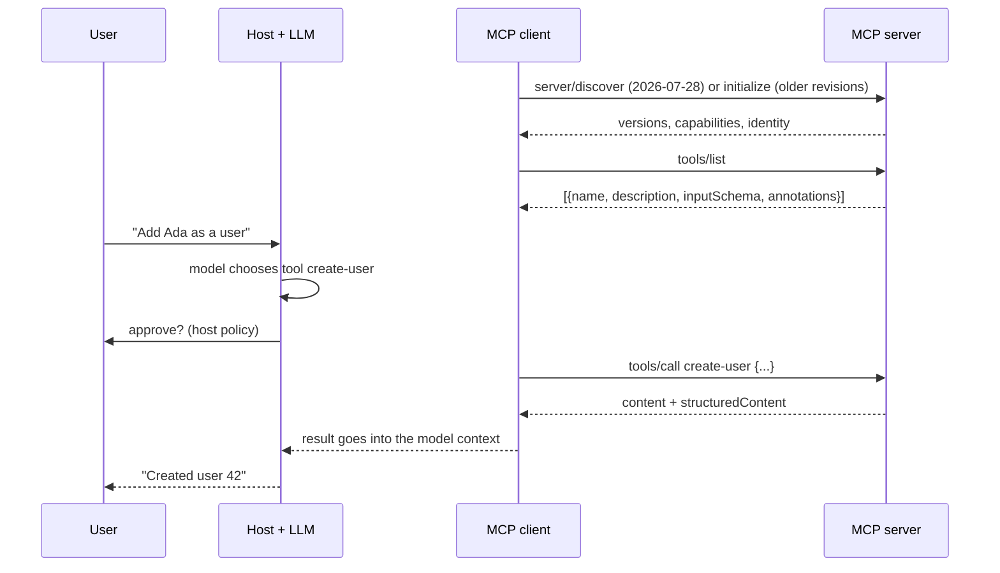
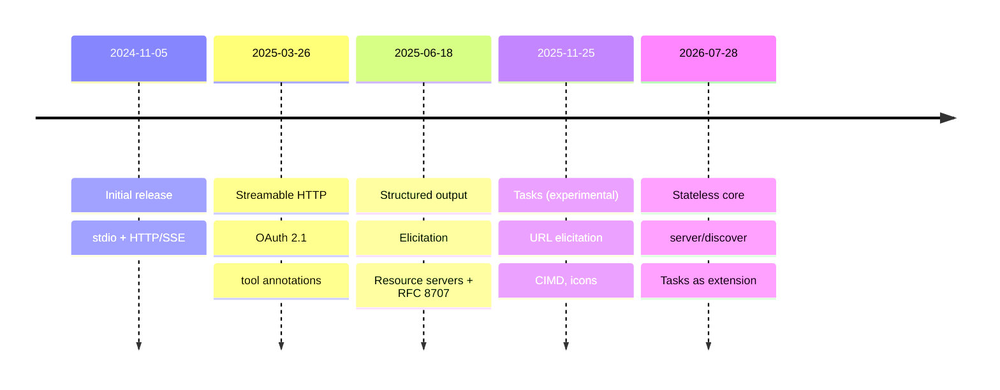

# MCP

> [!tldr] TL;DR
> The **Model Context Protocol (MCP)** is an open, JSON-RPC based standard for connecting AI applications (hosts like Claude, Cursor, VS Code, ChatGPT) to external **tools**, **resources** and **prompts** through small programs called **MCP servers**. Write a server once and any MCP-capable host can use it. The spec has moved fast: Streamable HTTP and OAuth (2025-03-26), structured output and elicitation (2025-06-18), tasks and URL elicitation (2025-11-25), and a **stateless** redesign in the current revision **2026-07-28**. Since 2025-12-09 MCP is governed by the Linux Foundation's **Agentic AI Foundation**.

This note is the protocol and server-building reference. For how front-end tooling uses MCP (Chrome DevTools for agents, Next.js/Angular MCP servers, WebMCP), see [[AI in Frontend - MCP, WebMCP & Built-in AI]].

- Docs: [modelcontextprotocol.io](https://modelcontextprotocol.io) · [Inspector](https://modelcontextprotocol.io/docs/tools/inspector)
- TypeScript SDK: [github.com/modelcontextprotocol/typescript-sdk](https://github.com/modelcontextprotocol/typescript-sdk)

## The idea

LLMs only know what's in their context window. To do useful work they need your data and your actions: files, databases, tickets, APIs. Before MCP every app wrote its own bespoke integration for every tool (an **M × N** problem). MCP standardises the connection so it becomes **M + N**: hosts implement the client side once, services implement a server once.

MCP helps you build agents and complex workflows on top of LLMs. It does **not** replace function/tool calling in model APIs; it standardises *where tools come from* and how they're described, discovered and invoked. See [[AI Agents & Agentic Patterns]].

```text
MCP Host (Claude, Cursor...)
  ├── MCP Client ──► MCP Server (GitHub)
  ├── MCP Client ──► MCP Server (Postgres)
  └── MCP Client ──► MCP Server (your internal API)
```

## Architecture

![[image 14.png]]

- **MCP Host**: the AI application the user interacts with (Claude Desktop/Code, Cursor, VS Code, ChatGPT). It owns the model, the UI and permissions.
- **MCP Client**: a protocol connector inside the host with a **1:1** connection to one server.
- **MCP Server**: a lightweight program that exposes specific capabilities through the protocol.
- **Local data sources**: your files, databases and services that a server can access on your machine.
- **Remote services**: external systems reached over the internet (usually by a remote MCP server).

Messages are **JSON-RPC 2.0**. A tool call looks like this on the wire:

```json
{ "jsonrpc": "2.0", "id": 7, "method": "tools/call",
  "params": { "name": "create-user", "arguments": { "name": "Ada", "email": "ada@example.com" } } }
```



## The building blocks (primitives)

**Server primitives**, what a server offers:

| Primitive | Who controls it | What it is | Example |
|---|---|---|---|
| **Tools** | the model decides to call | functions with a JSON Schema for inputs (and optionally outputs) | `create_issue`, `run_query` |
| **Resources** | the application attaches | read-only data identified by a URI | `file:///README.md`, `users://all` |
| **Prompts** | the user picks | reusable prompt templates, often exposed as slash commands | `/review-pr` |

**Client features**, what a host offers back to servers:
- **Sampling**: the server asks the host's model for a completion ("when the server wants something from the AI"). Useful when a server needs LLM help without holding its own API key. *Deprecated in 2026-07-28; call a model provider directly instead.*
- **Roots**: which folders/URIs the server may work in. *Deprecated in 2026-07-28; pass paths as tool parameters or config.*
- **Elicitation** (2025-06-18): the server asks the **user** for more input mid-operation, with a JSON Schema for the answer (e.g. "which environment?"). 2025-11-25 added **URL mode** for flows that must happen in a browser (OAuth to a third party, payments), so secrets never pass through the client.

## Transports

| Transport | Where | Status |
|---|---|---|
| **stdio** | local: the host launches the server as a subprocess and talks over stdin/stdout | current |
| **Streamable HTTP** | remote: one HTTP endpoint, `POST` for requests, response may stream as SSE | current (since 2025-03-26) |
| **HTTP + SSE** (two endpoints) | remote, original 2024-11-05 design | **deprecated** since 2025-03-26; formally in the deprecation registry in 2026-07-28 |

Remote servers are how SaaS vendors ship MCP (one URL, OAuth login) and are now the norm for anything not on your laptop.

## Building a server (TypeScript)

> [!info]+ 🆕 SDK API change
> The original version of this note used `server.tool(...)` and `server.resource(...)`. In SDK v1 those variadic methods were **deprecated in favour of `registerTool` / `registerResource` / `registerPrompt`**, and in **SDK v2** (released with spec 2026-07-28; server package 2.0.0 on npm 2026-07-27) they are **removed**. v2 also splits the SDK into `@modelcontextprotocol/server` and `@modelcontextprotocol/client`, and expects `z.object(...)` schemas rather than raw Zod shapes. The legacy `@modelcontextprotocol/sdk` (v1) keeps getting fixes for at least 6 months after v2.

### 1. Install and import (v2)
```bash
npm i @modelcontextprotocol/server zod
```
```typescript
import { McpServer } from '@modelcontextprotocol/server';
import { StdioServerTransport } from '@modelcontextprotocol/server/stdio';
import * as z from 'zod/v4';
```
(v1 equivalents: `@modelcontextprotocol/sdk/server/mcp.js` and `@modelcontextprotocol/sdk/server/stdio.js`.)

### 2. Create a server
```typescript
const server = new McpServer({ name: 'users-server', version: '1.0.0' });
```
Capabilities (tools, resources, prompts) are advertised automatically from what you register.

### 3. Register a tool
```typescript
server.registerTool(
  'create-user',
  {
    title: 'Create User',
    description: 'Create a new user in the database. Returns the new user id.',
    inputSchema: z.object({            // validated with zod
      name: z.string(),
      email: z.string().email(),
      address: z.string().optional(),
      phone: z.string().optional(),
    }),
    outputSchema: z.object({ id: z.string() }),   // structured output (2025-06-18)
    annotations: {
      readOnlyHint: false,     // does the tool only read data?
      destructiveHint: false,  // can it delete or overwrite data?
      idempotentHint: false,   // is calling it twice with the same args the same as once?
      openWorldHint: false,    // does it reach outside systems (web, 3rd-party APIs)?
    },
  },
  async (params) => {
    try {
      const id = await createUser(params);
      return {
        content: [{ type: 'text', text: `User ${id} created successfully` }],
        structuredContent: { id },
      };
    } catch (error) {
      return {
        isError: true,             // tells the model the call failed, so it can recover
        content: [{ type: 'text', text: `Failed to save user: ${error.message}` }],
      };
    }
  },
);
```

Fixes compared with the original snippet: template strings need backticks (`` `User ${id}` ``), not single quotes; the annotation is `destructiveHint`; **idempotent** means "repeating the call with the same arguments has no extra effect" (not "different outputs per run"); **openWorld** means "interacts with an open world of external entities"; errors should set `isError: true`.

> [!warning] Annotations are hints, not security
> The spec says clients must treat annotations as **untrusted** unless the server is trusted. Enforce permissions in the server itself.

### 4. Register a resource and a resource template
```typescript
import { ResourceTemplate } from '@modelcontextprotocol/server';

server.registerResource(
  'all-users',
  'users://all',
  { title: 'All Users', description: 'Get all users from the database', mimeType: 'application/json' },
  async (uri) => {
    const users = await getUsers();
    return { contents: [{ uri: uri.href, mimeType: 'application/json', text: JSON.stringify(users) }] };
  },
);

server.registerResource(
  'user-details',
  new ResourceTemplate('users://{userId}/profile', { list: undefined }),
  { title: 'User profile', mimeType: 'application/json' },
  async (uri, { userId }) => ({
    contents: [{ uri: uri.href, mimeType: 'application/json', text: JSON.stringify(await getUser(userId)) }],
  }),
);
```

![[image 16.png]]

### 5. Register a prompt
```typescript
server.registerPrompt(
  'generate-fake-user',
  {
    title: 'Generate fake user',
    description: 'Generate a realistic fake user for a given name',
    argsSchema: z.object({ name: z.string() }),
  },
  ({ name }) => ({
    messages: [{ role: 'user', content: { type: 'text',
      text: `Generate a fake user named ${name}. Include email, address and phone.` } }],
  }),
);
```

### 6. Connect a transport
```typescript
async function main() {
  const transport = new StdioServerTransport();
  await server.connect(transport);
}
main();
```
With stdio, **never `console.log` to stdout**: stdout is the protocol channel. Log to stderr.

### 7. Test it with the Inspector
```bash
npx @modelcontextprotocol/inspector npm run server:dev
```
The Inspector is a web UI to list and call tools, read resources and try prompts.

![[image 15.png]]

The original note set `DANGEROUSLY_OMIT_AUTH=true` to skip the Inspector's session token. That turns off the protection that stops other web pages from talking to the Inspector's local proxy (which can launch processes), so use it only briefly on a trusted machine, never on a shared network.

### 8. Use it from a host
```json
{
  "mcpServers": {
    "users": { "command": "node", "args": ["dist/server.js"] }
  }
}
```
Exact file and keys differ per host (Claude Desktop, Claude Code `claude mcp add`, Cursor, VS Code).

## Spec history



> [!info]+ 🆕 2025–2026
> - **2025-03-26**: OAuth 2.1 authorization framework; **Streamable HTTP** replaces HTTP+SSE; JSON-RPC batching added; **tool annotations**; audio content; `completions` capability.
> - **2025-06-18**: batching **removed**; **structured tool output** (`outputSchema` / `structuredContent`); MCP servers classified as **OAuth Resource Servers** (protected resource metadata) and clients must send **RFC 8707 resource indicators**; **elicitation**; **resource links** in tool results; `MCP-Protocol-Version` header required on HTTP; new Security Best Practices page.
> - **2025-11-25**: OpenID Connect discovery; **icons** for tools/resources/prompts; incremental scope consent; tool-naming guidance; **URL-mode elicitation**; **sampling with tools**; **Client ID Metadata Documents** as the recommended client registration; **experimental tasks** (long-running, pollable operations); JSON Schema 2020-12 as default; formal governance and SDK tiers.
> - **2026-07-28 (current)**: MCP becomes **stateless**: no `initialize` handshake, no `Mcp-Session-Id`; each request carries version and capabilities in `_meta`; servers must implement **`server/discover`**; `subscriptions/listen` replaces the GET stream and `resources/subscribe`; `ping` and `logging/setLevel` removed; **tasks move to an official extension** (`io.modelcontextprotocol/tasks`); **Multi Round-Trip Requests** (`InputRequiredResult`) replace server-initiated requests such as sampling and elicitation; SSE resumability removed; `ttlMs`/`cacheScope` caching hints; clients must validate the RFC 9207 `iss` parameter; **Roots, Sampling and Logging deprecated**, and Dynamic Client Registration deprecated in favour of Client ID Metadata Documents (12-month minimum deprecation window).
> - **2025-09-08**: official **MCP Registry** in preview (registry.modelcontextprotocol.io).
> - **2025-12-09**: Anthropic donated MCP to the **Agentic AI Foundation (AAIF)** under the Linux Foundation, co-founded with Block (goose) and OpenAI (AGENTS.md).
> - **2026-01-26**: **MCP Apps** launched as the first official extension: servers return interactive UIs (`ui://` resources rendered in sandboxed iframes), supported by Claude, ChatGPT, goose and VS Code.
> - **2026-07-27**: TypeScript SDK **v2** (`@modelcontextprotocol/server` 2.0.0).
> - Adoption: Microsoft announced MCP support across Windows 11, GitHub, Copilot Studio and Azure AI Foundry at Build (2025-05-19); Google announced managed remote MCP servers for its services (2025-12-11).

## Security

MCP gives a model hands. Treat every server like a dependency with production credentials.

- **Confused deputy**: an MCP proxy server using a static OAuth client ID can be tricked into granting a malicious client access. The spec requires per-client consent, exact redirect-URI matching and single-use `state`.
- **Token passthrough is forbidden**: a server must not accept tokens that weren't issued for it, and must not forward the client's token to downstream APIs.
- **Session / state-handle hijacking**: possessing a session ID or handle must never count as authentication; bind handles to the user.
- **SSRF, local server compromise, scope minimisation** are also covered in the official Security Best Practices.
- **Tool poisoning / prompt injection**: tool descriptions and tool results are text that goes into the model. A malicious server (or a malicious document returned by a benign one) can instruct the model to misuse other tools. Pin and review servers, keep a human approval step for destructive or outbound actions, and avoid combining private data, untrusted content and external communication in one agent. See [[AI Safety, Security & Guardrails for Apps]].

## Senior perspective
- **Design tools for the model, not as a 1:1 API mirror.** Fewer, higher-level tools with clear names, descriptions, examples and concise outputs beat 80 thin CRUD endpoints; tool definitions cost context tokens on every call.
- **Local stdio vs remote HTTP**: local is simple and private but runs with your user's permissions; remote needs OAuth, multi-tenancy, rate limits and audit logs, but is centrally updated and governed.
- **Versioning**: the protocol now has date-stamped revisions and a formal deprecation policy. Know which revision your hosts speak; the 2026-07-28 stateless change affects load-balancing and session design (it becomes easier).
- **Observability**: log every tool call with arguments, caller, result size and latency; the 2026-07-28 revision documents OpenTelemetry trace propagation in `_meta`.
- **Governance**: maintain an allow-list of approved servers (the MCP Registry helps discovery, not trust).

## Interview questions

> [!question]- What problem does MCP solve, and how is it different from function calling?
> Function calling is how a model API lets a model request a call to a tool you described. MCP standardises how tools, data and prompts are *packaged, discovered and invoked* across apps, so one server works in many hosts. Hosts turn MCP tools into function-calling tool definitions for their model.

> [!question]- Explain host, client and server.
> The host is the AI app (owns model, UI, permissions); it creates one client per server connection; the server exposes tools, resources and prompts over stdio or Streamable HTTP.

> [!question]- Tools vs resources vs prompts?
> Tools are model-controlled actions with side effects or computations; resources are application-controlled read-only context identified by URIs; prompts are user-selected templates.

> [!question]- Why was HTTP+SSE replaced by Streamable HTTP?
> The old transport needed two endpoints and a long-lived SSE connection per client, which was awkward for serverless and load balancers. Streamable HTTP uses one endpoint with plain POSTs that can optionally stream responses. The 2026-07-28 revision goes further and removes protocol sessions entirely.

> [!question]- How does authorization work for remote MCP servers?
> OAuth 2.1: the MCP server is a resource server that advertises its authorization server via protected resource metadata; the client obtains a token scoped to that server (RFC 8707 resource indicator), registering itself preferably via a Client ID Metadata Document. The server validates the token audience and must never pass it through to other APIs.

> [!question]- What are the main security risks of MCP?
> Prompt injection through tool results or descriptions, over-privileged tools, token passthrough and confused-deputy OAuth flows, malicious or compromised servers (supply chain), and local servers running arbitrary code with the user's permissions. Mitigate with allow-listed servers, least-privilege scopes, human approval for risky actions and audit logging.

## Related
- [[AI & ML Index]]
- [[AI in Frontend - MCP, WebMCP & Built-in AI]] (MCP in front-end tooling, WebMCP)
- [[AI Agents & Agentic Patterns]] · [[AI Safety, Security & Guardrails for Apps]] · [[LLM Landscape 2025-2026]] (A2A)
- [[AI-Assisted Software Development]]

## Sources
- MCP specification, current revision: https://modelcontextprotocol.io/specification/2026-07-28 · changelog: https://modelcontextprotocol.io/specification/2026-07-28/changelog
- Changelogs: [2025-03-26](https://modelcontextprotocol.io/specification/2025-03-26/changelog) · [2025-06-18](https://modelcontextprotocol.io/specification/2025-06-18/changelog) · [2025-11-25](https://modelcontextprotocol.io/specification/2025-11-25/changelog) · [versioning](https://modelcontextprotocol.io/specification/versioning)
- Transports: https://modelcontextprotocol.io/specification/2026-07-28/basic/transports · Deprecated features: https://modelcontextprotocol.io/specification/2026-07-28/deprecated
- Security Best Practices: https://modelcontextprotocol.io/specification/2026-07-28/basic/security_best_practices
- Tools (annotations are untrusted): https://modelcontextprotocol.io/specification/2026-07-28/server/tools
- MCP Registry preview (2025-09-08): https://blog.modelcontextprotocol.io/posts/2025-09-08-mcp-registry-preview/
- MCP joins the Agentic AI Foundation (2025-12-09): https://blog.modelcontextprotocol.io/posts/2025-12-09-mcp-joins-agentic-ai-foundation/ · Linux Foundation press release: https://www.linuxfoundation.org/press/linux-foundation-announces-the-formation-of-the-agentic-ai-foundation
- MCP Apps (2026-01-26): https://blog.modelcontextprotocol.io/posts/2026-01-26-mcp-apps/
- Spec 2026-07-28 announcement: https://blog.modelcontextprotocol.io/posts/2026-07-28/
- TypeScript SDK (v2): https://github.com/modelcontextprotocol/typescript-sdk · v1 docs: https://ts.sdk.modelcontextprotocol.io/
- Microsoft Build 2025: https://blogs.microsoft.com/blog/2025/05/19/microsoft-build-2025-the-age-of-ai-agents-and-building-the-open-agentic-web/
- Google managed MCP servers (2025-12-11): https://cloud.google.com/blog/products/ai-machine-learning/announcing-official-mcp-support-for-google-services
- Anthropic, Writing effective tools for AI agents (2025-09-11): https://www.anthropic.com/engineering/writing-tools-for-agents
