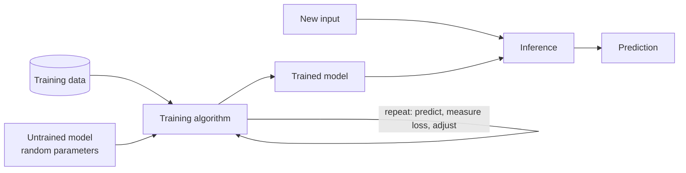

# Components of ML

<Note>
**TL;DR**

Nearly every ML task has three parts: a **model** (a generic, adjustable program), a **model training algorithm** (repeatedly nudges the model's parameters to fit the data) and a **model inference algorithm** (uses the trained model to make predictions). Think of a lump of clay (model), the potter shaping it (training), and using the finished teapot (inference).
</Note>

## The three components

1. **ML model**
   A block of code (a mathematical function with adjustable **parameters**) that can be shaped to solve different but related problems depending on the data it's trained on.
   *A model is an extremely generic program, made specific by the data used to train it.*
2. **Model training algorithm**
   An iterative process that:
   1. looks at how wrong the model currently is (the **loss**),
   2. decides which changes to the parameters would reduce that error,
   3. applies them,
   4. repeats until the model is good enough or stops improving.
3. **Model inference algorithm**
   The process of using the trained model to generate predictions on new data.



## The teapot analogy


1. You start with a block of **raw clay** (the untrained model). It could become many things; you decide to make a teapot (define the problem).
2. You **inspect and analyse** the clay and decide how to change it to look more like the teapot you have in mind (compute the loss, decide the update).
3. You **mould** the clay a little closer to the goal, then look again, and repeat (the training loop).
4. Finally, you **use** the teapot (inference).

## Worked example in code

```python
from sklearn.linear_model import LinearRegression

# 1. model: a line y = w*x + b, with parameters w and b not yet learned
model = LinearRegression()

# 2. training algorithm: fit() finds w and b that minimise squared error
X_train = [[50], [80], [120]]      # house size (m²)
y_train = [150_000, 240_000, 360_000]
model.fit(X_train, y_train)

# 3. inference: predict for an unseen house
model.predict([[100]])             # ≈ 300,000
```

## Parameters vs hyperparameters
| | Parameters | Hyperparameters |
|---|---|---|
| Set by | the training algorithm | you, before training |
| Examples | weights, biases, split thresholds | learning rate, number of trees, k in k-means |
| Changes during training? | yes | no |

## Interview questions

<Accordion title="What's the difference between training and inference?">
Training adjusts the model's parameters using data and a loss function; it is expensive and done up front (or periodically). Inference runs the trained model on new inputs to get predictions; it's cheaper per call but happens constantly in production, so latency and cost matter there.
</Accordion>

<Accordion title="Parameter vs hyperparameter?">
Parameters are learned during training (weights, biases). Hyperparameters are chosen before training and control how training happens (learning rate, epochs, tree depth, number of clusters).
</Accordion>

## Related
- [Machine Learning](/Software%20Engineering/AI%20%26%20ML/Machine%20Learning/Machine%20Learning) (course index) · [AI & ML Index](/Software%20Engineering/AI%20%26%20ML/AI%20%26%20ML%20Index)
- Previous: [Introduction to Machine Learning](/Software%20Engineering/AI%20%26%20ML/Machine%20Learning/Introduction%20to%20Machine%20Learning) · Next: [Major steps in ML](/Software%20Engineering/AI%20%26%20ML/Machine%20Learning/Major%20steps%20in%20ML/Major%20steps%20in%20ML)
- [Step 3 Train the model](/Software%20Engineering/AI%20%26%20ML/Machine%20Learning/Major%20steps%20in%20ML/Step%203%20Train%20the%20model) · [Step 5 Use the model](/Software%20Engineering/AI%20%26%20ML/Machine%20Learning/Major%20steps%20in%20ML/Step%205%20Use%20the%20model)

## Sources
- AWS DeepRacer Student: [Introduction to machine learning](https://student.deepracer.com/learn/85a3a216-703b-40c8-ad70-374767eba381)
- scikit-learn: [LinearRegression](https://scikit-learn.org/stable/modules/generated/sklearn.linear_model.LinearRegression.html)
