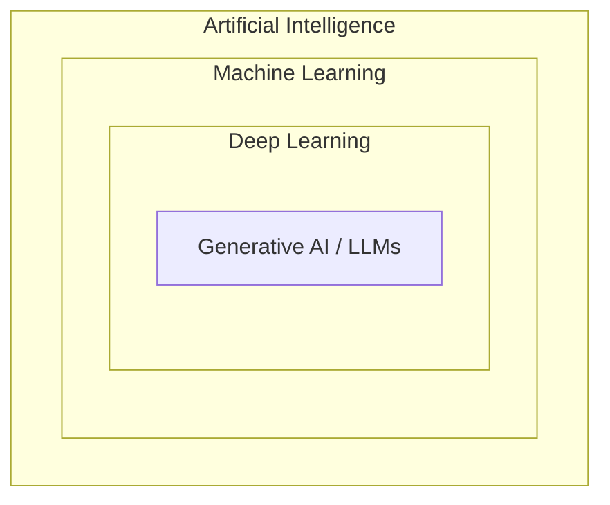

# Introduction to Machine Learning

<Note>
**TL;DR**

Machine learning is a way of building software where, instead of hand-writing the rules, you give the computer **examples (data)** and a **training algorithm** adjusts a flexible **model** until it captures the pattern. It is a subfield of AI. The three main kinds of task are **supervised** (learn from labelled examples), **unsupervised** (find structure in unlabelled data) and **reinforcement learning** (learn actions by maximising a reward).
</Note>

## What is machine learning?

- A modern software development technique, and a type of AI, that lets computers solve problems **by learning from real-world example data**.
- The computer improves from experience **without being explicitly programmed** with the rules.
- It sits inside the broader field of **artificial intelligence**, which is about machines performing tasks that seem to need human-like intelligence. **Deep learning** sits inside ML, and today's **generative AI / LLMs** sit inside deep learning.




## Kinds of ML tasks

| Kind | Data | The algorithm learns to... | Example |
|---|---|---|---|
| **Supervised** | every example has a **label** (the right answer) | predict the label for new inputs | spam or not spam; house price |
| **Unsupervised** | no labels | find the underlying patterns or groups | customer segments; book micro-genres |
| **Reinforcement** | no fixed dataset; an environment gives **rewards** | pick actions that maximise total reward | AWS DeepRacer car, game-playing agents |

- **Supervised learning**: every training sample has a corresponding label or output value, so the algorithm learns to predict labels or values. More in [Supervised vs Unsupervised Machine learning](/Software%20Engineering/AI%20%26%20ML/Machine%20Learning/Supervised%20vs%20Unsupervised%20Machine%20learning).
- **Unsupervised learning**: no labels; the algorithm learns the structure or distribution of the data (for example clusters).
- **Reinforcement learning**: like training a pet. The algorithm tries actions, gets a numeric reward, and learns which actions lead to the goal. RL is also a key ingredient of modern LLM training (RLHF and reasoning-model training); see [Transformers & How LLMs Work](/Software%20Engineering/AI%20%26%20ML/Transformers%20%26%20How%20LLMs%20Work).

## Traditional programming vs machine learning

**Traditional**: a person analyses the problem and writes code that solves it. For many real problems this is laborious or impossible, because a correct solution must handle a vast number of edge cases.

<Info>
**Is there a cat in this photo?**

Written by hand, you'd have to handle lighting, angles, breeds, poses, partial occlusion, backgrounds... the rule list never ends.
</Info>

**Machine learning**: the problem solver leaves part of the solution as a flexible component called a **model**, and uses a **model training algorithm** to fit that model to real-world data. The result is a **trained model** that can predict outcomes for new data it wasn't trained on.

In a way, ML automates part of the statistical reasoning and pattern matching the problem solver would otherwise do by hand.


```text
Traditional:   rules + data  ->  program  ->  answers
ML:            data + answers  ->  training  ->  model (the "rules")
               new data  ->  model  ->  predictions
```

## When ML is (and isn't) the right tool
- Good fit: the rules are too complex to write, the pattern changes over time, you have (or can get) plenty of representative data, and some error is acceptable.
- Poor fit: a simple deterministic rule works, you need exact guarantees or full explainability, or you have little or biased data.

## Interview questions

<Accordion title="How is ML different from traditional programming?">
In traditional programming a human writes the rules. In ML a human picks a model family and provides data; a training algorithm learns the rules (the model's parameters) from examples, and the trained model then generalises to new inputs.
</Accordion>

<Accordion title="Name the three main types of ML with an example each.">
Supervised (email spam classification, house price regression), unsupervised (clustering customers or books), reinforcement (a DeepRacer car learning to drive a track by reward).
</Accordion>

<Accordion title="How do AI, ML, deep learning and generative AI relate?">
Nested sets: AI is the broad goal, ML is AI that learns from data, deep learning is ML with many-layered neural networks, and generative AI (LLMs, image models) is deep learning that generates new content.
</Accordion>

## Related
- [Machine Learning](/Software%20Engineering/AI%20%26%20ML/Machine%20Learning/Machine%20Learning) (course index) · [AI & ML Index](/Software%20Engineering/AI%20%26%20ML/AI%20%26%20ML%20Index)
- Next: [Components of ML](/Software%20Engineering/AI%20%26%20ML/Machine%20Learning/Components%20of%20ML)
- [Supervised vs Unsupervised Machine learning](/Software%20Engineering/AI%20%26%20ML/Machine%20Learning/Supervised%20vs%20Unsupervised%20Machine%20learning) · [ML Core Concepts](/Software%20Engineering/AI%20%26%20ML/Machine%20Learning/ML%20Core%20Concepts)

## Sources
- AWS DeepRacer Student: [Introduction to machine learning](https://student.deepracer.com/learn/85a3a216-703b-40c8-ad70-374767eba381)
- AWS: [What is machine learning?](https://aws.amazon.com/what-is/machine-learning/)
- Google: [Machine Learning Crash Course](https://developers.google.com/machine-learning/crash-course)
