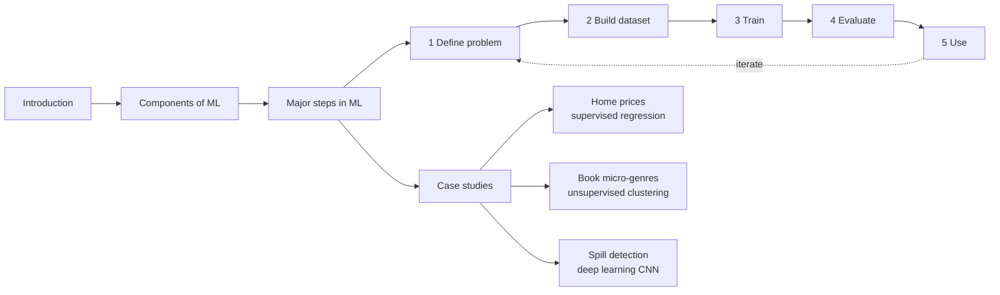

# Machine Learning

> [!tldr] TL;DR
> Course notes for classic machine learning: the AWS DeepRacer Student **"Introduction to machine learning"** course (what ML is, its three components, the five-step ML process and three case studies) plus notes from the Coursera / DeepLearning.AI **Machine Learning Specialization** (supervised vs unsupervised). Read them in the order below, then move on to deep learning and LLMs from the [[AI & ML Index]].

## AWS DeepRacer Student: Introduction to machine learning
Course link: [Introduction to machine learning](https://student.deepracer.com/learn/85a3a216-703b-40c8-ad70-374767eba381)

1. [[Introduction to Machine Learning|Introduction]]: what ML is, supervised / unsupervised / reinforcement learning, traditional vs ML problem solving
2. [[Components of ML]]: model, training algorithm, inference algorithm
3. [[Major steps in ML]]: the 5-step process
   - [[Step 1 Define The problem]]
   - [[Step 2 Building Dataset]]
   - [[Step 3 Train the model]]
   - [[Step 4 Evaluate the model]]
   - [[Step 5 Use the model]]
4. [[Case Studies that use ML]]
   - [[Example 1 Predicting Home Prices]]
   - [[Example 2 Micro-genre Book Genre]]
   - [[Example 3 Detecting Spills]]

Supporting concepts: [[ML Core Concepts]] (vectors, embeddings, neural networks, transformers, one-hot encoding).

## Coursera / DeepLearning.AI: Machine Learning Specialization
- [[Supervised vs Unsupervised Machine learning]]

## Where to go next
- [[Neural Networks & Deep Learning Basics]]: how the networks in Example 3 actually learn
- [[Transformers & How LLMs Work]]: the architecture behind LLMs
- [[AI & ML Index]]: the full domain map

## Related
- [[AI & ML Index]] · [[ML Core Concepts]]

## Sources
- AWS DeepRacer Student: [Introduction to machine learning](https://student.deepracer.com/learn/85a3a216-703b-40c8-ad70-374767eba381)
- DeepLearning.AI / Coursera: [Machine Learning Specialization](https://www.coursera.org/specializations/machine-learning-introduction)
- Google: [Machine Learning Crash Course](https://developers.google.com/machine-learning/crash-course)
