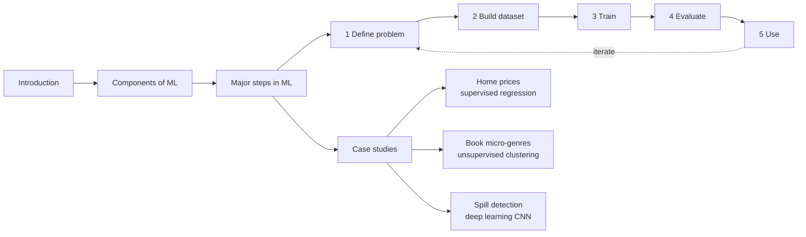

# Machine Learning

<Note>
**TL;DR**

Course notes for classic machine learning: the AWS DeepRacer Student **"Introduction to machine learning"** course (what ML is, its three components, the five-step ML process and three case studies) plus notes from the Coursera / DeepLearning.AI **Machine Learning Specialization** (supervised vs unsupervised). Read them in the order below, then move on to deep learning and LLMs from the [AI & ML Index](/Software%20Engineering/AI%20%26%20ML/AI%20%26%20ML%20Index).
</Note>

## AWS DeepRacer Student: Introduction to machine learning
Course link: [Introduction to machine learning](https://student.deepracer.com/learn/85a3a216-703b-40c8-ad70-374767eba381)

1. [Introduction](/Software%20Engineering/AI%20%26%20ML/Machine%20Learning/Introduction%20to%20Machine%20Learning): what ML is, supervised / unsupervised / reinforcement learning, traditional vs ML problem solving
2. [Components of ML](/Software%20Engineering/AI%20%26%20ML/Machine%20Learning/Components%20of%20ML): model, training algorithm, inference algorithm
3. [Major steps in ML](/Software%20Engineering/AI%20%26%20ML/Machine%20Learning/Major%20steps%20in%20ML/Major%20steps%20in%20ML): the 5-step process
   - [Step 1 Define The problem](/Software%20Engineering/AI%20%26%20ML/Machine%20Learning/Major%20steps%20in%20ML/Step%201%20Define%20The%20problem)
   - [Step 2 Building Dataset](/Software%20Engineering/AI%20%26%20ML/Machine%20Learning/Major%20steps%20in%20ML/Step%202%20Building%20Dataset)
   - [Step 3 Train the model](/Software%20Engineering/AI%20%26%20ML/Machine%20Learning/Major%20steps%20in%20ML/Step%203%20Train%20the%20model)
   - [Step 4 Evaluate the model](/Software%20Engineering/AI%20%26%20ML/Machine%20Learning/Major%20steps%20in%20ML/Step%204%20Evaluate%20the%20model)
   - [Step 5 Use the model](/Software%20Engineering/AI%20%26%20ML/Machine%20Learning/Major%20steps%20in%20ML/Step%205%20Use%20the%20model)
4. [Case Studies that use ML](/Software%20Engineering/AI%20%26%20ML/Machine%20Learning/Case%20Studies%20that%20use%20ML/Case%20Studies%20that%20use%20ML)
   - [Example 1 Predicting Home Prices](/Software%20Engineering/AI%20%26%20ML/Machine%20Learning/Case%20Studies%20that%20use%20ML/Example%201%20Predicting%20Home%20Prices)
   - [Example 2 Micro-genre Book Genre](/Software%20Engineering/AI%20%26%20ML/Machine%20Learning/Case%20Studies%20that%20use%20ML/Example%202%20Micro-genre%20Book%20Genre)
   - [Example 3 Detecting Spills](/Software%20Engineering/AI%20%26%20ML/Machine%20Learning/Case%20Studies%20that%20use%20ML/Example%203%20Detecting%20Spills)

Supporting concepts: [ML Core Concepts](/Software%20Engineering/AI%20%26%20ML/Machine%20Learning/ML%20Core%20Concepts) (vectors, embeddings, neural networks, transformers, one-hot encoding).

## Coursera / DeepLearning.AI: Machine Learning Specialization
- [Supervised vs Unsupervised Machine learning](/Software%20Engineering/AI%20%26%20ML/Machine%20Learning/Supervised%20vs%20Unsupervised%20Machine%20learning)

## Where to go next
- [Neural Networks & Deep Learning Basics](/Software%20Engineering/AI%20%26%20ML/Neural%20Networks%20%26%20Deep%20Learning%20Basics): how the networks in Example 3 actually learn
- [Transformers & How LLMs Work](/Software%20Engineering/AI%20%26%20ML/Transformers%20%26%20How%20LLMs%20Work): the architecture behind LLMs
- [AI & ML Index](/Software%20Engineering/AI%20%26%20ML/AI%20%26%20ML%20Index): the full domain map

## Related
- [AI & ML Index](/Software%20Engineering/AI%20%26%20ML/AI%20%26%20ML%20Index) · [ML Core Concepts](/Software%20Engineering/AI%20%26%20ML/Machine%20Learning/ML%20Core%20Concepts)

## Sources
- AWS DeepRacer Student: [Introduction to machine learning](https://student.deepracer.com/learn/85a3a216-703b-40c8-ad70-374767eba381)
- DeepLearning.AI / Coursera: [Machine Learning Specialization](https://www.coursera.org/specializations/machine-learning-introduction)
- Google: [Machine Learning Crash Course](https://developers.google.com/machine-learning/crash-course)
