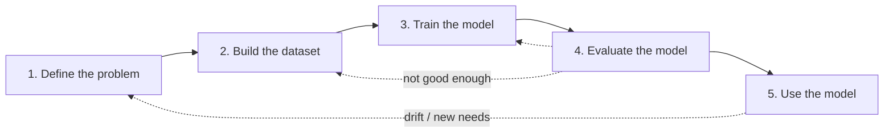

# Major steps in ML

<Note>
**TL;DR**

Every ML project follows the same five steps: **define the problem → build the dataset → train the model → evaluate the model → use the model (inference)**. The steps are **iterative**: at each step you check whether things behave as expected and go back when they don't. This note also keeps the course's side notes on **covariance**, correlation and the **Minimum Covariance Determinant** (used for outlier detection while building datasets).
</Note>




| Step | Key question | Note |
|---|---|---|
| 1 | What exactly are we predicting, and is it supervised or unsupervised? | [Step 1 Define The problem](/Software%20Engineering/AI%20%26%20ML/Machine%20Learning/Major%20steps%20in%20ML/Step%201%20Define%20The%20problem) |
| 2 | Does our data match the problem, and is it clean? | [Step 2 Building Dataset](/Software%20Engineering/AI%20%26%20ML/Machine%20Learning/Major%20steps%20in%20ML/Step%202%20Building%20Dataset) |
| 3 | Which model, which loss, which hyperparameters? | [Step 3 Train the model](/Software%20Engineering/AI%20%26%20ML/Machine%20Learning/Major%20steps%20in%20ML/Step%203%20Train%20the%20model) |
| 4 | Is it good enough on data it has never seen, by the right metric? | [Step 4 Evaluate the model](/Software%20Engineering/AI%20%26%20ML/Machine%20Learning/Major%20steps%20in%20ML/Step%204%20Evaluate%20the%20model) |
| 5 | Does it keep working in production? | [Step 5 Use the model](/Software%20Engineering/AI%20%26%20ML/Machine%20Learning/Major%20steps%20in%20ML/Step%205%20Use%20the%20model) |

These steps are iterative. In practice, at each step you review how things are going. Are they operating as you expected? If not, go back and revisit the current or a previous step to find the breakdown.

## Side notes: statistics used while building datasets

### Mean and deviation
The **mean** (average) of a dataset measures its central tendency: the sum of all values divided by their count.

```text
x̄ = (x1 + x2 + ... + xn) / n
```

The **deviation** of a data point is how far it is from the mean. It is positive above the mean and negative below.

```text
deviation of xi = xi − x̄
```

### Covariance
**Covariance** measures how two variables change **together** (their joint variability).

- **Positive**: they tend to rise and fall together (height and weight).
- **Negative**: one rises as the other falls (weekly exercise hours and body weight).
- **Near zero**: no linear relationship.

**Empirical (sample) covariance** estimates this from a sample: multiply each observation's deviations and average them.

```text
Cov(x, y) = 1/n · Σ (xi − x̄)(yi − ȳ)
```

(Statistics libraries usually divide by `n − 1` instead of `n` for an unbiased estimate from a sample, which is what `numpy.cov` does by default.)

### Correlation
Covariance's size depends on the units (cm vs m), so it isn't bounded. Dividing by the product of the two standard deviations gives the **correlation coefficient**, which is always between −1 and 1 and measures the strength and direction of the **linear** relationship.

```text
corr(x, y) = Cov(x, y) / (σx · σy)
```

<Info>
**Worked example**

```python
import numpy as np
height = [160, 170, 180, 190]
weight = [55, 65, 72, 85]
np.cov(height, weight)[0, 1]      # ≈ 161.7 (positive: they rise together; units are cm·kg)
np.corrcoef(height, weight)[0, 1] # ≈ 0.99, a strong positive linear relationship
```
</Info>

### Minimum Covariance Determinant (MCD)
MCD is a **robust** way to estimate the mean and covariance of multivariate data when some points are **outliers**.

- It finds the subset of `h` observations whose covariance matrix has the **smallest determinant** (the tightest, least spread-out core of the data).
- It computes the mean and covariance from that subset, so outliers can't drag them around the way they drag the ordinary (maximum likelihood) estimate.
- Points far from that robust centre (large Mahalanobis distance) are flagged as outliers. scikit-learn's `EllipticEnvelope` uses MCD for exactly this.
- Used in finance, engineering, geology and anywhere outliers distort results.
- Caveat: it assumes the core data is roughly **Gaussian (elliptical)**; it may not fit strongly non-normal data.

```python
from sklearn.covariance import EllipticEnvelope
detector = EllipticEnvelope(contamination=0.05).fit(X)
detector.predict(X)   # 1 = inlier, -1 = outlier
```

See the scikit-learn wine example linked in [Step 2 Building Dataset](/Software%20Engineering/AI%20%26%20ML/Machine%20Learning/Major%20steps%20in%20ML/Step%202%20Building%20Dataset).

## Interview questions

<Accordion title="Walk me through the steps of an ML project.">
Define a specific problem and the ML task (supervised/unsupervised, regression/classification); collect, inspect, clean and split data; pick a baseline model and train it by minimising a loss; evaluate on held-out data with a metric that matches the business goal; deploy for inference and monitor for drift, retraining when needed. Iterate throughout.
</Accordion>

<Accordion title="Covariance vs correlation?">
Both measure how two variables move together. Covariance is in the variables' units and unbounded; correlation is covariance normalised by both standard deviations, so it's unitless and bounded to [−1, 1]. Both only capture linear relationships.
</Accordion>

<Accordion title="Why use a robust estimator like MCD?">
A few extreme outliers can badly distort the ordinary mean and covariance. MCD estimates them from the tightest core subset of the data, so it's resistant to outliers and can then be used to flag them.
</Accordion>

## Related
- [Machine Learning](/Software%20Engineering/AI%20%26%20ML/Machine%20Learning/Machine%20Learning) (course index) · [AI & ML Index](/Software%20Engineering/AI%20%26%20ML/AI%20%26%20ML%20Index)
- Previous: [Components of ML](/Software%20Engineering/AI%20%26%20ML/Machine%20Learning/Components%20of%20ML) · Next: [Step 1 Define The problem](/Software%20Engineering/AI%20%26%20ML/Machine%20Learning/Major%20steps%20in%20ML/Step%201%20Define%20The%20problem)
- [Case Studies that use ML](/Software%20Engineering/AI%20%26%20ML/Machine%20Learning/Case%20Studies%20that%20use%20ML/Case%20Studies%20that%20use%20ML) shows the five steps applied three times

## Sources
- AWS DeepRacer Student: [Introduction to machine learning](https://student.deepracer.com/learn/85a3a216-703b-40c8-ad70-374767eba381)
- scikit-learn: [Covariance estimation (MinCovDet)](https://scikit-learn.org/stable/modules/covariance.html) · [Outlier detection on a real data set](https://scikit-learn.org/stable/auto_examples/applications/plot_outlier_detection_wine.html)
- Rousseeuw & Van Driessen (1999), *A Fast Algorithm for the Minimum Covariance Determinant Estimator*, Technometrics 41(3)
- NumPy: [numpy.cov](https://numpy.org/doc/stable/reference/generated/numpy.cov.html)
