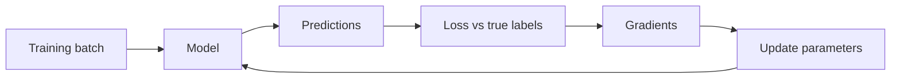

# Step 3 Train the model

<Note>
**TL;DR**

*Model training is a process where the model's parameters are iteratively updated to minimise a loss function that was defined beforehand.* First **split** the data (typically ~80% train / 20% test, often with a validation split too). Then loop: feed training data in, compute the **loss**, update the **parameters** in the direction that reduces it. Start with simple models (linear, tree-based) as baselines before reaching for deep learning.
</Note>

## Model families

### Linear models
Describe the relationship between inputs and outputs with a linear function (think `y = mx + b`, a straight line on an x-vs-y chart). Classification uses the closely related **logistic** model, which squashes the linear output into [0, 1] and reads it as "probability of being in the target class". Linear models are fast to train and give a great **baseline**. For most new problems, start simple.

### Tree-based models
Learn by building a large structure of nested `if/else` blocks that split the world into regions; training decides where each split happens and what value each leaf returns. A depth-1 tree for "is this light sensor in sunlight?" might learn `if (sensor_value > 0.698) return 1; else return 0;`. **XGBoost** (and LightGBM, CatBoost) are popular gradient-boosted tree implementations and are still the go-to for **tabular data**. Also a fast baseline.

### Deep learning models
Loosely based on how the brain works. A **neural network** is made of **neurons** (very simple computational units) connected by **weights** (how much signal flows from one neuron to the next). Training finds the value of every weight. Well-known structures:
- **FFNN (feed-forward)**: neurons in layers, each connected to all neurons of the previous layer.
- **CNN (convolutional)**: stacks of learned filters sliding over grid data; the standard for images.
- **RNN / LSTM (recurrent)**: carry state while iterating over a sequence, like a `for` loop.
- **Transformer**: the modern replacement for RNN/LSTMs; uses attention and trains in parallel on very large sequence datasets. Powers LLMs.

Details: [Neural Networks & Deep Learning Basics](/Software%20Engineering/AI%20%26%20ML/Neural%20Networks%20%26%20Deep%20Learning%20Basics) · [Transformers & How LLMs Work](/Software%20Engineering/AI%20%26%20ML/Transformers%20%26%20How%20LLMs%20Work).

| Model | Best for | Pros | Cons |
|---|---|---|---|
| Linear / logistic | baselines, simple relationships | fast, interpretable | can't capture complex patterns |
| Trees / gradient boosting | tabular data | strong accuracy, little preprocessing | less good on images/text |
| Deep learning | images, audio, text, huge data | learns features itself | data- and compute-hungry, harder to explain |

### Python libraries
- **scikit-learn** for classical models (linear, trees, clustering) and ML tooling; its docs are a great learning resource.
- For deep learning the course listed **MXNet, TensorFlow and PyTorch**. Update: Apache MXNet was retired to the Apache Attic in 2023, and **PyTorch** is now the dominant framework for research and LLM work, with TensorFlow/Keras and JAX as the other main options.

## Split the data first

The first step in training is to **randomly split the dataset**, so some data stays hidden during training and can be used to evaluate the model before production. This tests the **bias-variance trade-off** (does the model generalise, or did it memorise?).

- **Training dataset** (~80%): what the model learns from.
- **Test dataset** (~20%): withheld during training, used to check how well the model generalises to new data.
- In practice there's often a third **validation** set (or cross-validation) for tuning hyperparameters, so the test set is touched only once at the end.

```python
from sklearn.model_selection import train_test_split
X_train, X_test, y_train, y_test = train_test_split(X, y, test_size=0.2, random_state=42)
```

## What does a training algorithm actually do?

It **iteratively updates model parameters to minimise a loss function**.

- **Model parameters** (weights and biases): settings the training algorithm changes to alter how the model behaves. "Weights" is the neural-network term.
- **Loss function**: codifies how far the model is from its goal. For snow cone sales it might be "the average distance between predicted and actual sales"; training tries to make that number small.

### Putting it all together
1. Feed the training data into the model.
2. Compute the loss on the results.
3. Update the parameters in a direction that reduces the loss (**gradient descent**: follow the slope downhill).
4. Repeat until a stop condition (a number of epochs, or the loss stops improving).

```python
# gradient descent for y = w*x + b, by hand
w, b, lr = 0.0, 0.0, 0.01
for epoch in range(1000):
    y_pred = w * X + b
    loss = ((y_pred - y) ** 2).mean()          # mean squared error
    dw = (2 * (y_pred - y) * X).mean()         # gradient of loss w.r.t. w
    db = (2 * (y_pred - y)).mean()
    w, b = w - lr * dw, b - lr * db            # step downhill
```



## Practical questions
- **How do I implement training?** You can write it from scratch, but practitioners use frameworks with working implementations of models and training algorithms. Only build your own if you're researching new models or algorithms.
- **How do I choose a model? (model selection)** Mostly trial and error. The list of models keeps growing, and even experienced practitioners try several. Start with a baseline and move up in complexity only when it pays off.
- **Hyperparameters**: settings that aren't changed during training but strongly affect how quickly and reliably it trains, e.g. learning rate, number of epochs, tree depth, or the number of clusters.
- **Be prepared to iterate.**

## Senior perspective
- Always beat a **dumb baseline** (predict the mean / majority class) and a **simple model** before shipping something complex.
- Track experiments (MLflow, Weights & Biases): data version, code commit, hyperparameters, metrics. Unreproducible models are unmaintainable.
- Tune hyperparameters on validation data or with cross-validation, never on the test set.
- Watch the train vs validation loss curves: training loss falling while validation loss rises means **overfitting** (see [Step 4 Evaluate the model](/Software%20Engineering/AI%20%26%20ML/Machine%20Learning/Major%20steps%20in%20ML/Step%204%20Evaluate%20the%20model) and [Neural Networks & Deep Learning Basics](/Software%20Engineering/AI%20%26%20ML/Neural%20Networks%20%26%20Deep%20Learning%20Basics)).

## Key terms
- **Hyperparameters**: settings not changed during training that affect how fast or reliably it trains (e.g. number of clusters).
- **Loss function**: codifies the model's distance from its goal.
- **Training dataset**: the data the model is trained on; most of your data.
- **Test dataset**: data withheld during training, used to test generalisation.
- **Model parameters**: settings the training algorithm updates to change how the model behaves.

## Interview questions

<Accordion title="Why split into train, validation and test sets?">
Train to fit parameters, validation to choose hyperparameters and models, test for a single unbiased final estimate. Reusing test data for decisions leaks information and overstates performance.
</Accordion>

<Accordion title="Explain gradient descent in one minute.">
Compute the loss, compute its gradient with respect to each parameter (which direction increases loss), take a small step in the opposite direction scaled by the learning rate, repeat. Too large a learning rate diverges; too small is slow.
</Accordion>

<Accordion title="Why start with a linear or tree model?">
They're fast, need less data, are easier to explain, and give a baseline. If a deep model can't clearly beat them, the extra cost and complexity aren't worth it. For tabular data, gradient-boosted trees often win outright.
</Accordion>

## Related
- [Major steps in ML](/Software%20Engineering/AI%20%26%20ML/Machine%20Learning/Major%20steps%20in%20ML/Major%20steps%20in%20ML) · [Machine Learning](/Software%20Engineering/AI%20%26%20ML/Machine%20Learning/Machine%20Learning) (course index) · [AI & ML Index](/Software%20Engineering/AI%20%26%20ML/AI%20%26%20ML%20Index)
- Previous: [Step 2 Building Dataset](/Software%20Engineering/AI%20%26%20ML/Machine%20Learning/Major%20steps%20in%20ML/Step%202%20Building%20Dataset) · Next: [Step 4 Evaluate the model](/Software%20Engineering/AI%20%26%20ML/Machine%20Learning/Major%20steps%20in%20ML/Step%204%20Evaluate%20the%20model)
- [Components of ML](/Software%20Engineering/AI%20%26%20ML/Machine%20Learning/Components%20of%20ML) · [Neural Networks & Deep Learning Basics](/Software%20Engineering/AI%20%26%20ML/Neural%20Networks%20%26%20Deep%20Learning%20Basics)

## Sources
- AWS DeepRacer Student: [Introduction to machine learning](https://student.deepracer.com/learn/85a3a216-703b-40c8-ad70-374767eba381)
- scikit-learn: [train_test_split](https://scikit-learn.org/stable/modules/generated/sklearn.model_selection.train_test_split.html) · [Cross-validation](https://scikit-learn.org/stable/modules/cross_validation.html)
- XGBoost: [documentation](https://xgboost.readthedocs.io/)
- Apache Attic: [Apache MXNet (retired)](https://attic.apache.org/projects/mxnet.html)
- Google ML Crash Course: [Linear regression: gradient descent](https://developers.google.com/machine-learning/crash-course/linear-regression/gradient-descent)
