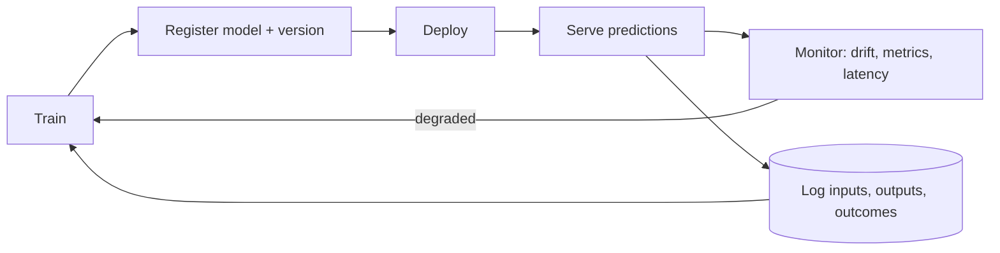

# Step 5 Use the model

> [!tldr] TL;DR
> Once the model is trained, evaluated and good enough, you use it to make predictions on new, real-world data. This is called **inference**. Deployment isn't the end: data and the world change, so you **monitor** predictions and inputs, and go back to earlier steps (more data, new parameters, a different model) when quality drops. Keeping models healthy in production is the job of **MLOps**.

## Model inference
Once you have trained the model, evaluated its effectiveness and are satisfied with the results, you can generate predictions for real problems using **unseen data in the field**. In ML this is **inference**.

![[Untitled 3.png]]

## Ways to serve a model

| Pattern | How | Example |
|---|---|---|
| **Batch** | run on a schedule over many records, store results | nightly churn scores written to a table |
| **Online / real-time** | API endpoint answers each request in milliseconds | fraud check during checkout |
| **Streaming** | score events as they flow through Kafka/Kinesis | anomaly detection on sensor data |
| **Edge / on-device** | model runs on the device or camera | spill detection on AWS Panorama ([[Example 3 Detecting Spills]]), on-device browser AI |

```python
# minimal online inference service
import joblib
from fastapi import FastAPI

model = joblib.load("house_price_model.joblib")   # load once at startup
app = FastAPI()

@app.post("/predict")
def predict(size_m2: float, bedrooms: int):
    price = model.predict([[size_m2, bedrooms]])[0]
    return {"price": round(price, -3), "model_version": "2026-09-01"}
```

## Always monitor

Even after deployment you keep checking the model produces the kind of results you expect. You may need to re-investigate the data, change training parameters, or switch model type.

What to watch:
- **Data drift**: input distributions change (new customer types, a new camera angle).
- **Concept drift**: the relationship between inputs and the label changes (house prices after an interest-rate jump).
- **Prediction distribution**: sudden shifts in the share of positive predictions.
- **Ground-truth performance**: once real outcomes arrive, recompute your evaluation metrics.
- **Operational health**: latency, errors, throughput, cost.



## Senior perspective
- **Roll out safely**: shadow mode (predict without acting), canary, or A/B test against the current model before full traffic.
- **Version everything** (data, code, model, features) and keep a rollback path to the previous model.
- **Training/serving skew**: features computed differently offline and online silently break models. Share feature code, or use a feature store.
- **Feedback loops**: a model's predictions can change the data it's later trained on (recommendations shape what people click). Keep some randomised exploration or holdout traffic.
- **Human in the loop** for high-stakes decisions, plus explanations and an appeal path.
- For LLM-based features the same ideas apply with extra layers: tracing, evals on live traffic and guardrails. See [[LLM Evaluation & Observability]] and [[AI Safety, Security & Guardrails for Apps]].

## Recap
1. *Solving problems with ML is an evolving and iterative process.*
2. *High-quality data is essential to solving a problem successfully.*
3. *Models are evaluated with statistical metrics tailored to the specific use case.*

## Interview questions

> [!question]- What is model drift and how do you detect it?
> Model quality degrades because production data (data drift) or the input-to-label relationship (concept drift) changed since training. Detect it by monitoring input feature distributions (e.g. population stability index, KS test), prediction distributions, and live metrics once ground truth arrives; alert and retrain.

> [!question]- Batch vs real-time inference?
> Batch is cheaper and simpler when predictions can be precomputed (daily scores). Real-time is needed when the input only exists at request time (a transaction being made) and brings latency, scaling and availability requirements.

> [!question]- How would you safely replace a model in production?
> Register the new version, run it in shadow mode comparing outputs, then canary or A/B test on a slice of traffic with guardrail metrics, ramp up, and keep the old version ready for instant rollback.

## Related
- [[Major steps in ML]] · [[Machine Learning]] (course index) · [[AI & ML Index]]
- Previous: [[Step 4 Evaluate the model]] · Next: [[Case Studies that use ML]]
- [[LLM Evaluation & Observability]]

## Sources
- AWS DeepRacer Student: [Introduction to machine learning](https://student.deepracer.com/learn/85a3a216-703b-40c8-ad70-374767eba381)
- Google Cloud: [MLOps: Continuous delivery and automation pipelines in machine learning](https://cloud.google.com/architecture/mlops-continuous-delivery-and-automation-pipelines-in-machine-learning)
- Sculley et al. (2015), [Hidden Technical Debt in Machine Learning Systems](https://papers.nips.cc/paper/2015/hash/86df7dcfd896fcaf2674f757a2463eba-Abstract.html), NeurIPS
- Chip Huyen, *Designing Machine Learning Systems* (O'Reilly, 2022)
