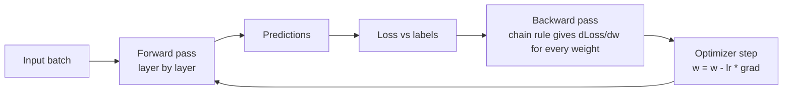

# Neural Networks & Deep Learning Basics

<Note>
**TL;DR**

A neural network is a stack of layers; each neuron computes a **weighted sum plus bias** and passes it through a non-linear **activation function**. Training runs data forward, measures the **loss**, uses **backpropagation** (the chain rule) to get the gradient of the loss for every weight, and nudges weights downhill with **gradient descent**. **CNNs** exploit spatial structure (images), **RNNs** carry state through sequences, and **transformers** replaced RNNs for language. Deep models overfit easily, so you fight it with more data, **regularisation** (weight decay, dropout), early stopping and augmentation.
</Note>

## From perceptron to deep network

### The perceptron (1958)
The simplest neuron: inputs `x`, weights `w`, bias `b`, and a **step** function.

```text
output = 1 if (w·x + b) > 0 else 0
```

It draws one straight line (hyperplane) between two classes. It can learn AND and OR, but famously **not XOR**, because XOR isn't linearly separable. That limitation stalled the field until multi-layer networks could be trained.


### Multi-layer perceptron (MLP)
Stack layers of neurons with non-linear activations between them and the network can approximate almost any function (the **universal approximation theorem**). "Deep" just means many hidden layers.


```python
import torch.nn as nn
model = nn.Sequential(
    nn.Linear(784, 128), nn.ReLU(),     # hidden layer 1
    nn.Linear(128, 64),  nn.ReLU(),     # hidden layer 2
    nn.Linear(64, 10),                  # output: 10 digit classes (logits)
)
```

One layer computes `h = activation(W·x + b)`: a matrix multiply plus a non-linearity. That's why GPUs (fast matrix maths) made deep learning practical.

## Activation functions

Without non-linearity, stacking layers collapses into a single linear function. Activations add the bends.

| Activation | Formula | Range | Used for | Notes |
|---|---|---|---|---|
| **Step** | 1 if z > 0 else 0 | \{0, 1\} | original perceptron | no gradient, can't train with backprop |
| **Sigmoid** | 1 / (1 + e^−z) | (0, 1) | binary output probability | saturates → vanishing gradients in deep nets |
| **Tanh** | (e^z − e^−z)/(e^z + e^−z) | (−1, 1) | older hidden layers, RNNs | zero-centred, still saturates |
| **ReLU** | max(0, z) | [0, ∞) | default hidden layer for CNNs/MLPs | cheap, no saturation for z > 0; "dead" neurons possible |
| **GELU / SiLU (Swish)** | smooth ReLU-like | ≈ [−0.2, ∞) | transformers, LLMs | smooth gradients; SwiGLU variants common in LLMs |
| **Softmax** | e^zi / Σ e^zj | (0, 1), sums to 1 | multi-class output | turns logits into a probability distribution |

## How training works: forward pass, loss, backprop



1. **Forward pass**: compute predictions layer by layer.
2. **Loss**: compare with the true labels (MSE for regression, cross-entropy for classification).
3. **Backpropagation**: apply the **chain rule** from the output back to the input, reusing intermediate results, to get the gradient of the loss with respect to every weight in one backward sweep.
4. **Optimizer step**: move each weight a little against its gradient. Plain SGD, or **Adam/AdamW** (adaptive per-weight step sizes, the default for transformers).
5. Repeat over **mini-batches** for several **epochs** (full passes over the data).

A tiny worked example of the chain rule, one neuron with squared-error loss:

```text
z = w·x + b,   ŷ = z,   L = (ŷ − y)²
dL/dw = dL/dŷ · dŷ/dz · dz/dw = 2(ŷ − y) · 1 · x
x = 2, y = 10, w = 3, b = 0  →  ŷ = 6,  dL/dw = 2(6 − 10)·2 = −16
lr = 0.01  →  w_new = 3 − 0.01·(−16) = 3.16   (moves toward the answer)
```

The full PyTorch training loop:

```python
opt = torch.optim.AdamW(model.parameters(), lr=1e-3, weight_decay=0.01)
loss_fn = nn.CrossEntropyLoss()
for epoch in range(10):
    for xb, yb in train_loader:
        logits = model(xb)              # forward
        loss = loss_fn(logits, yb)
        opt.zero_grad()
        loss.backward()                 # backprop: fills .grad for every weight
        opt.step()                      # gradient descent step
```

**Vanishing and exploding gradients**: in deep nets gradients are products of many terms, so they can shrink to zero or blow up. Fixes: ReLU-family activations, careful initialisation, **normalisation layers** (BatchNorm, LayerNorm), **residual (skip) connections**, and gradient clipping.

## Architectures: intuition

### CNN (convolutional neural network): images
A small filter (say 3×3) slides across the image and computes a dot product at each position, producing a **feature map**. The same filter weights are reused everywhere (**weight sharing**), so a "vertical edge" detector works anywhere in the image. **Pooling** shrinks the maps. Early layers learn edges and textures, deeper layers learn parts and objects. See [Example 3 Detecting Spills](/Software%20Engineering/AI%20%26%20ML/Machine%20Learning/Case%20Studies%20that%20use%20ML/Example%203%20Detecting%20Spills).

```text
image → [conv → ReLU → pool] × N → flatten → dense → softmax(classes)
```

### RNN / LSTM: sequences
An RNN processes one element at a time and carries a **hidden state** forward, like a `for` loop with memory: `h_t = f(W·x_t + U·h_{t−1})`. Plain RNNs forget long-range context (vanishing gradients); **LSTMs/GRUs** add gates that decide what to keep. Their weakness: they're **sequential**, so they can't be parallelised across a sentence, which limited scale.


### Residual networks
Skip connections add a layer's input to its output (`y = x + f(x)`), giving gradients a highway backwards. This made 100+ layer networks trainable and is used inside every transformer block.


### Transformers
Replace recurrence with **attention**: every token looks at every other token at once, in parallel. That parallelism made it possible to train on internet-scale data. See [Transformers & How LLMs Work](/Software%20Engineering/AI%20%26%20ML/Transformers%20%26%20How%20LLMs%20Work).

| Architecture | Data | Key idea | Status today |
|---|---|---|---|
| MLP | tabular, small inputs | fully connected layers | building block everywhere |
| CNN | images, audio spectrograms | shared local filters | still strong for vision, especially on edge devices |
| RNN/LSTM | sequences, time series | hidden state over time | largely replaced by transformers |
| Transformer | text, images, audio, code | self-attention | dominant (LLMs, vision transformers) |

## Overfitting and regularisation

**Overfitting**: the model memorises the training data (including noise) and does worse on new data. The sign: training loss keeps falling while validation loss rises.

```text
loss
 │ \                      validation
 │  \        ____....----'
 │   \___.--'
 │       `--.___          training
 │              `----.____________
 └──────────────────────────────── epochs
            ↑ stop here (early stopping)
```

| Technique | How it helps |
|---|---|
| **More / better data** | the most reliable fix |
| **Data augmentation** | flips, crops, noise, paraphrases create new training examples |
| **Weight decay (L2)** | penalises large weights, preferring simpler functions |
| **L1** | pushes weights to exactly zero (sparsity) |
| **Dropout** | randomly zeroes neurons during training so the network can't rely on any single path |
| **Early stopping** | stop when validation loss stops improving |
| **Smaller model / fewer epochs** | less capacity to memorise |
| **Transfer learning** | start from pretrained weights, fine-tune on your data |

**Underfitting** is the opposite (too simple, or not trained enough): train longer, add capacity, improve features.

## Senior perspective
- Deep learning shines on **unstructured data** (images, audio, text). For tabular business data, gradient-boosted trees are often better and cheaper; benchmark both.
- In industry you rarely train from scratch: you **fine-tune** or use a pretrained model (or call an LLM API). Training from scratch is for large teams with large data and compute.
- **Reproducibility**: fix seeds, log data versions and hyperparameters, keep checkpoints.
- **Serving**: latency and memory depend on parameter count and precision. **Quantisation** (fp16, int8, 4-bit) and **distillation** shrink models for production and edge.
- Debug training by first **overfitting a tiny batch** on purpose: if the model can't, the bug is in the code, not the data.

## Interview questions

<Accordion title="Why can't a single perceptron learn XOR?">
A perceptron draws one linear boundary, and XOR's positive cases (0,1) and (1,0) can't be separated from (0,0) and (1,1) by one line. A hidden layer with a non-linear activation solves it.
</Accordion>

<Accordion title="Explain backpropagation.">
After a forward pass computes the loss, backprop applies the chain rule from the output layer backwards to compute the gradient of the loss with respect to every weight, reusing intermediate values so the cost is about one extra forward pass. An optimizer then updates weights against those gradients.
</Accordion>

<Accordion title="Why ReLU over sigmoid in hidden layers?">
Sigmoid saturates at 0 and 1 where its gradient is near zero, so gradients vanish in deep networks. ReLU has gradient 1 for positive inputs, is cheap to compute, and trains faster. Sigmoid is still used for binary output probabilities.
</Accordion>

<Accordion title="What does dropout do and when is it active?">
During training it randomly zeroes a fraction of activations, forcing redundancy and reducing overfitting. At inference it's turned off (activations are scaled so expected values match).
</Accordion>

<Accordion title="CNN vs RNN vs transformer in one sentence each?">
CNN: shared local filters for grid data like images. RNN: processes sequences step by step with a hidden state. Transformer: attention lets all positions interact in parallel, which scales best for language and more.
</Accordion>

<Accordion title="Your validation loss rises while training loss falls. What do you do?">
That's overfitting. Stop earlier (early stopping), add regularisation (weight decay, dropout), augment or collect more data, reduce model size, or start from a pretrained model.
</Accordion>

## Related
- [AI & ML Index](/Software%20Engineering/AI%20%26%20ML/AI%20%26%20ML%20Index) · [ML Core Concepts](/Software%20Engineering/AI%20%26%20ML/Machine%20Learning/ML%20Core%20Concepts) · [Machine Learning](/Software%20Engineering/AI%20%26%20ML/Machine%20Learning/Machine%20Learning) (course)
- [Step 3 Train the model](/Software%20Engineering/AI%20%26%20ML/Machine%20Learning/Major%20steps%20in%20ML/Step%203%20Train%20the%20model) · [Step 4 Evaluate the model](/Software%20Engineering/AI%20%26%20ML/Machine%20Learning/Major%20steps%20in%20ML/Step%204%20Evaluate%20the%20model) · [Example 3 Detecting Spills](/Software%20Engineering/AI%20%26%20ML/Machine%20Learning/Case%20Studies%20that%20use%20ML/Example%203%20Detecting%20Spills)
- Next: [Transformers & How LLMs Work](/Software%20Engineering/AI%20%26%20ML/Transformers%20%26%20How%20LLMs%20Work)

## Sources
- Goodfellow, Bengio & Courville, [Deep Learning](https://www.deeplearningbook.org/) (MIT Press, 2016)
- Rumelhart, Hinton & Williams (1986), "Learning representations by back-propagating errors", *Nature* 323
- Srivastava et al. (2014), [Dropout: A Simple Way to Prevent Neural Networks from Overfitting](https://jmlr.org/papers/v15/srivastava14a.html), JMLR
- He et al. (2015), [Deep Residual Learning for Image Recognition](https://arxiv.org/abs/1512.03385)
- Stanford CS231n: [Convolutional Neural Networks for Visual Recognition](https://cs231n.github.io/)
- Michael Nielsen, [Neural Networks and Deep Learning](http://neuralnetworksanddeeplearning.com/) (free online book)
- PyTorch: [Learn the basics](https://pytorch.org/tutorials/beginner/basics/intro.html)
