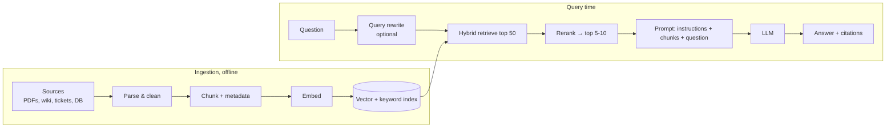
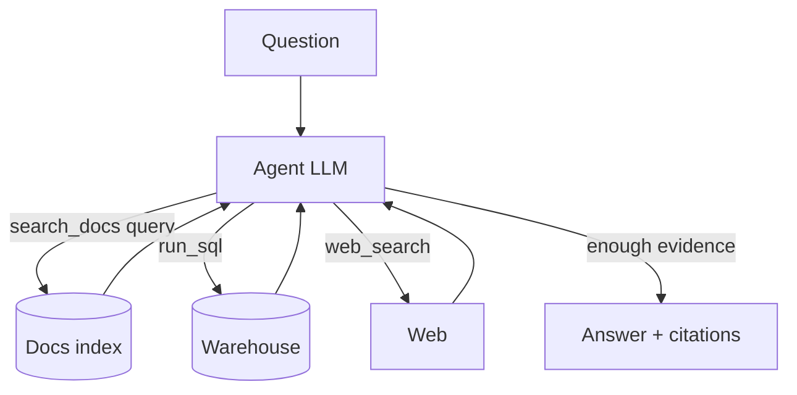

# Retrieval-Augmented Generation (RAG)

<Note>
**TL;DR**

**RAG** answers questions using **your** data: retrieve the most relevant passages from a knowledge base, put them in the prompt, and have the LLM answer **grounded** in them, with citations. Quality is decided mostly by **retrieval**: good **chunking**, **hybrid search** (keywords + embeddings), **reranking**, and metadata/permission filters. **Agentic RAG** lets the model decide what to search and when, over several steps. Evaluate retrieval and generation **separately**.
</Note>

## Why RAG?
LLMs don't know your private documents, have a knowledge cutoff, and hallucinate when unsure. RAG fixes that without retraining:
- **Fresh and private knowledge**: update the index, not the model.
- **Grounding and citations**: answers point to sources users can check.
- **Access control**: retrieve only what this user may see.
- **Cheaper than fine-tuning** for knowledge; see [Fine-tuning vs RAG vs Prompting](/Software%20Engineering/AI%20%26%20ML/Fine-tuning%20vs%20RAG%20vs%20Prompting).

## The basic pipeline



```python
def answer(question, user):
    chunks = hybrid_search(question, filter={"tenant": user.tenant, "acl": user.groups}, k=50)
    top = rerank(question, chunks)[:8]
    context = "\n\n".join(f"<doc id='{c.id}' title='{c.title}'>\n{c.text}\n</doc>" for c in top)
    prompt = f"""Answer using ONLY the documents below. Cite doc ids like [id].
If the answer is not in the documents, say you don't know.

<documents>
{context}
</documents>

<question>{question}</question>"""
    return llm(prompt, temperature=0.2)
```

## 1. Ingestion and chunking

Chunking splits documents into retrievable units. It's the most under-rated quality lever.

| Strategy | How | Good for |
|---|---|---|
| **Fixed size + overlap** | e.g. 300–800 tokens, 10–20% overlap | quick baseline |
| **Recursive / structure-aware** | split on headings, paragraphs, then sentences | docs, wikis, Markdown |
| **Semantic** | split where the embedding similarity between sentences drops | long unstructured prose |
| **Document-specific** | per function/class for code, per row/section for tables, per Q&A pair for FAQs | code, spreadsheets, support KBs |
| **Parent–child (small-to-big)** | retrieve small precise chunks, pass their larger parent section to the LLM | precision + context |

Tips:
- Keep **metadata** with every chunk: source, title, section path, date, author, tenant, permissions.
- Prepend the **document title and section heading** to the chunk text; bare chunks like "It costs $20/month" lose meaning.
- **Contextual Retrieval** (Anthropic, 2024-09-19): use an LLM to prepend a short, chunk-specific explanation of where it sits in the document before embedding and keyword indexing. Anthropic reported failed retrievals (top-20) dropping 35% with contextual embeddings, 49% with contextual embeddings + contextual BM25, and 67% when reranking was added. Prompt caching makes the preprocessing affordable.
- Parse PDFs and tables carefully: bad text extraction silently ruins everything downstream.

## 2. Retrieval

- **Dense (semantic)**: embeddings + ANN search. Good at meaning and paraphrase. See [Embeddings & Semantic Search](/Software%20Engineering/AI%20%26%20ML/Embeddings%20%26%20Semantic%20Search) and [Vector Databases & pgvector](/Software%20Engineering/Databases/Core%20Concepts/Vector%20Databases%20%26%20pgvector).
- **Sparse (lexical)**: BM25 / full-text search. Good at exact terms, codes and names.
- **Hybrid**: run both and merge with **Reciprocal Rank Fusion**. A strong default.
- **Metadata filters**: tenant, permissions, date ranges, product. Apply them **in** the search, not after.
- **Query transformation**: rewrite conversational follow-ups into standalone queries ("what about the EU?" → "EU data retention policy"), split multi-part questions, or generate a hypothetical answer and search with that (HyDE).

## 3. Reranking
Retrieval is optimised for **recall** over millions of chunks; a **reranker** optimises **precision** over the top 20–100. A cross-encoder reads the query and each candidate **together** and scores relevance, which is much more accurate than comparing precomputed vectors, but too slow to run on the whole corpus.

```text
hybrid retrieve 50 (fast, recall)  →  rerank to 8 (slower, precision)  →  LLM
```

An LLM can also act as the reranker (score or filter candidates), at higher cost.

## 4. Generation
- Instruct: answer **only** from the provided context, **cite** sources, say "I don't know" when the answer isn't there.
- Put the documents **before** the question; order chunks by relevance and avoid burying the key chunk mid-context.
- Use low temperature for factual answers and **structured outputs** if the app needs fields (answer, citations, confidence).
- Validate citations in code: every cited ID must exist in the retrieved set.

## 5. Agentic RAG
Classic RAG retrieves once, before generation. **Agentic RAG** gives the model **search tools** and lets it decide what to look up, inspect results, refine queries and search again across multiple sources (vector index, SQL, web, APIs) before answering.



| | Classic RAG | Agentic RAG |
|---|---|---|
| Retrieval | one shot, fixed pipeline | iterative, model-directed |
| Good for | FAQ-style, single-hop questions | multi-hop, comparative, research questions |
| Cost / latency | low, predictable | higher, variable |
| Failure modes | missed chunk = wrong answer | loops, over-searching, injection via retrieved content |

Coding agents are a form of agentic RAG: they `grep`, list files and read code just in time rather than embedding the whole repository. See [AI Agents & Agentic Patterns](/Software%20Engineering/AI%20%26%20ML/AI%20Agents%20%26%20Agentic%20Patterns) and [Prompt & Context Engineering](/Software%20Engineering/AI%20%26%20ML/Prompt%20%26%20Context%20Engineering).

## 6. Evaluation

Evaluate the two halves separately, or you can't tell which one broke.

| Stage | Metric | Question |
|---|---|---|
| Retrieval | **recall@k**, hit rate | is the needed chunk in the top k? |
| Retrieval | **MRR, nDCG** | how high is it ranked? |
| Retrieval | context precision | how much of what we retrieved is relevant? |
| Generation | **faithfulness / groundedness** | is every claim supported by the retrieved context? |
| Generation | answer relevance / correctness | does it answer the question, matching a reference answer? |
| Generation | citation accuracy | do citations point to passages that support the claim? |
| End to end | task success, user feedback | did the user get what they needed? |

Build a **golden dataset** of real questions with the expected source documents and reference answers; score with code where possible and **LLM-as-judge** for faithfulness and relevance. Frameworks such as Ragas, TruLens and DeepEval implement these metrics. See [LLM Evaluation & Observability](/Software%20Engineering/AI%20%26%20ML/LLM%20Evaluation%20%26%20Observability).

## Common failure modes

| Symptom | Likely cause | Fix |
|---|---|---|
| "I don't know" but the doc exists | chunk not retrieved | hybrid search, better chunking, query rewriting, contextual chunk headers |
| confident wrong answer | irrelevant chunks, no grounding instruction | reranking, stricter prompt, faithfulness evals |
| mixes up versions / products | missing metadata filters | filter by product/version/date |
| leaks another customer's data | filtering after retrieval or no ACLs | enforce tenant/ACL filters in the query |
| follows instructions hidden in a document | indirect prompt injection | treat retrieved text as data, restrict tools, output filtering |
| stale answers | index not refreshed | incremental ingestion, deletions, freshness metadata |

## Senior perspective
- **Retrieval quality is the product.** Invest in parsing, chunking, hybrid search and evals before swapping LLMs.
- **Permissions**: mirror source-system ACLs in the index and filter at query time; re-sync when permissions change. RAG is a classic data-leak path (OWASP LLM02 and LLM08).
- **Long context vs RAG**: million-token windows let you skip RAG for small, static corpora (with prompt caching), but RAG still wins on large, changing, permissioned corpora, on cost, and on citations.
- **Observability**: log query, retrieved IDs and scores, reranked set, prompt and answer for every request, so bad answers can be traced to retrieval or generation.
- **Cost/latency budget**: embedding + search + rerank + LLM. Cache frequent queries and stable prompt prefixes.
- **Data lifecycle**: deletion requests must remove chunks and vectors too.

## Interview questions

<Accordion title="Walk me through a RAG system.">
Ingest: parse sources, chunk with metadata, embed and index (vector + keyword). Query: rewrite the question if needed, retrieve with hybrid search and permission filters, rerank to the top few, build a prompt instructing the model to answer only from the context with citations, generate, validate citations, log everything, and evaluate retrieval and generation separately.
</Accordion>

<Accordion title="How do you choose a chunk size?">
Start with structure-aware chunks of a few hundred tokens with small overlap, then tune with a retrieval eval (recall@k). Smaller chunks are more precise but lose context; larger ones keep context but dilute relevance. Parent–child retrieval gets both.
</Accordion>

<Accordion title="Why hybrid search and reranking?">
Dense retrieval handles meaning, BM25 handles exact terms; fusing them improves recall. A cross-encoder reranker then reads query and candidate together to push the truly relevant chunks to the top, improving precision before the LLM sees them.
</Accordion>

<Accordion title="What is agentic RAG and when is it worth it?">
The model gets retrieval as tools and decides iteratively what to search, across sources, until it has enough evidence. Worth it for multi-hop or research-style questions; overkill (slower, costlier, less predictable) for simple FAQ lookups.
</Accordion>

<Accordion title="How do you evaluate a RAG system?">
Golden set of questions with expected sources and answers. Retrieval: recall@k, MRR/nDCG. Generation: faithfulness to context, answer correctness/relevance, citation accuracy, often with LLM-as-judge calibrated against human labels. Plus production signals: feedback, escalations, "don't know" rate.
</Accordion>

<Accordion title="The bot answered with another customer's data. What went wrong?">
Access control wasn't enforced at retrieval: missing or post-hoc tenant/ACL filters, a shared index without partitioning, or cached answers shared across tenants. Fix by filtering in the query, partitioning by tenant where needed, and testing for cross-tenant leakage.
</Accordion>

## Related
- [AI & ML Index](/Software%20Engineering/AI%20%26%20ML/AI%20%26%20ML%20Index)
- [Embeddings & Semantic Search](/Software%20Engineering/AI%20%26%20ML/Embeddings%20%26%20Semantic%20Search) · [Vector Databases & pgvector](/Software%20Engineering/Databases/Core%20Concepts/Vector%20Databases%20%26%20pgvector)
- [Prompt & Context Engineering](/Software%20Engineering/AI%20%26%20ML/Prompt%20%26%20Context%20Engineering) · [Fine-tuning vs RAG vs Prompting](/Software%20Engineering/AI%20%26%20ML/Fine-tuning%20vs%20RAG%20vs%20Prompting)
- [LLM Evaluation & Observability](/Software%20Engineering/AI%20%26%20ML/LLM%20Evaluation%20%26%20Observability) · [AI Safety, Security & Guardrails for Apps](/Software%20Engineering/AI%20%26%20ML/AI%20Safety%2C%20Security%20%26%20Guardrails%20for%20Apps) · [AI Agents & Agentic Patterns](/Software%20Engineering/AI%20%26%20ML/AI%20Agents%20%26%20Agentic%20Patterns)

## Sources
- Lewis et al. (2020), [Retrieval-Augmented Generation for Knowledge-Intensive NLP Tasks](https://arxiv.org/abs/2005.11401)
- Anthropic, [Introducing Contextual Retrieval](https://www.anthropic.com/news/contextual-retrieval) (2024-09-19)
- Gao et al. (2022), [Precise Zero-Shot Dense Retrieval without Relevance Labels (HyDE)](https://arxiv.org/abs/2212.10496)
- Liu et al. (2023), [Lost in the Middle](https://arxiv.org/abs/2307.03172)
- OWASP, [Top 10 for LLM Applications 2025 (LLM08 Vector and Embedding Weaknesses)](https://genai.owasp.org/llm-top-10/)
- Ragas docs: [Metrics](https://docs.ragas.io/en/stable/concepts/metrics/)
- pgvector: [github.com/pgvector/pgvector](https://github.com/pgvector/pgvector)
