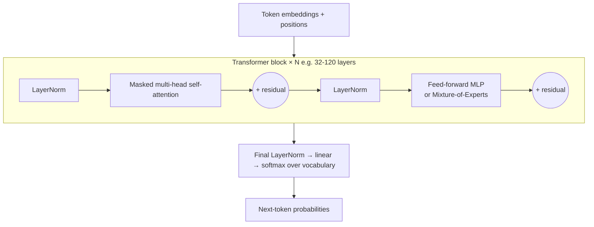
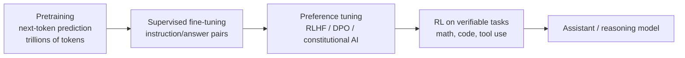

# Transformers & How LLMs Work

> [!tldr] TL;DR
> An LLM is a **transformer** trained to **predict the next token**. Text is split into **tokens**, each token becomes an **embedding** vector, and stacked layers of **self-attention** let every token gather information from earlier tokens. **Pretraining** on trillions of tokens gives broad knowledge; **fine-tuning** (SFT) and **preference training** (RLHF/DPO) turn it into a helpful assistant; **reinforcement learning on verifiable tasks** produced 2025's **reasoning models** that "think" before answering. At inference the model outputs a probability distribution and **sampling parameters** (temperature, top-p) choose the next token, one at a time, within a finite **context window**.

## The one-sentence version

Given all the tokens so far, predict a probability distribution over the next token; pick one; append it; repeat.

```text
"The capital of France is" → P(" Paris")=0.92, P(" a")=0.02, ... → " Paris"
"The capital of France is Paris" → P(".")=0.61, P(",")=0.20, ... → "."
```

Everything an LLM does (chat, code, tool calls, JSON) is this loop. Tool calls are just tokens in a special format that the application parses.

## 1. Tokens

Models don't see characters or words; they see **tokens**, chunks from a fixed vocabulary (typically 100k–250k entries) built with **byte-pair encoding (BPE)** or similar.

```text
"Tokenization isn't magic!" → ["Token", "ization", " isn", "'t", " magic", "!"]
```

- Rule of thumb for English: ~4 characters or ~0.75 words per token; other languages and code often use more tokens per word.
- **Pricing, limits and latency are all per token**, with output tokens usually more expensive than input tokens.
- Tokenisation explains classic quirks: miscounting letters in "strawberry" (the model sees tokens, not letters), trouble with arithmetic on long numbers, and odd behaviour with rare strings.

## 2. Embeddings and positions

Each token ID maps to a learned vector (an **embedding**, e.g. 4,096+ numbers). Similar tokens end up near each other. Because attention itself has no sense of order, the model adds **positional information** (modern LLMs mostly use **rotary position embeddings, RoPE**). See [[Embeddings & Semantic Search]] for embeddings used in search.

## 3. Attention: the core idea

For each token, the model asks: *which other tokens matter for understanding me?*

Each token's vector is projected into three vectors:
- **Query (Q)**: what am I looking for?
- **Key (K)**: what do I contain?
- **Value (V)**: what do I pass on if selected?

```text
Attention(Q, K, V) = softmax(Q·Kᵀ / √d) · V
```

The score `Q·K` measures relevance between every pair of tokens; softmax turns scores into weights; the output is a weighted mix of values. In *"The animal didn't cross the street because **it** was too tired"*, the token "it" puts high weight on "animal".

- **Multi-head attention** runs several attention computations in parallel, each learning a different kind of relationship (syntax, coreference, topic).
- **Causal masking**: in a decoder-only LLM, each token can only attend to **earlier** tokens, which is what makes next-token prediction possible.
- **Cost**: attention compares every token with every other, so compute grows roughly with the **square of the sequence length**. Long contexts are expensive, which drove many optimisations (FlashAttention, sparse/sliding-window attention, grouped-query attention).

### A transformer block



The **feed-forward** layers hold much of the model's "knowledge". **Mixture-of-Experts (MoE)** models replace one big feed-forward layer with many "experts" and a router that activates only a few per token, so a model can have huge total parameters but modest compute per token. Example: DeepSeek V4-Pro is reported as 1.6T total / 49B active parameters, and Mistral Large 3 as 675B total / 41B active.

### KV cache
During generation the keys and values of previous tokens are cached so each new token only computes its own. The KV cache grows with context length and is a major memory cost when serving long conversations. (It's also the mechanism behind **prompt caching**; see [[Prompt & Context Engineering]].)

## 4. How an LLM is trained



| Stage | Data | What it gives |
|---|---|---|
| **Pretraining** | huge web, book and code corpora; self-supervised | language, world knowledge, raw capability. A "base model" continues text but doesn't follow instructions well |
| **Supervised fine-tuning (SFT)** | curated prompt → ideal response pairs | instruction following, chat format, tool-call format |
| **RLHF** | humans rank outputs → train a **reward model** → optimise the LLM against it (with a KL penalty to stay close to the SFT model) | helpfulness, harmlessness, tone |
| **DPO** (2023) | the same preference pairs, optimised directly with a classification-style loss | RLHF-like results without a separate reward model or RL loop |
| **RL with verifiable rewards** | problems with checkable answers (unit tests, math) | long chains of reasoning, self-correction: **reasoning models** |

**Fine-tuning** in the application sense (adapting a model to your data, e.g. with LoRA) is covered in [[Fine-tuning vs RAG vs Prompting]].

## 5. Reasoning models

A reasoning model generates a (often hidden or summarised) chain of thought before its final answer, trading more output tokens and latency for accuracy on math, code, planning and agentic tasks.

> [!info]+ 🆕 2025–2026
> - **DeepSeek-R1** (2025-01-20, open weights, MIT licence) showed that large-scale RL can produce strong reasoning, and published how.
> - **Claude 3.7 Sonnet** (2025-02-24) introduced *hybrid* reasoning: one model with an optional extended-thinking mode and a budget you control.
> - **o3 and o4-mini** (2025-04-16), **Gemini 2.5 Pro** (2025-03-25) and **GPT-5** (2025-08-07) made thinking modes standard; by 2026 most frontier models expose a reasoning effort or thinking budget setting.
> - **DeepSeek V3.1** (2025-08-21) combined thinking and non-thinking modes in one open model.
> - **1M-token context windows** became common on frontier models (e.g. Claude Opus 4.6 in beta, 2026-02-05; DeepSeek V4, 2026-04-24).
> Full timeline: [[LLM Landscape 2025-2026]].

Practical notes:
- Give reasoning models the **goal and constraints**, not step-by-step instructions on how to think.
- Budget for the thinking tokens: they're billed as output tokens.
- Use them where accuracy matters more than latency; route simple requests to fast non-reasoning modes.

## 6. Context windows

The **context window** is the maximum number of tokens (input + output) the model can consider at once: the system prompt, conversation, documents, tool definitions and results, and the answer.

- Everything the model "knows" about your task must be in the context or in its weights. It has **no memory between API calls**; the app resends history each time.
- Bigger isn't automatically better: quality drops for information buried in the **middle** of long contexts ("Lost in the Middle", 2023) and generally degrades as context fills ("context rot"). Cost and latency grow with length.
- The model's **knowledge cutoff** means recent facts must come from retrieval or tools ([[Retrieval-Augmented Generation (RAG)]]).

## 7. Sampling parameters

After the forward pass the model has scores (**logits**) for every vocabulary token. Sampling chooses one.

| Parameter | What it does | Typical use |
|---|---|---|
| **temperature** | divides logits before softmax. <1 sharpens (more deterministic), >1 flattens (more random). 0 ≈ always pick the top token (greedy) | 0–0.3 for extraction/classification/code; 0.7–1.0 for creative writing |
| **top_p** (nucleus) | sample only from the smallest set of tokens whose probabilities add up to p | 0.9–1.0; usually tune temperature *or* top_p, not both |
| **top_k** | sample only from the k most likely tokens | some APIs only |
| **max tokens** | hard cap on output length | always set it |
| **stop sequences** | stop when this string is produced | delimiting structured output |
| **frequency / presence penalty** | discourage repeating tokens | reduce repetition (some APIs) |

```text
logits:  Paris 5.0, Lyon 3.0, Rome 1.0
T = 1.0  → softmax → Paris 0.87, Lyon 0.12, Rome 0.02
T = 0.5  → logits/0.5 = 10, 6, 2 → Paris 0.98, Lyon 0.02, Rome 0.0003
T = 2.0  → logits/2 = 2.5, 1.5, 0.5 → Paris 0.67, Lyon 0.24, Rome 0.09
```

Caveats: temperature 0 is **not guaranteed deterministic** (batching and floating-point effects on GPUs), and many reasoning models restrict or ignore sampling parameters. Check your provider's docs.

## Why LLMs hallucinate
The model is trained to produce **plausible** continuations, not to look facts up. When the answer isn't well represented in its weights or context, a fluent but wrong answer can still be the most probable one. Mitigations: ground answers in retrieved sources, allow "I don't know", ask for citations, verify with tools, and evaluate ([[LLM Evaluation & Observability]]).

## Senior perspective
- Think in **tokens**: cost = (input + output tokens) × price; latency ≈ time-to-first-token + output tokens × per-token time. Long prompts and verbose outputs are the usual cost bugs.
- **Model choice is a routing problem**: small/fast models for classification and extraction, frontier or reasoning models for hard steps. Re-evaluate on every model release with your own evals.
- **Open-weight vs API**: open weights give control, privacy and fixed costs but you own serving (GPUs, vLLM/TGI, quantisation, scaling). APIs give frontier quality with zero ops but vendor, data-residency and price risk.
- Pin **model versions** in production; "latest" aliases change behaviour under you.
- The model is **stateless**; all "memory", personalisation and knowledge freshness is your application's job.

## Interview questions

> [!question]- Explain self-attention simply.
> Each token creates a query, key and value. It compares its query with every other token's key to score relevance, turns the scores into weights with softmax, and takes a weighted sum of the values. The result is a context-aware representation of the token.

> [!question]- Why did transformers beat RNNs?
> Attention connects any two positions directly (no long-range forgetting) and processes all tokens in parallel during training, which uses GPUs efficiently and let models scale to huge data and parameter counts.

> [!question]- What's the difference between pretraining, fine-tuning and RLHF?
> Pretraining learns language and knowledge by predicting the next token on huge unlabelled corpora. Supervised fine-tuning teaches the format and instruction following from curated examples. RLHF (or DPO) aligns behaviour to human preferences using ranked outputs.

> [!question]- What does temperature do? What would you use for a JSON extraction task?
> It scales the logits before softmax: low temperature concentrates probability on the top tokens (more deterministic), high temperature spreads it out (more varied). For extraction use a low temperature (0–0.2) plus structured outputs.

> [!question]- What is a reasoning model and when would you not use one?
> A model trained (largely with RL on verifiable tasks) to produce an internal chain of thought before answering, improving hard math, code and planning. Avoid it for simple, latency-sensitive or high-volume tasks where the extra thinking tokens add cost and delay without improving quality.

> [!question]- Why does a longer context window not solve everything?
> Cost and latency grow with tokens, attention quality degrades for information in the middle and as context fills, and irrelevant context distracts the model. Retrieval and careful context curation often beat stuffing everything in.

> [!question]- What is Mixture-of-Experts?
> A transformer whose feed-forward layers are split into many experts, with a router activating only a few per token. Total parameters (knowledge capacity) can be very large while compute per token stays close to a much smaller dense model; the trade-off is memory to hold all experts and more complex serving.

## Related
- [[AI & ML Index]]
- Previous: [[Neural Networks & Deep Learning Basics]] · [[ML Core Concepts]]
- Next: [[Prompt & Context Engineering]] · [[Embeddings & Semantic Search]]
- [[Fine-tuning vs RAG vs Prompting]] · [[LLM Landscape 2025-2026]]

## Sources
- Vaswani et al. (2017), [Attention Is All You Need](https://arxiv.org/abs/1706.03762)
- Jay Alammar, [The Illustrated Transformer](https://jalammar.github.io/illustrated-transformer/)
- Ouyang et al. (2022), [Training language models to follow instructions with human feedback (InstructGPT)](https://arxiv.org/abs/2203.02155)
- Rafailov et al. (2023), [Direct Preference Optimization](https://arxiv.org/abs/2305.18290)
- Liu et al. (2023), [Lost in the Middle: How Language Models Use Long Contexts](https://arxiv.org/abs/2307.03172)
- Su et al. (2021), [RoFormer: Rotary Position Embedding](https://arxiv.org/abs/2104.09864)
- DeepSeek, [DeepSeek-R1 (2025-01-20)](https://api-docs.deepseek.com/news/news250120) · [API updates](https://api-docs.deepseek.com/updates/) · [DeepSeek V4 preview (2026-04-24)](https://api-docs.deepseek.com/news/news260424/)
- Anthropic, [Claude 3.7 Sonnet (2025-02-24)](https://www.anthropic.com/news/claude-3-7-sonnet) · [Claude Opus 4.6](https://www.anthropic.com/news/claude-opus-4-6)
- Mistral, [Mistral 3 (2025-12-02)](https://mistral.ai/news/mistral-3/)
- OpenAI, [API changelog](https://developers.openai.com/api/docs/changelog) · Google, [Gemini 2.5 (2025-03-25)](https://blog.google/technology/google-deepmind/gemini-model-thinking-updates-march-2025/)
- Andrej Karpathy, [Let's build GPT: from scratch, in code](https://www.youtube.com/watch?v=kCc8FmEb1nY)
