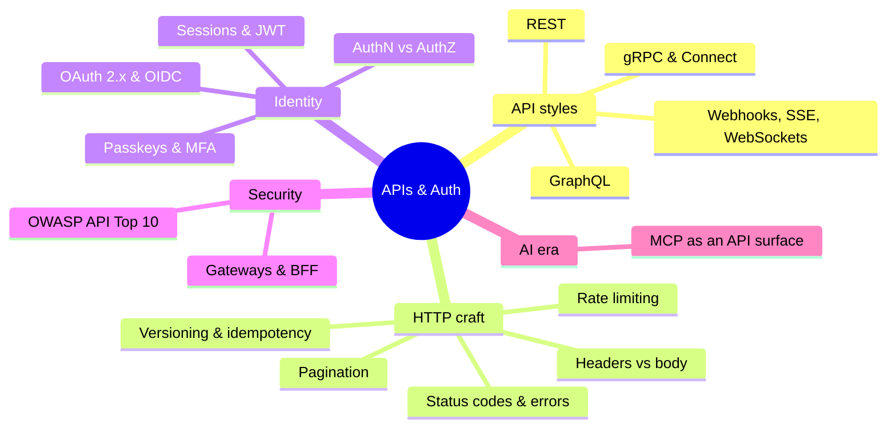

# APIs & Auth Index

> [!tldr] Start here
> Everything about designing, securing and operating APIs: REST, GraphQL and gRPC styles, HTTP semantics, versioning and idempotency, rate limiting, real-time delivery, and the whole identity stack (sessions, JWTs, OAuth/OIDC, passkeys, authorization models). Notes go beginner → senior, each with worked examples, a 🆕 2025–2026 box and interview questions. Infrastructure around APIs (Nginx, gateways, background jobs) lives in [[Backend Index]].

## 🟢 Beginner: the fundamentals
| Note | What you'll learn |
|---|---|
| [[REST API Design]] | resources, methods, status codes, pagination, Problem Details errors, OpenAPI |
| [[HTTP Headers vs Body - Where Data Belongs]] | path vs query vs headers vs body, standard and custom headers, correlation IDs |
| [[Authentication vs Authorization]] | AuthN vs AuthZ, 401 vs 403, RBAC/ABAC/ReBAC |
| [[JWT vs Cookies]] | sessions vs tokens, what a JWT really is (signed, not encrypted), refresh and revocation |
| [[GraphQL vs REST]] | when a typed query language beats resource endpoints |

## 🟡 Intermediate: building real APIs
| Note | What you'll learn |
|---|---|
| [[gRPC vs REST]] | Protobuf contracts, HTTP/2 streaming, gRPC-Web and Connect |
| [[API Versioning, Idempotency & Backward Compatibility]] | breaking changes, version strategies, Deprecation/Sunset, idempotency keys |
| [[Rate Limiting & Throttling]] | token/leaky bucket, sliding windows, Redis implementation, RateLimit headers |
| [[Webhooks, Polling, SSE & WebSockets]] | server-side real-time and event delivery, signatures, scaling connections |
| [[OAuth 2.x & OpenID Connect]] | Auth Code + PKCE, client credentials, device flow, token types, DPoP, OAuth 2.1 |
| [[Passkeys, WebAuthn & MFA]] | phishing-resistant MFA, WebAuthn ceremonies, TOTP, recovery, step-up |

## 🔴 Senior: security and architecture
| Note | What you'll learn |
|---|---|
| [[API Security]] (Security folder) | OWASP API Top 10: BOLA, mass assignment, SSRF, resource consumption, inventory |
| [[API Gateways & Reverse Proxies]] | gateway vs proxy vs mesh, BFF pattern, Gateway API, AI/MCP gateways |
| [[Background Jobs & Task Queues]] | async processing behind APIs: retries, idempotency, durable execution |

The "Senior perspective" section in every note covers production concerns (scale, failure modes, review questions).

## Suggested study paths
> [!example]- 🔁 From zero to solid API engineer
> 1. [[REST API Design]] → [[HTTP Headers vs Body - Where Data Belongs]] → [[Networking - HTTP, Caching & Real-time]] (browser side of HTTP)
> 2. [[Authentication vs Authorization]] → [[JWT vs Cookies]] → [[OAuth 2.x & OpenID Connect]] → [[Passkeys, WebAuthn & MFA]]
> 3. [[API Versioning, Idempotency & Backward Compatibility]] → [[Rate Limiting & Throttling]] → [[Webhooks, Polling, SSE & WebSockets]]
> 4. [[GraphQL vs REST]] → [[gRPC vs REST]]
> 5. [[API Security]] → [[API Gateways & Reverse Proxies]] → [[Background Jobs & Task Queues]]

> [!example]- 🔐 Auth deep dive
> [[Authentication vs Authorization]] → [[JWT vs Cookies]] → [[OAuth 2.x & OpenID Connect]] → [[Passkeys, WebAuthn & MFA]] → [[API Security]] → frontend side: [[Authentication & Token Storage]] and [[Frontend Security - XSS, CSRF, CSP & Trusted Types]]

> [!example]- 🎯 One week before an interview
> Day 1 [[REST API Design]] · Day 2 [[JWT vs Cookies]] + [[OAuth 2.x & OpenID Connect]] · Day 3 [[Rate Limiting & Throttling]] (implement a token bucket) · Day 4 [[API Versioning, Idempotency & Backward Compatibility]] · Day 5 [[GraphQL vs REST]] + [[gRPC vs REST]] · Day 6 [[Webhooks, Polling, SSE & WebSockets]] · Day 7 [[API Security]]. Answer every "Interview questions" callout out loud.

## 🆕 2025–2026 in this area
- **2025-01** RFC 9700 OAuth 2.0 Security BCP → [[OAuth 2.x & OpenID Connect]]
- **2025-03** RFC 9745 `Deprecation` header → [[API Versioning, Idempotency & Backward Compatibility]]
- **2025-04** RFC 9728 Protected Resource Metadata → [[OAuth 2.x & OpenID Connect]]
- **2025-07/08** NIST SP 800-63B-4: synced passkeys at AAL2, new password rules → [[Passkeys, WebAuthn & MFA]]
- **2025-09-08** GraphQL spec, September 2025 edition (OneOf inputs, schema coordinates) → [[GraphQL vs REST]]
- **2025-09** OpenAPI 3.2 (streaming, QUERY/any method, structured tags, device flow) → [[REST API Design]]
- **2025-10** `Idempotency-Key` header draft -07 (still a draft) → [[API Versioning, Idempotency & Backward Compatibility]]
- **2025-10-14** FIDO Passkey Index launched → [[Passkeys, WebAuthn & MFA]]
- **2026-03-02** OAuth 2.1 draft -15 (still not an RFC) → [[OAuth 2.x & OpenID Connect]]
- **2026-05-23** RateLimit headers draft -11 (still a draft) → [[Rate Limiting & Throttling]]
- **2026-06** RFC 10008 HTTP `QUERY` method → [[REST API Design]] · [[HTTP Headers vs Body - Where Data Belongs]]
- **2026-07-28** MCP spec: stateless core, routing headers, OAuth hardening, legacy HTTP+SSE deprecated → [[OAuth 2.x & OpenID Connect]] · [[Webhooks, Polling, SSE & WebSockets]]
- **2026-08** RFC 10017 OAuth for Browser-Based Apps (BFF recommended) → [[JWT vs Cookies]] · [[API Gateways & Reverse Proxies]]
- **2026-08-25** WebAuthn Level 3 becomes a W3C Recommendation → [[Passkeys, WebAuthn & MFA]]
- **2026-09-01** Kong AI Gateway 2.0 GA (MCP bundling and ACLs) → [[API Gateways & Reverse Proxies]]

## 🤖 MCP: APIs for AI agents
The Model Context Protocol turns APIs into **tools** that AI agents call. For API teams this means: good OpenAPI/GraphQL descriptions become tool descriptions; OAuth (RFC 9728 metadata, PKCE, issuer validation) secures agent access; gateways route and meter tool calls; and model-generated arguments are untrusted input. Protocol details: [[AI in Frontend - MCP, WebMCP & Built-in AI]].

## Related
- [[Software Engineering]], the vault root
- [[Backend Index]] (Nginx, gateways, jobs, Node.js, Java & Spring)
- Frontend counterparts: [[Networking - HTTP, Caching & Real-time]] · [[Authentication & Token Storage]] · [[Frontend Security - XSS, CSRF, CSP & Trusted Types]] · [[Frontend System Design Index]]
