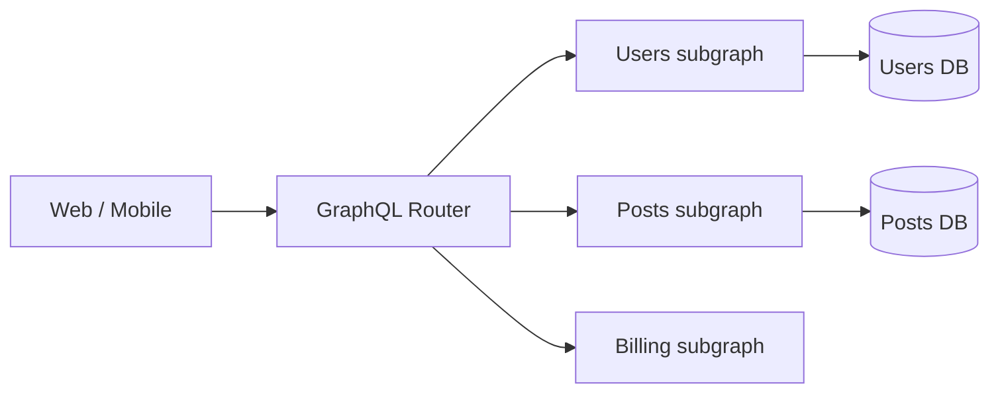

# GraphQL vs REST

> [!tldr] TL;DR
> **REST** is an architectural style: many resource URLs, HTTP methods and status codes, and free HTTP caching. **GraphQL** is a typed query language and runtime: one endpoint, a schema, and clients ask for exactly the fields they need. GraphQL wins when many clients need different shapes of deeply related data; REST wins for simple CRUD, public APIs, caching and file-heavy workloads. They coexist happily, and GraphQL is **not** a database technology.

## What is REST

REST (Representational State Transfer) is a **software architectural style** defined by Roy Fielding (2000). An API that follows its constraints is "RESTful":

1. **Client-server**: user-interface concerns are separated from data storage concerns, which improves portability of the UI across platforms.
2. **Stateless**: every request carries all the information needed to process it; the server does not keep per-client conversation state between requests (auth travels with each request as a token or cookie).
3. **Cacheable**: responses must label themselves cacheable or not, so clients and intermediaries can reuse them safely.
4. **Layered system**: proxies, gateways and load balancers can sit between client and server without the client knowing whether it talks to the end server.
5. **Uniform interface**: resources are identified in requests (URIs), manipulated through representations, messages are self-descriptive, and hypermedia drives state (HATEOAS).
6. **Code on demand** (optional): the server can send executable code (e.g. JavaScript).

Design details (URLs, status codes, pagination, errors): [[REST API Design]].

## What is GraphQL

GraphQL is a **query language for APIs** and a server runtime, open-sourced by Facebook in 2015 and now governed by the GraphQL Foundation (Linux Foundation). Clients declare exactly the data they need; the server validates the query against a typed **schema** and resolves each field.

What it is **not**:
- **Not a database technology.** It is not an alternative to SQL or an ORM. Resolvers can fetch from SQL, REST, gRPC, anything.
- **Not a REST replacement**, but an alternative. Both can live in the same project (e.g. REST for webhooks and file uploads, GraphQL for the product UI).
- Not tied to HTTP: a GraphQL server can work over other protocols like WebSockets (subscriptions) or lower-level transports. In practice it is almost always HTTP POST.

GraphQL solves **over-fetching** (getting fields you don't need) and **under-fetching** (needing N round trips to assemble one screen).

### Worked example: same screen, two APIs

Screen: a user's name plus titles of their last 3 posts with comment counts.

REST (3+ requests, extra fields):
```http
GET /users/7                  → {id, name, email, address, ...}
GET /users/7/posts?limit=3    → [{id, title, body, ...}, ...]
GET /posts/101/comments/count  (× 3)
```

GraphQL (1 request, exact shape):
```graphql
query UserCard($id: ID!) {
  user(id: $id) {
    name
    posts(first: 3) {
      title
      commentCount
    }
  }
}
```

Schema and resolvers (JavaScript, Apollo/GraphQL Yoga style):
```graphql
type User { id: ID!  name: String!  posts(first: Int = 10): [Post!]! }
type Post { id: ID!  title: String!  commentCount: Int! }
type Query { user(id: ID!): User }
type Mutation { createPost(input: CreatePostInput!): Post! }
```

```js
const resolvers = {
  Query:  { user: (_, { id }, ctx) => ctx.db.user.find(id) },
  User:   { posts: (user, { first }, ctx) => ctx.db.post.byUser(user.id, first) },
  Post:   { commentCount: (post, _, ctx) => ctx.loaders.commentCount.load(post.id) },
};
```

### The N+1 problem and DataLoader

Naively, `commentCount` runs one SQL query per post. **DataLoader** batches all `.load(id)` calls in the same tick into one query:

```js
const commentCount = new DataLoader(async (postIds) => {
  const rows = await db.query(
    'SELECT post_id, count(*) c FROM comments WHERE post_id = ANY($1) GROUP BY post_id', [postIds]);
  const map = new Map(rows.map(r => [r.post_id, Number(r.c)]));
  return postIds.map(id => map.get(id) ?? 0);   // same order as input
});
```
Create loaders **per request** (so caches don't leak between users).

## Comparison

| Aspect | GraphQL | REST |
| --- | --- | --- |
| Endpoints | Usually a single endpoint (`/graphql`) | Many resource endpoints |
| Organised by | A typed schema | Resources and URLs |
| Who shapes the response | The **client** selects fields (client-driven) | The **server** decides the representation (server-driven) |
| Typing | Strongly typed schema, introspection | Untyped by default; typed when described with OpenAPI/JSON Schema |
| Machine-readable contract | Built in (introspection, SDL) | Optional (OpenAPI) |
| Identity | Separated from how you fetch it (global IDs, fields) | The URL you call is the identity of the resource |
| Over/under-fetching | Solved by design | Common; mitigated with sparse fieldsets, BFFs, `include=` |
| HTTP caching | Hard (POST to one URL); needs persisted queries + GET or client caches (Apollo, Relay) | Native: `Cache-Control`, `ETag`, CDNs |
| Errors | `200 OK` with an `errors` array is common; partial success possible | HTTP status codes + Problem Details (RFC 9457) |
| Versioning | Evolve the schema, `@deprecated` fields | URL/header versioning |
| Real-time | Subscriptions (WebSocket/SSE) | Webhooks, SSE, WebSockets separately |
| File upload | Awkward (multipart spec is a community extension) | Natural |
| Rate limiting | Needs query cost/complexity analysis | Per endpoint, simple |
| Learning curve | Steeper for server teams (resolvers, N+1, security) | Moderate |
| Community | Large and growing | Largest; universal tooling |

The old claim "GraphQL mutations must be strings" is inaccurate: queries are text, but variables are JSON, and mutation inputs are typed input objects.

## Scaling GraphQL: federation

Large orgs split one graph across teams:
- **Apollo Federation** / the open **GraphQL Composite Schemas** work: each team owns a **subgraph**; a **router/gateway** composes them into a supergraph and plans queries across services.
- Alternatives: schema stitching, a single "BFF" GraphQL layer over REST/gRPC microservices.



## Security checklist for GraphQL

- **Depth and complexity limits**, or query cost analysis (a nested `friends { friends { friends … } }` query can take down a server).
- **Persisted / trusted documents**: in production, only accept queries registered at build time (by hash). Blocks arbitrary queries, enables GET + CDN caching.
- **Disable introspection** in production for private APIs (not a security boundary, but reduces reconnaissance).
- **Field-level authorization** in resolvers (or via directives), not just at the endpoint.
- **Batching attacks**: limit aliases and batched operations (brute-forcing login via 1,000 aliased mutations in one request).

> [!info]+ 🆕 2025–2026
> - **2025-09-08:** the **September 2025 edition of the GraphQL specification** was published, the first new edition since October 2021. It adds **OneOf input objects** (`@oneOf`, exactly one field must be set), **schema coordinates** (canonical addresses like `User.name`), **descriptions on executable documents** (operations can carry docs, useful for tooling and LLM/MCP tools), full Unicode support, and clarifications on deprecation and execution.
> - GraphQL APIs are increasingly exposed to AI agents as **MCP tools** (persisted operations with descriptions become tool definitions). See [[AI in Frontend - MCP, WebMCP & Built-in AI]].

```graphql
# OneOf input (Sept 2025 spec): exactly one of these must be provided
input UserBy @oneOf { id: ID  email: String  username: String }
type Query { user(by: UserBy!): User }
```

## When to choose which

| Choose GraphQL when… | Choose REST when… |
|---|---|
| Many clients (web, iOS, Android, partners) need different shapes of the same data | CRUD over clear resources |
| Screens aggregate data from several services | Public API for third parties (simpler, cacheable, familiar) |
| Product iterates fast and the frontend team should not wait for new endpoints | Heavy use of HTTP caching / CDN |
| You want a typed contract and codegen end to end | File upload/download, streaming large payloads |
| | Simple service-to-service calls (or use [[gRPC vs REST|gRPC]]) |

## Senior perspective

- GraphQL moves complexity from the client to the server: performance (N+1, DataLoader), security (cost limits), caching and observability (one URL, so you trace per operation name, not per endpoint).
- **Monitor by operation name**; require named operations.
- **Schema governance**: a schema registry, breaking-change checks in CI (schema coordinates help), `@deprecated` with usage tracking before removal.
- GraphQL is often best as a **BFF/aggregation layer** in front of REST/gRPC services, not as the protocol between microservices.
- Review questions: *What is the max query cost? Are persisted queries enforced? How do we cache? Which team owns which types?*

## Interview questions

> [!question]- What problems does GraphQL solve compared to REST?
> Over-fetching and under-fetching: clients request exactly the fields they need in one round trip, across related entities. It also gives a strongly typed, introspectable schema that enables codegen and tooling, and lets the API evolve by adding fields and deprecating old ones without URL versions.

> [!question]- What is the N+1 problem in GraphQL and how do you fix it?
> A list resolver returns N items and a field resolver then runs one query per item, giving N+1 queries. Fix with DataLoader-style batching and per-request caching, or by resolving joins in the parent resolver / using a query planner.

> [!question]- Why is caching harder in GraphQL?
> Most requests are POSTs to one URL, so HTTP caches and CDNs can't key them. Solutions: persisted queries sent via GET with a hash, response caching at the gateway by operation + variables, and normalised client caches (Apollo, Relay, urql) keyed by type + id.

> [!question]- How do you protect a GraphQL API from abusive queries?
> Depth and complexity/cost limits, timeouts, pagination limits, alias and batch limits, persisted/trusted documents, rate limiting by cost rather than by request, and field-level authorization.

> [!question]- How does error handling differ?
> REST uses HTTP status codes per request. GraphQL typically returns 200 with a `data` object and an `errors` array, allowing partial success; many teams model expected business errors as union result types (`CreateUserResult = User | EmailTaken`).

> [!question]- What changed in the September 2025 GraphQL spec?
> First edition since 2021: OneOf input objects, schema coordinates, descriptions on operations and fragments, full Unicode support, and clarifications on deprecation and execution semantics.

## Related
- [[APIs & Auth Index]] · [[Backend Index]]
- [[REST API Design]] · [[gRPC vs REST]] · [[API Versioning, Idempotency & Backward Compatibility]] · [[Rate Limiting & Throttling]] · [[API Gateways & Reverse Proxies]]
- Frontend: [[Networking - HTTP, Caching & Real-time]] · [[Server State - TanStack Query & RTK Query]] · [[Frontend System Design Index]] · [[AI in Frontend - MCP, WebMCP & Built-in AI]]
- Other domains: [[System Design Index]] · [[API Security]]

## Sources
- [GraphQL specification, September 2025 edition](https://spec.graphql.org/September2025/)
- [GraphQL blog: Announcing the September 2025 Edition (2025-09-08)](https://graphql.org/blog/2025-09-08-september-edition/)
- [graphql.org: Learn](https://graphql.org/learn/) · [Security](https://graphql.org/learn/security/)
- [Roy Fielding: Architectural Styles and the Design of Network-based Software Architectures (2000), ch. 5](https://ics.uci.edu/~fielding/pubs/dissertation/rest_arch_style.htm)
- [DataLoader (GitHub)](https://github.com/graphql/dataloader)
- [Apollo Federation docs](https://www.apollographql.com/docs/graphos/schema-design/federated-schemas/federation)
- [OWASP GraphQL Cheat Sheet](https://cheatsheetseries.owasp.org/cheatsheets/GraphQL_Cheat_Sheet.html)
