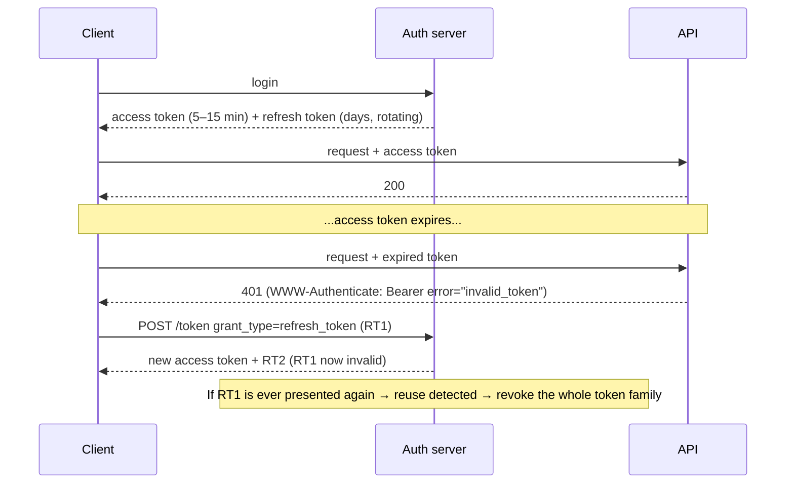

# JWT vs Cookies

<Note>
**TL;DR**

The real comparison is **server-side sessions vs self-contained tokens**; cookies and headers are just **transports**. A session is an opaque random ID pointing to state on the server (easy to revoke). A **JWT is signed, not encrypted** (JWS): anyone can base64-decode and read its claims; the signature only proves it wasn't tampered with. JWE is the encrypted variant. Use short-lived access tokens plus rotating refresh tokens, store them in `HttpOnly` cookies or behind a BFF, and plan revocation from day one.
</Note>

## Two approaches to session management

HTTP is stateless, so after login the server needs a way to recognise the next request. There are primarily two approaches:

- **Session (stateful) approach**: usually carried in a cookie.
- **Token (stateless) approach**: usually a JWT, carried in the `Authorization` header or a cookie.

<Note>
**Cookie ≠ session and JWT ≠ header**

A cookie is a *storage and transport mechanism*; it can hold a session ID **or** a JWT. A JWT is a *token format*; it can travel in a header **or** a cookie. The frontend storage trade-offs are in [Authentication & Token Storage](/Software%20Engineering/Frontend/11%20Security/Authentication%20%26%20Token%20Storage) and [Browser Storage - Cookies, Web Storage & IndexedDB](/Software%20Engineering/Frontend/03%20Browser%20%26%20Web%20Platform/Browser%20Storage%20-%20Cookies%2C%20Web%20Storage%20%26%20IndexedDB).
</Note>

### Session cookie approach

```text
1. User logs in. Server generates a random, unguessable sessionId
   (≥128 bits of entropy; optionally signed/HMAC'd with a secret key), and
   (a) saves sessionId → {userId, roles, createdAt, ...} in a session store (Redis/DB), and
   (b) sends Set-Cookie: sid=<sessionId>; HttpOnly; Secure; SameSite=Lax; Path=/
2. The browser stores the cookie in its cookie jar.
3. The browser automatically sends the cookie on every subsequent request to that site.
4. Server looks up sessionId in the store on each request → gets the user.
Logout / revoke = delete the row. Done.
```

### JWT approach

```text
1. User logs in. Server creates an accessToken containing claims such as
   sub (userId), exp (expiry), iat, iss, aud, and SIGNS it (HMAC with a
   secret, or RSA/ECDSA/EdDSA with a private key). It does NOT encrypt it.
2. The client stores the token (ideally an HttpOnly cookie, or memory).
3. The token is sent on every request (Authorization: Bearer <token> or cookie).
4. Any server with the secret/public key verifies the signature and exp
   locally, with no database lookup.
```

<Warning>
**Correction: JWTs are signed, not encrypted**

The original version of this note said the server "encrypts" the userId into the token. That is the most common JWT misconception. A standard JWT is a **JWS** (JSON Web Signature): `base64url(header).base64url(payload).signature`. The payload is **readable by anyone** who has the token (paste it into jwt.io). The signature guarantees **integrity and authenticity**, not confidentiality. If claims must be secret, use **JWE** (JSON Web Encryption, RFC 7516), or better, don't put secrets in tokens at all.
</Warning>

## Anatomy of a JWT

```text
eyJhbGciOiJFUzI1NiIsInR5cCI6ImF0K2p3dCIsImtpZCI6IjIwMjYtMDkifQ   ← header
.eyJpc3MiOiJodHRwczovL2F1dGguZXhhbXBsZS5jb20iLCJzdWIiOiI3Iiwi...  ← payload (claims)
.MEUCIQDx...                                                      ← signature
```

```json
// header
{ "alg": "ES256", "typ": "at+jwt", "kid": "2026-09" }
// payload
{ "iss": "https://auth.example.com", "sub": "7", "aud": "api.example.com",
  "exp": 1790000900, "iat": 1790000000, "jti": "a1b2c3", "scope": "orders:read" }
```

| Claim | Meaning | Always validate? |
|---|---|---|
| `iss` | issuer | yes, exact match |
| `aud` | intended audience (your API) | yes, prevents token reuse across services |
| `exp` / `nbf` | expiry / not before | yes, with small clock skew |
| `sub` | subject (user ID) | used for identity |
| `jti` | unique token ID | needed for denylists / replay detection |
| `kid` (header) | which key signed it | used to pick the key from JWKS |

### Verifying correctly (Node, `jose`)

```ts
import { createRemoteJWKSet, jwtVerify } from 'jose';

const JWKS = createRemoteJWKSet(new URL('https://auth.example.com/.well-known/jwks.json'));

export async function verifyAccessToken(token: string) {
  const { payload } = await jwtVerify(token, JWKS, {
    issuer: 'https://auth.example.com',
    audience: 'api.example.com',
    algorithms: ['ES256'],       // pin algorithms: never accept "none" or alg switching
    typ: 'at+jwt',               // explicit typing (RFC 9068 / RFC 8725 guidance)
    clockTolerance: '30s',
  });
  return payload;
}
```

Classic JWT vulnerabilities (all avoided by the code above): `alg: none`, **algorithm confusion** (RS256 public key used as an HS256 secret), not checking `aud`/`iss`, weak HMAC secrets brute-forced offline, trusting `jku`/`x5u` headers that point to attacker keys.

## Sessions vs JWTs

| | Server-side session (opaque ID) | Self-contained JWT |
|---|---|---|
| State | on the server (Redis/DB) | in the token |
| Lookup per request | yes (fast with Redis) | no, just signature check |
| Revocation | instant: delete the session | hard: valid until `exp` unless you add a denylist |
| Size | ~32 bytes | often 500 B – 2 KB+ (sent on every request) |
| Readable by client | no | yes (base64) unless JWE |
| Cross-service / cross-domain | needs shared store or gateway | any service with the public key can verify |
| Permission changes | take effect immediately | take effect at next token refresh |
| Best for | classic web apps, same-site SPAs, anything needing instant logout | service-to-service, third-party APIs, OAuth access tokens, multi-region edges |

A common production answer is **both**: a session cookie between browser and your backend (or BFF), and short-lived JWT access tokens between backend and APIs.

## Refresh tokens

Short-lived access tokens limit damage if stolen, but users should not log in every 10 minutes.



- **Refresh token rotation**: each use returns a new refresh token and invalidates the old one. If an old one is reused, someone stole it; revoke the whole family (session).
- Refresh tokens are **stateful by design**: store them (hashed) server-side so you can revoke them.
- OAuth 2.1 requires refresh tokens for public clients to be **rotated or sender-constrained** (DPoP/mTLS). See [OAuth 2.x & OpenID Connect](/Software%20Engineering/APIs%20%26%20Auth/OAuth%202.x%20%26%20OpenID%20Connect).
- Absolute lifetime (e.g. 30 days) + idle timeout (e.g. 7 days without use).

## Revocation strategies for JWTs

| Strategy | How | Cost |
|---|---|---|
| Short expiry | 5–15 min access tokens | revocation delay = token lifetime |
| Denylist by `jti` | store revoked `jti` until its `exp` in Redis | a lookup per request (still cheaper than full session) |
| Token version / `sid` | keep `user.tokenVersion` or session ID in claims; bump on logout-everywhere / password change | a lookup (cacheable) |
| Introspection | resource server calls `/introspect` (RFC 7662) for opaque tokens | network hop; cache briefly |
| Key rotation | rotate signing key (`kid`) | nukes **all** tokens; emergency only |

## Storage and transport (backend view)

```http
Set-Cookie: __Host-sid=V2kx...; Path=/; Secure; HttpOnly; SameSite=Lax; Max-Age=1209600
```

- `HttpOnly`: JavaScript can't read it (limits XSS token theft). `Secure`: HTTPS only. `SameSite=Lax/Strict`: mitigates CSRF. The `__Host-` prefix forces `Secure`, `Path=/` and no `Domain`, so subdomains can't overwrite it.
- Cookies bring **CSRF** risk; use `SameSite`, CSRF tokens for unsafe methods, and check `Origin`. Bearer tokens in headers bring **XSS** theft risk if stored in `localStorage`. Details: [Frontend Security - XSS, CSRF, CSP & Trusted Types](/Software%20Engineering/Frontend/11%20Security/Frontend%20Security%20-%20XSS%2C%20CSRF%2C%20CSP%20%26%20Trusted%20Types).
- For SPAs the current recommendation (RFC 10017, Aug 2026) is a **BFF**: the backend holds OAuth tokens and gives the browser only an `HttpOnly` session cookie. See [API Gateways & Reverse Proxies](/Software%20Engineering/Backend/API%20Gateways%20%26%20Reverse%20Proxies).

## Session management checklist

- Regenerate the session ID on login and privilege change (prevents **session fixation**).
- Idle timeout + absolute timeout; re-authenticate for sensitive actions (step-up, see [Passkeys, WebAuthn & MFA](/Software%20Engineering/APIs%20%26%20Auth/Passkeys%2C%20WebAuthn%20%26%20MFA)).
- "Log out everywhere": delete all sessions / bump token version / revoke refresh-token families.
- Show users their active sessions (device, IP, last seen).
- Bind sessions to signals carefully (IP changes on mobile are normal; device-bound credentials are better).

<Info>
**🆕 2025–2026**

- **2025-01:** RFC 9700 (OAuth 2.0 Security BCP) recommends sender-constrained tokens and refresh-token rotation for public clients.
- **2025-10 / 2025-11:** `draft-ietf-oauth-rfc8725bis` (JWT BCP update) progresses in the OAuth WG, adding guidance such as **explicit typing** (`typ`, e.g. `at+jwt`) for every new JWT use (still a draft).
- **2026-08:** RFC 10017 (OAuth 2.0 for Browser-Based Applications, BCP 212) recommends the **BFF** pattern for business/sensitive SPAs, keeping tokens out of JavaScript.
- Chrome's **Device Bound Session Credentials (DBSC)** binds session cookies to a device-held key so stolen cookies stop working elsewhere. Chrome's docs list it under "shipped to the web platform" (exact version/date unverified; check chromestatus.com). Other browsers' support is not guaranteed, so treat it as defence in depth.
</Info>

## Pitfalls

<Warning>
**Common mistakes**

- Believing JWT payloads are secret. They are not; never put PII or secrets in them.
- Long-lived JWTs (days) with no revocation path.
- Storing permissions in the JWT and expecting role removal to apply instantly.
- Accepting any `alg`, skipping `aud`/`iss` checks, or using a short HMAC secret.
- Using JWTs as a session store "because stateless", then adding a DB lookup per request anyway, getting the downsides of both.
- Not rotating refresh tokens, or storing them in plain text.
</Warning>

## Senior perspective

- Ask *"what's our revocation story?"* before choosing JWTs. If the answer is "wait 1 hour", is that acceptable for a fired employee or a stolen laptop?
- Prefer asymmetric signing (ES256/EdDSA) with a JWKS endpoint and `kid`-based rotation, so resource servers never hold signing secrets.
- Keep tokens small (header limits, bandwidth on every request); fetch rich permissions server-side.
- Sessions scale fine: a Redis lookup is ~sub-millisecond. "Stateless for scale" is rarely the real bottleneck.
- Observability: log `sid`/`jti`, never the token.

## Interview questions

<Accordion title="Is a JWT encrypted?">
No. A normal JWT is a JWS: base64url-encoded header and payload plus a signature. Anyone can read the claims; the signature only proves integrity and who issued it. JWE (RFC 7516) is the encrypted form, used when claims must be confidential.
</Accordion>

<Accordion title="Sessions or JWTs: how do you choose?">
Sessions (opaque IDs + server store) give instant revocation, small cookies and simple security; ideal for first-party web apps. JWTs let many services verify identity without a shared store, suit cross-domain and service-to-service use, but make revocation and permission changes harder. Many systems use a session cookie at the edge/BFF and short-lived JWTs internally.
</Accordion>

<Accordion title="How do you revoke a JWT?">
Keep access tokens short-lived, and add a server-side check when needed: a `jti` denylist until expiry, a per-user token version or session ID claim checked against a cache, or opaque tokens with introspection. Revoke refresh tokens in the store. Rotating signing keys revokes everything and is an emergency measure.
</Accordion>

<Accordion title="What is refresh token rotation and reuse detection?">
Each refresh returns a new refresh token and invalidates the old one. If an already-used refresh token is presented again, the server assumes theft and revokes the whole token family, forcing re-login.
</Accordion>

<Accordion title="Where should a browser app store tokens?">
Best: don't; use a BFF so the browser only holds an HttpOnly, Secure, SameSite session cookie. Otherwise keep access tokens in memory and refresh tokens in HttpOnly cookies. Avoid localStorage for long-lived tokens because any XSS can read it.
</Accordion>

<Accordion title="Name common JWT validation bugs.">
Accepting `alg: none`; algorithm confusion between RS256 and HS256; not validating `aud`, `iss`, `exp`; weak HMAC secrets; trusting key URLs from the token header; not pinning the expected `typ`.
</Accordion>

## Related
- [APIs & Auth Index](/Software%20Engineering/APIs%20%26%20Auth/APIs%20%26%20Auth%20Index) · [Backend Index](/Software%20Engineering/Backend/Backend%20Index)
- [Authentication vs Authorization](/Software%20Engineering/APIs%20%26%20Auth/Authentication%20vs%20Authorization) · [OAuth 2.x & OpenID Connect](/Software%20Engineering/APIs%20%26%20Auth/OAuth%202.x%20%26%20OpenID%20Connect) · [Passkeys, WebAuthn & MFA](/Software%20Engineering/APIs%20%26%20Auth/Passkeys%2C%20WebAuthn%20%26%20MFA) · [API Security](/Software%20Engineering/Security/API%20Security) · [API Gateways & Reverse Proxies](/Software%20Engineering/Backend/API%20Gateways%20%26%20Reverse%20Proxies)
- Frontend: [Authentication & Token Storage](/Software%20Engineering/Frontend/11%20Security/Authentication%20%26%20Token%20Storage) · [Browser Storage - Cookies, Web Storage & IndexedDB](/Software%20Engineering/Frontend/03%20Browser%20%26%20Web%20Platform/Browser%20Storage%20-%20Cookies%2C%20Web%20Storage%20%26%20IndexedDB) · [Frontend Security - XSS, CSRF, CSP & Trusted Types](/Software%20Engineering/Frontend/11%20Security/Frontend%20Security%20-%20XSS%2C%20CSRF%2C%20CSP%20%26%20Trusted%20Types)
- Other domains: [Security Index](/Software%20Engineering/Security/Security%20Index) · [Backend Security Essentials](/Software%20Engineering/Security/Backend%20Security%20Essentials) · [Secrets Management](/Software%20Engineering/Security/Secrets%20Management)

## Sources
- [RFC 7519: JSON Web Token](https://www.rfc-editor.org/rfc/rfc7519.html) · [RFC 7515: JWS](https://www.rfc-editor.org/rfc/rfc7515.html) · [RFC 7516: JWE](https://www.rfc-editor.org/rfc/rfc7516.html)
- [RFC 8725: JWT Best Current Practices](https://www.rfc-editor.org/rfc/rfc8725.html) · [draft-ietf-oauth-rfc8725bis](https://datatracker.ietf.org/doc/draft-ietf-oauth-rfc8725bis/)
- [RFC 9068: JWT Profile for OAuth 2.0 Access Tokens](https://www.rfc-editor.org/rfc/rfc9068.html) · [RFC 7662: Token Introspection](https://www.rfc-editor.org/rfc/rfc7662.html)
- [RFC 9700: OAuth 2.0 Security BCP (Jan 2025)](https://www.rfc-editor.org/info/rfc9700/)
- [RFC 10017: OAuth 2.0 for Browser-Based Applications (Aug 2026)](https://datatracker.ietf.org/doc/html/rfc10017)
- [OWASP Session Management Cheat Sheet](https://cheatsheetseries.owasp.org/cheatsheets/Session_Management_Cheat_Sheet.html) · [OWASP JWT Cheat Sheet](https://cheatsheetseries.owasp.org/cheatsheets/JSON_Web_Token_for_Java_Cheat_Sheet.html)
- [MDN: Set-Cookie](https://developer.mozilla.org/en-US/docs/Web/HTTP/Headers/Set-Cookie)
- [jose (panva) library](https://github.com/panva/jose)
- [Chrome for Developers: Device Bound Session Credentials](https://developer.chrome.com/docs/web-platform/device-bound-session-credentials)
