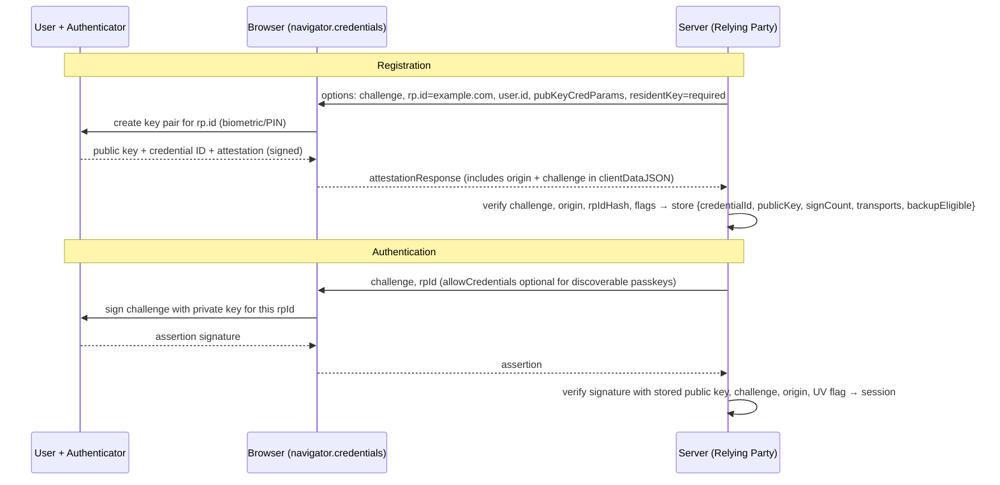

# Passkeys, WebAuthn & MFA

<Note>
**TL;DR**

**MFA** combines factors from different categories (something you know, have, are). Not all MFA is equal: **SMS and TOTP codes can be phished**; **passkeys** (FIDO2/WebAuthn public-key credentials) cannot, because the browser binds every signature to the real website's origin. A passkey stores a **private key** on the user's device or password manager; the server stores only the **public key**, so a database leak exposes nothing reusable. In 2025–2026 passkeys went mainstream: NIST SP 800-63B-4 (July 2025) recognises synced passkeys at AAL2, and **WebAuthn Level 3 became a W3C Recommendation on 2026-08-25**.
</Note>

## Factors and how strong they are

| Method | Factor | Phishing-resistant | Main risks |
|---|---|---|---|
| Password | know | ❌ | reuse, stuffing, phishing |
| SMS / voice OTP | have (phone number) | ❌ | SIM swap, SS7 interception, real-time phishing proxies |
| Email magic link / OTP | have (inbox) | ❌ | inbox compromise |
| TOTP app (RFC 6238) | have | ❌ | real-time phishing (attacker relays the code) |
| Push approval | have | ❌ (mostly) | **MFA fatigue** / push bombing; mitigated by number matching |
| **Passkey / security key (WebAuthn)** | have (+ biometric/PIN = know/are) | ✅ | account recovery flows become the weak link |
| Smart card / PIV, client certs | have | ✅ | deployment cost |

A passkey with user verification (Face ID, fingerprint, device PIN) is **multi-factor in a single gesture**: possession of the device + biometric/PIN, which never leaves the device.

## How WebAuthn works

Two ceremonies, both challenge-response with public-key crypto:



**Why it's phishing-proof**: the browser puts the real **origin** into `clientDataJSON`, and keys are scoped to the `rp.id` domain. A look-alike site `examp1e.com` simply can't get a signature for `example.com`, and there's no code for the user to type into the wrong site.

### Server side with SimpleWebAuthn (Node)

```ts
import { generateRegistrationOptions, verifyRegistrationResponse,
         generateAuthenticationOptions, verifyAuthenticationResponse } from '@simplewebauthn/server';

const rpID = 'example.com', origin = 'https://example.com';

// 1. Registration options
app.post('/passkeys/register/options', async (req, res) => {
  const opts = await generateRegistrationOptions({
    rpName: 'Example', rpID, userName: req.user.email,
    userID: new TextEncoder().encode(req.user.webauthnId),     // random, not the email
    excludeCredentials: (await creds.forUser(req.user.id)).map(c => ({ id: c.id })),
    authenticatorSelection: { residentKey: 'required', userVerification: 'preferred' },
  });
  req.session.challenge = opts.challenge;
  res.json(opts);
});

// 2. Verify registration
app.post('/passkeys/register/verify', async (req, res) => {
  const v = await verifyRegistrationResponse({
    response: req.body, expectedChallenge: req.session.challenge,
    expectedOrigin: origin, expectedRPID: rpID,
  });
  if (!v.verified) return res.sendStatus(400);
  const { credential, credentialBackedUp, credentialDeviceType } = v.registrationInfo!;
  await creds.save({ userId: req.user.id, id: credential.id, publicKey: credential.publicKey,
                     counter: credential.counter, transports: credential.transports,
                     backedUp: credentialBackedUp, deviceType: credentialDeviceType });
  res.sendStatus(201);
});

// 3/4. Authentication: generateAuthenticationOptions({ rpID }) → verifyAuthenticationResponse(...)
//      look up the credential by id, verify, update counter, then create the session (regenerate session id!)
```

Browser side it's `navigator.credentials.create()` / `.get()`; with **conditional mediation** (`mediation: 'conditional'` + `autocomplete="username webauthn"`) passkeys appear in the username field's autofill. Frontend details: [Authentication & Token Storage](/Software%20Engineering/Frontend/11%20Security/Authentication%20%26%20Token%20Storage).

### Synced vs device-bound passkeys

| | Synced passkey | Device-bound (security key, some enterprise) |
|---|---|---|
| Where | iCloud Keychain, Google Password Manager, 1Password, Bitwarden… | hardware (YubiKey), TPM |
| Survives lost phone | ✅ | ❌ (register a backup key) |
| Exportable | yes (by the provider) | no |
| NIST SP 800-63B-4 | AAL2 | AAL3-capable |
| WebAuthn flags | BE=1 (backup eligible), BS (backed up) | BE=0 |

**Attestation** proves the authenticator model (AAGUID); consumer sites usually use `attestation: 'none'`; regulated enterprises may require specific hardware.

## TOTP (still common as a second factor)

```ts
// RFC 6238: HMAC-SHA1 over floor(unixTime / 30), dynamic truncation to 6 digits
import crypto from 'node:crypto';
function totp(secret: Buffer, t = Date.now(), step = 30, digits = 6) {
  const counter = Buffer.alloc(8);
  counter.writeBigUInt64BE(BigInt(Math.floor(t / 1000 / step)));
  const h = crypto.createHmac('sha1', secret).update(counter).digest();
  const off = h[h.length - 1] & 0xf;
  const code = (h.readUInt32BE(off) & 0x7fffffff) % 10 ** digits;
  return code.toString().padStart(digits, '0');
}
// verify: accept current ±1 step, compare in constant time, and remember used codes (no replay)
```

Store TOTP secrets **encrypted** (they're symmetric secrets, unlike passkey public keys), rate-limit attempts ([Rate Limiting & Throttling](/Software%20Engineering/APIs%20%26%20Auth/Rate%20Limiting%20%26%20Throttling)), and issue one-time **recovery codes** (hashed).

## Account recovery, the real weak point

- A passkey rollout is only as strong as "I lost my phone". If recovery is an SMS code, attackers target that.
- Options: multiple passkeys per account (prompt to add a second), synced passkeys, recovery codes, identity verification for high-value accounts, time delays and notifications on recovery.
- Let users see and revoke registered passkeys (show the provider name from the AAGUID).

## Step-up authentication

Ask for a fresh, strong authentication before sensitive actions (change email, payout details, delete account):

- Track `auth_time` and method (`amr`/`acr` in OIDC) in the session.
- If older than N minutes or not phishing-resistant → require a passkey assertion again, then continue.
- OAuth has a standard signal for this: RFC 9470 (Step-Up Authentication Challenge), where the API returns `WWW-Authenticate: Bearer error="insufficient_user_authentication", acr_values="…"`.

<Info>
**🆕 2025–2026**

- **2025-07/08:** **NIST SP 800-63B-4** final: **syncable authenticators (passkeys) are recognised at AAL2** (not AAL3, since keys are exportable); the earlier syncable-authenticator supplement was withdrawn 2025-08-01. Password guidance: no composition rules, no forced periodic rotation, blocklist screening, and a longer minimum length (15 characters when a password is the only factor).
- **2025-10-14:** FIDO Alliance launches the **Passkey Index**, with sign-in data from Amazon, Google, Microsoft, PayPal, TikTok, Target and others.
- **2026-01 → 2026-05:** WebAuthn Level 3 Candidate Recommendation snapshots; **2026-08-25: WebAuthn Level 3 is a W3C Recommendation**. It standardises conditional mediation (autofill UI and conditional create), backup-eligibility flags, the **Signals API** (tell the credential manager a passkey was deleted or the username changed), **related origin requests** (one passkey across related domains), the **PRF extension**, JSON serialisation helpers and capability detection.
- **2026-06:** FIDO "State of Passkeys 2026" survey: 90% consumer awareness (75% in 2025), 75% have enabled a passkey on at least one account, 68% of organisations deploying or piloting passkeys for employees.
</Info>

## Pitfalls

<Warning>
**Common mistakes**

- Treating SMS OTP as "strong MFA" for admins or high-value accounts.
- Using the email as the WebAuthn `user.id` (it's exposed and changes); use a random opaque ID.
- Not verifying origin/RP ID/challenge, or reusing challenges.
- Offering passkeys but keeping a weak fallback that attackers can simply choose.
- Push MFA without number matching (MFA fatigue attacks).
- Forgetting to regenerate the session ID after authentication.
</Warning>

## Senior perspective

- Roadmap: passwords + TOTP → offer passkeys (autofill, prompt after login) → passkey-first → remove passwords for enrolled users → phishing-resistant MFA mandatory for staff and admins.
- Measure: enrolment rate, passkey sign-in success rate, fallback usage, recovery volume, account takeover rate.
- Workforce: tie into the IdP (Entra ID, Okta, Google) and conditional access; device-bound keys for privileged roles.
- Keep auth in a dedicated service/IdP; your apps consume OIDC and check `acr`/`amr` for step-up ([OAuth 2.x & OpenID Connect](/Software%20Engineering/APIs%20%26%20Auth/OAuth%202.x%20%26%20OpenID%20Connect)).
- Review questions: *What is the recovery path and is it weaker than the login path? Which actions require step-up? How do users manage and revoke passkeys?*

## Interview questions

<Accordion title="Why are passkeys phishing-resistant but TOTP isn't?">
TOTP produces a code a user can type into any site, so a phishing proxy relays it in real time. With WebAuthn the browser includes the real origin in the signed data and keys are scoped to the RP ID, so a fake domain can't obtain a valid signature and there is nothing for the user to copy.
</Accordion>

<Accordion title="What does the server store for a passkey?">
The credential ID, the public key, the signature counter, transports, backup flags and the user handle. No secret: a database leak does not let attackers log in.
</Accordion>

<Accordion title="Synced vs device-bound passkeys?">
Synced passkeys are backed up by a credential provider across the user's devices, making recovery easy (AAL2 under NIST 800-63B-4). Device-bound keys never leave hardware such as a security key, suitable for AAL3/high-privilege users, but require backup keys.
</Accordion>

<Accordion title="What is MFA fatigue and how do you prevent it?">
Attackers with a stolen password trigger repeated push prompts until the user approves one. Prevent with number matching, rate limits on prompts, context in the prompt (location, app), and moving to phishing-resistant methods like passkeys.
</Accordion>

<Accordion title="What is step-up authentication?">
Requiring a recent or stronger authentication before a sensitive action, based on the session's auth time and method (OIDC `acr`/`amr`); the API can signal it with RFC 9470's `insufficient_user_authentication` error.
</Accordion>

## Related
- [APIs & Auth Index](/Software%20Engineering/APIs%20%26%20Auth/APIs%20%26%20Auth%20Index) · [Backend Index](/Software%20Engineering/Backend/Backend%20Index)
- [Authentication vs Authorization](/Software%20Engineering/APIs%20%26%20Auth/Authentication%20vs%20Authorization) · [OAuth 2.x & OpenID Connect](/Software%20Engineering/APIs%20%26%20Auth/OAuth%202.x%20%26%20OpenID%20Connect) · [JWT vs Cookies](/Software%20Engineering/APIs%20%26%20Auth/JWT%20vs%20Cookies) · [Rate Limiting & Throttling](/Software%20Engineering/APIs%20%26%20Auth/Rate%20Limiting%20%26%20Throttling) · [API Security](/Software%20Engineering/Security/API%20Security)
- Frontend: [Authentication & Token Storage](/Software%20Engineering/Frontend/11%20Security/Authentication%20%26%20Token%20Storage) · [Modern Web Platform APIs 2025-2026](/Software%20Engineering/Frontend/03%20Browser%20%26%20Web%20Platform/Modern%20Web%20Platform%20APIs%202025-2026)
- Other domains: [Security Index](/Software%20Engineering/Security/Security%20Index) · [Backend Security Essentials](/Software%20Engineering/Security/Backend%20Security%20Essentials)

## Sources
- [W3C: Web Authentication Level 3](https://www.w3.org/TR/webauthn-3/) · [FIDO Alliance: WebAuthn Level 3 is now a W3C Recommendation (2026-08-25)](https://fidoalliance.org/webauthn-level-3-is-now-a-w3c-recommendation/)
- [NIST SP 800-63B-4](https://pages.nist.gov/800-63-4/sp800-63b.html)
- [FIDO Alliance: Passkey Index 2025 (2025-10-14)](https://fidoalliance.org/passkey-index-2025/)
- [Descope summary of the FIDO "State of Passkeys 2026" report](https://www.descope.com/blog/post/2026-fido-report)
- [passkeys.dev](https://passkeys.dev/) · [SimpleWebAuthn docs](https://simplewebauthn.dev/)
- [RFC 6238: TOTP](https://www.rfc-editor.org/rfc/rfc6238.html) · [RFC 9470: OAuth 2.0 Step Up Authentication Challenge](https://www.rfc-editor.org/rfc/rfc9470.html)
- [OWASP Multifactor Authentication Cheat Sheet](https://cheatsheetseries.owasp.org/cheatsheets/Multifactor_Authentication_Cheat_Sheet.html)
- [CISA: Implementing phishing-resistant MFA](https://www.cisa.gov/sites/default/files/publications/fact-sheet-implementing-phishing-resistant-mfa-508c.pdf)
