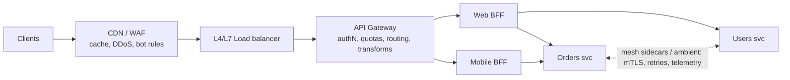

# API Gateways & Reverse Proxies

> [!tldr] TL;DR
> A **reverse proxy** forwards traffic to backends (TLS, routing, load balancing). An **API gateway** is a reverse proxy specialised for APIs: it adds **authentication, rate limits/quotas, request validation, transformation, API keys, analytics and a developer portal**. A **BFF (Backend for Frontend)** is an app-specific gateway owned by a frontend team that aggregates calls and keeps tokens out of the browser. A **service mesh** handles service-to-service (east-west) traffic. In 2026, Kubernetes traffic management is moving from Ingress to **Gateway API**, and "AI gateways" add MCP/LLM routing on top.

## Layers of the edge



| Component | Main job | Traffic | Examples |
|---|---|---|---|
| CDN / WAF | caching, DDoS, TLS near users, bot filtering | north-south | Cloudflare, Fastly, CloudFront, Akamai |
| Load balancer | spread connections/requests, health checks | north-south | AWS ALB/NLB, HAProxy, Nginx |
| Reverse proxy | TLS termination, routing, static files, compression | north-south | [[Nginx]], Caddy, Envoy, Traefik |
| **API gateway** | API-level policies: auth, keys, quotas, transformation, analytics, portal | north-south | Kong, Envoy Gateway, Apigee, AWS API Gateway, Azure APIM, Tyk, KrakenD |
| **BFF** | per-client aggregation and shaping; OAuth token handling | north-south | a small Node/Kotlin/Go service or Next.js server |
| Service mesh | mTLS, retries, timeouts, traffic shifting, telemetry between services | east-west | Istio (incl. ambient mode), Linkerd, Cilium |

## Reverse proxy vs API gateway

| | Reverse proxy | API gateway |
|---|---|---|
| Unit of thinking | hosts, paths, upstreams | APIs, consumers, plans, keys |
| Auth | basic/TLS client certs | OAuth/JWT validation, API keys, OIDC |
| Limits | per IP | per consumer/plan quotas |
| Transformation | headers, rewrites | request/response mapping, protocol translation (REST↔gRPC) |
| Extras | caching, static files | developer portal, analytics, monetisation, schema validation |

Many products do both; Nginx + modules can act as a gateway, Kong is built on Nginx/OpenResty, Envoy Gateway on Envoy.

## What belongs in the gateway (and what doesn't)

✅ Cross-cutting, business-agnostic concerns:
- TLS, routing, versions (`/v1` → cluster A)
- **Token validation** (signature, `exp`, `aud`) and coarse **scope checks**
- **Rate limits and quotas** ([[Rate Limiting & Throttling]])
- Request size limits, schema validation against OpenAPI
- Correlation IDs, access logs, metrics, tracing headers ([[HTTP Headers vs Body - Where Data Belongs]])
- CORS, caching of public responses, canary/blue-green routing

❌ Keep out:
- **Business logic** and object-level authorization ("does user 7 own order 42?") → services ([[Authentication vs Authorization]])
- Heavy orchestration across many services (becomes a distributed monolith; use a BFF or a workflow engine)

### Worked example: Kong declarative config

```yaml
_format_version: "3.0"
services:
  - name: orders
    url: http://orders.internal:8080
    routes:
      - name: orders-v1
        paths: [/v1/orders]
    plugins:
      - name: jwt                 # validate JWTs issued by our IdP
      - name: rate-limiting
        config: { minute: 600, policy: redis, redis: { host: redis } }
      - name: correlation-id
        config: { header_name: X-Request-Id, generator: uuid }
      - name: request-size-limiting
        config: { allowed_payload_size: 2 }   # MB
```

### Worked example: Kubernetes Gateway API

```yaml
apiVersion: gateway.networking.k8s.io/v1
kind: HTTPRoute
metadata: { name: orders }
spec:
  parentRefs: [{ name: public-gateway }]
  hostnames: ["api.example.com"]
  rules:
    - matches: [{ path: { type: PathPrefix, value: /v1/orders } }]
      backendRefs:
        - { name: orders-v1, port: 8080, weight: 90 }
        - { name: orders-v2, port: 8080, weight: 10 }   # canary 10%
```

Gateway API splits roles: infra teams own `GatewayClass`/`Gateway`, app teams own `HTTPRoute`/`GRPCRoute`. It replaces most annotation-heavy Ingress setups.

## The BFF pattern

**Backend for Frontend**: one backend per client experience (web, iOS, partner), owned by that client's team.

- **Aggregation**: one call from the UI → BFF fans out to 5 services in parallel, shapes one response (fixes chatty REST, see [[GraphQL vs REST]]).
- **Security (OAuth BFF)**: the BFF is a *confidential OAuth client*; it runs the Authorization Code + PKCE flow, stores access/refresh tokens **server-side**, and gives the browser only an `HttpOnly` session cookie. The browser never sees a token, so XSS can't steal one. RFC 10017 (Aug 2026) recommends this for business and sensitive SPAs. See [[OAuth 2.x & OpenID Connect]], [[JWT vs Cookies]], and the frontend side in [[Authentication & Token Storage]].
- **Risks**: duplication across BFFs, BFF becoming a monolith; keep them thin (composition, not business rules).

```ts
// Minimal BFF proxy: cookie session in, bearer token out
app.use('/api', requireSession, async (req, res) => {
  const token = await tokens.getFreshAccessToken(req.session.id);   // refreshes if needed
  const upstream = await fetch(`https://api.internal${req.url}`, {
    method: req.method,
    headers: { authorization: `Bearer ${token}`, 'x-request-id': req.id, 'content-type': req.get('content-type') ?? '' },
    body: ['GET', 'HEAD'].includes(req.method) ? undefined : req.body,
  });
  res.status(upstream.status);
  upstream.body?.pipeTo(new WritableStream({ write: (c) => void res.write(c), close: () => res.end() }));
});
```

## Gateways for AI agents and MCP

APIs are increasingly called by **AI agents** through the Model Context Protocol (MCP). Gateways now:
- expose internal REST/GraphQL operations as **MCP tools**, and bundle several MCP servers behind one endpoint;
- apply **per-tool authorization** (hide tools a caller can't use), quotas by **tokens/cost**, and audit logging;
- route by the MCP `Mcp-Method`/`Mcp-Name` headers (2026-07-28 spec) instead of parsing JSON-RPC bodies.

See [[AI in Frontend - MCP, WebMCP & Built-in AI]] for the protocol itself.

> [!info]+ 🆕 2025–2026
> - **2025-11-11 → March 2026:** Kubernetes **ingress-nginx retired** (no further fixes). Recommended path: **Gateway API** implementations (Envoy Gateway, Istio, Cilium, Kong, NGINX Gateway Fabric, etc.) using `ingress2gateway`. See [[Nginx]].
> - **2026-06-23:** **Envoy AI Gateway 1.0**, now renamed **Agent Router** (an Agentic AI Foundation project): stable v1beta1 API, 16 LLM providers behind an OpenAI-compatible interface, full **MCP gateway**, OpenTelemetry tracing, multi-tenant routing.
> - **2026-07-28:** MCP spec goes **stateless** and adds routing headers, so MCP servers can sit behind ordinary round-robin load balancers and gateways.
> - **2026-09-01:** **Kong AI Gateway 2.0 GA**: MCP server bundling, MCP ACLs (unauthorised tools invisible at discovery), identity-aware AI policies, modality-aware cost tracking; AI plugins remain supported on Kong Gateway 3.14 LTS.
> - **2026-08:** RFC 10017 formalises the **BFF** as the most secure architecture for browser-based OAuth clients.

## Pitfalls

> [!warning] Common mistakes
> - The gateway as a **single point of failure**: run it highly available, with capacity headroom; it sees 100% of traffic.
> - Business logic creeping into gateway plugins/Lua scripts (untestable, owned by nobody).
> - Trusting identity headers (`X-User-Id`) from the outside; the gateway must strip them and set its own.
> - Double retries: client + gateway + mesh + SDK each retrying 3× → 81 attempts during an outage. Retry in one layer, with budgets.
> - Timeouts that don't nest (gateway 30 s, service 60 s → wasted work after the client gave up). Propagate deadlines.
> - One shared gateway config edited by every team without ownership or CI.

## Senior perspective

- Decide explicitly **which concerns live at which layer** (CDN, gateway, BFF, mesh, service) and document it; overlaps cause double rate limiting and retries.
- Gateways add latency (typically ~1–5 ms per hop); measure P99, not averages.
- Prefer **declarative, GitOps-managed** gateway config with per-team ownership (Gateway API's role split helps).
- For internal traffic, a mesh (or gRPC client-side LB) usually beats routing everything through a central gateway.
- Review questions: *Where is the token validated and where is the object-level check? What's the retry budget per layer? What happens when the gateway's Redis (quotas) is down? Who owns each route?*

## Interview questions

> [!question]- Reverse proxy vs API gateway vs load balancer?
> A load balancer distributes traffic across instances. A reverse proxy fronts servers, terminating TLS and routing by host/path, often also load balancing and caching. An API gateway is a reverse proxy with API-management features: authentication, consumer quotas, transformation, schema validation, analytics and developer portals.

> [!question]- What is the BFF pattern and when is it useful?
> A dedicated backend per client type that aggregates and shapes data for that UI and, in OAuth setups, acts as a confidential client so tokens stay server-side and the browser holds only an HttpOnly session cookie. Useful when clients have different data needs, for reducing chattiness, and for SPA security.

> [!question]- What should not be done in an API gateway?
> Business logic and fine-grained, object-level authorization, which need domain context and belong in services; complex orchestration across many services, which turns the gateway into a fragile monolith.

> [!question]- API gateway vs service mesh?
> Gateway handles north-south traffic (external clients into the system) with API-management concerns. A mesh handles east-west traffic between services: mTLS, retries, timeouts, traffic shifting and telemetry, usually via sidecars or node-level proxies.

> [!question]- Why is Kubernetes moving from Ingress to Gateway API?
> Ingress is minimal and relies on controller-specific annotations for anything advanced. Gateway API is expressive (header matching, traffic splitting, gRPC routes), portable across implementations, and role-oriented. The retirement of ingress-nginx in March 2026 accelerated migrations.

## Related
- [[Backend Index]] · [[APIs & Auth Index]]
- [[Nginx]] · [[Rate Limiting & Throttling]] · [[OAuth 2.x & OpenID Connect]] · [[JWT vs Cookies]] · [[API Security]] · [[GraphQL vs REST]] · [[gRPC vs REST]]
- [[Microservices Architecture]] · Frontend: [[Authentication & Token Storage]] · [[AI in Frontend - MCP, WebMCP & Built-in AI]]
- Other domains: [[Kubernetes Networking - Services, Ingress & Gateway API]] · [[CDN & Edge Computing]] · [[Microservices Architecture]] · [[Security Index]]

## Sources
- [Kubernetes Gateway API](https://gateway-api.sigs.k8s.io/) · [ingress2gateway](https://github.com/kubernetes-sigs/ingress2gateway)
- [Kubernetes blog: Ingress NGINX Retirement (2025-11-11)](https://www.kubernetes.io/blog/2025/11/11/ingress-nginx-retirement/)
- [Envoy proxy docs](https://www.envoyproxy.io/docs) · [Agent Router (formerly Envoy AI Gateway) v1.0 release notes](https://theagentrouter.ai/release-notes/v1.0/)
- [Kong Gateway docs](https://developer.konghq.com/gateway/) · [Kong AI Gateway 2.0 GA (2026-09-01)](https://konghq.com/blog/product-releases/kong-ai-gateway-2-0-ga)
- [Sam Newman: Backends For Frontends pattern](https://samnewman.io/patterns/architectural/bff/)
- [RFC 10017: OAuth 2.0 for Browser-Based Applications (Aug 2026)](https://datatracker.ietf.org/doc/html/rfc10017)
- [microservices.io: API gateway pattern](https://microservices.io/patterns/apigateway.html)
- [MCP 2026-07-28 release post](https://blog.modelcontextprotocol.io/posts/2026-07-28/)
