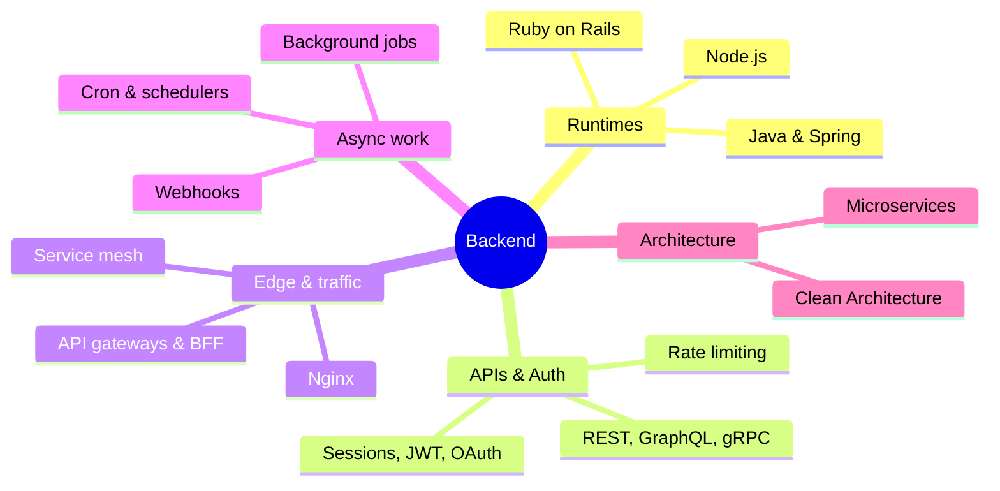

# Backend Index

> [!tldr] Start here
> The domain home for everything server-side: runtimes (**Node.js**, **Java & Spring**), the infrastructure in front of your app (**Nginx**, **API gateways**, BFFs), the work that happens outside the request (**background jobs**, **cron**), and application architecture (**Rails Clean Architecture**). API design and authentication have their own home in [[APIs & Auth Index]]. Every topic note has worked examples, a 🆕 2025–2026 box where something changed, and interview questions.

## 🧭 Areas
| Area | Home note |
|---|---|
| Node.js (event loop, streams, HTTP servers, performance, security) | [[Node.js Index]] |
| Java & Spring (language, JVM, concurrency, reactive, data access) | [[Java & Spring Index]] |
| API design & authentication | [[APIs & Auth Index]] |
| System design, caching, message brokers | [[System Design Index]] |
| Databases | see the Databases folder (e.g. [[Keyset Pagination vs Offset]]) |
| Security | [[Security Index]] |

## 🟢 Beginner
- [[REST API Design]]: how a good HTTP API looks
- [[HTTP Headers vs Body - Where Data Belongs]]
- [[Authentication vs Authorization]] → [[JWT vs Cookies]]
- [[Nginx]]: reverse proxy, config, TLS, load balancing
- [[Cron Jobs]]: scheduling with cron, `whenever`, Kubernetes CronJobs
- Runtime basics: start of [[Node.js Index]] or [[Java & Spring Index]]

## 🟡 Intermediate
- [[Background Jobs & Task Queues]]: Sidekiq, Solid Queue, BullMQ, Celery; retries with backoff; idempotency
- [[Scheduled Jobs Index]]: cron + message queues, BullMQ Job Schedulers, K8s CronJobs, a job control API and a Next.js dashboard to pause/resume/run/stop jobs, Playwright as a cron job
- [[Webhooks, Polling, SSE & WebSockets]]: server-side real-time and event delivery
- [[Rate Limiting & Throttling]]
- [[API Versioning, Idempotency & Backward Compatibility]]
- [[OAuth 2.x & OpenID Connect]] · [[Passkeys, WebAuthn & MFA]]
- [[GraphQL vs REST]] · [[gRPC vs REST]]
- [[Rails Clean Architecture]]: service objects, use cases, adapters

## 🔴 Senior
- [[API Gateways & Reverse Proxies]]: gateway vs proxy vs mesh, BFF, Gateway API, AI/MCP gateways
- [[API Security]] (OWASP API Top 10, in the Security folder)
- [[Microservices Architecture]] · [[Distributed Systems Patterns]] · [[Message Queues & Event Streaming]] · [[Caching Strategies]]
- Runtime internals and production tuning: the senior sections of [[Node.js Index]] and [[Java & Spring Index]]

## Suggested study paths
> [!example]- 🔁 Backend foundations (any language)
> 1. [[REST API Design]] → [[HTTP Headers vs Body - Where Data Belongs]] → [[Authentication vs Authorization]] → [[JWT vs Cookies]]
> 2. One runtime in depth: [[Node.js Index]] *or* [[Java & Spring Index]]
> 3. [[Nginx]] → [[API Gateways & Reverse Proxies]]
> 4. [[Background Jobs & Task Queues]] → [[Cron Jobs]] → [[Webhooks, Polling, SSE & WebSockets]]
> 5. [[Rate Limiting & Throttling]] → [[API Versioning, Idempotency & Backward Compatibility]] → [[OAuth 2.x & OpenID Connect]]
> 6. [[Rails Clean Architecture]] (architecture ideas apply to any framework) → [[System Design Index]]

> [!example]- ⚡ Catch up on 2025–2026 only
> [[Nginx]] (1.30, ingress-nginx retirement) → [[API Gateways & Reverse Proxies]] (Gateway API, AI gateways, MCP) → [[Background Jobs & Task Queues]] (Sidekiq 8, Rails 8.1 continuations, BullMQ schedulers) → [[OAuth 2.x & OpenID Connect]] (RFC 9700, OAuth 2.1 draft, RFC 10017) → [[Passkeys, WebAuthn & MFA]] (WebAuthn L3, NIST 800-63B-4) → [[REST API Design]] (OpenAPI 3.2, QUERY method) → runtime updates in [[Node.js Index]] and [[Java & Spring Index]]

> [!example]- 🎯 Backend interview week
> [[REST API Design]] · [[JWT vs Cookies]] · [[Rate Limiting & Throttling]] (code a token bucket) · [[Background Jobs & Task Queues]] · [[API Gateways & Reverse Proxies]] · [[Nginx]] · runtime Q&A in [[Node.js Index]] / [[Java & Spring Index]] · then [[System Design Index]]

## 🆕 2025–2026 in this area
- **2025-03** IngressNightmare CVEs in Kubernetes ingress-nginx → [[Nginx]]
- **2025-03-05** Sidekiq 8.0 (profiler, job iteration, new Web UI) → [[Background Jobs & Task Queues]]
- **2025-10-22** Rails 8.1 Active Job Continuations; Solid Queue as Rails 8 default backend → [[Background Jobs & Task Queues]]
- **2025-11-11 → 2026-03** ingress-nginx retirement announced, then retired; migrate to Gateway API → [[Nginx]] · [[API Gateways & Reverse Proxies]]
- **2026-02-17** Temporal $300M Series D: durable execution for long-running (agent) workflows → [[Background Jobs & Task Queues]]
- **2026-04-14** nginx 1.30.0 stable (Early Hints, HTTP/2 to upstreams, ECH, sticky sessions, MPTCP) → [[Nginx]]
- **2026-06-23** Envoy AI Gateway 1.0, renamed Agent Router (MCP gateway) → [[API Gateways & Reverse Proxies]]
- **2026-07-28** MCP spec goes stateless (gateway-friendly routing headers) → [[API Gateways & Reverse Proxies]]
- **2026-09-01** Kong AI Gateway 2.0 GA → [[API Gateways & Reverse Proxies]]
- API and auth standards (OpenAPI 3.2, RFC 10008 QUERY, OAuth 2.1 draft, RFC 10017, WebAuthn L3) → see the list in [[APIs & Auth Index]]
- Runtime changes → [[Node.js Index]] · [[Java & Spring Index]]

## Related
- [[Software Engineering]], the vault root
- [[APIs & Auth Index]] · [[Node.js Index]] · [[Java & Spring Index]] · [[System Design Index]] · [[Security Index]]
- Frontend counterpart: [[Frontend Home]]
