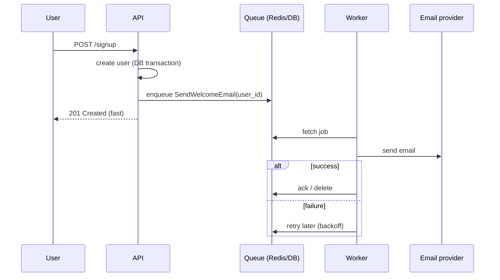

# Background Jobs & Task Queues

<Note>
**TL;DR**

Anything slow, unreliable or not needed for the HTTP response (emails, webhooks, image processing, reports, third-party calls) should be **enqueued** and run by **workers** outside the request. A job system gives you **retries with exponential backoff and jitter**, **concurrency control**, **scheduling**, **dead-letter queues** and dashboards. Delivery is almost always **at-least-once**, so every job must be **idempotent**. Classic stacks: **Sidekiq** (Ruby/Redis), **Solid Queue** (Rails 8 default, database-backed), **BullMQ** (Node/Redis), **Celery** (Python), with **Temporal**-style durable execution for long multi-step workflows.
</Note>

## Why



- **Latency**: respond in 50 ms instead of 3 s.
- **Reliability**: provider down? The job retries for hours; the user's request doesn't fail.
- **Load levelling**: a spike of 100k jobs is drained at the rate workers can handle.
- **Scheduling**: run later (`perform_in(1.hour)`) or periodically (see [Cron Jobs](/Software%20Engineering/Backend/Cron%20Jobs)).

## Core concepts

| Concept | Meaning |
|---|---|
| **Producer** | code that enqueues (web app, another job, a scheduler) |
| **Queue / broker** | stores jobs: Redis (Sidekiq, BullMQ), a SQL DB (Solid Queue, GoodJob, Oban, pg-boss), RabbitMQ/SQS (Celery, others) |
| **Worker** | process that pulls jobs and runs them, with N threads/processes |
| **Ack / visibility timeout** | job is removed only after success; if a worker dies, the job becomes visible again → **at-least-once** |
| **Retry policy** | how many times, with what delay |
| **Dead-letter queue (DLQ)** | where jobs go after exhausting retries, for inspection and manual replay |
| **Priority / multiple queues** | `critical`, `default`, `low`; separate workers so slow jobs don't starve urgent ones |
| **Concurrency limits / rate limits** | protect downstream APIs (e.g. max 10 concurrent calls to a provider) |
| **Uniqueness / dedupe** | prevent enqueuing the same job twice |

A job queue is not the same as an event stream: a queue hands each **task** to one worker and deletes it; a log like Kafka keeps **events** for many consumers to replay. Many systems use both.

## Retries with exponential backoff and jitter

```text
delay(attempt) = min(cap, base × 2^attempt)  ±  random jitter
```

```ts
function backoff(attempt: number, baseMs = 1000, capMs = 60 * 60 * 1000) {
  const exp = Math.min(capMs, baseMs * 2 ** attempt);
  return Math.random() * exp;          // "full jitter" (AWS): spreads retries so they don't sync up
}
// attempt 0 → up to 1s, 1 → 2s, 2 → 4s, … 12 → ~68 min (capped at 60 min)
```

- **Jitter** prevents thousands of failed jobs retrying at the same instant (thundering herd).
- Distinguish **retryable** errors (timeouts, 429, 503) from **permanent** ones (validation error, 404, 400): don't retry permanent failures; send them to the DLQ or discard with a log.
- Honour `Retry-After` from rate-limited APIs ([Rate Limiting & Throttling](/Software%20Engineering/APIs%20%26%20Auth/Rate%20Limiting%20%26%20Throttling)).
- Sidekiq's default is 25 retries over about 20 days with a polynomial backoff; BullMQ and Celery require you to configure attempts/backoff explicitly.

## Idempotency: the golden rule

At-least-once delivery means a job **can run twice** (worker crash after the side effect but before ack, a deploy, a retry after a timeout that actually succeeded).

```ruby
class ChargeInvoiceJob
  include Sidekiq::Job
  sidekiq_options queue: :critical, retry: 10

  def perform(invoice_id)
    invoice = Invoice.find(invoice_id)
    return if invoice.paid?                                   # 1. check state first

    # 2. idempotency key at the provider: a retry won't double-charge
    charge = Payments.charge(invoice.amount_cents, idempotency_key: "invoice-#{invoice.id}")

    # 3. conditional update: only transitions pending → paid once
    Invoice.where(id: invoice.id, status: "pending").update_all(status: "paid", charge_id: charge.id)
  end
end
```

Techniques: state checks, unique constraints, conditional updates, provider idempotency keys, a processed-jobs table. See [API Versioning, Idempotency & Backward Compatibility](/Software%20Engineering/APIs%20%26%20Auth/API%20Versioning%2C%20Idempotency%20%26%20Backward%20Compatibility).

Also: pass **IDs, not objects** (`perform(user_id)` not a serialized user), so the job reads current data and payloads stay small.

## Enqueue after commit (the dual-write problem)

```ruby
User.transaction do
  user = User.create!(params)
  WelcomeEmailJob.perform_async(user.id)   # ❌ worker may run before commit → RecordNotFound,
end                                        #    or the transaction rolls back but the job was sent
```

Fixes: enqueue **after commit** (`after_commit` callbacks; Rails 7.2+ Active Job also has an `enqueue_after_transaction_commit` setting; check its default for your Rails version), use a **database-backed queue in the same DB** (Solid Queue, GoodJob, Oban, pg-boss: enqueue is part of the transaction), or a **transactional outbox**.

## Examples in three ecosystems

### Ruby: Sidekiq / Active Job

```ruby
class ResizeImageJob < ApplicationJob
  queue_as :media
  retry_on Net::ReadTimeout, wait: :polynomially_longer, attempts: 10
  discard_on ActiveRecord::RecordNotFound

  def perform(upload_id)
    Upload.find(upload_id).then { |u| ImageResizer.call(u) }
  end
end

ResizeImageJob.perform_later(upload.id)             # now
ResizeImageJob.set(wait: 10.minutes).perform_later(upload.id)
```

### Node: BullMQ

```ts
import { Queue, Worker } from 'bullmq';
const connection = { host: 'redis', port: 6379 };

export const emails = new Queue('emails', { connection });
await emails.add('welcome', { userId: 42 }, {
  jobId: 'welcome-42',                                       // dedupe: same id won't be added twice
  attempts: 8, backoff: { type: 'exponential', delay: 1000 },
  removeOnComplete: 1000, removeOnFail: 5000,
});

// Recurring job (BullMQ ≥ 5.16 "job schedulers" replace repeatable jobs)
await emails.upsertJobScheduler('daily-digest', { pattern: '0 8 * * *', tz: 'UTC' },
  { name: 'digest', data: {} });

new Worker('emails', async (job) => {
  if (job.name === 'welcome') await sendWelcome(job.data.userId);
  if (job.name === 'digest') await sendDigest();
}, { connection, concurrency: 20, limiter: { max: 50, duration: 1000 } });  // ≤ 50 jobs/s
```

### Python: Celery

```python
from celery import Celery
app = Celery("app", broker="redis://redis:6379/0", backend="redis://redis:6379/1")
app.conf.task_acks_late = True                 # ack after completion (at-least-once)
app.conf.worker_prefetch_multiplier = 1        # fair dispatch for long tasks

@app.task(bind=True, autoretry_for=(TimeoutError,), retry_backoff=True,
          retry_backoff_max=3600, retry_jitter=True, max_retries=10)
def send_invoice(self, invoice_id: int):
    ...

send_invoice.delay(42)
send_invoice.apply_async(args=[42], countdown=600)   # in 10 minutes

app.conf.beat_schedule = {                            # Celery beat = the scheduler
    "nightly-report": {"task": "reports.nightly", "schedule": crontab(hour=2, minute=30)},
}
```

## Cron vs scheduler vs queue

| | System cron | Framework scheduler (Solid Queue recurring, sidekiq-cron, BullMQ schedulers, Celery beat) | Workflow engine (Temporal, Airflow) |
|---|---|---|---|
| Triggers | shell commands | enqueue jobs on a schedule | start workflows on schedules/events |
| Runs once across a fleet | ❌ (every host) | ✅ (leader/lock built in) | ✅ |
| Retries, visibility | ❌ | ✅ (via the queue) | ✅ with full history |
| Multi-step with state | ❌ | limited (batches, continuations) | ✅ durable execution |

Rule: **the scheduler enqueues; the queue executes**. See [Cron Jobs](/Software%20Engineering/Backend/Cron%20Jobs).

## Durable execution (long, multi-step work)

For flows like "charge → reserve stock → ship → wait 3 days → send survey", chaining jobs by hand gets fragile. **Durable execution** engines (Temporal, Restate, AWS Step Functions, Azure Durable Functions) persist every step's result; after a crash the workflow resumes exactly where it left off, with timers that can sleep for days.

```ts
// Temporal workflow (TypeScript): plain code, but durable
export async function orderWorkflow(orderId: string) {
  await activities.chargePayment(orderId);          // retried per policy; result recorded
  await activities.reserveStock(orderId);
  await sleep('3 days');                            // survives restarts/deploys
  await activities.sendSurvey(orderId);
}
```

<Info>
**🆕 2025–2026**

- **2025-03-05:** **Sidekiq 8.0** released: redesigned, lighter Web UI, a **job profiler** tab, **job iteration** (split long jobs into resumable chunks), shorter default thread timeslice.
- **2025-10-22:** **Rails 8.1** adds **Active Job Continuations**: jobs declare steps and resume from the last completed step after a restart or deploy (supported by Solid Queue from v1.2.0 and the Sidekiq adapter). Rails 8 (Nov 2024) made **Solid Queue** (database-backed, `FOR UPDATE SKIP LOCKED`, no Redis) the default Active Job backend, with **Mission Control – Jobs** as the dashboard.
- **BullMQ 5.16+:** **Job Schedulers** (`upsertJobScheduler`) replace "repeatable jobs" for cron/interval work.
- **Durable execution goes mainstream for AI agents:** Temporal raised a $146M Series C (2025-03-31) and a $300M Series D (2026-02-17), positioning durable workflows as the backbone for long-running agent tasks.
</Info>

## Pitfalls

<Warning>
**Common mistakes**

- Non-idempotent jobs + at-least-once delivery = duplicate emails and charges.
- Enqueuing inside a DB transaction (job runs before commit or after rollback).
- Huge payloads in the queue (store in DB/S3, pass an ID).
- One queue for everything: a burst of slow report jobs delays password-reset emails.
- Infinite retries of permanent errors; no DLQ; no alert on DLQ growth.
- Redis as the queue store without persistence/eviction set correctly (`maxmemory-policy noeviction`), losing jobs.
- Workers killed on deploy without graceful shutdown (SIGTERM → finish or re-enqueue current jobs).
- No monitoring of **queue latency** (time from enqueue to start), which is what users feel.
</Warning>

## Senior perspective

- Key metrics: **queue depth**, **queue latency** per queue, job duration P50/P99, failure/retry rate, DLQ size. Autoscale workers on latency (KEDA on Kubernetes).
- Choose the store deliberately: **DB-backed** queues (Solid Queue, GoodJob, Oban, pg-boss) give transactional enqueue and one less system, fine up to thousands of jobs/s; **Redis** queues give higher throughput; **SQS/RabbitMQ** give managed durability; **Kafka** is for event streams, not task queues.
- Protect downstream systems with per-queue concurrency and rate limits; a job system can DDoS your own partners.
- Version job arguments like an API: old jobs already in the queue must still deserialise after a deploy.
- Review questions: *What happens if this job runs twice? Or never? Is it enqueued after commit? Which queue and why? What's the retry schedule and when does it give up? Who gets alerted?*

## Interview questions

<Accordion title="Why use background jobs instead of doing work in the request?">
To keep responses fast, isolate users from slow or failing dependencies with retries, smooth traffic spikes, and run scheduled or long tasks. The request enqueues a job and returns (often 202 Accepted with a status URL).
</Accordion>

<Accordion title="What delivery guarantee do most job queues give and what does that imply?">
At-least-once: a job is acknowledged only after it finishes, so a crash can cause re-execution. Jobs must be idempotent (state checks, unique constraints, idempotency keys).
</Accordion>

<Accordion title="How do you design retries?">
Retry only transient errors, with exponential backoff capped at a maximum, plus jitter to avoid synchronized retries; honour Retry-After; limit attempts; send exhausted jobs to a dead-letter queue with alerting and a replay tool.
</Accordion>

<Accordion title="What's the problem with enqueuing a job inside a database transaction?">
The worker may pick up the job before the transaction commits (data not visible) or the transaction may roll back after the job was sent. Enqueue after commit, use a DB-backed queue in the same transaction, or a transactional outbox.
</Accordion>

<Accordion title="Cron vs job scheduler vs workflow engine?">
Cron triggers commands on one host with no retries. A job framework's scheduler enqueues a single job across a fleet, gaining retries and visibility. A workflow engine (Temporal, Step Functions) manages multi-step, long-running processes with persisted state, timers and compensation.
</Accordion>

<Accordion title="Redis-backed vs database-backed queues?">
Redis (Sidekiq, BullMQ): very fast, high throughput, but a separate system and enqueue isn't transactional with your DB. DB-backed (Solid Queue, GoodJob, Oban): transactional enqueue, simpler ops, good enough for most apps; heavy load can stress the primary database.
</Accordion>

## Related
- Scheduled jobs deep dive: [Scheduled Jobs Index](/Software%20Engineering/Backend/Scheduled%20Jobs/Scheduled%20Jobs%20Index) · [Cron with Message Queues - Architecture](/Software%20Engineering/Backend/Scheduled%20Jobs/Cron%20with%20Message%20Queues%20-%20Architecture) · [BullMQ Job Schedulers in Practice](/Software%20Engineering/Backend/Scheduled%20Jobs/BullMQ%20Job%20Schedulers%20in%20Practice) · [Kubernetes CronJobs in Practice](/Software%20Engineering/Backend/Scheduled%20Jobs/Kubernetes%20CronJobs%20in%20Practice) · [Job Control API - Pause, Resume, Run Now & Stop](/Software%20Engineering/Backend/Scheduled%20Jobs/Job%20Control%20API%20-%20Pause%2C%20Resume%2C%20Run%20Now%20%26%20Stop) · [Job Scheduler Dashboard with Next.js](/Software%20Engineering/Backend/Scheduled%20Jobs/Job%20Scheduler%20Dashboard%20with%20Next.js)
- [Backend Index](/Software%20Engineering/Backend/Backend%20Index) · [APIs & Auth Index](/Software%20Engineering/APIs%20%26%20Auth/APIs%20%26%20Auth%20Index)
- [Cron Jobs](/Software%20Engineering/Backend/Cron%20Jobs) · [Webhooks, Polling, SSE & WebSockets](/Software%20Engineering/APIs%20%26%20Auth/Webhooks%2C%20Polling%2C%20SSE%20%26%20WebSockets) · [API Versioning, Idempotency & Backward Compatibility](/Software%20Engineering/APIs%20%26%20Auth/API%20Versioning%2C%20Idempotency%20%26%20Backward%20Compatibility) · [Rate Limiting & Throttling](/Software%20Engineering/APIs%20%26%20Auth/Rate%20Limiting%20%26%20Throttling) · [Rails Clean Architecture](/Software%20Engineering/Backend/Rails%20Clean%20Architecture)
- [Node.js Index](/Software%20Engineering/Backend/The%20Hard%20Parts%20of%20Servers%20%26%20Node.js/Node.js%20Index) · [Java & Spring Index](/Software%20Engineering/Backend/Java/Java%20%26%20Spring%20Index) · [Microservices Architecture](/Software%20Engineering/DevOps/Microservices%20Architecture)
- Other domains: [Message Queues & Event Streaming](/Software%20Engineering/System%20Design/Message%20Queues%20%26%20Event%20Streaming) · [Distributed Systems Patterns](/Software%20Engineering/System%20Design/Distributed%20Systems%20Patterns) · [System Design Index](/Software%20Engineering/System%20Design/System%20Design%20Index)

## Sources
- [Sidekiq wiki: Best practices](https://github.com/sidekiq/sidekiq/wiki/Best-Practices) · [Error handling and retries](https://github.com/sidekiq/sidekiq/wiki/Error-Handling)
- [Mike Perham: Introducing Sidekiq 8.0 (2025-03-05)](https://www.mikeperham.com/2025/03/05/introducing-sidekiq-8.0/)
- [Rails 8.1: Job continuations, structured events, local CI (2025-10-22)](https://rubyonrails.org/2025/10/22/rails-8-1) · [Solid Queue](https://github.com/rails/solid_queue) · [Mission Control – Jobs](https://github.com/rails/mission_control-jobs)
- [Rails Guides: Active Job Basics](https://guides.rubyonrails.org/active_job_basics.html)
- [BullMQ docs: Job Schedulers](https://docs.bullmq.io/guide/job-schedulers/) · [Retrying failing jobs](https://docs.bullmq.io/guide/retrying-failing-jobs)
- [Celery docs: Tasks](https://docs.celeryq.dev/en/stable/userguide/tasks.html) · [Periodic tasks](https://docs.celeryq.dev/en/stable/userguide/periodic-tasks.html)
- [AWS Architecture Blog: Exponential backoff and jitter](https://aws.amazon.com/blogs/architecture/exponential-backoff-and-jitter/)
- [Temporal docs](https://docs.temporal.io/) · [Temporal Series C (2025-03-31)](https://temporal.io/blog/temporal-series-c-announcement) · [Temporal Series D (2026-02-17)](https://temporal.io/blog/temporal-raises-usd300m-series-d-at-a-usd5b-valuation)
- [microservices.io: Transactional outbox](https://microservices.io/patterns/data/transactional-outbox.html)
