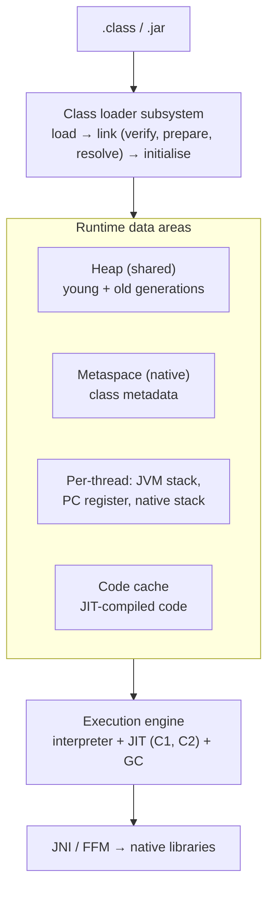
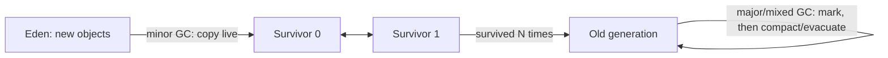

# JVM Internals - Memory & Garbage Collection

<Note>
**TL;DR**

The JVM loads classes, interprets bytecode and **JIT-compiles** hot methods (C1 then C2). Objects live on the **heap**, method calls on per-thread **stacks**, class metadata in **Metaspace**. Memory is reclaimed by a **garbage collector**: **G1** is the default balanced collector (and from JDK 27 the default everywhere), **ZGC** and **Shenandoah** give sub-millisecond pauses on large heaps, **Parallel** maximises throughput, **Serial** suits tiny heaps. Tune by first measuring (GC logs, JFR), setting heap size relative to container memory, and picking the collector for your latency goal.
</Note>

## JVM architecture



### Class loading
- **Bootstrap** loader (core `java.*`), **platform** loader, **application** loader (your classpath), plus custom loaders (app servers, plugins).
- Parent delegation: a loader asks its parent first. Classes are identified by (name, loader), which is how containers isolate apps and also how "ClassCastException: X cannot be cast to X" happens.
- Static initialisers run on first active use.

### JIT compilation (tiered)
1. Interpret bytecode, collect profiles.
2. **C1** compiles warm methods quickly with light optimisation.
3. **C2** recompiles hot methods aggressively (inlining, escape analysis, loop unrolling), speculating on profiles; **deoptimises** if assumptions break.

Same ideas as V8's tiers: see [V8 Engine - Ignition, TurboFan & Garbage Collection](/Software%20Engineering/Backend/The%20Hard%20Parts%20of%20Servers%20%26%20Node.js/V8%20Engine%20-%20Ignition%2C%20TurboFan%20%26%20Garbage%20Collection). Warm-up is why JVM services are slow for their first requests; AOT caches (Java 24/25, Project Leyden) and CRaC/GraalVM native image address startup.

## Memory areas

| Area | Holds | Error when full |
|---|---|---|
| Heap | All objects and arrays | `OutOfMemoryError: Java heap space` |
| Stack (per thread) | Frames: locals, operand stack, return address | `StackOverflowError` |
| Metaspace | Class metadata (native memory) | `OutOfMemoryError: Metaspace` |
| Code cache | JIT-compiled code | JIT stops compiling (warning) |
| Direct / native memory | NIO direct buffers, thread stacks, GC structures | `OutOfMemoryError: Direct buffer memory` or OS OOM-kill |

```java
void example() {
    int count = 3;                 // primitive local: on the stack frame
    User u = new User("ana");      // reference `u` on the stack, User object on the heap
}                                  // frame popped; User becomes unreachable → GC eligible
```

Escape analysis can allocate non-escaping objects on the stack (scalar replacement), so "all objects are on the heap" is the model, not always the reality.

### Object layout
An object has a **header** (mark word + class pointer; 12 bytes with compressed class pointers on 64-bit) followed by fields, padded to 8 bytes. **Compact object headers** (JEP 519, product in JDK 25, **default in JDK 27**) shrink headers to 8 bytes, cutting heap for object-heavy apps.

## Garbage collection

### Reachability and generations
- Live = reachable from **GC roots** (thread stacks, static fields, JNI refs). Unreachable cycles are collected too.
- **Generational hypothesis**: most objects die young. The heap is split into a **young generation** (Eden + two Survivor spaces) and an **old generation**. Survivors are copied between survivor spaces and promoted after a few collections.



### Collectors

| Collector | Flag | Pauses | Best for |
|---|---|---|---|
| **Serial** | `-XX:+UseSerialGC` | Stop-the-world, single thread | Tiny heaps, CLI tools |
| **Parallel** | `-XX:+UseParallelGC` | STW, multi-threaded | Batch throughput |
| **G1** (default) | `-XX:+UseG1GC` | Mostly short, target `-XX:MaxGCPauseMillis=200` | General purpose, heaps 1–32 GB+ |
| **ZGC** (generational) | `-XX:+UseZGC` | Sub-millisecond, concurrent | Latency-sensitive, large heaps (to TBs) |
| **Shenandoah** (generational in 25) | `-XX:+UseShenandoahGC` | Sub-millisecond, concurrent compaction | Latency-sensitive (OpenJDK builds that include it) |
| **Epsilon** | `-XX:+UseEpsilonGC` | None, never collects | Benchmarks, very short jobs |

G1 splits the heap into equal **regions**, collects the regions with the most garbage first ("garbage first"), and does concurrent marking of the old generation followed by **mixed** collections.

<Info>
**🆕 2025–2026**

- **JDK 24 (2025-03-18)**: ZGC's non-generational mode removed (JEP 490); generational Shenandoah experimental (JEP 404); late barrier expansion for G1 (JEP 475).
- **JDK 25 LTS (2025-09-16)**: **Generational Shenandoah** product feature (JEP 521); **Compact Object Headers** product, opt-in with `-XX:+UseCompactObjectHeaders` (JEP 519); AOT method profiling (JEP 515) and command-line ergonomics (JEP 514) for faster warm-up; JFR CPU-time profiling (JEP 509, experimental).
- **JDK 26 (2026-03-17)**: G1 throughput improved by reducing synchronization (JEP 522); AOT object caching works with any GC including ZGC (JEP 516).
- **JDK 27 (2026-09-15)**: **G1 becomes the default GC in all environments** (JEP 523; previously the JVM picked Serial on machines/containers with &lt;2 CPUs or &lt;1792 MB); **compact object headers on by default** (JEP 534).
</Info>

## Sizing and containers

```bash
java -XX:MaxRAMPercentage=75 \        # heap = 75% of container memory limit
     -XX:+UseG1GC \
     -Xlog:gc*:file=gc.log:time,uptime:filecount=5,filesize=20m \
     -XX:+HeapDumpOnOutOfMemoryError -XX:HeapDumpPath=/dumps \
     -jar app.jar
```

- The JVM is **container-aware** (cgroups v1/v2): it reads CPU and memory limits. Prefer `MaxRAMPercentage` over a fixed `-Xmx` in containers.
- Leave headroom: total RSS = heap + metaspace + code cache + thread stacks + direct buffers + GC overhead. A heap equal to the container limit guarantees OOM-kills.
- `-Xms` = `-Xmx` avoids resize pauses for long-running services.

## Diagnosing problems

| Symptom | Tool |
|---|---|
| Frequent/long GC pauses | GC logs (`-Xlog:gc*`), GCeasy/GCViewer, JFR |
| Memory leak (old gen grows after every full GC) | Heap dump (`jcmd <pid> GC.heap_dump file.hprof`) + Eclipse MAT: dominator tree, leak suspects |
| High CPU | `jcmd <pid> Thread.print`, async-profiler flame graphs, JFR |
| Stuck threads / deadlock | Thread dump (`jstack`/`jcmd`) shows `BLOCKED` threads and lock owners |
| Everything, low overhead in prod | **Java Flight Recorder**: `jcmd <pid> JFR.start duration=60s filename=rec.jfr`, open in JDK Mission Control |
| Native memory growth | `-XX:NativeMemoryTracking=summary` + `jcmd <pid> VM.native_memory summary` |

Common leaks: static maps used as caches, `ThreadLocal`s in pooled threads, listeners/callbacks never removed, unbounded queues, classloader leaks on redeploy, Hibernate first-level cache in huge transactions.

## Pitfalls
- Tuning dozens of GC flags copied from blog posts; start with defaults plus heap size and a pause goal.
- Calling `System.gc()` (triggers full GC; often disabled with `-XX:+DisableExplicitGC`).
- Relying on `finalize()` (deprecated for removal); use `try-with-resources` or `Cleaner`.
- Measuring performance before JIT warm-up (use JMH for microbenchmarks).

## Senior perspective
- Choose GC by SLO: throughput (Parallel), balanced (G1), tail latency on big heaps (ZGC/Shenandoah). Validate under production-like load with GC logs and p99 latency.
- Allocation rate is the lever: fewer temporary objects means fewer GCs. Profile allocations with JFR/async-profiler.
- Startup and footprint matter in Kubernetes/serverless: consider AOT caches (JDK 24+), CDS, CRaC, or GraalVM native image (with its reflection/config trade-offs).
- Make diagnostics production-ready ahead of time: GC logs on, heap dump on OOM to a volume, JFR continuous recording, and `jcmd` available in the image.

## Interview questions

<Accordion title="Describe the JVM memory areas.">
Heap (objects, shared, GC-managed, split into young/old generations), per-thread stacks (frames with locals), Metaspace (class metadata, native), code cache (JIT output), and native/direct memory for buffers and thread stacks.
</Accordion>

<Accordion title="How does generational GC work?">
New objects go to Eden. Minor GCs copy live objects to a survivor space and eventually promote long-lived ones to the old generation. The old generation is collected less often by marking reachable objects and compacting or evacuating regions.
</Accordion>

<Accordion title="G1 vs ZGC?">
G1 is region-based and balances throughput and pause times (target ~200 ms, usually far less); it's the default. ZGC does almost all work concurrently, keeping pauses under a millisecond regardless of heap size, at some throughput and memory cost. ZGC suits large heaps with strict latency SLOs.
</Accordion>

<Accordion title="How would you investigate an `OutOfMemoryError`?">
Read which space (heap, metaspace, direct). For heap: get the heap dump (`HeapDumpOnOutOfMemoryError`), open it in MAT, look at the dominator tree and retained sizes, and follow GC roots to the leaking reference. Check GC logs to see if old gen grows steadily. Also check the container limit vs `-Xmx`.
</Accordion>

<Accordion title="What is JIT compilation and why do JVM apps need warm-up?">
The JVM starts by interpreting bytecode and compiles hot methods to optimised native code (C1, then C2) using runtime profiles. Until that happens, code runs slower, so the first requests are slower. AOT caches, CDS and native images reduce warm-up.
</Accordion>

<Accordion title="What changed with GC defaults recently?">
JDK 23 made ZGC generational by default and JDK 24 removed the old mode; JDK 25 made generational Shenandoah and compact object headers product features; JDK 27 makes G1 the default in every environment and turns compact object headers on by default.
</Accordion>

## Related
- [Java & Spring Index](/Software%20Engineering/Backend/Java/Java%20%26%20Spring%20Index)
- [Java Concurrency & Virtual Threads](/Software%20Engineering/Backend/Java/Java%20Concurrency%20%26%20Virtual%20Threads) · [Modern Java 17 to 25](/Software%20Engineering/Backend/Java/Modern%20Java%2017%20to%2025) · [Java Language Essentials](/Software%20Engineering/Backend/Java/Java%20Language%20Essentials)
- Node/V8 comparison: [V8 Engine - Ignition, TurboFan & Garbage Collection](/Software%20Engineering/Backend/The%20Hard%20Parts%20of%20Servers%20%26%20Node.js/V8%20Engine%20-%20Ignition%2C%20TurboFan%20%26%20Garbage%20Collection) · [Node.js Performance & Debugging](/Software%20Engineering/Backend/The%20Hard%20Parts%20of%20Servers%20%26%20Node.js/Node.js%20Performance%20%26%20Debugging) · [Memory Management & Garbage Collection](/Software%20Engineering/Frontend/01%20JavaScript/Memory%20Management%20%26%20Garbage%20Collection)

## Sources
- [Oracle: HotSpot Virtual Machine Garbage Collection Tuning Guide (JDK 25)](https://docs.oracle.com/en/java/javase/25/gctuning/)
- [JVM Specification, Chapter 2: Structure of the JVM](https://docs.oracle.com/javase/specs/jvms/se25/html/jvms-2.html)
- [JEP 519: Compact Object Headers](https://openjdk.org/jeps/519) · [JEP 521: Generational Shenandoah](https://openjdk.org/jeps/521) · [JEP 523: G1 default in all environments](https://openjdk.org/jeps/523) · [JEP 534: Compact object headers by default](https://openjdk.org/jeps/534)
- [JEP 490: ZGC remove non-generational mode](https://openjdk.org/jeps/490) · [JEP 522: G1 reduce synchronization](https://openjdk.org/jeps/522)
- [OpenJDK: JDK 25](https://openjdk.org/projects/jdk/25/) · [JDK 26](https://openjdk.org/projects/jdk/26/) · [JDK 27](https://openjdk.org/projects/jdk/27/)
- [Oracle: Java Flight Recorder / jcmd troubleshooting guide](https://docs.oracle.com/en/java/javase/25/troubleshoot/)
