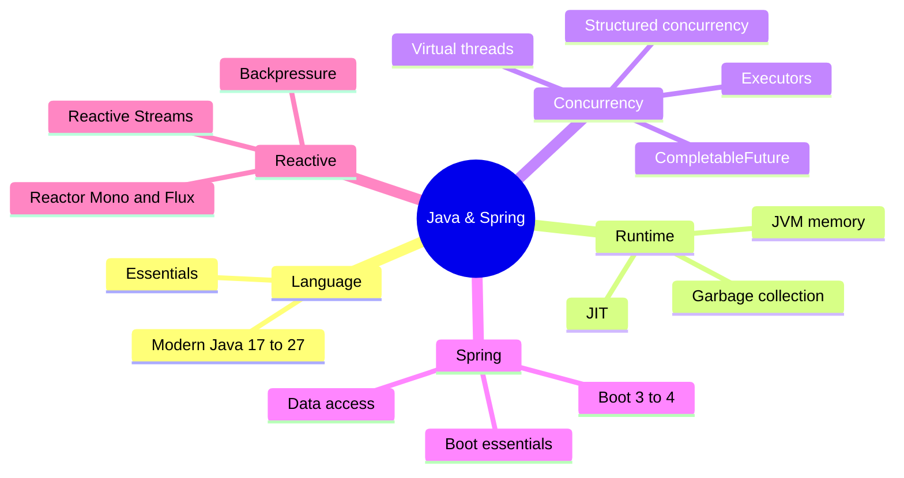

# Java & Spring Index

> [!tldr] Start here
> Entry point for all Java and Spring notes: the language and JVM, concurrency and virtual threads, Spring Boot and data access, and reactive programming (course notes from a Java Reactive course and Josh Long's *Reactive Spring* book). Every topic note has worked examples, a 🆕 2025–2026 box where something changed, and interview questions. Use the [[Java Backend Preparation Checklist]] to track progress.

## 🧭 Quick links
- ✅ [[Java Backend Preparation Checklist]]: the topic checklist, every item linked
- 🆕 [[Modern Java 17 to 25]] · [[Spring Boot 3 to 4 - What's New]]
- 📚 Course/book: [[Java Reactive Course]] · [[Reactive Spring Book]]
- ⬆️ [[Backend Index]] · [[Software Engineering]]

## 1. Beginner: the language
| Note | What you learn |
|---|---|
| [[Java Language Essentials]] | Types, OOP, collections, generics, exceptions, lambdas/streams, records, sealed types, pattern matching |
| [[Reactive Spring - Ch 2 Java Refresher]] | `var`, lambdas, functional interfaces, method references, abstract class vs interface |
| [[Spring Boot Essentials]] | DI/IoC, auto-configuration, starters, profiles, MVC, JPA, transactions, testing |
| [[Reactive Spring - Ch 3 Spring Fundamentals]] | Beans, Java config, `BeanPostProcessor`, component scanning |

## 2. Intermediate: data, concurrency, reactive
| Note | What you learn |
|---|---|
| [[JPA, Hibernate & jOOQ - Data Access in Java]] | JDBC, JPA/Hibernate, persistence context, N+1, locking, jOOQ |
| [[Java Concurrency & Virtual Threads]] | Threads, JMM, locks, executors, `CompletableFuture`, virtual threads, structured concurrency |
| [[Java Reactive Course]] | The four I/O models |
| [[Reactor - Mono & Flux]] | Publishers, operators, schedulers, error handling, backpressure, testing |
| [[Reactive Spring - Ch 4 IO & Reactive Streams]] | Why reactive; Publisher/Subscriber/Subscription/Processor |
| [[Reactive Spring - Ch 5 Reactor & Backpressure]] | Cooperative multithreading, flow control, signals |

## 3. Senior: runtime, upgrades, trade-offs
| Note | What you learn |
|---|---|
| [[JVM Internals - Memory & Garbage Collection]] | Class loading, JIT, heap/stack/metaspace, G1/ZGC/Shenandoah, container sizing, diagnostics |
| [[Modern Java 17 to 25]] | JDK 17 → 27 features, LTS cadence, upgrade guidance |
| [[Spring Boot 3 to 4 - What's New]] | Framework 7 / Boot 4 changes and migration playbook |
| [[Java Backend Preparation Checklist]] | Links out to system design, distributed systems, messaging, databases |

## Suggested study path
> [!example]- 🔁 From zero to senior
> 1. [[Java Language Essentials]] → [[Reactive Spring - Ch 2 Java Refresher]]
> 2. [[Spring Boot Essentials]] → [[Reactive Spring - Ch 3 Spring Fundamentals]] → [[JPA, Hibernate & jOOQ - Data Access in Java]]
> 3. [[Java Concurrency & Virtual Threads]] → [[Java Reactive Course]] → [[Reactor - Mono & Flux]] → [[Reactive Spring - Ch 4 IO & Reactive Streams]] → [[Reactive Spring - Ch 5 Reactor & Backpressure]]
> 4. [[JVM Internals - Memory & Garbage Collection]]
> 5. Stay current: [[Modern Java 17 to 25]] → [[Spring Boot 3 to 4 - What's New]]

> [!example]- ⚡ Catch up on 2025–2026 only
> [[Modern Java 17 to 25]] (JDK 24, 25 LTS, 26, 27) → [[Java Concurrency & Virtual Threads]] (no-pinning, scoped values) → [[JVM Internals - Memory & Garbage Collection]] (GC defaults, compact headers) → [[Spring Boot 3 to 4 - What's New]] → [[JPA, Hibernate & jOOQ - Data Access in Java]] (Hibernate 7)

> [!example]- 🎯 One week before an interview
> [[Java Backend Preparation Checklist]], then the interview-question sections of [[Java Language Essentials]], [[Java Concurrency & Virtual Threads]], [[Spring Boot Essentials]], [[JPA, Hibernate & jOOQ - Data Access in Java]] and [[JVM Internals - Memory & Garbage Collection]].

## 🆕 2025–2026 in this area
- **2025-03-18** JDK 24: Stream Gatherers final, virtual threads no longer pin in `synchronized`, Security Manager disabled, AOT class loading: [[Modern Java 17 to 25]], [[Java Concurrency & Virtual Threads]]
- **2025-05-19** Hibernate ORM 7.0 (JPA 3.2, Apache 2.0 license): [[JPA, Hibernate & jOOQ - Data Access in Java]]
- **2025-05-22** Spring Boot 3.5: [[Spring Boot 3 to 4 - What's New]]
- **2025-09-16** JDK 25 LTS: scoped values, compact source files, flexible constructors, module imports, compact object headers, generational Shenandoah: [[Modern Java 17 to 25]], [[JVM Internals - Memory & Garbage Collection]]
- **2025-09-30** Spring announces `RestTemplate` deprecation path (deprecated in 7.0 docs, for removal in 7.1, removed in 8.0): [[Spring Boot 3 to 4 - What's New]]
- **2025-11-13** Spring Framework 7.0: Jakarta EE 11, JSpecify, API versioning, HTTP service clients, `@Retryable`/`@ConcurrencyLimit`, Jackson 3: [[Spring Boot 3 to 4 - What's New]]
- **2025-11-20** Spring Boot 4.0: modular starters, `@MockBean` removed, Undertow dropped, OpenTelemetry starter: [[Spring Boot 3 to 4 - What's New]], [[Spring Boot Essentials]]
- **2026-03-17** JDK 26: HTTP/3 client, "final means final" warnings, Applet API removed: [[Modern Java 17 to 25]]
- **2026-06-10** Spring Boot 4.1: Spring gRPC, SSRF mitigation: [[Spring Boot 3 to 4 - What's New]]
- **2026-09-15** JDK 27: G1 default everywhere, compact object headers by default, structured concurrency 7th preview: [[Modern Java 17 to 25]], [[JVM Internals - Memory & Garbage Collection]], [[Java Concurrency & Virtual Threads]]

## Related
- [[Backend Index]] · [[Software Engineering]]
- [[Node.js Index]] (the other backend runtime in this vault)
- [[Principles Index]] · [[Databases Index]] · [[System Design Index]]
- `_Archive` holds the original jOOQ note before it was absorbed into [[JPA, Hibernate & jOOQ - Data Access in Java]]
