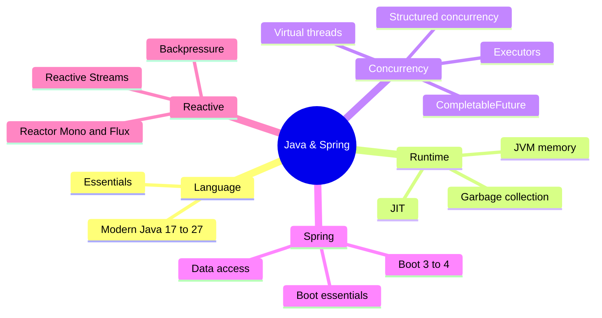

# Java & Spring Index

<Note>
**Start here**

Entry point for all Java and Spring notes: the language and JVM, concurrency and virtual threads, Spring Boot and data access, and reactive programming (course notes from a Java Reactive course and Josh Long's *Reactive Spring* book). Every topic note has worked examples, a 🆕 2025–2026 box where something changed, and interview questions. Use the [Java Backend Preparation Checklist](/Software%20Engineering/Backend/Java/Java%20Backend%20Preparation%20Checklist) to track progress.
</Note>

## 🧭 Quick links
- ✅ [Java Backend Preparation Checklist](/Software%20Engineering/Backend/Java/Java%20Backend%20Preparation%20Checklist): the topic checklist, every item linked
- 🆕 [Modern Java 17 to 25](/Software%20Engineering/Backend/Java/Modern%20Java%2017%20to%2025) · [Spring Boot 3 to 4 - What's New](/Software%20Engineering/Backend/Java/Spring%20Boot%203%20to%204%20-%20What's%20New)
- 📚 Course/book: [Java Reactive Course](/Software%20Engineering/Backend/Java/Java%20Reactive%20Course/Java%20Reactive%20Course) · [Reactive Spring Book](/Software%20Engineering/Backend/Java/Reactive%20Spring%20Book/Reactive%20Spring%20Book)
- ⬆️ [Backend Index](/Software%20Engineering/Backend/Backend%20Index) · [Software Engineering](/Software%20Engineering/Software%20Engineering)

## 1. Beginner: the language
| Note | What you learn |
|---|---|
| [Java Language Essentials](/Software%20Engineering/Backend/Java/Java%20Language%20Essentials) | Types, OOP, collections, generics, exceptions, lambdas/streams, records, sealed types, pattern matching |
| [Reactive Spring - Ch 2 Java Refresher](/Software%20Engineering/Backend/Java/Reactive%20Spring%20Book/Reactive%20Spring%20-%20Ch%202%20Java%20Refresher) | `var`, lambdas, functional interfaces, method references, abstract class vs interface |
| [Spring Boot Essentials](/Software%20Engineering/Backend/Java/Spring%20Boot%20Essentials) | DI/IoC, auto-configuration, starters, profiles, MVC, JPA, transactions, testing |
| [Reactive Spring - Ch 3 Spring Fundamentals](/Software%20Engineering/Backend/Java/Reactive%20Spring%20Book/Reactive%20Spring%20-%20Ch%203%20Spring%20Fundamentals) | Beans, Java config, `BeanPostProcessor`, component scanning |

## 2. Intermediate: data, concurrency, reactive
| Note | What you learn |
|---|---|
| [JPA, Hibernate & jOOQ - Data Access in Java](/Software%20Engineering/Backend/Java/JPA%2C%20Hibernate%20%26%20jOOQ%20-%20Data%20Access%20in%20Java) | JDBC, JPA/Hibernate, persistence context, N+1, locking, jOOQ |
| [Java Concurrency & Virtual Threads](/Software%20Engineering/Backend/Java/Java%20Concurrency%20%26%20Virtual%20Threads) | Threads, JMM, locks, executors, `CompletableFuture`, virtual threads, structured concurrency |
| [Java Reactive Course](/Software%20Engineering/Backend/Java/Java%20Reactive%20Course/Java%20Reactive%20Course) | The four I/O models |
| [Reactor - Mono & Flux](/Software%20Engineering/Backend/Java/Java%20Reactive%20Course/Reactor%20-%20Mono%20%26%20Flux) | Publishers, operators, schedulers, error handling, backpressure, testing |
| [Reactive Spring - Ch 4 IO & Reactive Streams](/Software%20Engineering/Backend/Java/Reactive%20Spring%20Book/Reactive%20Spring%20-%20Ch%204%20IO%20%26%20Reactive%20Streams) | Why reactive; Publisher/Subscriber/Subscription/Processor |
| [Reactive Spring - Ch 5 Reactor & Backpressure](/Software%20Engineering/Backend/Java/Reactive%20Spring%20Book/Reactive%20Spring%20-%20Ch%205%20Reactor%20%26%20Backpressure) | Cooperative multithreading, flow control, signals |

## 3. Senior: runtime, upgrades, trade-offs
| Note | What you learn |
|---|---|
| [JVM Internals - Memory & Garbage Collection](/Software%20Engineering/Backend/Java/JVM%20Internals%20-%20Memory%20%26%20Garbage%20Collection) | Class loading, JIT, heap/stack/metaspace, G1/ZGC/Shenandoah, container sizing, diagnostics |
| [Modern Java 17 to 25](/Software%20Engineering/Backend/Java/Modern%20Java%2017%20to%2025) | JDK 17 → 27 features, LTS cadence, upgrade guidance |
| [Spring Boot 3 to 4 - What's New](/Software%20Engineering/Backend/Java/Spring%20Boot%203%20to%204%20-%20What's%20New) | Framework 7 / Boot 4 changes and migration playbook |
| [Java Backend Preparation Checklist](/Software%20Engineering/Backend/Java/Java%20Backend%20Preparation%20Checklist) | Links out to system design, distributed systems, messaging, databases |

## Suggested study path
<Info>
**🔁 From zero to senior**

1. [Java Language Essentials](/Software%20Engineering/Backend/Java/Java%20Language%20Essentials) → [Reactive Spring - Ch 2 Java Refresher](/Software%20Engineering/Backend/Java/Reactive%20Spring%20Book/Reactive%20Spring%20-%20Ch%202%20Java%20Refresher)
2. [Spring Boot Essentials](/Software%20Engineering/Backend/Java/Spring%20Boot%20Essentials) → [Reactive Spring - Ch 3 Spring Fundamentals](/Software%20Engineering/Backend/Java/Reactive%20Spring%20Book/Reactive%20Spring%20-%20Ch%203%20Spring%20Fundamentals) → [JPA, Hibernate & jOOQ - Data Access in Java](/Software%20Engineering/Backend/Java/JPA%2C%20Hibernate%20%26%20jOOQ%20-%20Data%20Access%20in%20Java)
3. [Java Concurrency & Virtual Threads](/Software%20Engineering/Backend/Java/Java%20Concurrency%20%26%20Virtual%20Threads) → [Java Reactive Course](/Software%20Engineering/Backend/Java/Java%20Reactive%20Course/Java%20Reactive%20Course) → [Reactor - Mono & Flux](/Software%20Engineering/Backend/Java/Java%20Reactive%20Course/Reactor%20-%20Mono%20%26%20Flux) → [Reactive Spring - Ch 4 IO & Reactive Streams](/Software%20Engineering/Backend/Java/Reactive%20Spring%20Book/Reactive%20Spring%20-%20Ch%204%20IO%20%26%20Reactive%20Streams) → [Reactive Spring - Ch 5 Reactor & Backpressure](/Software%20Engineering/Backend/Java/Reactive%20Spring%20Book/Reactive%20Spring%20-%20Ch%205%20Reactor%20%26%20Backpressure)
4. [JVM Internals - Memory & Garbage Collection](/Software%20Engineering/Backend/Java/JVM%20Internals%20-%20Memory%20%26%20Garbage%20Collection)
5. Stay current: [Modern Java 17 to 25](/Software%20Engineering/Backend/Java/Modern%20Java%2017%20to%2025) → [Spring Boot 3 to 4 - What's New](/Software%20Engineering/Backend/Java/Spring%20Boot%203%20to%204%20-%20What's%20New)
</Info>

<Info>
**⚡ Catch up on 2025–2026 only**

[Modern Java 17 to 25](/Software%20Engineering/Backend/Java/Modern%20Java%2017%20to%2025) (JDK 24, 25 LTS, 26, 27) → [Java Concurrency & Virtual Threads](/Software%20Engineering/Backend/Java/Java%20Concurrency%20%26%20Virtual%20Threads) (no-pinning, scoped values) → [JVM Internals - Memory & Garbage Collection](/Software%20Engineering/Backend/Java/JVM%20Internals%20-%20Memory%20%26%20Garbage%20Collection) (GC defaults, compact headers) → [Spring Boot 3 to 4 - What's New](/Software%20Engineering/Backend/Java/Spring%20Boot%203%20to%204%20-%20What's%20New) → [JPA, Hibernate & jOOQ - Data Access in Java](/Software%20Engineering/Backend/Java/JPA%2C%20Hibernate%20%26%20jOOQ%20-%20Data%20Access%20in%20Java) (Hibernate 7)
</Info>

<Info>
**🎯 One week before an interview**

[Java Backend Preparation Checklist](/Software%20Engineering/Backend/Java/Java%20Backend%20Preparation%20Checklist), then the interview-question sections of [Java Language Essentials](/Software%20Engineering/Backend/Java/Java%20Language%20Essentials), [Java Concurrency & Virtual Threads](/Software%20Engineering/Backend/Java/Java%20Concurrency%20%26%20Virtual%20Threads), [Spring Boot Essentials](/Software%20Engineering/Backend/Java/Spring%20Boot%20Essentials), [JPA, Hibernate & jOOQ - Data Access in Java](/Software%20Engineering/Backend/Java/JPA%2C%20Hibernate%20%26%20jOOQ%20-%20Data%20Access%20in%20Java) and [JVM Internals - Memory & Garbage Collection](/Software%20Engineering/Backend/Java/JVM%20Internals%20-%20Memory%20%26%20Garbage%20Collection).
</Info>

## 🆕 2025–2026 in this area
- **2025-03-18** JDK 24: Stream Gatherers final, virtual threads no longer pin in `synchronized`, Security Manager disabled, AOT class loading: [Modern Java 17 to 25](/Software%20Engineering/Backend/Java/Modern%20Java%2017%20to%2025), [Java Concurrency & Virtual Threads](/Software%20Engineering/Backend/Java/Java%20Concurrency%20%26%20Virtual%20Threads)
- **2025-05-19** Hibernate ORM 7.0 (JPA 3.2, Apache 2.0 license): [JPA, Hibernate & jOOQ - Data Access in Java](/Software%20Engineering/Backend/Java/JPA%2C%20Hibernate%20%26%20jOOQ%20-%20Data%20Access%20in%20Java)
- **2025-05-22** Spring Boot 3.5: [Spring Boot 3 to 4 - What's New](/Software%20Engineering/Backend/Java/Spring%20Boot%203%20to%204%20-%20What's%20New)
- **2025-09-16** JDK 25 LTS: scoped values, compact source files, flexible constructors, module imports, compact object headers, generational Shenandoah: [Modern Java 17 to 25](/Software%20Engineering/Backend/Java/Modern%20Java%2017%20to%2025), [JVM Internals - Memory & Garbage Collection](/Software%20Engineering/Backend/Java/JVM%20Internals%20-%20Memory%20%26%20Garbage%20Collection)
- **2025-09-30** Spring announces `RestTemplate` deprecation path (deprecated in 7.0 docs, for removal in 7.1, removed in 8.0): [Spring Boot 3 to 4 - What's New](/Software%20Engineering/Backend/Java/Spring%20Boot%203%20to%204%20-%20What's%20New)
- **2025-11-13** Spring Framework 7.0: Jakarta EE 11, JSpecify, API versioning, HTTP service clients, `@Retryable`/`@ConcurrencyLimit`, Jackson 3: [Spring Boot 3 to 4 - What's New](/Software%20Engineering/Backend/Java/Spring%20Boot%203%20to%204%20-%20What's%20New)
- **2025-11-20** Spring Boot 4.0: modular starters, `@MockBean` removed, Undertow dropped, OpenTelemetry starter: [Spring Boot 3 to 4 - What's New](/Software%20Engineering/Backend/Java/Spring%20Boot%203%20to%204%20-%20What's%20New), [Spring Boot Essentials](/Software%20Engineering/Backend/Java/Spring%20Boot%20Essentials)
- **2026-03-17** JDK 26: HTTP/3 client, "final means final" warnings, Applet API removed: [Modern Java 17 to 25](/Software%20Engineering/Backend/Java/Modern%20Java%2017%20to%2025)
- **2026-06-10** Spring Boot 4.1: Spring gRPC, SSRF mitigation: [Spring Boot 3 to 4 - What's New](/Software%20Engineering/Backend/Java/Spring%20Boot%203%20to%204%20-%20What's%20New)
- **2026-09-15** JDK 27: G1 default everywhere, compact object headers by default, structured concurrency 7th preview: [Modern Java 17 to 25](/Software%20Engineering/Backend/Java/Modern%20Java%2017%20to%2025), [JVM Internals - Memory & Garbage Collection](/Software%20Engineering/Backend/Java/JVM%20Internals%20-%20Memory%20%26%20Garbage%20Collection), [Java Concurrency & Virtual Threads](/Software%20Engineering/Backend/Java/Java%20Concurrency%20%26%20Virtual%20Threads)

## Related
- [Backend Index](/Software%20Engineering/Backend/Backend%20Index) · [Software Engineering](/Software%20Engineering/Software%20Engineering)
- [Node.js Index](/Software%20Engineering/Backend/The%20Hard%20Parts%20of%20Servers%20%26%20Node.js/Node.js%20Index) (the other backend runtime in this vault)
- [Principles Index](/Software%20Engineering/Principles/Principles%20Index) · [Databases Index](/Software%20Engineering/Databases/Databases%20Index) · [System Design Index](/Software%20Engineering/System%20Design/System%20Design%20Index)
- `_Archive` holds the original jOOQ note before it was absorbed into [JPA, Hibernate & jOOQ - Data Access in Java](/Software%20Engineering/Backend/Java/JPA%2C%20Hibernate%20%26%20jOOQ%20-%20Data%20Access%20in%20Java)
