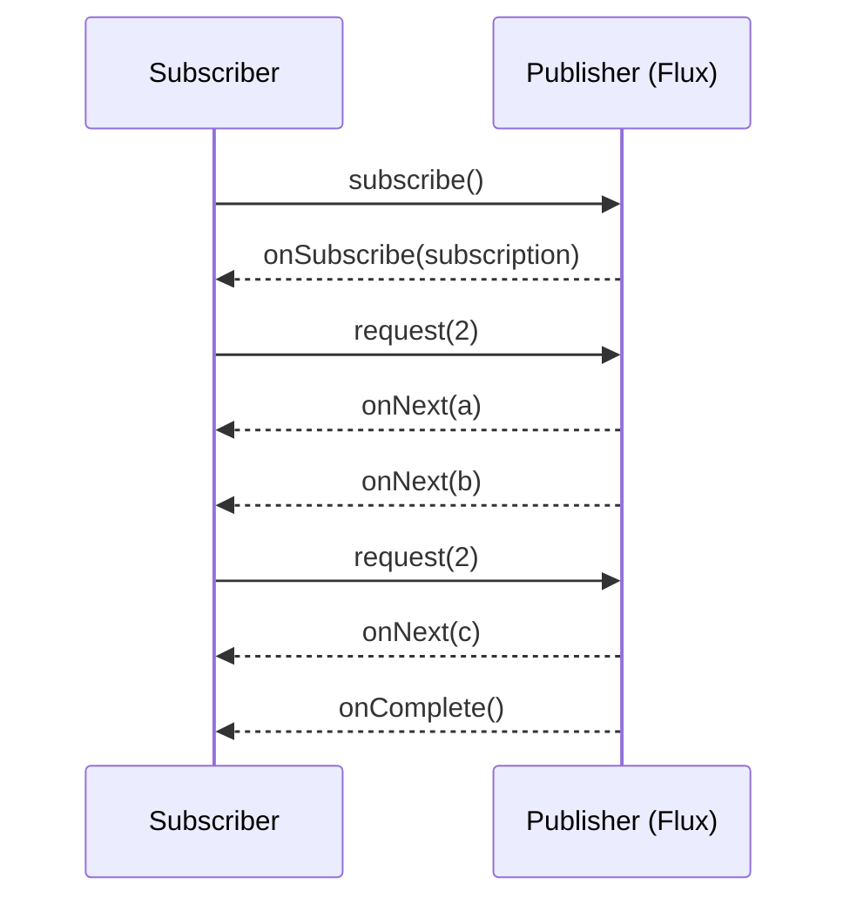

# Reactor - Mono & Flux

> [!tldr] TL;DR
> In Project Reactor a **Publisher** is either a **`Mono<T>`** (0 or 1 item, then complete/error) or a **`Flux<T>`** (0..N items, then complete/error). Pipelines are **lazy**: nothing happens until you **subscribe**. You transform with operators (`map`, `flatMap`, `filter`, `zip`...), choose threads with **schedulers** (`subscribeOn`, `publishOn`), handle errors with `onErrorResume`/`retryWhen`, and the subscriber controls the rate with **backpressure** (`request(n)`). Never block inside a reactive pipeline.

*Part of [[Java Reactive Course]] (course notes). Renamed from "Mono"; expanded with Flux, operators, schedulers and backpressure.*

## Course notes

- **Publisher** → `Mono<T>` & `Flux<T>`. A publisher can also emit no value at all.
- **Mono** can emit **0 or 1** item followed by an `onComplete` / `onError`. Mono → Subscriber.
- **Flux** can emit **0 or N** items (a stream) followed by `onComplete` / `onError`. Flux → Subscriber.
- Java Streams are lazy: they won't do anything unless connected to a terminal operator (like `forEach`). Similarly in reactive programming: **"Nothing happens until you subscribe."**
- `Mono.just(...)` evaluates its argument **immediately**, even without subscribers (it's a plain Java argument). Use `just` only when you already **have** the data.
- Use `Mono.fromSupplier(...)` (or `fromCallable`, `defer`) when you only want to do the work if someone subscribes.
- By default Reactor runs on the **thread that subscribes** (e.g. the main thread in a simple program); it doesn't create threads unless an operator or scheduler does.

```java
Mono<String> eager = Mono.just(expensiveLookup());          // expensiveLookup() runs NOW
Mono<String> lazy  = Mono.fromSupplier(() -> expensiveLookup()); // runs per subscription
Mono<User>   deferred = Mono.defer(() -> repo.findById(id));    // builds a fresh Mono per subscriber

lazy.subscribe(
    value -> System.out.println("got " + value),   // onNext
    err   -> System.err.println("failed " + err),  // onError
    ()    -> System.out.println("done"));          // onComplete
```

## Signals



Rule: `onNext*` then at most one terminal signal (`onComplete` **or** `onError`).

## Creating publishers

```java
Flux.just("a", "b", "c");
Flux.fromIterable(list);
Flux.range(1, 5);
Flux.interval(Duration.ofSeconds(1));            // ticks on a parallel scheduler (infinite)
Mono.empty(); Mono.error(new NotFoundException());
Mono.fromCallable(() -> blockingCall()).subscribeOn(Schedulers.boundedElastic()); // wrap blocking code
Flux.create(sink -> listener.onEvent(sink::next)); // bridge callbacks
```

## Operators (the everyday set)

| Operator | Does | Example |
|---|---|---|
| `map` | Sync 1:1 transform | `.map(User::email)` |
| `filter` | Drop items | `.filter(o -> o.total() > 100)` |
| `flatMap` | Async transform, **concurrent**, order not kept | `.flatMap(id -> repo.findById(id))` |
| `concatMap` | Async transform, **sequential**, order kept | `.concatMap(this::sendInOrder)` |
| `flatMapSequential` | Concurrent, but emits in source order | |
| `zip` / `zipWith` | Combine latest pairs | `Mono.zip(userMono, ordersMono)` |
| `merge` / `concat` | Interleave / append streams | |
| `take`, `skip`, `distinct`, `buffer`, `window` | Slice, dedupe, batch | `.buffer(100)` |
| `switchIfEmpty` / `defaultIfEmpty` | Fallback for empty | `.switchIfEmpty(Mono.error(new NotFound()))` |
| `doOnNext`, `doOnError`, `log()` | Side effects / debugging | |
| `timeout` | Fail if too slow | `.timeout(Duration.ofSeconds(2))` |

```java
// Dashboard: user + recent orders in parallel, then combine
Mono<Dashboard> dashboard(long userId) {
    Mono<User> user = userClient.get(userId);
    Mono<List<Order>> orders = orderClient.recent(userId).take(10).collectList();
    return Mono.zip(user, orders, Dashboard::new)
               .timeout(Duration.ofSeconds(2))
               .onErrorResume(TimeoutException.class, e -> Mono.just(Dashboard.empty()));
}
```

`map` vs `flatMap`: `map` returns a value; `flatMap` returns a **Publisher** and subscribes to it. If your function returns `Mono<X>`, `map` would give you `Mono<Mono<X>>`.

## Error handling

```java
client.fetch(id)
    .retryWhen(Retry.backoff(3, Duration.ofMillis(200)).filter(this::isTransient))
    .onErrorResume(NotFoundException.class, e -> Mono.empty())   // fallback publisher
    .onErrorMap(IOException.class, UpstreamException::new)        // translate
    .doOnError(e -> log.warn("fetch failed", e));
```

An error **terminates** the sequence: no more `onNext` after `onError`.

## Schedulers (threading)

| Scheduler | For |
|---|---|
| `Schedulers.immediate()` | Current thread |
| `Schedulers.single()` | One reusable thread |
| `Schedulers.parallel()` | CPU-bound work, ≈ #cores threads |
| `Schedulers.boundedElastic()` | Wrapping **blocking** I/O (bounded pool, queued) |
| `Schedulers.fromExecutor(...)` | Your own executor (e.g. virtual threads) |

- **`subscribeOn`**: where the **source** runs (affects the whole chain upstream, position doesn't matter much; the first one wins).
- **`publishOn`**: switches the thread for everything **downstream** of it.

```java
Flux.range(1, 3)
    .map(i -> { log("map1", i); return i; })          // runs on boundedElastic (subscribeOn)
    .publishOn(Schedulers.parallel())
    .map(i -> { log("map2", i); return i * 2; })      // runs on parallel (publishOn)
    .subscribeOn(Schedulers.boundedElastic())
    .subscribe();
```

In WebFlux, requests run on **Netty event-loop threads**; blocking one of them stalls many requests. Detect with **BlockHound** in tests.

## Backpressure

The subscriber decides how much it can handle by calling `request(n)`; the publisher must not send more. See [[Reactive Spring - Ch 5 Reactor & Backpressure]].

```java
Flux.range(1, 1_000)
    .log()
    .subscribe(new BaseSubscriber<Integer>() {
        @Override protected void hookOnSubscribe(Subscription s) { request(10); }   // start with 10
        @Override protected void hookOnNext(Integer v) {
            process(v);
            if (v % 10 == 0) request(10);                                             // ask for more
        }
    });

// operators that limit or shed load
source.limitRate(100);                    // request in batches of 100
source.onBackpressureBuffer(10_000);      // buffer up to 10k, then error
source.onBackpressureDrop(d -> metrics.dropped());
source.onBackpressureLatest();            // keep only the newest
flux.flatMap(this::callApi, 8);           // concurrency limit 8 for inner publishers
```

## Hot vs cold
- **Cold** (default): each subscriber triggers its own execution (e.g. an HTTP call per subscriber).
- **Hot**: emits regardless of subscribers; late subscribers miss earlier items (`Sinks.many().multicast()`, `share()`, `publish().autoConnect()`, `cache()` to replay).

## Testing with StepVerifier

```java
StepVerifier.create(Flux.just(1, 2, 3).map(i -> i * 10))
    .expectNext(10, 20, 30)
    .verifyComplete();

StepVerifier.withVirtualTime(() -> Mono.delay(Duration.ofHours(1)).thenReturn("x"))
    .thenAwait(Duration.ofHours(1))
    .expectNext("x")
    .verifyComplete();
```

## Pitfalls
- Forgetting to subscribe (or return the publisher to the framework): nothing runs.
- Calling `.block()` inside a reactive chain or on an event-loop thread.
- Using `Mono.just(repo.find())` which executes eagerly and possibly blocks.
- Side effects in `map` instead of `doOnNext`, or nested `subscribe()` calls instead of `flatMap`.
- `ThreadLocal`-based context (MDC, security) doesn't follow thread hops; use Reactor **`Context`** and context propagation (Micrometer).
- Unbounded `flatMap` concurrency hammering downstream services.

## Senior perspective
- Reactive is a trade: high concurrency and built-in backpressure versus harder debugging, stack traces and onboarding. With Java 21+ virtual threads, choose reactive deliberately (streaming, SSE, many long-lived connections, event pipelines), not by default. See [[Java Concurrency & Virtual Threads]].
- Every blocking call is a production incident waiting to happen in WebFlux: enforce BlockHound in CI, wrap legacy blocking calls with `boundedElastic`.
- Tune concurrency explicitly (`flatMap` concurrency, `limitRate`), add timeouts and retries with backoff+jitter at every remote boundary.
- Debugging: `checkpoint("desc")`, `Hooks.onOperatorDebug()` in dev only, and the Reactor debug agent (`ReactorDebugAgent.init()`) for readable assembly traces in production.

## Interview questions

> [!question]- Mono vs Flux?
> Both implement `Publisher<T>`. Mono emits at most one item then completes or errors (like an async `Optional`); Flux emits zero to many items then completes or errors (like an async stream).

> [!question]- What does "nothing happens until you subscribe" mean?
> Building a pipeline only assembles operators. Work starts when a subscriber subscribes (in WebFlux, the framework subscribes to the publisher you return). Each subscription to a cold publisher re-executes it.

> [!question]- `Mono.just` vs `Mono.fromSupplier` vs `Mono.defer`?
> `just` captures a value already computed (eager). `fromSupplier`/`fromCallable` compute the value lazily per subscription. `defer` lazily creates a whole new publisher per subscription.

> [!question]- `map` vs `flatMap` vs `concatMap`?
> `map` is a synchronous 1:1 transformation. `flatMap` maps each item to a publisher and merges them concurrently (order not preserved). `concatMap` does the same sequentially, preserving order.

> [!question]- `subscribeOn` vs `publishOn`?
> `subscribeOn` chooses the scheduler on which the subscription (and the source) runs, affecting the chain from the source. `publishOn` switches execution to a scheduler for operators after it.

> [!question]- What is backpressure and how does Reactor support it?
> A consumer signalling how many items it can handle via `request(n)` so a fast producer doesn't overwhelm it. Reactor propagates demand through operators and offers strategies (`limitRate`, `onBackpressureBuffer/Drop/Latest`, bounded `flatMap` concurrency).

> [!question]- How do you call a blocking API from a reactive pipeline?
> Wrap it with `Mono.fromCallable(...)` and `subscribeOn(Schedulers.boundedElastic())` so it doesn't block event-loop threads; better, use a non-blocking client.

## Related
- [[Java Reactive Course]] · [[Java & Spring Index]]
- [[Reactive Spring - Ch 4 IO & Reactive Streams]] · [[Reactive Spring - Ch 5 Reactor & Backpressure]] · [[Reactive Spring Book]]
- [[Java Concurrency & Virtual Threads]] · [[Java Language Essentials]] (Java Streams laziness)

## Sources
- [Project Reactor reference guide](https://projectreactor.io/docs/core/release/reference/)
- [Reactor: Which operator do I need?](https://projectreactor.io/docs/core/release/reference/apdx-operatorChoice.html)
- [Reactor: Threading and schedulers](https://projectreactor.io/docs/core/release/reference/coreFeatures/schedulers.html)
- [Reactive Streams specification](https://www.reactive-streams.org/)
- [BlockHound](https://github.com/reactor/BlockHound)
- Josh Long, *Reactive Spring* (2020)
