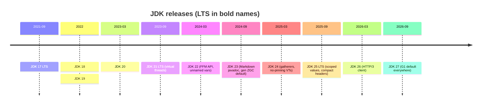

# Modern Java 17 to 25

> [!tldr] TL;DR
> Java ships a feature release every **six months** (March and September), with an **LTS** every two years: **17** (2021), **21** (2023), **25** (2025-09-16). Java 17 → 21 brought **records, sealed classes, pattern matching, text blocks and virtual threads**. Java 21 → 25 finalised **scoped values, stream gatherers, FFM API, compact source files, flexible constructors, module imports, compact object headers** and AOT startup improvements, and fixed virtual-thread pinning. JDK 26 (2026-03-17) and **JDK 27 (2026-09-15)** continue with HTTP/3, lazy constants and G1-by-default everywhere; structured concurrency is still in preview.

## Release cadence



- **Preview** features need `--enable-preview` and can change; **incubator** modules (Vector API) are APIs under `jdk.incubator.*`.
- Vendors (Oracle, Eclipse Temurin, Amazon Corretto, Azul, Microsoft) provide builds and LTS support. Spring Boot 4 still supports **Java 17+** but is tuned for 25.

## Java 17 LTS (2021-09) highlights, and what came before it
| Feature | JEP / version |
|---|---|
| `var` for locals | Java 10 |
| Switch expressions (`->`, `yield`) | 14 |
| Text blocks `"""` | 15 |
| Records | 16 (JEP 395) |
| Pattern matching for `instanceof` | 16 |
| **Sealed classes** | **17 (JEP 409)** |
| Strong encapsulation of JDK internals | 17 (JEP 403) |
| Helpful NullPointerExceptions | 14 |

## Java 18–20 (non-LTS)
- **18**: UTF-8 by default (JEP 400), simple web server `jwebserver` (JEP 408), `@snippet` in Javadoc.
- **19–20**: previews of virtual threads, record patterns, structured concurrency.

## Java 21 LTS (2023-09-19)
| JEP | Feature | What it means |
|---|---|---|
| 444 | **Virtual threads** | Millions of cheap threads; blocking code scales. See [[Java Concurrency & Virtual Threads]] |
| 441 | **Pattern matching for switch** | `switch` over types with `case Circle c ->`, guards with `when` |
| 440 | **Record patterns** | Deconstruct records: `case Point(var x, var y)` |
| 431 | **Sequenced collections** | `getFirst()`, `getLast()`, `reversed()` on List/Deque/LinkedHashMap... |
| 439 | Generational ZGC | Lower overhead for ZGC |
| 453/446 | Structured concurrency, scoped values | Preview |

```java
// Java 21: data-oriented programming
sealed interface Expr permits Num, Add, Mul {}
record Num(int v) implements Expr {}
record Add(Expr l, Expr r) implements Expr {}
record Mul(Expr l, Expr r) implements Expr {}

static int eval(Expr e) {
    return switch (e) {
        case Num(var v)        -> v;
        case Add(var l, var r) -> eval(l) + eval(r);
        case Mul(var l, var r) -> eval(l) * eval(r);
    };
}
```

## Java 22 (2024-03-19)
- **Foreign Function & Memory API** final (JEP 454): call native code and manage off-heap memory without JNI.
- **Unnamed variables & patterns** final (JEP 456): `catch (Exception _)`, `case Point(var x, _)`.
- Launch multi-file source programs (JEP 458): `java Main.java` with several files.
- Region pinning for G1 (JEP 423).

## Java 23 (2024-09-17)
- **Markdown documentation comments** (JEP 467): `///` Javadoc in Markdown.
- **ZGC generational mode by default** (JEP 474).
- Deprecate `sun.misc.Unsafe` memory-access methods for removal (JEP 471).

## Java 24 (2025-03-18)
| JEP | Feature |
|---|---|
| 485 | **Stream Gatherers** (final): custom intermediate ops |
| 491 | **Synchronize virtual threads without pinning**: `synchronized` no longer pins carrier threads |
| 483 | Ahead-of-time class loading & linking (faster startup via AOT cache) |
| 484 | Class-File API (final) |
| 486 | **Security Manager permanently disabled** |
| 490 | ZGC: non-generational mode removed |
| 496/497 | Quantum-resistant ML-KEM and ML-DSA |
| 450 | Compact object headers (experimental) |
| 472 | Prepare to restrict JNI |

```java
// Gatherers: sliding windows
List<List<Integer>> windows = Stream.of(1,2,3,4,5)
    .gather(Gatherers.windowSliding(3))
    .toList();   // [[1,2,3],[2,3,4],[3,4,5]]
```

## Java 25 LTS (2025-09-16)

> [!info]+ 🆕 2025: JDK 25 is the new LTS
> Final features:
> - **JEP 506 Scoped Values**: immutable, inheritable per-thread context; the virtual-thread-friendly replacement for many `ThreadLocal` uses.
> - **JEP 512 Compact Source Files and Instance Main Methods**: `void main() { IO.println("hi"); }`.
> - **JEP 511 Module Import Declarations**: `import module java.base;`.
> - **JEP 513 Flexible Constructor Bodies**: validate arguments before calling `super(...)`.
> - **JEP 519 Compact Object Headers** (product feature, opt-in): 8-byte headers instead of 12, less heap.
> - **JEP 521 Generational Shenandoah**.
> - **JEP 514/515 AOT command-line ergonomics and method profiling**: easier AOT cache creation, faster warm-up.
> - **JEP 510 Key Derivation Function API**; JFR CPU-time profiling (509, experimental), cooperative sampling (518), method timing & tracing (520).
> - **JEP 503**: 32-bit x86 port removed.
> Still preview: Structured Concurrency (5th), Stable Values (502), PEM encodings (470), primitive types in patterns (507), Vector API (10th incubator).

```java
// Scoped values (final in 25)
static final ScopedValue<String> REQUEST_ID = ScopedValue.newInstance();

void handle(Request req) {
    ScopedValue.where(REQUEST_ID, req.id()).run(() -> service.process(req));
}
// deep inside service code:
log.info("processing {}", REQUEST_ID.get());
```

```java
// Flexible constructor bodies (final in 25)
class PositiveBigInteger extends BigInteger {
    PositiveBigInteger(long value) {
        if (value <= 0) throw new IllegalArgumentException("non-positive");  // before super()
        super(Long.toString(value));
    }
}
```

## Java 26 (2026-03-17) and Java 27 (2026-09-15)

> [!info]+ 🆕 2026: JDK 26 and JDK 27
> **JDK 26** (GA 2026-03-17):
> - **JEP 517 HTTP/3 for the HTTP Client API**
> - JEP 516 AOT object caching with any GC; JEP 522 G1 throughput improvement (less synchronization)
> - JEP 500 **Prepare to make final mean final** (warnings when deep reflection mutates `final` fields)
> - JEP 504 Applet API removed
> - Previews: Structured Concurrency (6th), Lazy Constants (2nd, the renamed Stable Values), PEM (2nd), primitive patterns (4th); Vector API (11th incubator)
>
> **JDK 27** (GA **2026-09-15**, current release):
> - JEP 523 **G1 is the default GC in all environments** (including small/single-CPU containers, where Serial used to be picked)
> - JEP 534 **Compact object headers by default**
> - JEP 527 Post-quantum hybrid key exchange for TLS 1.3
> - JEP 536 JFR in-process data redaction
> - Previews: Structured Concurrency (**7th**), Lazy Constants (3rd), primitive patterns (5th), PEM (3rd); Vector API (12th incubator)
>
> Next LTS: expected to be JDK 29 (Sept 2027) under the two-year LTS cadence (unverified until announced).

## Upgrade guidance
- **17 → 21**: mostly smooth; biggest win is virtual threads (`spring.threads.virtual.enabled=true` in Boot 3.2+). Watch for removed/deprecated APIs and dependencies needing updates (Lombok, ByteBuddy, Mockito agents).
- **21 → 25**: JEP 491 removes most pinning pain; compact object headers can noticeably cut heap for object-heavy apps (JEP 519 reports double-digit % in benchmarks; measure your own, flag `-XX:+UseCompactObjectHeaders`). The Security Manager is gone; dynamic agent loading and JNI now warn.
- Run tests on the new JDK in CI with `--release` set; use `jdeprscan` and `jdeps` for API checks.

## Pitfalls
- Using preview features in production code: they can change or disappear.
- Assuming "Java 25" means your framework supports every feature; check Spring/Hibernate/Lombok versions.
- Mismatched `--release`/toolchain between build and runtime images.

## Senior perspective
- Pick **LTS for production** (21 or 25 in 2026) and plan upgrades every two years; non-LTS releases are for trying features early.
- Most gains come without code changes: newer GCs, AOT caches, compact headers. Benchmark startup, footprint and p99 latency when upgrading.
- Data-oriented Java (records + sealed + patterns) changes how domain models and DTOs are written; update team style guides.
- Virtual threads + scoped values change the concurrency story; reconsider reactive stacks for new I/O-bound services. See [[Java Concurrency & Virtual Threads]].

## Interview questions

> [!question]- What are the current Java LTS versions?
> 17 (2021), 21 (2023) and 25 (2025-09-16). A new LTS arrives every two years; feature releases every six months (JDK 26 in March 2026, JDK 27 in September 2026).

> [!question]- What are the most important features of Java 21?
> Virtual threads, pattern matching for switch, record patterns, sequenced collections and generational ZGC.

> [!question]- What did Java 25 finalise?
> Scoped values, compact source files/instance main methods, module import declarations, flexible constructor bodies, compact object headers (opt-in), generational Shenandoah, AOT ergonomics/profiling, the KDF API.

> [!question]- What's the status of structured concurrency?
> Still a preview API: 5th preview in 25, 6th in 26, 7th in 27. Use it only with `--enable-preview`; otherwise use executors/CompletableFuture.

> [!question]- What is a preview feature?
> A fully specified, implemented feature that isn't permanent yet. It must be enabled with `--enable-preview` at compile and run time and may change based on feedback.

## Related
- [[Java & Spring Index]]
- [[Java Language Essentials]] · [[Java Concurrency & Virtual Threads]] · [[JVM Internals - Memory & Garbage Collection]] · [[Spring Boot 3 to 4 - What's New]]

## Sources
- [OpenJDK: JDK 21](https://openjdk.org/projects/jdk/21/) · [JDK 22](https://openjdk.org/projects/jdk/22/) · [JDK 23](https://openjdk.org/projects/jdk/23/) · [JDK 24](https://openjdk.org/projects/jdk/24/)
- [OpenJDK: JDK 25 (GA 2025-09-16)](https://openjdk.org/projects/jdk/25/)
- [OpenJDK: JDK 26 (GA 2026-03-17)](https://openjdk.org/projects/jdk/26/)
- [OpenJDK: JDK 27 (GA 2026-09-15)](https://openjdk.org/projects/jdk/27/)
- [JEP 444: Virtual Threads](https://openjdk.org/jeps/444) · [JEP 491](https://openjdk.org/jeps/491) · [JEP 506: Scoped Values](https://openjdk.org/jeps/506) · [JEP 519: Compact Object Headers](https://openjdk.org/jeps/519)
- [JEP 12: Preview Features](https://openjdk.org/jeps/12)
- [Oracle Java SE Support Roadmap](https://www.oracle.com/java/technologies/java-se-support-roadmap.html)
