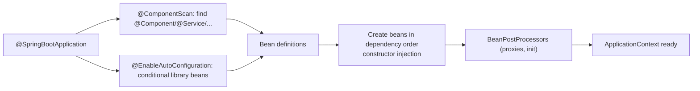

# Reactive Spring - Ch 3 Spring Fundamentals

<Note>
**TL;DR**

"Spring is just a big bag of beans." The chapter covers **DI/IoC**, **Java configuration** (`@Configuration` + `@Bean`), the **application context**, **AOP**, lifecycle hooks like **`BeanPostProcessor`**, **component scanning** with stereotype annotations and constructor injection, **profiles**, and Spring Boot's **starters** and **auto-configuration**.
</Note>

*Part of [Reactive Spring Book](/Software%20Engineering/Backend/Java/Reactive%20Spring%20Book/Reactive%20Spring%20Book) (book notes). Renamed from "Chapter 3". The up-to-date topic note is [Spring Boot Essentials](/Software%20Engineering/Backend/Java/Spring%20Boot%20Essentials).*

## What the chapter covers
DI, IoC, Java configuration, the Spring application context, aspect-oriented programming (AOP), and Spring Boot auto-configuration.

## Starter libraries/packages

- **Web** → everything to build a web application based on the Servlet specification and traditional Spring MVC: form validation, JSON/XML marshalling, WebSocket support, REST and HTTP controller support. (Renamed `spring-boot-starter-webmvc` in Boot 4.)
- **JDBC** → `JdbcTemplate` for working with SQL databases (plus `JdbcClient` since Boot 3.2).
- **Lombok** → compile-time annotation processor that generates getters, setters, `toString`, etc. (Records now cover many of its uses.)
- **Actuator** → HTTP endpoints exposing the health and metrics of the application.

`TransactionTemplate` lets you run code in a transaction programmatically: it commits, or rolls back if you throw an exception.

```java
transactionTemplate.executeWithoutResult(status -> {
    accounts.debit(from, amount);
    accounts.credit(to, amount);        // exception here → whole transaction rolled back
});
```

## Beans and Java configuration

Spring is just a big bag of beans.

A `@Configuration` class has methods annotated with `@Bean` whose return values are objects stored in, and made available to other objects through, the **application context**.

```java
@Configuration
class DataConfig {
    @Bean
    DataSource dataSource(Environment env) {
        var ds = new HikariDataSource();
        ds.setJdbcUrl(env.getProperty("db.url"));
        return ds;
    }

    @Bean
    CustomerService customerService(DataSource ds) {   // dependency injected by parameter
        return new CustomerService(ds);
    }
}
```

## `BeanPostProcessor`

`BeanPostProcessor` is a callback interface with two (default) methods. Overriding `postProcessAfterInitialization` lets you act on **every** object in the Spring application. In the book's example, the processor checks whether the bean is a `DataSource` of some sort and initialises it, so it doesn't matter how or where the `DataSource` was created: the post-processor ensures it's properly initialised.

```java
@Component
class DataSourceInitializer implements BeanPostProcessor {
    @Override
    public Object postProcessAfterInitialization(Object bean, String beanName) {
        if (bean instanceof DataSource ds) {
            runSchemaScripts(ds);
        }
        return bean;          // could also return a proxy wrapping the bean
    }
}
```

Spring has other lifecycle events and callback interfaces you'll meet from time to time; `BeanPostProcessor` is one of the most common, and it's how Spring itself creates proxies for `@Transactional`, `@Async` and `@Cacheable`.

## Profiles

Spring supports a command-line argument `--spring.profiles.active=prod` (note the double dash). Beans annotated `@Profile("prod")` and `application-prod.yaml` properties are then active.

## Component scanning and constructor injection

Spring can **implicitly** learn how objects are wired if we let it perform **component scanning** at startup. With `@ComponentScan` (included in `@SpringBootApplication`), Spring discovers objects in the current package or beneath it that carry identifying marker ("stereotype") annotations: `@Component`, `@Service`, `@Repository`, `@Controller`.

When Spring finds such a class it inspects the constructor(s):
- No explicit constructor → it uses the default constructor.
- A single constructor with no arguments → it uses that.
- A constructor whose arguments can be satisfied by other beans → Spring provides those collaborators (just like parameters of `@Bean` methods).
- Several ambiguous constructors → mark the one to use with `@Autowired`.



## Interview questions

<Accordion title="What is a `BeanPostProcessor` used for?">
A hook called for every bean before and after initialisation. Frameworks use it to wrap beans in proxies (transactions, async, caching, security) or to apply cross-cutting initialisation.
</Accordion>

<Accordion title="How does Spring choose a constructor for a component?">
If there's one constructor it uses it and resolves its parameters from the context. With several, it uses the one annotated `@Autowired` (or the no-arg one if present and none are annotated).
</Accordion>

<Accordion title="`@Configuration` + `@Bean` vs component scanning?">
`@Bean` methods give explicit control and work for third-party classes you can't annotate. Component scanning is implicit and convenient for your own classes. Most apps use both.
</Accordion>

## Related
- [Reactive Spring Book](/Software%20Engineering/Backend/Java/Reactive%20Spring%20Book/Reactive%20Spring%20Book) · [Java & Spring Index](/Software%20Engineering/Backend/Java/Java%20%26%20Spring%20Index)
- [Spring Boot Essentials](/Software%20Engineering/Backend/Java/Spring%20Boot%20Essentials) · [Reactive Spring - Ch 2 Java Refresher](/Software%20Engineering/Backend/Java/Reactive%20Spring%20Book/Reactive%20Spring%20-%20Ch%202%20Java%20Refresher) · [Reactive Spring - Ch 4 IO & Reactive Streams](/Software%20Engineering/Backend/Java/Reactive%20Spring%20Book/Reactive%20Spring%20-%20Ch%204%20IO%20%26%20Reactive%20Streams)

## Sources
- Josh Long, *Reactive Spring* (2020), chapter 3
- [Spring Framework reference: The IoC container](https://docs.spring.io/spring-framework/reference/core/beans.html)
- [Spring Framework reference: Container extension points (BeanPostProcessor)](https://docs.spring.io/spring-framework/reference/core/beans/factory-extension.html)
