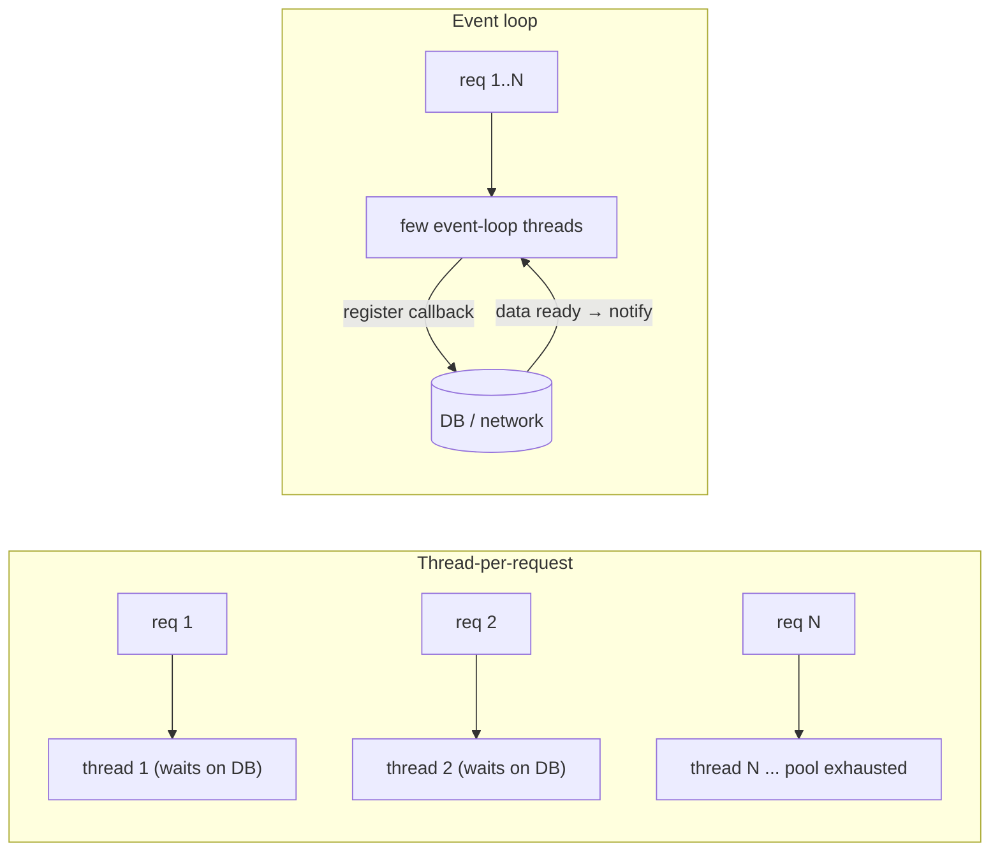

# Reactive Spring - Ch 4 IO & Reactive Streams

<Note>
**TL;DR**

Reactive programming embraces **asynchronous I/O**: instead of a thread waiting idle for I/O, the client of a data stream is **notified** when new data arrives. It pays off for I/O-bound work, not CPU-bound work. The **Reactive Streams** initiative standardises four interfaces, **`Publisher`**, **`Subscriber`**, **`Subscription`** and **`Processor`**, whose only job is to move data from producer to consumer with demand-based flow control.
</Note>

*Part of [Reactive Spring Book](/Software%20Engineering/Backend/Java/Reactive%20Spring%20Book/Reactive%20Spring%20Book) (book notes). Renamed from "Chapter 4 I-O".*

## Why reactive?

- Reactive programming is an approach to writing software that embraces asynchronous input and output (I/O).
- The idea is to use resources that would otherwise sit idle waiting for I/O: a client of a stream of data is **notified** of new data instead of asking (and waiting) for it.
- We can't have true parallelism beyond the number of **cores** on the machine.
- Threads in Java, .NET, Python and Ruby are backed by **operating-system threads** that the OS schedules. Each has context associated with it; by default about **1 MB of stack** on the JVM (64-bit Linux).
- The JVM, .NET and others take a middle-of-the-road approach to concurrency: delegating to the OS is a safe bet with predictable results and asks little of the programmer. But it means one blocked request = one idle, expensive thread.
- If the work is **CPU-bound** (Fibonacci, bitcoin mining, cryptography), reactive programming buys nothing: the CPU is busy, not waiting.



<Info>
**🆕 Since the book: virtual threads**

Java 21 (2023-09-19) added **virtual threads** (JEP 444): cheap JVM-managed threads that unmount from the OS thread while blocked, fixing the "expensive idle thread" problem *without* rewriting code in reactive style. Java 24 (2025-03-18, JEP 491) removed pinning in `synchronized`. For many request/response services this is now the simpler choice; reactive keeps its edge for streaming and backpressure. See [Java Concurrency & Virtual Threads](/Software%20Engineering/Backend/Java/Java%20Concurrency%20%26%20Virtual%20Threads).
</Info>

## The Reactive Streams interfaces

The Reactive Streams initiative defines four types. They are useful, but they do one thing and do it really well: **move data from producer to consumer**.

```java
public interface Publisher<T> {
    void subscribe(Subscriber<? super T> s);
}
public interface Subscriber<T> {
    void onSubscribe(Subscription s);
    void onNext(T t);
    void onError(Throwable t);
    void onComplete();
}
public interface Subscription {
    void request(long n);
    void cancel();
}
public interface Processor<T, R> extends Subscriber<T>, Publisher<R> {}
```

1. **`Publisher<T>`**: a provider of a potentially unbounded number of sequenced elements, publishing them according to the demand received from its `Subscriber`(s). A publisher can serve multiple subscribers that `subscribe(Subscriber)` dynamically at various points in time.
2. **`Subscriber<T>`**: a receiver of signals from a publisher: data elements, error signals or completion. It has methods for handling the subscription (`onSubscribe(Subscription)`), elements (`onNext(T)`), errors (`onError(Throwable)`) and completion (`onComplete()`).
3. **`Subscription`**: the one-to-one lifecycle of a subscriber subscribed to a publisher. It's used both to **signal demand** (`request(n)`) and to **cancel** (allowing resource clean-up).
4. **`Processor<T, R>`**: a processing stage that is both a subscriber and a publisher and obeys both contracts. It consumes `T` and produces `R`.

The type parameter `T` is the type of item processed by `Publisher`, `Subscriber` and `Processor`. `Subscription` has **no** type parameter: it only deals with the mechanics of subscribing, not the data. In `Processor<T, R>`, `T` is the input type and `R` the output type.

Since Java 9 the same four interfaces exist in the JDK as `java.util.concurrent.Flow.*`; `FlowAdapters` converts between them (see [Reactive Spring - Ch 5 Reactor & Backpressure](/Software%20Engineering/Backend/Java/Reactive%20Spring%20Book/Reactive%20Spring%20-%20Ch%205%20Reactor%20%26%20Backpressure)).

## Interview questions

<Accordion title="When does reactive programming help and when doesn't it?">
It helps when threads would otherwise wait on I/O (many concurrent network/DB calls, streaming). It doesn't help CPU-bound work, where cores are the limit.
</Accordion>

<Accordion title="Name the Reactive Streams interfaces and their roles.">
Publisher (produces items on demand), Subscriber (receives onSubscribe/onNext/onError/onComplete), Subscription (link between them: `request(n)` and `cancel()`), Processor (both, a transformation stage).
</Accordion>

<Accordion title="Why doesn't `Subscription` have a type parameter?">
It doesn't carry data, only control: demand (`request`) and cancellation.
</Accordion>

## Related
- [Reactive Spring Book](/Software%20Engineering/Backend/Java/Reactive%20Spring%20Book/Reactive%20Spring%20Book) · [Java & Spring Index](/Software%20Engineering/Backend/Java/Java%20%26%20Spring%20Index)
- [Reactive Spring - Ch 5 Reactor & Backpressure](/Software%20Engineering/Backend/Java/Reactive%20Spring%20Book/Reactive%20Spring%20-%20Ch%205%20Reactor%20%26%20Backpressure) · [Reactor - Mono & Flux](/Software%20Engineering/Backend/Java/Java%20Reactive%20Course/Reactor%20-%20Mono%20%26%20Flux) · [Java Reactive Course](/Software%20Engineering/Backend/Java/Java%20Reactive%20Course/Java%20Reactive%20Course)
- [Java Concurrency & Virtual Threads](/Software%20Engineering/Backend/Java/Java%20Concurrency%20%26%20Virtual%20Threads) · [Concurrency And Parallelism](/Software%20Engineering/Principles/Concurrency%20And%20Parallelism)

## Sources
- Josh Long, *Reactive Spring* (2020), chapter 4
- [Reactive Streams specification for the JVM](https://github.com/reactive-streams/reactive-streams-jvm)
- [java.util.concurrent.Flow (Java SE 25 API)](https://docs.oracle.com/en/java/javase/25/docs/api/java.base/java/util/concurrent/Flow.html)
- [JEP 444: Virtual Threads](https://openjdk.org/jeps/444)
