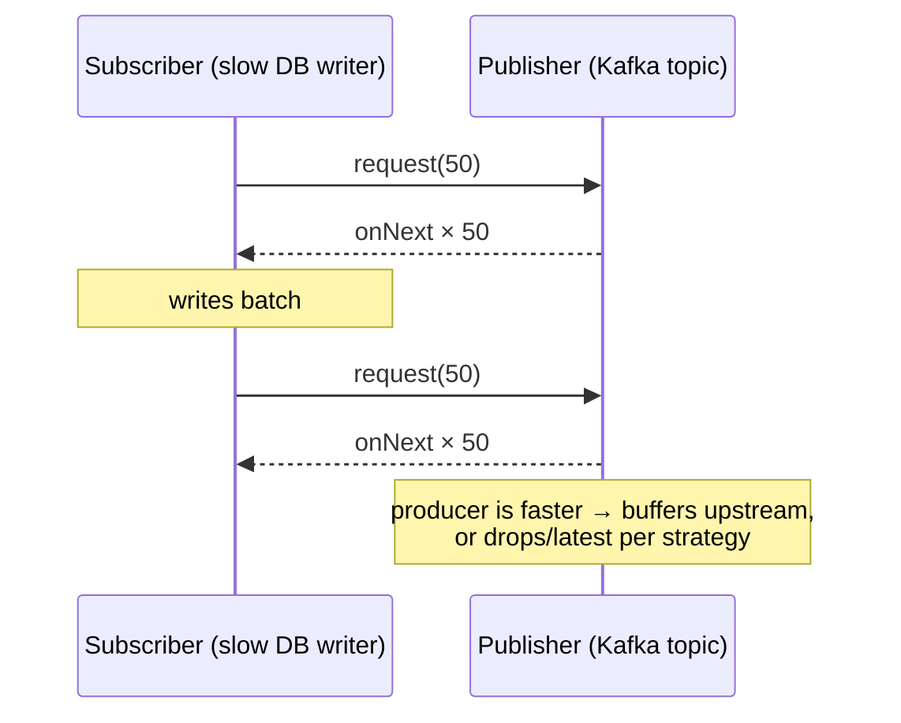

# Reactive Spring - Ch 5 Reactor & Backpressure

<Note>
**TL;DR**

Reactive programming answers "how do we handle more users with the same threads?" through **cooperative multithreading**: code signals when it isn't using a thread, and **Reactor** (a scheduler plus operators) moves work between threads. **Backpressure** (flow control) lets the **subscriber** set the pace with `request(n)`, so a fast producer can't overwhelm it. Reactor's two publishers are **`Flux<T>`** (0..N) and **`Mono<T>`** (0..1); everything a stream emits is a **signal**.
</Note>

*Part of [Reactive Spring Book](/Software%20Engineering/Backend/Java/Reactive%20Spring%20Book/Reactive%20Spring%20Book) (book notes). Renamed from "Chapter 5". Hands-on Reactor details: [Reactor - Mono & Flux](/Software%20Engineering/Backend/Java/Java%20Reactive%20Course/Reactor%20-%20Mono%20%26%20Flux).*

## Why: cooperative multithreading

- Reactive programming offers a solution to an old problem: how do we handle more users? How do we scale? How do we make more efficient use of our threads? **Reactive programming supports cooperative multithreading.**
- It requires rewriting code so that it signals to the runtime when it is and isn't using a thread (by returning publishers instead of blocking).
- **Reactor** moves the flow of execution from one thread to another in the course of its work: it's a **scheduler** as much as a library of operators.

## Backpressure (flow control)

Message queues are a critical component of distributed systems. They keep decoupled components alive by **buffering** messages, letting consumers process messages as they can, and no faster. This regulated consumption of data is **flow control**.

In reactive programming, flow control is called **backpressure**. It ensures data is **consumed at a regulated rate** so consumers are not overwhelmed. The **subscriber** controls the flow and requests more data with `request(n)`. The publisher won't produce more than the subscriber asked for. If the subscriber is ever overwhelmed, it has only itself to blame.



```java
kafkaFlux
    .limitRate(50)                                   // request in batches of 50
    .buffer(50)
    .concatMap(batch -> repository.saveAll(batch))   // one batch at a time
    .subscribe();
```

## The Reactive Streams specification

It consists of **four interfaces** and (since the JDK integration) an adapter class:

1. **`Publisher<T>`**: publishes (broadcasts!) data of type `T` to a `Subscriber<T>`.
2. **`Subscriber<T>`**: as soon as it subscribes, it receives a `Subscription`, arguably the most crucial type in the whole specification.
3. **`Subscription`**: received in `onSubscribe`, **unique per subscriber**: three subscribers means three distinct subscriptions. It's the link between producer and consumer. The subscriber uses it to request more data with `request(n)`. This is the critical point: **the subscriber controls the rate of processing**.
4. **`Processor<T, R>`**: just a bridge implementing both `Publisher` and `Subscriber`: a producer *and* a consumer, a source *and* a sink.
5. **`FlowAdapters`**: a concrete class that adapts Reactive Streams types to and from their Java 9 `java.util.concurrent.Flow` analogues.

## Reactor's publishers: Flux and Mono

Reactor provides two specialisations of `Publisher<T>`:
- **`Flux<T>`**: produces zero or more values; potentially unbounded.
- **`Mono<T>`**: emits zero or one value.

Both implement `Publisher<T>`. The book's recommendation: **accept `Publisher<T>`** in method parameters but **return `Flux<T>` or `Mono<T>`**, so callers get the rich operator API while you stay flexible about inputs.

```java
public Flux<Order> enrich(Publisher<Order> orders) {
    return Flux.from(orders).flatMap(o -> pricing.price(o), 16);
}
```

## Signals

In the Reactor world a stream emits **signals**. Each new message is a signal. Each new subscription is a signal. Each abnormal termination is a signal. `Signal` is a concept and part of the API, and you can listen for them:

```java
flux.doOnSubscribe(s -> log.info("subscribed"))
    .doOnNext(v -> log.info("next {}", v))
    .doOnError(e -> log.error("error", e))
    .doOnComplete(() -> log.info("complete"))
    .doFinally(type -> log.info("terminated with {}", type))   // ON_COMPLETE, ON_ERROR, CANCEL
    .materialize()                                              // turn signals into Signal<T> objects
    .subscribe(sig -> log.info("{}", sig));
```

## The four I/O models (recap)

Repeated from the course (the insurance-company call-waiting example); full table in [Java Reactive Course](/Software%20Engineering/Backend/Java/Java%20Reactive%20Course/Java%20Reactive%20Course):

1. Sync + blocking (default)
2. Async (hire another thread so you're free; that thread still waits)
3. Non-blocking (low-level polling)
4. Non-blocking + async (the "hyped" approach: callbacks/events, nobody waits)

<Info>
**🆕 Since the book**

Spring Framework 7 (2025-11-13) still ships WebFlux and Reactor support, and adds core `@ConcurrencyLimit`/`@Retryable` that make blocking + virtual-thread code simpler to protect. Backpressure remains the main reason to pick reactive for streaming pipelines. See [Spring Boot 3 to 4 - What's New](/Software%20Engineering/Backend/Java/Spring%20Boot%203%20to%204%20-%20What's%20New) and [Java Concurrency & Virtual Threads](/Software%20Engineering/Backend/Java/Java%20Concurrency%20%26%20Virtual%20Threads).
</Info>

## Interview questions

<Accordion title="What is backpressure?">
Flow control where the consumer signals how much data it can handle (`request(n)`) and the producer respects it, so memory and downstream systems aren't overwhelmed.
</Accordion>

<Accordion title="Why accept `Publisher<T>` but return `Flux`/`Mono`?">
Accepting the minimal interface lets callers pass any Reactive Streams implementation (RxJava, Akka Streams, JDK Flow via adapters); returning Reactor types gives callers Reactor's operators and clear cardinality (0..1 vs 0..N).
</Accordion>

<Accordion title="What is a signal in Reactor?">
Any event a stream emits: subscription, next item, error, completion (and cancellation). Operators like `doOnNext`, `doOnError`, `materialize` let you observe them.
</Accordion>

## Related
- [Reactive Spring Book](/Software%20Engineering/Backend/Java/Reactive%20Spring%20Book/Reactive%20Spring%20Book) · [Java & Spring Index](/Software%20Engineering/Backend/Java/Java%20%26%20Spring%20Index)
- [Reactor - Mono & Flux](/Software%20Engineering/Backend/Java/Java%20Reactive%20Course/Reactor%20-%20Mono%20%26%20Flux) · [Reactive Spring - Ch 4 IO & Reactive Streams](/Software%20Engineering/Backend/Java/Reactive%20Spring%20Book/Reactive%20Spring%20-%20Ch%204%20IO%20%26%20Reactive%20Streams) · [Java Reactive Course](/Software%20Engineering/Backend/Java/Java%20Reactive%20Course/Java%20Reactive%20Course)
- [Java Concurrency & Virtual Threads](/Software%20Engineering/Backend/Java/Java%20Concurrency%20%26%20Virtual%20Threads) · [Microservices Architecture](/Software%20Engineering/DevOps/Microservices%20Architecture)

## Sources
- Josh Long, *Reactive Spring* (2020), chapter 5
- [Reactive Streams specification](https://github.com/reactive-streams/reactive-streams-jvm)
- [Project Reactor reference guide](https://projectreactor.io/docs/core/release/reference/)
- [Spring Framework 7.0 General Availability](https://spring.io/blog/2025/11/13/spring-framework-7-0-general-availability/)
