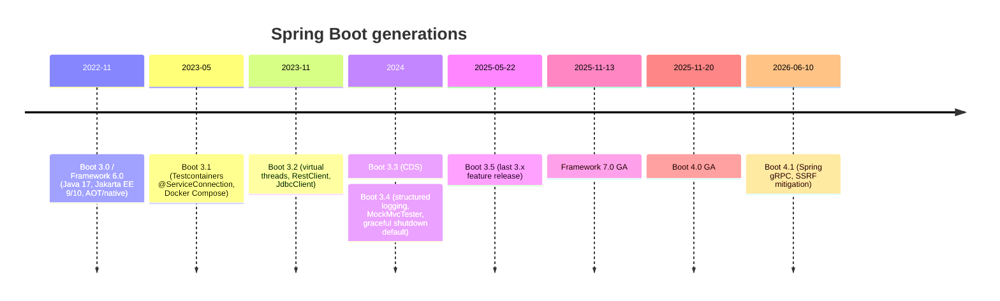

# Spring Boot 3 to 4 - What's New

> [!tldr] TL;DR
> **Spring Boot 3** (2022) moved Spring to **Java 17** and **Jakarta EE** (`javax.*` → `jakarta.*`), then added virtual threads, `RestClient`/`JdbcClient`, Testcontainers/Docker Compose integration and structured logging across 3.1–3.5. **Spring Framework 7.0 (2025-11-13)** and **Spring Boot 4.0 (2025-11-20)** start a new generation: **Jakarta EE 11**, **JSpecify null safety**, built-in **API versioning**, **HTTP service client** groups, core **resilience** annotations, **Jackson 3**, a fully **modularised** Boot with renamed starters, and `@MockBean` removed. Java 17 is still the baseline, Java 25 is first-class. **Boot 4.1 (2026-06-10)** added Spring gRPC and SSRF protection.

## Timeline



## Spring Boot 3.x recap (what you should already be using)

| Version | Key features |
|---|---|
| 3.0 | Java 17 baseline, **Jakarta EE 9/10** namespace, GraalVM native images and AOT, Micrometer Observation / tracing |
| 3.1 | `@ServiceConnection` for Testcontainers, Docker Compose support in dev |
| 3.2 | **Virtual threads** (`spring.threads.virtual.enabled`), **`RestClient`**, **`JdbcClient`**, CRaC support |
| 3.3 | Class Data Sharing (CDS) support, SBOM endpoint |
| 3.4 | **Structured logging** (ECS, GELF, Logstash JSON), `MockMvcTester`, graceful shutdown on by default |
| 3.5 (2025-05-22) | Structured-logging improvements, SSL for service connections, loading properties from a single env var, bean background initialisation, annotations to register filters/servlets |

## Spring Framework 7.0 (2025-11-13)

> [!info]+ 🆕 2025: Spring Framework 7.0
> - **Baselines**: Java 17 minimum, **Java 25** embraced; **Jakarta EE 11** (Servlet 6.1, JPA 3.2, Bean Validation 3.1); Kotlin 2.2; JUnit 6 support.
> - **JSpecify null safety** across the portfolio (`@Nullable`, `@NullMarked`), replacing Spring's own `@Nullable` annotations.
> - **API versioning** built into MVC and WebFlux.
> - **HTTP interface client** configuration with `@ImportHttpServices` groups.
> - **Resilience**: `@Retryable` and `@ConcurrencyLimit` in core (with `@EnableResilientMethods`).
> - **Programmatic bean registration** (`BeanRegistrar`).
> - **Jackson 3** support (Jackson 2 still supported, deprecated).
> - `JmsClient`, `RestTestClient` for testing.
> - `RestTemplate`: the 7.0 docs mark it deprecated in favour of **`RestClient`**; the Spring team's plan (2025-09-30) is a formal `@Deprecated(forRemoval)` in **7.1** (provisionally Nov 2026) and removal in 8.0.

### API versioning

```java
@Configuration
class WebConfig implements WebMvcConfigurer {
    @Override
    public void configureApiVersion(ApiVersionConfigurer configurer) {
        configurer.resolveFromHeader("X-API-Version")      // or resolveFromQueryParameter / resolveFromPath
                  .usingSemanticVersionParser()
                  .withSupportedVersions("1.0", "2.0");
    }
}

@RestController
@RequestMapping("/users/{id}")
class UserController {
    @GetMapping(version = "1.0") UserV1 v1(@PathVariable long id) { ... }
    @GetMapping(version = "2.0") UserV2 v2(@PathVariable long id) { ... }
}
```

Boot 4 auto-configures this from `spring.mvc.apiversion.*` properties. Deprecated versions can emit deprecation headers (RFC 9745/8594).

### HTTP service clients

```java
@HttpExchange("/repos/{owner}/{repo}")
interface RepositoryService {
    @GetExchange Repository get(@PathVariable String owner, @PathVariable String repo);
}

@Configuration
@ImportHttpServices(group = "github", types = RepositoryService.class)
class ClientConfig {}
// Boot 4 auto-configures the group's RestClient (base URL, timeouts) from properties;
// inject RepositoryService anywhere like a normal bean
```

### Resilience in core

```java
@Configuration @EnableResilientMethods
class ResilienceConfig {}

@Service
class PaymentGateway {
    @Retryable                                    // retries with backoff on exception (attributes tune count/delay/jitter)
    @ConcurrencyLimit(10)                         // at most 10 concurrent calls (good with virtual threads)
    public Receipt charge(Charge c) { ... }
}
```

(Check the exact attribute names for retry count/backoff in the reference docs for your 7.x version.)

### JSpecify null safety

```java
@NullMarked                         // package-info.java: everything non-null by default
package com.shop.orders;

public interface OrderRepository {
    @Nullable Order findOrNull(long id);    // explicit
}
```

Tools like NullAway (Error Prone) and IntelliJ then flag possible NPEs at compile time; Kotlin sees Spring APIs with correct nullability.

## Spring Boot 4.0 (2025-11-20)

> [!info]+ 🆕 2025: Spring Boot 4.0
> - Built on Spring Framework 7, **Spring Security 7**, **Hibernate 7.2**, Jakarta EE 11. **Java 17+** required, first-class **Java 25**.
> - **Complete modularisation**: smaller focused jars and **renamed starters**, e.g. `spring-boot-starter-web` → **`spring-boot-starter-webmvc`**, `-web-services` → `-webservices`, OAuth starters gain a `security` prefix (`spring-boot-starter-security-oauth2-client`). Each technology has a companion **test starter** (`spring-boot-starter-webmvc-test`, `-data-jpa-test`). `spring-boot-starter-classic` / `-test-classic` give the old "everything" classpath for quick migration.
> - **Jackson 3** by default (group id `tools.jackson`, except `jackson-annotations`); Jackson 2 support deprecated.
> - **API versioning** and **HTTP service client** auto-configuration; JDK `HttpClient` auto-config uses **virtual threads** when enabled.
> - `spring-boot-starter-opentelemetry` for OTLP metrics and traces; `spring-boot-starter-kotlin-serialization`.
> - **Removed**: `@MockBean`/`@SpyBean` (use `@MockitoBean`/`@MockitoSpyBean`), **Undertow** (not Servlet 6.1 compatible yet), executable-jar launch scripts, Spock integration, Pulsar reactive, Spring Session Hazelcast/MongoDB direct support. Spring Batch runs in-memory by default (`spring-boot-starter-batch-jdbc` for DB metadata).

## Spring Boot 4.1 (2026-06-10)

> [!info]+ 🆕 2026: Spring Boot 4.1
> - **Spring gRPC** support.
> - **HTTP client SSRF mitigation** with `InetAddressFilter`.
> - Updated Jackson configuration properties and customisation.
> - OpenTelemetry updates; file rotation for Log4j.
> - 4.1.1 released 2026-08-20; 4.2.0-M1 on 2026-08-20.

## Migration playbook (3.x → 4.0)
1. Upgrade to the **latest 3.5.x** first and fix all deprecation warnings (Boot removes things deprecated in 3.x).
2. Java 17+ (ideally 21 or 25), Kotlin 2.2 if applicable, Gradle 8.14+/9 or current Maven.
3. Swap starters to the new names, or temporarily use `spring-boot-starter-classic` to get running, then trim.
4. Jackson 3: change imports/group ids (`com.fasterxml.jackson.databind` → `tools.jackson.databind`) or keep Jackson 2 temporarily.
5. Tests: `@MockBean` → `@MockitoBean`; add module test starters.
6. Hibernate 7 / JPA 3.2 changes (see [[JPA, Hibernate & jOOQ - Data Access in Java]]); Spring Security 7 config changes.
7. Replace Undertow with Tomcat or Jetty; replace `RestTemplate` with `RestClient` over time.
8. Use the **Spring Boot properties migrator** (`spring-boot-properties-migrator`) at runtime to flag renamed properties, and OpenRewrite recipes for mechanical changes.

## Pitfalls
- Jumping straight from 2.x or early 3.x to 4.0: do it in steps (javax→jakarta is the 2→3 pain, modularisation/Jackson 3 is the 3→4 pain).
- Transitive libraries still on Jackson 2 or Undertow.
- Assuming null-safety annotations change runtime behaviour: they're for tooling/compile-time checks.
- Over-versioning APIs: API versioning support doesn't mean every change needs a new version; prefer additive changes.

## Senior perspective
- Treat framework majors as planned projects with a compatibility matrix (Boot ↔ Framework ↔ Security ↔ Hibernate ↔ Jackson ↔ your libraries) and OSS support dates.
- The 4.x features push you toward **virtual threads + `RestClient` + HTTP interfaces + core resilience**: a simpler stack than reactive + Resilience4j for many services.
- Enforce null safety in CI (NullAway) as you adopt JSpecify; it pays off most in shared libraries.
- Keep observability consistent (OpenTelemetry starter) across services during migration.

## Interview questions

> [!question]- What were the big changes in Spring Boot 3?
> Java 17 baseline, Jakarta EE namespace (`jakarta.*`), native images/AOT, Micrometer observation and tracing, then virtual threads, `RestClient`/`JdbcClient`, Testcontainers/Docker Compose integration and structured logging in later 3.x releases.

> [!question]- What's new in Spring Framework 7 / Spring Boot 4?
> Jakarta EE 11, JSpecify null safety, API versioning, HTTP service client groups, `@Retryable`/`@ConcurrencyLimit` in core, Jackson 3, `RestTestClient`, programmatic bean registration; Boot 4 is fully modularised with renamed starters and per-module test starters, removes `@MockBean` and Undertow, and adds an OpenTelemetry starter.

> [!question]- What should you use instead of `RestTemplate`?
> `RestClient` for synchronous code (optionally behind declarative `@HttpExchange` interfaces), `WebClient` for reactive/streaming. `RestTemplate` is deprecated in 7.0 docs, formally deprecated for removal in 7.1 and to be removed in 8.0.

> [!question]- How does API versioning work in Spring 7?
> Configure a version resolution strategy (header, query parameter, path segment or media type) with `ApiVersionConfigurer` (or Boot properties), then add `version = "x"` to mapping annotations. Unsupported versions are rejected; deprecated ones can advertise deprecation headers.

> [!question]- How would you migrate a service from Boot 3 to Boot 4?
> Upgrade to latest 3.5 and clear deprecations, move to Java 21/25, rename starters (or use the classic starters temporarily), migrate to Jackson 3, update tests to `@MockitoBean` and module test starters, check Hibernate 7/Security 7 changes, run the properties migrator and OpenRewrite recipes, then roll out gradually.

## Related
- [[Java & Spring Index]]
- [[Spring Boot Essentials]] · [[JPA, Hibernate & jOOQ - Data Access in Java]] · [[Java Concurrency & Virtual Threads]] · [[Modern Java 17 to 25]]
- [[Reactive Spring Book]]

## Sources
- [Spring Framework 7.0 General Availability (2025-11-13)](https://spring.io/blog/2025/11/13/spring-framework-7-0-general-availability/)
- [Spring Boot 4.0.0 available now (2025-11-20)](https://spring.io/blog/2025/11/20/spring-boot-4-0-0-available-now/)
- [Spring Boot 4.0 Release Notes](https://github.com/spring-projects/spring-boot/wiki/Spring-Boot-4.0-Release-Notes) · [Spring Boot 4.0 Migration Guide](https://github.com/spring-projects/spring-boot/wiki/Spring-Boot-4.0-Migration-Guide)
- [Spring Boot 4.1.0 available now (2026-06-10)](https://spring.io/blog/2026/06/10/spring-boot-4/) · [Spring Boot 4.1.1 (2026-08-20)](https://spring.io/blog/2026/08/20/spring-boot-4-1-1-available-now/)
- [Spring Boot 3.5.0 available now (2025-05-22)](https://spring.io/blog/2025/05/22/spring-boot-3-5-0-available-now)
- [The state of HTTP clients in Spring (2025-09-30)](https://spring.io/blog/2025/09/30/the-state-of-http-clients-in-spring/)
- [Spring Framework reference: API versioning](https://docs.spring.io/spring-framework/reference/web/webmvc-versioning.html)
- [Spring Framework reference: REST clients / HTTP interfaces](https://docs.spring.io/spring-framework/reference/integration/rest-clients.html)
- [JSpecify](https://jspecify.dev/)
