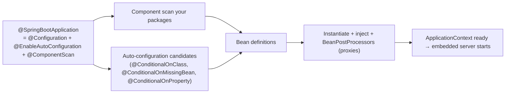

# Spring Boot Essentials

<Note>
**TL;DR**

**Spring** is an **IoC container**: you declare beans (classes annotated `@Component`/`@Service`/`@Repository`/`@Controller` or `@Bean` methods) and Spring creates them and **injects** their dependencies. **Spring Boot** adds **auto-configuration** (beans created automatically when a library is on the classpath and you haven't defined your own), **starters** (curated dependency sets), externalised **configuration and profiles**, an embedded server, **Actuator** for health/metrics, and test support. On top you typically use **Spring MVC** (or WebFlux), **Spring Data JPA**, **`@Transactional`** and **Spring Security**.
</Note>

## IoC and dependency injection

Instead of objects creating their collaborators (`new`), the container creates everything and wires it. That's **Inversion of Control**; supplying collaborators via constructors is **Dependency Injection**. Background from the book: [Reactive Spring - Ch 3 Spring Fundamentals](/Software%20Engineering/Backend/Java/Reactive%20Spring%20Book/Reactive%20Spring%20-%20Ch%203%20Spring%20Fundamentals).

```java
@Service
public class OrderService {
    private final OrderRepository orders;
    private final PaymentClient payments;

    // single constructor: Spring injects it, no @Autowired needed
    public OrderService(OrderRepository orders, PaymentClient payments) {
        this.orders = orders;
        this.payments = payments;
    }
}

@Configuration
class ClientsConfig {
    @Bean
    PaymentClient paymentClient(RestClient.Builder builder, PaymentProperties props) {
        return new PaymentClient(builder.baseUrl(props.url()).build());
    }
}
```

- Prefer **constructor injection** (immutable, testable, fails fast). Avoid field `@Autowired`.
- Stereotypes: `@Component` (generic), `@Service`, `@Repository` (adds exception translation), `@Controller`/`@RestController`.
- Ambiguity: `@Primary`, `@Qualifier("name")`, or inject `List<Interface>` to get all implementations.
- Scopes: `singleton` (default, one per context), `prototype`, `request`, `session`.
- Lifecycle: constructor → dependency injection → `@PostConstruct` → `BeanPostProcessor`s (how proxies for `@Transactional`, `@Async`, `@Cacheable` are created) → ready → `@PreDestroy`.



## Auto-configuration and starters

```java
@SpringBootApplication
public class ShopApplication {
    public static void main(String[] args) { SpringApplication.run(ShopApplication.class, args); }
}
```

- Add `spring-boot-starter-data-jpa` + a JDBC driver and Boot configures a `DataSource` (HikariCP), `EntityManagerFactory`, transaction manager and repositories.
- Your own bean always wins: auto-configs are `@ConditionalOnMissingBean`.
- See why something was (not) configured: run with `--debug` (condition evaluation report) or Actuator's `/actuator/conditions`.

Common starters (Boot 4 names): `spring-boot-starter-webmvc`, `-webflux`, `-data-jpa`, `-jdbc`, `-validation`, `-security`, `-actuator`, `-test` (plus per-module test starters in Boot 4). See [Spring Boot 3 to 4 - What's New](/Software%20Engineering/Backend/Java/Spring%20Boot%203%20to%204%20-%20What's%20New).

## Configuration and profiles

```yaml
# application.yaml
server.port: 8080
payments:
  url: https://payments.internal
  timeout: 2s
spring:
  datasource:
    url: jdbc:postgresql://localhost:5432/shop
    username: shop
    password: ${DB_PASSWORD}          # from env, never committed
  threads.virtual.enabled: true
---
spring.config.activate.on-profile: prod
payments.url: https://payments.prod.internal
```

```java
@ConfigurationProperties("payments")
@Validated
public record PaymentProperties(@NotBlank String url, Duration timeout) {}
// enable with @ConfigurationPropertiesScan on the application class
```

- Precedence (high → low, simplified): command-line args → env vars (`PAYMENTS_URL`) → profile-specific files → `application.yaml` → defaults.
- Activate profiles: `--spring.profiles.active=prod` or `SPRING_PROFILES_ACTIVE=prod`. Use `@Profile("dev")` on beans.
- Prefer typed `@ConfigurationProperties` over scattered `@Value`.

## Web layer (Spring MVC)

```java
@RestController
@RequestMapping("/api/orders")
class OrderController {
    private final OrderService service;
    OrderController(OrderService service) { this.service = service; }

    @PostMapping
    ResponseEntity<OrderDto> create(@Valid @RequestBody CreateOrder req) {
        OrderDto created = service.create(req);
        return ResponseEntity.created(URI.create("/api/orders/" + created.id())).body(created);
    }

    @GetMapping("/{id}")
    OrderDto get(@PathVariable long id) { return service.get(id); }
}

record CreateOrder(@NotNull Long customerId, @NotEmpty List<@Valid Line> lines) {}

@RestControllerAdvice
class ErrorHandler {
    @ExceptionHandler(NotFoundException.class)
    ProblemDetail notFound(NotFoundException e) {
        return ProblemDetail.forStatusAndDetail(HttpStatus.NOT_FOUND, e.getMessage());   // RFC 9457
    }
}
```

Outbound HTTP: use `RestClient` (sync) or `WebClient` (reactive), or declarative **HTTP interface clients** (`@HttpExchange`). `RestTemplate` is being deprecated (see [Spring Boot 3 to 4 - What's New](/Software%20Engineering/Backend/Java/Spring%20Boot%203%20to%204%20-%20What's%20New)).

## Spring Data JPA

```java
@Entity
@Table(name = "orders")
class Order {
    @Id @GeneratedValue(strategy = GenerationType.IDENTITY) Long id;
    Long customerId;
    @Enumerated(EnumType.STRING) Status status;
    @OneToMany(mappedBy = "order", cascade = CascadeType.ALL, orphanRemoval = true)
    List<OrderLine> lines = new ArrayList<>();
    @Version Long version;                       // optimistic locking
}

interface OrderRepository extends JpaRepository<Order, Long> {
    List<Order> findByCustomerIdAndStatus(Long customerId, Status status);   // derived query

    @Query("select o from Order o join fetch o.lines where o.id = :id")        // avoid N+1
    Optional<Order> findWithLines(Long id);

    Page<OrderSummary> findByStatus(Status status, Pageable pageable);        // projection + paging
}
```

Deep dive (entities, N+1, fetch strategies, jOOQ alternative): [JPA, Hibernate & jOOQ - Data Access in Java](/Software%20Engineering/Backend/Java/JPA%2C%20Hibernate%20%26%20jOOQ%20-%20Data%20Access%20in%20Java).

## Transactions

```java
@Service
class TransferService {
    @Transactional                                   // commit on success, rollback on RuntimeException
    public void transfer(long from, long to, BigDecimal amount) {
        accounts.debit(from, amount);
        accounts.credit(to, amount);
    }

    @Transactional(readOnly = true)
    public Balance balance(long id) { ... }
}
```

How it works: Spring wraps the bean in a **proxy**; the proxy opens a transaction, calls your method, then commits or rolls back.

| Gotcha | Why |
|---|---|
| **Self-invocation** (`this.otherTxMethod()`) ignores `@Transactional` | The call doesn't go through the proxy |
| Checked exceptions **don't** roll back by default | Use `@Transactional(rollbackFor = Exception.class)` |
| `private` methods can't be transactional | Proxies can't intercept private methods (keep transactional methods public) |
| Long transactions holding connections while calling HTTP APIs | Keep remote calls outside transactions |

Propagation: `REQUIRED` (default, join or create), `REQUIRES_NEW` (suspend outer, new tx: audit logs), `MANDATORY`, `NESTED` (savepoints). Isolation defaults to the database's (Postgres: READ COMMITTED).

## Testing

```java
@WebMvcTest(OrderController.class)                     // web slice only
class OrderControllerTest {
    @Autowired MockMvcTester mvc;                       // AssertJ-based MockMvc (6.2+)
    @MockitoBean OrderService service;                  // replaces @MockBean (removed in Boot 4)

    @Test void returns404() {
        given(service.get(1L)).willThrow(new NotFoundException("order 1"));
        assertThat(mvc.get().uri("/api/orders/1")).hasStatus(HttpStatus.NOT_FOUND);
    }
}

@DataJpaTest                                           // JPA slice with a real DB via Testcontainers
@Testcontainers
class OrderRepositoryTest {
    @Container @ServiceConnection
    static PostgreSQLContainer<?> db = new PostgreSQLContainer<>("postgres:17");
    @Autowired OrderRepository repo;
    @Test void findsByStatus() { ... }
}

@SpringBootTest(webEnvironment = RANDOM_PORT)          // full app for a few end-to-end tests
class ShopIT { ... }
```

- Pyramid: many plain unit tests (no Spring), some slice tests (`@WebMvcTest`, `@DataJpaTest`, `@JsonTest`), few `@SpringBootTest`s.
- `@ServiceConnection` wires Testcontainers into Boot config automatically; reuse contexts to keep suites fast (avoid many different `@MockitoBean` combinations).

## Actuator and observability
- `/actuator/health` (liveness/readiness groups for Kubernetes), `/actuator/metrics`, `/actuator/prometheus`, `/actuator/info`.
- Micrometer metrics + Micrometer Tracing/OpenTelemetry; Boot 4 adds `spring-boot-starter-opentelemetry`.
- Expose only what you need and secure the endpoints.

## Pitfalls
- Business logic in controllers or entities anemic in the wrong places; keep a service layer.
- Returning JPA entities from controllers (lazy-loading exceptions, leaking internals, accidental over-posting). Map to DTOs/records.
- `spring.jpa.open-in-view=true` (Boot's default, with a warning): DB connection held during view rendering and hidden N+1s. Turn it off.
- Circular dependencies (disallowed by default since Boot 2.6): redesign rather than `@Lazy` hacks.
- Component scan missing beans because the main class is in a sub-package.

## Senior perspective
- Keep auto-configuration visible: know which beans Boot created for you (conditions report) before overriding.
- Transaction boundaries are a design decision: one use case = one transaction, no remote calls inside, idempotency for retries.
- Configuration: typed properties, validated at startup, secrets from a vault/env, no profile explosion (prefer env-specific values over many profiles).
- Production readiness checklist: health probes, graceful shutdown (`server.shutdown=graceful`, default since Boot 3.4), timeouts on every client, metrics/tracing, structured logging (built-in since Boot 3.4), DB migrations (Flyway/Liquibase), virtual threads on.
- Review questions: are transactions on the right layer? Any N+1? DTO boundaries? Error contract (ProblemDetail)? Tests at the right level?

<Info>
**🆕 2025–2026**

- **Spring Boot 4.0.0 (2025-11-20)** on **Spring Framework 7.0 (2025-11-13)**: modularised starters, Jakarta EE 11, JSpecify null safety, API versioning, HTTP service client auto-config, `@MockBean` removed in favour of `@MockitoBean`, Jackson 3. **Boot 4.1 (2026-06-10)** added Spring gRPC support and SSRF mitigation for HTTP clients.
- Full details: [Spring Boot 3 to 4 - What's New](/Software%20Engineering/Backend/Java/Spring%20Boot%203%20to%204%20-%20What's%20New).
</Info>

## Interview questions

<Accordion title="What is IoC and DI in Spring?">
IoC: the container, not your code, creates and manages objects. DI: dependencies are supplied to a bean (preferably via its constructor) instead of the bean creating them. It decouples components and makes them easy to test with fakes.
</Accordion>

<Accordion title="How does Spring Boot auto-configuration work?">
`@EnableAutoConfiguration` loads auto-configuration classes listed in `META-INF/spring/...AutoConfiguration.imports`. Each is guarded by conditions (`@ConditionalOnClass`, `@ConditionalOnMissingBean`, `@ConditionalOnProperty`), so beans are created only when the library is present and you haven't defined your own.
</Accordion>

<Accordion title="Why doesn't `@Transactional` work when calling a method from the same class?">
Transactions are applied by a proxy around the bean. A call via `this` bypasses the proxy, so no transaction advice runs. Move the method to another bean, inject self, or use `TransactionTemplate`.
</Accordion>

<Accordion title="When does `@Transactional` roll back?">
By default on unchecked exceptions (`RuntimeException`) and `Error`s, not on checked exceptions. Configure with `rollbackFor`/`noRollbackFor`.
</Accordion>

<Accordion title="Constructor vs field injection?">
Constructor injection makes dependencies explicit and final, allows creating the object in tests without Spring, and fails at startup if something's missing. Field injection hides dependencies and needs reflection.
</Accordion>

<Accordion title="How do you test a Spring Boot app efficiently?">
Mostly plain unit tests; slice tests (`@WebMvcTest`, `@DataJpaTest`) for framework integration with Testcontainers for real databases; a few `@SpringBootTest` end-to-end tests. Reuse application contexts and avoid unnecessary mocks.
</Accordion>

<Accordion title="What are Spring profiles?">
Named sets of configuration and beans (`dev`, `test`, `prod`) activated via `spring.profiles.active`. Profile-specific property documents and `@Profile` beans let one artifact run in different environments.
</Accordion>

## Related
- [Java & Spring Index](/Software%20Engineering/Backend/Java/Java%20%26%20Spring%20Index)
- [Spring Boot 3 to 4 - What's New](/Software%20Engineering/Backend/Java/Spring%20Boot%203%20to%204%20-%20What's%20New) · [JPA, Hibernate & jOOQ - Data Access in Java](/Software%20Engineering/Backend/Java/JPA%2C%20Hibernate%20%26%20jOOQ%20-%20Data%20Access%20in%20Java) · [Java Concurrency & Virtual Threads](/Software%20Engineering/Backend/Java/Java%20Concurrency%20%26%20Virtual%20Threads)
- [Reactive Spring - Ch 3 Spring Fundamentals](/Software%20Engineering/Backend/Java/Reactive%20Spring%20Book/Reactive%20Spring%20-%20Ch%203%20Spring%20Fundamentals) · [Reactive Spring Book](/Software%20Engineering/Backend/Java/Reactive%20Spring%20Book/Reactive%20Spring%20Book)
- [Design Patterns](/Software%20Engineering/Principles/Design%20Patterns) · [SOLID](/Software%20Engineering/Principles/SOLID) · [Microservices Architecture](/Software%20Engineering/DevOps/Microservices%20Architecture) · Node comparison: [Building HTTP Servers - Express, Fastify & Hono](/Software%20Engineering/Backend/The%20Hard%20Parts%20of%20Servers%20%26%20Node.js/Building%20HTTP%20Servers%20-%20Express%2C%20Fastify%20%26%20Hono)

## Sources
- [Spring Boot reference documentation](https://docs.spring.io/spring-boot/reference/)
- [Spring Framework reference: IoC container](https://docs.spring.io/spring-framework/reference/core/beans.html)
- [Spring Framework reference: Transaction management](https://docs.spring.io/spring-framework/reference/data-access/transaction.html)
- [Spring Data JPA reference](https://docs.spring.io/spring-data/jpa/reference/)
- [Spring Boot reference: Testing](https://docs.spring.io/spring-boot/reference/testing/)
- [Spring Boot 4.0.0 available now (2025-11-20)](https://spring.io/blog/2025/11/20/spring-boot-4-0-0-available-now/)
- [Spring Boot 4.1.0 available now (2026-06-10)](https://spring.io/blog/2026/06/10/spring-boot-4/)
- [Spring Boot 4.0 Migration Guide](https://github.com/spring-projects/spring-boot/wiki/Spring-Boot-4.0-Migration-Guide)
