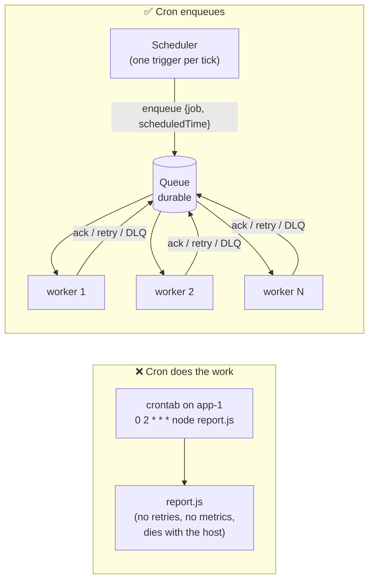
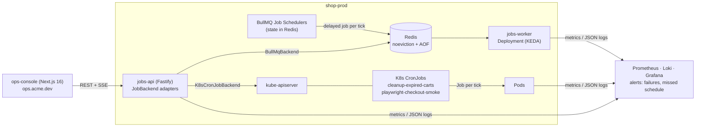
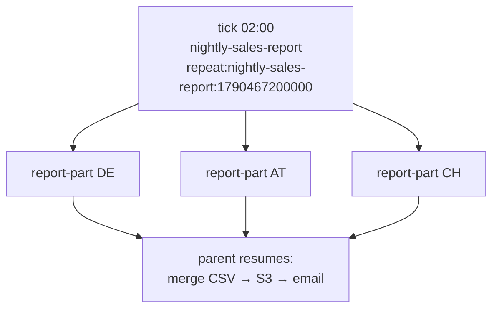
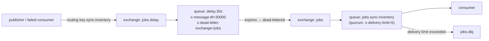

# Cron with Message Queues - Architecture

<Note>
**TL;DR**

A production scheduler should **trigger, not do**: on each tick it enqueues one message with an **idempotency key** (`<job>:<scheduledTime>`), and a pool of **workers** does the work with retries, timeouts, concurrency limits and metrics. That split gives you decoupling, horizontal scaling and backpressure, but it moves the hard problems into the design: exactly one trigger per tick across N scheduler replicas (leader election, locks or a queue-native scheduler that dedupes by key), **overlap policy** (Allow / Forbid / Replace), **misfires and catch-up**, **time zones and DST**, heartbeats for long jobs, DLQs for poison messages, and a **"missed schedule" alert** that fires when success *stops* happening.
</Note>

This note is the theory behind the Acme Ops system. The hands-on notes are [BullMQ Job Schedulers in Practice](/Software%20Engineering/Backend/Scheduled%20Jobs/BullMQ%20Job%20Schedulers%20in%20Practice), [Kubernetes CronJobs in Practice](/Software%20Engineering/Backend/Scheduled%20Jobs/Kubernetes%20CronJobs%20in%20Practice) and [Job Control API - Pause, Resume, Run Now & Stop](/Software%20Engineering/Backend/Scheduled%20Jobs/Job%20Control%20API%20-%20Pause%2C%20Resume%2C%20Run%20Now%20%26%20Stop). Cron syntax lives in [Cron Jobs](/Software%20Engineering/Backend/Cron%20Jobs); queue basics (retries, backoff, idempotency) in [Background Jobs & Task Queues](/Software%20Engineering/Backend/Background%20Jobs%20%26%20Task%20Queues).

## 1. Why "cron that enqueues" beats "cron that does the work"



| Concern | Cron runs the script | Scheduler enqueues, workers execute |
|---|---|---|
| **Decoupling** | schedule, code and host are one thing | scheduler knows *when*, workers know *how*; deploy each independently |
| **Retries** | none (or hand-rolled loops) | queue retries with exponential backoff and jitter, then DLQ |
| **Horizontal scale** | one host does all the work | add workers; fan one tick out to 1,000 jobs |
| **Backpressure** | overlapping runs pile up on one box | queue absorbs bursts; workers pull at the rate they can handle; concurrency and rate limits protect downstream APIs |
| **Visibility** | grep a log file on the host | job states, attempts, durations, logs per run, dashboards |
| **Manual "run now"** | SSH and run the script | enqueue the same message with a manual trigger |
| **Host failure** | the tick is lost | message waits in the queue; another worker takes it |

The cost: you now operate a queue (Redis, RabbitMQ, SQS, Postgres) and must think about delivery semantics. For one small script on one VM, plain cron with `flock` is fine ([Cron Jobs](/Software%20Engineering/Backend/Cron%20Jobs)).

## 2. The Acme Ops reference architecture



- The **scheduler** for BullMQ jobs is *inside* Redis: a Job Scheduler keeps exactly one delayed job for the next tick, with a deterministic id `repeat:<schedulerId>:<millis>`. No separate scheduler process exists, so there is nothing to leader-elect.
- The **scheduler** for K8s jobs is the CronJob controller in `kube-controller-manager`, which is itself leader-elected.
- **`jobs-api`** is the control plane that pauses, resumes, triggers and stops runs on either backend. See [Job Control API - Pause, Resume, Run Now & Stop](/Software%20Engineering/Backend/Scheduled%20Jobs/Job%20Control%20API%20-%20Pause%2C%20Resume%2C%20Run%20Now%20%26%20Stop).

## 3. Exactly one trigger per tick

Running the scheduler in every replica of your app (e.g. `node-cron` in each of 4 pods) fires every tick 4 times. Three families of fixes:

### 3.1 Single leader scheduler

Only one process schedules; the others stand by.

| Mechanism | How | Notes |
|---|---|---|
| **Kubernetes Lease** | `coordination.k8s.io/v1` Lease object, renewed every few seconds (client-go `leaderelection`, or a sidecar) | What the K8s controllers themselves use; the leader can lose the lease during a GC pause, so still make jobs idempotent |
| **Redis lock** | `SET scheduler:leader <podId> NX PX 15000`, renew every 5 s with a Lua compare-and-extend | Simple. A single Redis is a single point of failure; Redlock across nodes is debated (see Kleppmann's critique). Use **fencing tokens** if correctness matters |
| **Postgres advisory lock** | `SELECT pg_try_advisory_lock(hashtext('acme-scheduler'))` held on a dedicated session | Lock disappears when the session dies; no TTL tuning; one less system if you already run Postgres. See [Locking & Concurrency Control](/Software%20Engineering/Databases/Core%20Concepts/Locking%20%26%20Concurrency%20Control) |
| **Singleton workload** | a `replicas: 1` Deployment or StatefulSet | During a rollout or node failure you may get 0 or (briefly) 2; acceptable only with idempotent enqueue |

```ts
// Leader-only tick with a Postgres advisory lock (pg, Node 24)
import pg from 'pg';
const LOCK_KEY = 4242_0001; // any stable bigint per scheduler

const client = new pg.Client({ connectionString: process.env.DATABASE_URL });
await client.connect(); // dedicated session: the lock lives as long as this connection

async function isLeader(): Promise<boolean> {
  const { rows } = await client.query<{ ok: boolean }>('SELECT pg_try_advisory_lock($1) AS ok', [LOCK_KEY]);
  return rows[0].ok; // true once we hold it (re-entrant in the same session)
}

setInterval(async () => {
  if (!(await isLeader())) return;                 // followers do nothing
  const scheduledTime = floorToMinute(new Date());
  await enqueueIfDue('sync-inventory', scheduledTime); // idempotent: jobId includes scheduledTime
}, 10_000);
```

### 3.2 Distributed lock per tick

Every replica tries, only one wins the tick: `SET lock:sync-inventory:2026-09-27T10:15 <pod> NX EX 600`. Simpler than leader election, but every replica must agree on the tick boundaries (clock skew!), and the lock TTL must outlive the enqueue.

### 3.3 Queue-native schedulers that dedupe by key (preferred)

Let the queue store the schedule and dedupe the job id. Two replicas upserting the same scheduler produce one scheduler; two attempts to create the same tick produce one job.

| System | Dedupe key |
|---|---|
| BullMQ Job Schedulers | scheduler id, and the generated job id `repeat:<schedulerId>:<nextMillis>` |
| BullMQ manual jobs | custom `jobId` (unique per queue while the job exists) or `deduplication: { id }` |
| Kubernetes CronJob | Job name `<cronjob>-<scheduled time in minutes>`; the API server rejects a duplicate name |
| SQS FIFO | `MessageDeduplicationId` (5-minute window) |
| Temporal Schedules | Workflow id `<scheduleId>-<timestamp>`; a running workflow id can't be started twice |
| pg-boss / Solid Queue | unique constraint on (job, scheduled time) in the database |

<Tip>
**Rule of thumb**

Whatever does the triggering, the **enqueue must be idempotent** on `(job, scheduledTime)`. Then duplicate triggers are harmless, and you can choose the simplest trigger mechanism.
</Tip>

## 4. Fan-out, chaining and flows

- **Fan-out**: one tick produces many jobs. `sync-inventory` could enqueue one job per supplier (`sync-inventory-<tick>-<supplierId>`) into a queue with concurrency 20 and a rate limit that matches the supplier API. Workers scale on that queue's depth.
- **Chaining**: job A's success enqueues job B. Easy, but the chain is invisible and a failure in the middle needs custom handling.
- **Flows (parent/child)**: a parent job waits until all its children finish, then runs with their results. BullMQ has `FlowProducer` and `moveToWaitingChildren`; Temporal, Step Functions and Airflow model this natively. `nightly-sales-report` uses this: one child per sales region, then the parent assembles the CSV. See [BullMQ Job Schedulers in Practice](/Software%20Engineering/Backend/Scheduled%20Jobs/BullMQ%20Job%20Schedulers%20in%20Practice#10-flows---parent-and-child-jobs).



When chains become DAGs with backfills and cross-job dependencies, switch to a workflow orchestrator (Temporal, Airflow, Dagster, Argo Workflows) instead of more glue code.

## 5. Delivery semantics and idempotency keys per run

Queues give you **at-least-once** delivery: a worker can crash after doing the work but before the ack, and the job runs again. "Exactly once" is at-least-once plus **idempotent effects** ([Message Queues & Event Streaming](/Software%20Engineering/System%20Design/Message%20Queues%20%26%20Event%20Streaming)).

**Key the run by its scheduled time, not its start time**:

```text
idempotencyKey = <job>:<scheduledTime>          e.g.  nightly-sales-report:2026-09-27T00:00:00Z
BullMQ job id  = repeat:nightly-sales-report:1790467200000   (generated by the scheduler)
Manual run id  = manual-<sha256(user + Idempotency-Key)[0..32]> (BullMQ custom ids must not contain ':')
```

Then make each side effect idempotent on that key or on a **business key**:

| Job | Business key | Idempotent effect |
|---|---|---|
| `nightly-sales-report` | report date (yesterday, Europe/Berlin) | S3 key `reports/sales/2026-09-26.csv` (overwrite is harmless); email sent only if `report_emails(report_date)` insert succeeds |
| `sync-inventory` | supplier SKU | `INSERT ... ON CONFLICT (sku) DO UPDATE ... WHERE supplier_updated_at < EXCLUDED.supplier_updated_at` |
| `cleanup-expired-carts` | none needed | `DELETE ... WHERE updated_at < now() - interval '7 days'` is naturally idempotent |
| `playwright-checkout-smoke` | none | read-only synthetic check; uses a test card and a test account |

## 6. Overlap policies

What happens when a tick arrives while the previous run is still going?

| Policy | Behaviour | Use for | K8s | BullMQ | Temporal |
|---|---|---|---|---|---|
| **Allow** | start another run in parallel | stateless, independent runs | `concurrencyPolicy: Allow` (default) | worker concurrency > 1 | `ALLOW_ALL` |
| **Forbid / Skip** | skip the new tick | syncs where the next run will catch up anyway | `Forbid` | global concurrency 1 per queue + misfire check (see below) | `SKIP` (default) |
| **Buffer one** | queue exactly one follow-up run | "run again after this one finishes" | n/a | global concurrency 1 (the scheduler only creates the next job once the current one starts) | `BUFFER_ONE` |
| **Replace** | cancel the running one, start the new one | freshness beats completion (e.g. cache warmers) | `Replace` | stop the active run via the control API, then start | `CANCEL_OTHER` / `TERMINATE_OTHER` |

Acme Ops uses **Forbid** by default. In BullMQ, a queue with global concurrency 1 actually behaves like *buffer one*: the late job waits and then runs. To get true *Forbid*, the processor compares `now - scheduledTime` against a **misfire grace** and completes immediately with `{ skipped: 'misfire' }` if it's too late.

## 7. Misfires and catch-up

A **misfire** is a tick that didn't start on time: the scheduler was down, the queue was paused, all workers were busy, or the tick was suspended.

| Strategy | Meaning | Where |
|---|---|---|
| **Fire once now** | run a single catch-up for the latest missed tick | K8s default when unsuspending without a deadline; Quartz `MISFIRE_INSTRUCTION_FIRE_ONCE_NOW` |
| **Skip** | ignore missed ticks, wait for the next one | K8s with a small `startingDeadlineSeconds`; Temporal with a short `catchupWindow` |
| **Backfill all** | run every missed tick | Temporal `backfill`, Airflow `catchup=True`; dangerous for non-idempotent jobs |

Kubernetes detail worth knowing: the CronJob controller counts missed schedules since the last run; if more than **100** were missed it gives up and logs an error. Setting `startingDeadlineSeconds` limits the counting window, and missed runs while `suspend: true` also count. Acme Ops' **Resume** semantics are "no backfill", so every CronJob sets `startingDeadlineSeconds` (e.g. 300) and BullMQ misfire grace is set per job. See [Kubernetes CronJobs in Practice](/Software%20Engineering/Backend/Scheduled%20Jobs/Kubernetes%20CronJobs%20in%20Practice).

## 8. Time zones and DST

- Cron expressions are evaluated in **some** time zone: host local time (crontab), `CRON_TZ` (some crons), `spec.timeZone` (K8s ≥ 1.27, GA), `tz` (BullMQ), `ScheduleExpressionTimezone` (EventBridge), `timezone` (GitHub Actions since March 2026).
- **Spring forward** (Europe/Berlin, 2026-03-29): 02:00 jumps to 03:00. `nightly-sales-report` at `0 2 * * *` has *no* 02:00 that day. Libraries differ: some skip, some run at 03:00. EventBridge Scheduler documents that it **skips**.
- **Fall back** (2026-10-25): 02:00–02:59 happens **twice**. A job at `30 2 * * *` may run twice. EventBridge documents that it runs **once**.
- Business logic must not depend on the tick time: `nightly-sales-report` computes "yesterday in Europe/Berlin" from the scheduled time and keys the output by that date, so a double run overwrites the same file and a skipped run is caught by the missed-schedule alert.

<Warning>
**DST checklist**

Prefer UTC for machine jobs; use a local zone only for human-facing times ("reports at 2 am Berlin"). Avoid local 01:00–03:00 for daily jobs. Store and log timestamps in UTC (ISO 8601). Test the two DST days explicitly: compute the next 5 ticks with your library and assert them.
</Warning>

## 9. Long-running jobs, heartbeats and timeouts

| Mechanism | Purpose | Example |
|---|---|---|
| **Lease / lock renewal** | tells the queue "I'm still alive" so the job isn't handed to another worker | BullMQ lock (default `lockDuration` 30 s, auto-renewed); SQS `ChangeMessageVisibility`; Temporal activity `heartbeat()` + `heartbeatTimeout` |
| **Stall detection** | detects dead workers and re-queues their jobs | BullMQ stalled checker (`maxStalledCount` default 1); K8s restarts the pod |
| **Hard timeout** | bounds a run no matter what | `AbortSignal.timeout()` in the processor; K8s `activeDeadlineSeconds`; Temporal `startToCloseTimeout` |
| **Progress** | shows humans the job is moving | `job.updateProgress({ done, total })` |

The event loop matters in Node: a CPU-bound processor blocks lock renewal and the job "stalls" even though it's working. Use a **sandboxed processor** (separate process or worker thread) for CPU work.

## 10. Failures: retries, DLQs and poison messages

- **Transient errors** (timeouts, 429, 503): retry with exponential backoff + jitter; honour `Retry-After`.
- **Permanent errors** (validation, 404, bad config): fail fast without retry (`UnrecoverableError` in BullMQ, `AMQP reject(requeue=false)`).
- **Poison message**: a message that crashes the consumer every time (bad payload, a bug). Without a limit it loops forever and blocks the queue. Every system needs a **max delivery count** → **DLQ**: BullMQ `attempts` + the failed set; RabbitMQ quorum queues' `x-delivery-limit` + DLX; SQS `maxReceiveCount` redrive policy.
- A DLQ nobody watches is a black hole: alert on DLQ size > 0 and give operators a **replay** button.

## 11. The RabbitMQ variant

RabbitMQ has no cron. The usual shape is: a **scheduler** (a K8s CronJob, a leader-elected service, or EventBridge) **publishes** a message; workers consume from a quorum queue.

For **delays** (retry later, run at a time):

### 11.1 TTL + dead-letter exchange (the portable pattern)



```ts
// amqplib: one delay queue per delay "bucket"
import amqp from 'amqplib';
const conn = await amqp.connect(process.env.AMQP_URL!);
const ch = await conn.createChannel();

await ch.assertExchange('jobs', 'direct', { durable: true });
await ch.assertExchange('jobs.delay', 'direct', { durable: true });
await ch.assertExchange('jobs.dlx', 'fanout', { durable: true });
await ch.assertQueue('jobs.dlq', { durable: true, arguments: { 'x-queue-type': 'quorum' } });
await ch.bindQueue('jobs.dlq', 'jobs.dlx', '');

await ch.assertQueue('jobs.sync-inventory', {
  durable: true,
  arguments: { 'x-queue-type': 'quorum', 'x-delivery-limit': 5, 'x-dead-letter-exchange': 'jobs.dlx' },
});
await ch.bindQueue('jobs.sync-inventory', 'jobs', 'sync-inventory');

await ch.assertQueue('delay.30s', {
  durable: true,
  arguments: { 'x-queue-type': 'quorum', 'x-message-ttl': 30_000, 'x-dead-letter-exchange': 'jobs' },
});
await ch.bindQueue('delay.30s', 'jobs.delay', 'sync-inventory');

// retry in 30 s: publish to the delay exchange with the original routing key
ch.publish('jobs.delay', 'sync-inventory', Buffer.from(JSON.stringify(msg)), {
  persistent: true, messageId: `sync-inventory:${scheduledTime}`,
});
```

Use a **per-queue** TTL (one queue per delay bucket), not per-message TTLs in one queue: messages only expire from the **head** of a queue, so a 1-hour message blocks a 30-second one behind it.

### 11.2 The delayed-message exchange plugin

`rabbitmq-delayed-message-exchange` (exchange type `x-delayed-message`, header `x-delay`) was popular, but it stored delayed messages in Mnesia on a single node (not replicated) and was never meant for long delays.

<Info>
**🆕 2025–2026: RabbitMQ delays**

- **2025-11-04:** last plugin release, **v4.2.0**, for RabbitMQ 4.2.
- **2026-04-23:** **RabbitMQ 4.3.0** released. Mnesia is fully removed in the 4.3 cycle, so the Mnesia-based plugin has no future. 4.3 also adds **delayed retry for quorum queues** (`x-delayed-retry-type`, `x-delayed-retry-min`, `x-delayed-retry-max`: linear back-off when a message is rejected or returned).
- **2026-09:** the plugin README says Team RabbitMQ **no longer maintains** it and the GitHub repo is archived. The README points to TTL + DLX today and to **native message delivery delay in quorum queues starting with RabbitMQ 4.4**. As of 2026-09-27, 4.4 is not yet released (latest GA is 4.3.0), so treat that as upcoming.
- Takeaway: for new systems use TTL + DLX, quorum-queue delayed retry (4.3+), or an external scheduler. Don't adopt the plugin.
</Info>

## 12. SQS + EventBridge Scheduler

On AWS the managed pair is **EventBridge Scheduler** (the trigger) and **SQS** (the queue):

- Schedules are `cron(...)` with **six** fields (minutes hours day-of-month month day-of-week **year**, with `?` in one of the day fields), `rate(15 minutes)` or one-time `at(...)`, evaluated in an IANA time zone.
- Targets include SQS directly (templated target), with a **retry policy** and a **DLQ** for failed deliveries, and an optional **flexible time window** to spread load.
- Put the scheduled time in the payload via the context attribute `<aws.scheduler.scheduled-time>` so workers can build the idempotency key.

```bash
aws scheduler create-schedule \
  --name acme-sync-inventory \
  --schedule-expression "cron(0/15 * * * ? *)" \
  --schedule-expression-timezone "Europe/Berlin" \
  --flexible-time-window '{"Mode":"OFF"}' \
  --target '{
    "Arn": "arn:aws:sqs:eu-central-1:123456789012:acme-jobs",
    "RoleArn": "arn:aws:iam::123456789012:role/acme-scheduler-to-sqs",
    "Input": "{\"job\":\"sync-inventory\",\"scheduledTime\":\"<aws.scheduler.scheduled-time>\"}",
    "RetryPolicy": {"MaximumRetryAttempts": 10, "MaximumEventAgeInSeconds": 3600},
    "DeadLetterConfig": {"Arn": "arn:aws:sqs:eu-central-1:123456789012:acme-scheduler-dlq"}
  }'
```

Workers long-poll SQS, extend the visibility timeout while working (heartbeat), and rely on the queue's redrive policy (`maxReceiveCount`) for poison messages. Pause = `update-schedule --state DISABLED`.

## 13. Temporal Schedules: the durable alternative

Temporal **Schedules** are first-class objects (separate from the older "cron workflows") that start a workflow per tick, with built-in pause/unpause, manual trigger, backfill and overlap policies. The workflow itself is durable: every step's result is persisted and it resumes after crashes.

```ts
import { Client, Connection, ScheduleOverlapPolicy } from '@temporalio/client';

const client = new Client({ connection: await Connection.connect({ address: 'temporal-frontend:7233' }) });

await client.schedule.create({
  scheduleId: 'nightly-sales-report',
  spec: { cronExpressions: ['0 2 * * *'], timezone: 'Europe/Berlin' },
  action: { type: 'startWorkflow', workflowType: 'nightlySalesReport', taskQueue: 'reports', args: [] },
  policies: { overlap: ScheduleOverlapPolicy.SKIP, catchupWindow: '10 minutes' },
});

const handle = client.schedule.getHandle('nightly-sales-report');
await handle.pause('Supplier API maintenance');  // Pause
await handle.unpause();                           // Resume
await handle.trigger();                           // Run now (works even while paused)
```

Overlap policies: `SKIP` (default), `BUFFER_ONE`, `BUFFER_ALL`, `CANCEL_OTHER`, `TERMINATE_OTHER`, `ALLOW_ALL`. The **catch-up window** (default one year) decides how far back missed actions are still run after an outage; `pauseOnFailure` pauses the schedule after a failed run. Cancelling a run is `WorkflowHandle.cancel()`, which the workflow observes cooperatively, the same model as `AbortSignal`.

Temporal gives you most of what Acme Ops builds by hand (control plane, history, UI) at the cost of running a Temporal cluster (or paying for Temporal Cloud) and learning its determinism rules.

## 14. Observability

**Metrics** (Acme Ops names):

| Metric | Type | Labels |
|---|---|---|
| `jobs_runs_total` | counter | `job`, `status` (`succeeded`, `failed`, `cancelled`, `skipped`) |
| `jobs_run_duration_seconds` | histogram | `job` |
| `jobs_last_success_timestamp_seconds` | gauge | `job` |
| `jobs_expected_interval_seconds` | gauge | `job` (exported from the registry, e.g. 900 for `sync-inventory`) |
| `bullmq_job_count` | gauge | `queue`, `state` (from BullMQ's Prometheus exporter) |
| `kube_cronjob_status_last_successful_time`, `kube_cronjob_spec_suspend` | gauge | `cronjob` (kube-state-metrics) |

**Alerts** (Grafana / Prometheus rules):

```yaml
groups:
  - name: scheduled-jobs
    rules:
      - alert: ScheduledJobMissed          # "dead man's switch": success stopped happening
        expr: |
          (time() - jobs_last_success_timestamp_seconds)
            > 2 * on(job) jobs_expected_interval_seconds
          unless on(job) jobs_paused == 1
        for: 5m
        labels: { severity: page }
        annotations:
          summary: "{{ $labels.job }}: no successful run in 2× its interval"
      - alert: ScheduledJobFailing
        expr: |
          increase(jobs_runs_total{status="failed"}[1h]) >= 3
          and on(job) increase(jobs_runs_total{status="succeeded"}[1h]) == 0
        labels: { severity: ticket }
      - alert: JobsDeadLetters
        expr: sum by (queue) (bullmq_job_count{state="failed"}) > 0
        for: 30m
        labels: { severity: ticket }
```

The **missed-schedule** alert is the most important one: failure alerts can't fire if the scheduler never ran. External heartbeat services (Healthchecks.io, Cronitor, Sentry Crons) do the same from outside your cluster, which also catches "the whole cluster is down".

**Logs**: JSON with `job` and `run_id` fields on every line ([Grafana & the LGTM Stack](/Software%20Engineering/DevOps/Delivery%20Platform/Grafana%20%26%20the%20LGTM%20Stack)). Keep `run_id` a **field**, never a Loki label (unbounded cardinality). In LogQL: `{namespace="shop-prod", app="jobs-worker"} | json | run_id="repeat:sync-inventory:1790500500000"`. If the stream already has a `job` label (Alloy often sets one), the extracted field becomes `job_extracted`.

## 15. Failure modes

| Failure | Symptom | Mitigation |
|---|---|---|
| Scheduler down / leader lost | no runs at all, no errors | missed-schedule alert; queue-native scheduler; K8s controller HA |
| Two schedulers fire the same tick | duplicate emails, double work | idempotent enqueue keyed by `(job, scheduledTime)`; leader election or locks |
| Queue unavailable at tick time | tick lost (scheduler can't enqueue) | queue-native scheduler state (the tick lives in the queue); EventBridge retry policy + DLQ; alert |
| Worker crashes mid-run | job stalls, then re-runs | idempotent effects; stall detection; graceful shutdown on SIGTERM |
| Run longer than its interval | overlapping runs, lock contention | overlap policy (Forbid); timeouts; split into smaller jobs |
| Misfire after outage or resume | burst of catch-up runs, or silent skip | explicit misfire policy (`startingDeadlineSeconds`, misfire grace, catch-up window) |
| DST / time zone surprise | job skipped or doubled twice a year | UTC or safe local hours; business-date keys; DST tests |
| Poison message | same job fails forever, blocks the queue | max attempts / delivery limit → DLQ; `UnrecoverableError` for permanent errors |
| Stuck job (hangs, no heartbeat) | "running" for hours | hard timeout (`AbortSignal.timeout`, `activeDeadlineSeconds`); alert on duration |
| Redis evicts keys | jobs and schedulers vanish silently | `maxmemory-policy noeviction`, AOF persistence, memory alerts |
| Backlog grows faster than workers drain | queue latency climbs, stale data | autoscale on queue depth/latency (KEDA); rate limits; shed low-priority work |
| Downstream rate limit hit | 429 storms, retries amplify load | queue rate limiter; backoff with jitter; per-tenant concurrency |
| Orphan schedulers after a job is removed from code | old job keeps running | reconcile schedulers from a registry at deploy (upsert desired, remove unknown) |
| "Successful" run that did nothing | green dashboard, stale data | assert on outcomes (rows synced, file size), freshness metrics |
| Clock skew between nodes | early/late or duplicate ticks with lock-per-tick | NTP/chrony; one time source (the queue or the controller) |

## Senior perspective

- **Choose the trigger by where state lives.** If jobs already live in Redis, use BullMQ schedulers; if in Postgres, pg-boss or Solid Queue; on AWS, EventBridge Scheduler + SQS; for multi-step business processes with days of waiting, Temporal. Avoid mixing three schedulers without a control plane that shows them together (the reason `jobs-api` exists).
- **Every scheduled job has an owner, an SLO and a runbook**: expected interval, expected duration, what "stale" costs the business, and what to do when the missed-schedule alert fires.
- **Treat schedules as code**: registry in Git, reconciled at deploy, visible in review. A schedule changed by hand in a UI is drift.
- **Design for the double run and the missed run**, then pick the cheapest trigger. Most incidents come from assuming exactly-once.
- **Separate queues by blast radius**: a 30-minute report must never delay a password-reset email. Separate queues or even separate Redis instances for critical paths.
- Review questions: *What is the idempotency key? What happens if this tick fires twice, never, or 3 hours late? Which time zone, and what happens on DST days? What's the timeout, and who is alerted when it stops succeeding?*

## Interview questions

<Accordion title="Why should a cron job enqueue work instead of doing it?">
It decouples scheduling from execution. The queue adds retries with backoff, durable storage if a host dies, horizontal scaling across workers, backpressure and concurrency limits, visibility per run, and a natural "run now" path. The scheduler becomes a tiny, reliable component.
</Accordion>

<Accordion title="You run 4 replicas of a service that contains a scheduler. How do you avoid 4 triggers per tick?">
Options: leader election (K8s Lease, Postgres advisory lock, Redis lock with TTL and fencing), a lock per tick, or a queue-native scheduler that dedupes by key (BullMQ Job Schedulers, K8s CronJob names, SQS FIFO dedup ids). In all cases make the enqueue idempotent on `(job, scheduledTime)` so a duplicate trigger is harmless.
</Accordion>

<Accordion title="What's the difference between the Forbid, Replace and Allow overlap policies?">
Allow starts a new run even if the previous one is still running. Forbid skips the new tick. Replace cancels the running one and starts the new one. Temporal adds buffer-one/buffer-all (queue the tick until the current run ends). Pick based on whether freshness or completion matters and whether runs can safely overlap.
</Accordion>

<Accordion title="What is a misfire and how should a scheduler handle it?">
A tick that didn't start on time (scheduler down, suspended, no free workers). Policies: run once now, skip to the next tick, or backfill every missed tick. K8s uses `startingDeadlineSeconds` (and gives up after 100 missed schedules), Temporal a catch-up window, Quartz misfire instructions. The choice depends on idempotency and whether stale runs are useful.
</Accordion>

<Accordion title="How do DST changes break cron jobs and how do you defend against it?">
In spring-forward a local time like 02:30 doesn't exist, so the job may be skipped or shifted; in fall-back it exists twice and may run twice. Defend with UTC schedules or safe local hours, compute business dates from the scheduled time, make outputs idempotent by business key, and test DST days.
</Accordion>

<Accordion title="How do you detect that a scheduled job silently stopped running?">
A dead man's switch: export the last success timestamp and alert when `now - lastSuccess > 2 × expected interval` (unless paused), or ping an external heartbeat service at the end of each successful run. Failure alerts alone can't catch a scheduler that never fires.
</Accordion>

<Accordion title="What is a poison message and what do you do about it?">
A message that makes the consumer fail every time. Without a limit it's retried forever and can block the queue. Cap attempts or deliveries, route exhausted messages to a DLQ, mark permanent errors as non-retryable, alert on DLQ growth, and provide a replay tool after the fix.
</Accordion>

<Accordion title="How do you implement delayed retries in RabbitMQ today?">
TTL + dead-letter exchange: publish to a per-delay-bucket queue with `x-message-ttl` whose DLX routes back to the work queue. On RabbitMQ 4.3+ quorum queues also support delayed retry with linear back-off. The delayed-message exchange plugin is no longer maintained (Mnesia-based, single node), so don't build on it.
</Accordion>

## Related
- [Scheduled Jobs Index](/Software%20Engineering/Backend/Scheduled%20Jobs/Scheduled%20Jobs%20Index) · [Backend Index](/Software%20Engineering/Backend/Backend%20Index)
- [Cron Jobs](/Software%20Engineering/Backend/Cron%20Jobs) · [Background Jobs & Task Queues](/Software%20Engineering/Backend/Background%20Jobs%20%26%20Task%20Queues) · [Message Queues & Event Streaming](/Software%20Engineering/System%20Design/Message%20Queues%20%26%20Event%20Streaming) · [Distributed Systems Patterns](/Software%20Engineering/System%20Design/Distributed%20Systems%20Patterns)
- [BullMQ Job Schedulers in Practice](/Software%20Engineering/Backend/Scheduled%20Jobs/BullMQ%20Job%20Schedulers%20in%20Practice) · [Kubernetes CronJobs in Practice](/Software%20Engineering/Backend/Scheduled%20Jobs/Kubernetes%20CronJobs%20in%20Practice) · [Job Control API - Pause, Resume, Run Now & Stop](/Software%20Engineering/Backend/Scheduled%20Jobs/Job%20Control%20API%20-%20Pause%2C%20Resume%2C%20Run%20Now%20%26%20Stop) · [Job Scheduler Dashboard with Next.js](/Software%20Engineering/Backend/Scheduled%20Jobs/Job%20Scheduler%20Dashboard%20with%20Next.js) · [Playwright Automation as a Cron Job](/Software%20Engineering/Backend/Scheduled%20Jobs/Playwright%20Automation%20as%20a%20Cron%20Job)
- [Locking & Concurrency Control](/Software%20Engineering/Databases/Core%20Concepts/Locking%20%26%20Concurrency%20Control) · [API Versioning, Idempotency & Backward Compatibility](/Software%20Engineering/APIs%20%26%20Auth/API%20Versioning%2C%20Idempotency%20%26%20Backward%20Compatibility) · [Rate Limiting & Throttling](/Software%20Engineering/APIs%20%26%20Auth/Rate%20Limiting%20%26%20Throttling)
- [Grafana & the LGTM Stack](/Software%20Engineering/DevOps/Delivery%20Platform/Grafana%20%26%20the%20LGTM%20Stack) · [Observability - Logs, Metrics & Traces](/Software%20Engineering/DevOps/Observability%20-%20Logs%2C%20Metrics%20%26%20Traces)

## Sources
- [BullMQ: Job Schedulers](https://docs.bullmq.io/guide/job-schedulers) · [Job ids](https://docs.bullmq.io/guide/jobs/job-ids) · [Stalled jobs](https://docs.bullmq.io/guide/jobs/stalled)
- [Kubernetes: CronJob (concurrencyPolicy, startingDeadlineSeconds, suspend, time zones)](https://kubernetes.io/docs/concepts/workloads/controllers/cron-jobs/)
- [Kubernetes: Leases](https://kubernetes.io/docs/concepts/architecture/leases/)
- [PostgreSQL: Advisory locks](https://www.postgresql.org/docs/current/explicit-locking.html#ADVISORY-LOCKS)
- [Martin Kleppmann: How to do distributed locking](https://martin.kleppmann.com/2016/02/08/how-to-do-distributed-locking.html)
- [RabbitMQ: Dead letter exchanges](https://www.rabbitmq.com/docs/dlx) · [TTL](https://www.rabbitmq.com/docs/ttl) · [Quorum queues: delayed retry (4.3)](https://www.rabbitmq.com/docs/quorum-queues#delayed-retry)
- [rabbitmq-delayed-message-exchange README (no longer maintained)](https://github.com/rabbitmq/rabbitmq-delayed-message-exchange) · [RabbitMQ server releases](https://github.com/rabbitmq/rabbitmq-server/releases)
- [AWS: EventBridge Scheduler schedule types, time zones and DST](https://docs.aws.amazon.com/scheduler/latest/UserGuide/schedule-types.html) · [Context attributes](https://docs.aws.amazon.com/scheduler/latest/UserGuide/managing-schedule-context-attributes.html)
- [Temporal: Schedules](https://docs.temporal.io/schedule) · [TypeScript SDK schedules](https://docs.temporal.io/develop/typescript/schedules)
- [GitHub Changelog: Actions late March 2026 updates (timezone for schedules)](https://github.blog/changelog/2026-03-19-github-actions-late-march-2026-updates/)
- [AWS Architecture Blog: Exponential backoff and jitter](https://aws.amazon.com/blogs/architecture/exponential-backoff-and-jitter/)
- [Healthchecks.io: How it works (dead man's switch)](https://healthchecks.io/docs/)
