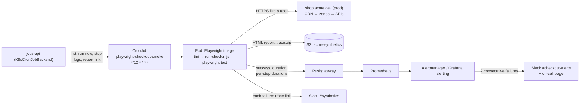

# Playwright Automation as a Cron Job

> [!tldr] TL;DR
> Running Playwright on a schedule turns E2E tests into **synthetic monitoring** ("can a user still check out, right now, on prod?"), and the same machinery runs **nightly regression suites** and **browser automation of your own sites**. Package the tests in an image built on `mcr.microsoft.com/playwright:v<version>-noble` with the **same pinned version** as `@playwright/test`, run as non-root, give Chromium a memory-backed `/dev/shm`, and schedule it as a Kubernetes CronJob with `concurrencyPolicy: Forbid` and a deadline shorter than the interval. Configure for diagnosis, not for green builds: one retry, `trace: 'on-first-retry'`, video and screenshots on failure, JUnit + HTML + a metrics reporter. Ship reports and traces to S3, push pass/fail and per-step durations as metrics, page after **2 consecutive failures**, and post the trace link to Slack. Only automate sites you own or have permission to automate.

This note uses the Acme Ops job `playwright-checkout-smoke` (every 10 minutes, Kubernetes CronJob). The generic CronJob mechanics are in [[Kubernetes CronJobs in Practice]], the control plane that lists and triggers it in [[Job Control API - Pause, Resume, Run Now & Stop]] and [[Job Scheduler Dashboard with Next.js]]. Playwright basics (locators, fixtures, auto-waiting) are in [[Frontend Testing]] and [[Next.js Testing - Unit, Integration & E2E]].

## 1. Three reasons to run Playwright on a schedule

| Use | Example at Acme | Cadence | Success means |
|---|---|---|---|
| **Synthetic monitoring** | `playwright-checkout-smoke`: log in as a test shopper, add the synthetic product, pay with the test payment method, see the confirmation | every 5–15 min, from outside the cluster's network path | "the critical journey works for real users now" |
| **Nightly regression** | full E2E suite against staging (or prod read-only), all browsers | nightly | "yesterday's merges didn't break anything we didn't cover in PR CI" |
| **Automation / scraping of your own sites** | export a CSV from a legacy admin UI with no API; crawl the sitemap for broken links and missing `<title>`s; screenshot key pages for visual diffs | hourly / daily | "the task ran and produced its output" |

Synthetic checks complement, not replace, server-side monitoring: RED metrics tell you the API returns 200s; the browser check tells you the button still exists, the JS bundle loads from the CDN, the consent banner doesn't cover the "Pay" button, and the payment iframe renders.



## 2. Project setup

```text
synthetics/
├── package.json                 # exact versions
├── playwright.config.ts
├── tests/
│   ├── auth.setup.ts            # logs in once per run, saves storageState
│   ├── checkout-smoke.spec.ts   # @smoke
│   └── regression/**            # @regression (nightly)
├── reporters/metrics-reporter.ts
├── scripts/run-check.mjs        # wrapper: run, upload, notify, exit code
└── Dockerfile
```

```json
{
  "name": "@acme/synthetics",
  "private": true,
  "type": "module",
  "scripts": { "smoke": "playwright test --project=smoke", "regression": "playwright test --project=regression" },
  "dependencies": {
    "@playwright/test": "1.63.0",
    "@aws-sdk/client-s3": "^3.700.0",
    "@aws-sdk/s3-request-presigner": "^3.700.0"
  }
}
```

`@playwright/test` is a runtime dependency here (the image runs the tests), and its version must match the image tag exactly, or Playwright looks for browser builds that aren't in the image.

```ts
// playwright.config.ts
import { defineConfig, devices } from "@playwright/test";

const OUT = process.env.PW_OUT_DIR ?? "out";              // writable emptyDir in K8s
const BASE_URL = process.env.BASE_URL ?? "https://shop.acme.dev";

export default defineConfig({
  testDir: "tests",
  outputDir: `${OUT}/test-results`,                        // traces, videos, screenshots
  fullyParallel: false,
  workers: 1,                                              // be gentle with prod
  forbidOnly: true,
  retries: 1,                                              // one retry separates flake from outage
  timeout: 60_000,                                         // per test
  globalTimeout: 5 * 60_000,                               // whole run: stays under the 8-min K8s deadline
  expect: { timeout: 10_000 },

  reporter: [
    ["list"],                                              // pod logs (visible in ops-console)
    ["html", { outputFolder: `${OUT}/html-report`, open: "never" }],
    ["junit", { outputFile: `${OUT}/junit.xml` }],
    ["./reporters/metrics-reporter.ts", { check: process.env.CHECK_NAME ?? "checkout", outputFile: `${OUT}/summary.json` }],
  ],

  use: {
    baseURL: BASE_URL,
    headless: true,
    trace: "on-first-retry",                               // full trace only when something went wrong once
    video: "retain-on-failure",
    screenshot: "only-on-failure",
    actionTimeout: 15_000,
    navigationTimeout: 30_000,
    locale: "de-DE",
    timezoneId: "Europe/Berlin",
    userAgent: `${devices["Desktop Chrome"].userAgent} AcmeSynthetics/1.0`,   // identifiable traffic
    extraHTTPHeaders: { "x-acme-synthetic": "1" },          // excluded from analytics, fraud rules, emails
  },

  projects: [
    { name: "setup", testMatch: /auth\.setup\.ts/ },
    {
      name: "smoke",
      grep: /@smoke/,
      dependencies: ["setup"],
      use: { ...devices["Desktop Chrome"], storageState: `${OUT}/.auth/shopper.json` },
    },
    {
      name: "regression",                                  // nightly, all engines
      grep: /@regression/,
      dependencies: ["setup"],
      retries: 2,
      use: { ...devices["Desktop Chrome"], storageState: `${OUT}/.auth/shopper.json` },
    },
  ],
});
```

Choices explained:
- **`retries: 1`** and `trace: 'on-first-retry'`: the first failure records a trace on the retry; if the retry passes, the result is **flaky** (reported, not paged); if it fails too, it's a real failure with a trace attached.
- **`globalTimeout`** is the run's time budget. The CronJob's `activeDeadlineSeconds` is the hard backstop; keep the Playwright budget smaller so reports still get written.
- **`workers: 1`** and one browser: a synthetic check is a canary, not a load test.
- Four reporters: `list` for logs, `html` for humans, `junit` for CI systems and test analytics, a custom one for metrics.

### Auth setup project

```ts
// tests/auth.setup.ts
import { test as setup, expect } from "@playwright/test";

const file = `${process.env.PW_OUT_DIR ?? "out"}/.auth/shopper.json`;

setup("log in as the synthetic shopper", async ({ page }) => {
  const email = process.env.SYNTH_SHOPPER_EMAIL;
  const password = process.env.SYNTH_SHOPPER_PASSWORD;
  if (!email || !password) throw new Error("missing SYNTH_SHOPPER_* env");   // config error

  await page.goto("/account/login");
  await page.getByLabel("E-Mail").fill(email);
  await page.getByLabel("Passwort").fill(password);
  await page.getByRole("button", { name: "Anmelden" }).click();
  await expect(page.getByRole("link", { name: "Mein Konto" })).toBeVisible();

  await page.context().storageState({ path: file });   // cookies + localStorage (+ IndexedDB if asked)
});
```

Each scheduled run is a fresh Pod, so login runs every time, which also monitors login. For heavy suites, log in through an API call instead of the UI to save time. The `storageState` file is a live session: keep it out of uploaded reports.

## 3. The check itself

```ts
// tests/checkout-smoke.spec.ts
import { test, expect } from "@playwright/test";

// Synthetic product (hidden from catalog listings, unlimited stock, excluded from reports)
const SKU = "SYNTH-001";

test("checkout with the synthetic shopper", { tag: ["@smoke", "@checkout"] }, async ({ page }) => {
  test.info().annotations.push({ type: "owner", description: "team-checkout" });

  await test.step("open product page", async () => {
    const res = await page.goto(`/p/${SKU}`);
    expect(res?.status()).toBe(200);
    await expect(page.getByRole("heading", { level: 1 })).toContainText("Synthetic");
  }, { timeout: 10_000 });                                   // step time budget (Playwright 1.50+)

  await test.step("add to cart", async () => {
    await page.getByRole("button", { name: "In den Warenkorb" }).click();
    await expect(page.getByTestId("cart-count")).toHaveText("1");
  }, { timeout: 8_000 });

  await test.step("checkout: address and shipping", async () => {
    await page.getByRole("link", { name: "Zur Kasse" }).click();
    await expect(page).toHaveURL(/\/checkout/);
    await page.getByRole("radio", { name: /Standardversand/ }).check();
    await page.getByRole("button", { name: "Weiter zur Zahlung" }).click();
  }, { timeout: 15_000 });

  await test.step("pay with the test payment method", async () => {
    // The synthetic account is flagged server-side: its payments go to the PSP's test mode.
    // Test card numbers (e.g. Stripe's 4242 4242 4242 4242) only work with TEST API keys,
    // so on prod this depends on that routing, never on real cards.
    const card = page.frameLocator('iframe[title*="Kartenzahlung"]');
    await card.getByPlaceholder("Kartennummer").fill(process.env.SYNTH_TEST_CARD ?? "4242424242424242");
    await card.getByPlaceholder("MM / JJ").fill("12 / 34");
    await card.getByPlaceholder("CVC").fill("123");
    await page.getByRole("button", { name: "Jetzt kaufen" }).click();
  }, { timeout: 20_000 });

  await test.step("see confirmation", async () => {
    await expect(page.getByRole("heading", { name: "Danke für deine Bestellung" })).toBeVisible({ timeout: 15_000 });
    const orderId = await page.getByTestId("order-id").textContent();
    test.info().annotations.push({ type: "orderId", description: orderId ?? "" });   // for cleanup/debugging
  }, { timeout: 20_000 });
});
```

Rules for testing **production**:
- A dedicated **test account** and a **synthetic product**; orders from it are marked `synthetic`, never shipped, auto-cancelled, and excluded from revenue, analytics, emails and fraud models (the `x-acme-synthetic` header and the account flag both carry that signal).
- **Test payment routing**: agree with the payments team how synthetic orders reach the PSP's test mode, or stop the check at the payment page. Never use real cards.
- **Time budgets per step** turn "slow" into a signal: step durations are exported as metrics, and a step that exceeds its budget fails with a clear name ("pay with the test payment method" timed out).
- **Tags** (`@smoke`, `@regression`, `@checkout`) choose what runs where: `grep` in the project config, `--grep @smoke` on the CLI, `grepInvert` for quarantine.

## 4. Custom reporter: JSON summary + metrics

```ts
// reporters/metrics-reporter.ts
import { writeFileSync, mkdirSync } from "node:fs";
import { dirname } from "node:path";
import type { FullResult, Reporter, TestCase, TestResult, TestStep } from "@playwright/test/reporter";

type Options = { check: string; outputFile: string };

export default class MetricsReporter implements Reporter {
  private tests: { title: string; outcome: string; durationMs: number; retries: number; steps: Record<string, number> }[] = [];
  private startedAt = Date.now();
  constructor(private opts: Options) {}

  onTestEnd(test: TestCase, result: TestResult) {
    // Called per attempt; keep the final attempt (test.outcome() reflects all attempts)
    if (result.status !== "passed" && result.retry < test.retries) return;
    const steps: Record<string, number> = {};
    const walk = (s: TestStep) => { if (s.category === "test.step") steps[s.title] = s.duration; s.steps.forEach(walk); };
    result.steps.forEach(walk);
    this.tests.push({ title: test.title, outcome: test.outcome(), durationMs: result.duration, retries: result.retry, steps });
  }

  async onEnd(result: FullResult) {
    const summary = {
      check: this.opts.check,
      status: result.status,                                  // passed | failed | timedout | interrupted
      durationMs: Date.now() - this.startedAt,
      flaky: this.tests.filter((t) => t.outcome === "flaky").length,
      failed: this.tests.filter((t) => t.outcome === "unexpected").length,
      tests: this.tests,
      runId: process.env.RUN_ID,
      finishedAt: new Date().toISOString(),
    };
    mkdirSync(dirname(this.opts.outputFile), { recursive: true });
    writeFileSync(this.opts.outputFile, JSON.stringify(summary, null, 2));

    const url = process.env.PUSHGATEWAY_URL;
    if (!url || result.status === "interrupted") return;     // stopped by an operator: don't report as down
    const c = this.opts.check;
    const lines = [
      "# TYPE synthetic_check_success gauge",
      `synthetic_check_success{check="${c}"} ${result.status === "passed" ? 1 : 0}`,
      "# TYPE synthetic_check_duration_seconds gauge",
      `synthetic_check_duration_seconds{check="${c}"} ${summary.durationMs / 1000}`,
      "# TYPE synthetic_check_flaky gauge",
      `synthetic_check_flaky{check="${c}"} ${summary.flaky}`,
      "# TYPE synthetic_check_last_run_timestamp_seconds gauge",
      `synthetic_check_last_run_timestamp_seconds{check="${c}"} ${Math.floor(Date.now() / 1000)}`,
      "# TYPE synthetic_step_duration_seconds gauge",
      ...this.tests.flatMap((t) => Object.entries(t.steps).map(([step, ms]) =>
        `synthetic_step_duration_seconds{check="${c}",step="${step.replace(/"/g, "'")}"} ${ms / 1000}`)),
      "",
    ].join("\n");
    // PUT replaces all metrics of this group: stale step series from renamed steps disappear
    const res = await fetch(`${url}/metrics/job/synthetics/check/${encodeURIComponent(c)}`, { method: "PUT", body: lines });
    if (!res.ok) console.error(`pushgateway ${res.status}`);  // never fail the check because metrics failed
  }
}
```

Why a Pushgateway: a 1–2 minute Pod can't be scraped reliably. The Pushgateway keeps the **last pushed value** per group until overwritten; that's exactly the semantics needed for "what did the last run say". Its drawbacks (a single point of failure, no automatic staleness, values never expire) are why the reporter also pushes a `last_run_timestamp` and the alerts check freshness.

OTLP instead: pushing with the OpenTelemetry metrics SDK to Alloy's OTLP receiver (then to Prometheus/Mimir) avoids running a Pushgateway, but short-lived processes emitting counters are awkward (every run is a new process whose counters start at zero). Emit gauges, or let a long-lived component count runs: `jobs-api` already exposes `jobs_runs_total{job,status}` and `jobs_run_duration_seconds` for every job it controls ([[Cron with Message Queues - Architecture]]).

## 5. Packaging: the Docker image

As of Sept 2026 the Playwright docs list **v1.63.0** images tagged `mcr.microsoft.com/playwright:v1.63.0-noble` (Ubuntu 24.04), `-jammy` (22.04) and `-resolute` (26.04). The image contains Node (24 in current builds), all browsers and their OS dependencies, and a non-root user `pwuser`, but not the `@playwright/test` package itself.

```dockerfile
# Dockerfile
# Pin the tag AND the digest; bump both together with package.json
FROM mcr.microsoft.com/playwright:v1.63.0-noble

# tini as PID 1: reaps Chromium zombie processes and forwards signals (K8s has no `docker run --init`)
RUN apt-get update && apt-get install -y --no-install-recommends tini \
 && rm -rf /var/lib/apt/lists/*

WORKDIR /app
COPY package.json package-lock.json ./
RUN npm ci && npx playwright --version | grep -q "1.63.0"     # fail the build on a version mismatch
COPY playwright.config.ts ./
COPY tests ./tests
COPY reporters ./reporters
COPY scripts ./scripts

ENV CI=1 \
    PW_OUT_DIR=/work/out \
    HOME=/work/home \
    NODE_ENV=production

# pwuser (uid 1001 in the noble image; check with `id pwuser`)
USER 1001
ENTRYPOINT ["/usr/bin/tini", "--"]
CMD ["node", "scripts/run-check.mjs"]
```

Image choices:
- **Official image** (≈2 GB, all browsers, tested dependency set) vs **slim custom image** (`node:24-bookworm-slim` + `npx playwright install --with-deps chromium`, ~1 GB, you own the OS deps). For a check that runs every 10 minutes, the image is cached on the node after the first pull, so the size mostly matters for cold nodes. Start with the official image.
- **Pin everything**: image tag + digest, `@playwright/test` exact version, `package-lock.json`. A silent browser update changing rendering is the last thing you want in a monitor. Renovate/Dependabot bumps image and package in one PR.
- **Sandbox**: Playwright launches Chromium without its sandbox by default (`chromiumSandbox: false`). That's acceptable for your own sites. For untrusted sites the Playwright docs recommend a separate user plus a seccomp profile so the sandbox can run.

The wrapper that runs the tests, uploads results, notifies Slack and reports the report link to the Kubernetes status:

```js
// scripts/run-check.mjs
import { spawn } from "node:child_process";
import { readFileSync, writeFileSync, existsSync, readdirSync, statSync, mkdirSync } from "node:fs";
import { join, relative } from "node:path";
import { S3Client, PutObjectCommand, GetObjectCommand } from "@aws-sdk/client-s3";
import { getSignedUrl } from "@aws-sdk/s3-request-presigner";

const OUT = process.env.PW_OUT_DIR ?? "out";
const RUN_ID = process.env.RUN_ID ?? `local-${Date.now()}`;
const CHECK = process.env.CHECK_NAME ?? "checkout";

// 1. Run Playwright; forward SIGTERM (Stop from the dashboard, node drain) as SIGINT so reporters still write
if (process.env.HOME) mkdirSync(process.env.HOME, { recursive: true });   // HOME lives on an emptyDir
const child = spawn("./node_modules/.bin/playwright", ["test", "--project=smoke"], { stdio: "inherit" }); // no npx layer: signals reach it
process.on("SIGTERM", () => child.kill("SIGINT"));
const code = await new Promise((r) => child.on("exit", (c) => r(c ?? 1)));

// 2. Upload report + traces (best effort: a failed upload must not hide the test result)
let reportUrl, traceUrl;
try {
  const s3 = new S3Client({});                                   // credentials from EKS Pod Identity / IRSA
  const bucket = process.env.REPORT_BUCKET;
  const prefix = `playwright-checkout-smoke/${RUN_ID}`;
  const files = walk(OUT).filter((f) => !f.includes(".auth"));   // never upload storageState
  for (const f of files) {
    await s3.send(new PutObjectCommand({ Bucket: bucket, Key: `${prefix}/${relative(OUT, f)}`, Body: readFileSync(f), ServerSideEncryption: "aws:kms" }));
  }
  reportUrl = `https://reports.acme.dev/${prefix}/html-report/index.html`;   // served behind SSO
  const trace = files.find((f) => f.endsWith("trace.zip"));
  if (trace) {
    const signed = await getSignedUrl(s3, new GetObjectCommand({ Bucket: bucket, Key: `${prefix}/${relative(OUT, trace)}` }), { expiresIn: 24 * 3600 });
    traceUrl = `https://trace.playwright.dev/?trace=${encodeURIComponent(signed)}`;
  }
} catch (err) {
  console.error("upload failed", err);
}

// 3. Slack on failure (Grafana handles paging after 2 consecutive failures)
const summary = existsSync(join(OUT, "summary.json")) ? JSON.parse(readFileSync(join(OUT, "summary.json"), "utf8")) : { status: "failed" };
if (summary.status !== "passed" && summary.status !== "interrupted" && process.env.SLACK_WEBHOOK_URL) {
  const failed = summary.tests?.filter((t) => t.outcome === "unexpected").map((t) => t.title).join(", ") || "setup/runner";
  await fetch(process.env.SLACK_WEBHOOK_URL, {
    method: "POST",
    headers: { "Content-Type": "application/json" },
    body: JSON.stringify({
      text: `:red_circle: Synthetic check *${CHECK}* failed (${failed}). Run ${RUN_ID}.` +
        (reportUrl ? `\nReport: ${reportUrl}` : "") + (traceUrl ? `\nTrace: ${traceUrl}` : ""),
    }),
  }).catch((e) => console.error("slack failed", e));
}

// 4. Hand the report link to Kubernetes: ends up in the Pod's terminated.message, which jobs-api shows
try { writeFileSync("/dev/termination-log", JSON.stringify({ reportUrl, status: summary.status }).slice(0, 4000)); } catch {}

process.exit(code);

function walk(dir) {
  if (!existsSync(dir)) return [];
  return readdirSync(dir).flatMap((n) => { const p = join(dir, n); return statSync(p).isDirectory() ? walk(p) : [p]; });
}
```

About the links:
- A presigned URL signs **one object**. The HTML report is many files with relative links, so presigning `index.html` doesn't work; serve the report prefix through an internal, SSO-protected static host (`reports.acme.dev`: an S3 origin behind an auth proxy) and presign only single files like `trace.zip`.
- SigV4 presigned URLs last at most **7 days**, and never longer than the credentials that signed them. With Pod Identity/IRSA (temporary credentials) that's typically hours; 24 h here assumes the session allows it, otherwise the link dies earlier.
- `trace.playwright.dev` is a static web app that loads the trace **in your browser** from the URL you give it; the bucket needs a CORS rule allowing `https://trace.playwright.dev`. Or download the zip and run `npx playwright show-trace trace.zip`.
- Traces and videos contain everything the browser saw: session cookies, form values (the test password typed during login), API responses. Private bucket, KMS encryption, a lifecycle rule deleting objects after 14–30 days, and an account whose credentials are worthless outside the test tenant.

## 6. Scheduling options

### A. Kubernetes CronJob (what Acme Ops runs)

```yaml
apiVersion: batch/v1
kind: CronJob
metadata:
  name: playwright-checkout-smoke
  namespace: shop-prod
  labels:
    app.kubernetes.io/name: playwright-checkout-smoke
    acme.dev/managed-by: jobs-api                     # appears in ops-console
  annotations:
    acme.dev/owner: team-checkout
    acme.dev/description: "Synthetic checkout on prod (test shopper, test payments)"
    acme.dev/runbook: https://runbooks.acme.dev/synthetics/checkout
spec:
  schedule: "*/10 * * * *"
  timeZone: Europe/Berlin
  concurrencyPolicy: Forbid                            # never two browsers on the same account
  startingDeadlineSeconds: 120                         # a late synthetic check is noise, skip it
  successfulJobsHistoryLimit: 3
  failedJobsHistoryLimit: 5
  jobTemplate:
    metadata:
      labels: { app.kubernetes.io/name: playwright-checkout-smoke }
    spec:
      backoffLimit: 0                                  # Playwright retries flakes itself; a Pod retry double-counts
      activeDeadlineSeconds: 480                       # 8 min < 10 min interval
      podFailurePolicy:
        rules:
          - action: Ignore                             # node drain/preemption: rerun, don't count
            onPodConditions: [{ type: DisruptionTarget }]
      template:
        metadata:
          labels: { app.kubernetes.io/name: playwright-checkout-smoke }
        spec:
          restartPolicy: Never
          serviceAccountName: synthetics               # bound to an IAM role: s3:PutObject/GetObject on acme-synthetics/*
          terminationGracePeriodSeconds: 30            # time for reporters + upload after Stop
          securityContext:
            runAsNonRoot: true
            runAsUser: 1001
            runAsGroup: 1001
            fsGroup: 1001
            seccompProfile: { type: RuntimeDefault }
          containers:
            - name: playwright
              image: ghcr.io/acme/synthetics:1.63.0-7c1e2d4   # built FROM the pinned Playwright image
              env:
                - name: RUN_ID
                  valueFrom: { fieldRef: { fieldPath: "metadata.labels['batch.kubernetes.io/job-name']" } }
                - { name: CHECK_NAME, value: checkout }
                - { name: BASE_URL, value: "https://shop.acme.dev" }
                - { name: REPORT_BUCKET, value: acme-synthetics }
                - { name: PUSHGATEWAY_URL, value: "http://pushgateway.monitoring.svc:9091" }
              envFrom:
                - secretRef: { name: synthetics-secrets }   # from ExternalSecret below
              resources:
                requests: { cpu: "1", memory: 1536Mi }
                limits: { memory: 2560Mi }             # /dev/shm (tmpfs) counts toward this limit
              securityContext:
                allowPrivilegeEscalation: false
                readOnlyRootFilesystem: true
                capabilities: { drop: [ALL] }
              volumeMounts:
                - { name: dshm, mountPath: /dev/shm }  # Chromium's shared memory (the --ipc=host problem)
                - { name: work, mountPath: /work }     # PW_OUT_DIR and HOME
                - { name: tmp, mountPath: /tmp }
          volumes:
            - name: dshm
              emptyDir: { medium: Memory, sizeLimit: 1Gi }
            - name: work
              emptyDir: { sizeLimit: 2Gi }
            - name: tmp
              emptyDir: { sizeLimit: 512Mi }
---
apiVersion: external-secrets.io/v1
kind: ExternalSecret
metadata: { name: synthetics-secrets, namespace: shop-prod }
spec:
  refreshInterval: 1h
  secretStoreRef: { kind: ClusterSecretStore, name: aws-secrets-manager }
  target: { name: synthetics-secrets }
  data:
    - { secretKey: SYNTH_SHOPPER_EMAIL,    remoteRef: { key: prod/synthetics/shopper, property: email } }
    - { secretKey: SYNTH_SHOPPER_PASSWORD, remoteRef: { key: prod/synthetics/shopper, property: password } }
    - { secretKey: SLACK_WEBHOOK_URL,      remoteRef: { key: prod/synthetics/slack,   property: webhook_url } }
```

`/dev/shm`: Docker's default 64 MB shared memory makes Chromium crash on real pages, which is why the docs recommend `--ipc=host`. Kubernetes has no such flag (and `hostIPC: true` is a security hole), so mount a memory-backed `emptyDir` at `/dev/shm`. The alternative is Chromium's `--disable-dev-shm-usage` flag (uses `/tmp`, slower).

### B. BullMQ worker with the Playwright library API

When checks should start **instantly** on "Run now", keep a warm worker that drives Chromium through the library API. This is also the natural shape for **automation tasks** that aren't tests (export a report from an admin UI, crawl your own sitemap).

```ts
// synthetics-worker/src/worker.ts  (Deployment built FROM the Playwright image, concurrency 1)
import { Worker, UnrecoverableError, type Job } from "bullmq";
import { chromium, type Browser } from "playwright";

const connection = { host: "redis.shop-prod.svc", port: 6379 };
let browser: Browser | undefined;

async function checkout(job: Job, signal?: AbortSignal) {
  browser ??= await chromium.launch({ headless: true });          // warm browser, reused across runs
  const context = await browser.newContext({
    baseURL: "https://shop.acme.dev",
    extraHTTPHeaders: { "x-acme-synthetic": "1" },
  });
  const onAbort = () => { void context.close(); };                 // Stop from ops-console
  signal?.addEventListener("abort", onAbort, { once: true });
  await context.tracing.start({ screenshots: true, snapshots: true });
  const page = await context.newPage();
  const timings: Record<string, number> = {};
  const step = async (name: string, fn: () => Promise<void>) => {
    const t0 = performance.now();
    await job.log(`step: ${name}`);                                 // streamed to the dashboard log viewer
    await fn();
    timings[name] = Math.round(performance.now() - t0);
  };
  try {
    await step("login", async () => {
      await page.goto("/account/login");
      await page.getByLabel("E-Mail").fill(process.env.SYNTH_SHOPPER_EMAIL!);
      await page.getByLabel("Passwort").fill(process.env.SYNTH_SHOPPER_PASSWORD!);
      await page.getByRole("button", { name: "Anmelden" }).click();
      await page.getByRole("link", { name: "Mein Konto" }).waitFor();
    });
    await step("add to cart", async () => {
      await page.goto("/p/SYNTH-001");
      await page.getByRole("button", { name: "In den Warenkorb" }).click();
    });
    // ... same steps as the spec
    await context.tracing.stop();                                  // discard trace on success
    return { ok: true, timings };
  } catch (err) {
    if (signal?.aborted) throw new UnrecoverableError("cancelled by operator");   // no retry
    await context.tracing.stop({ path: `/work/traces/${job.id}.zip` });         // then upload as in run-check
    throw err;
  } finally {
    signal?.removeEventListener("abort", onAbort);
    await context.close().catch(() => {});
  }
}

new Worker("synthetics", (job, _token, signal) => checkout(job, signal), {
  connection,
  concurrency: 1,
  lockDuration: 120_000,
});

process.on("SIGTERM", async () => { await browser?.close(); process.exit(0); });
```

BullMQ passes an `AbortSignal` as the processor's third argument; `worker.cancelJob(id)` aborts it, and throwing `UnrecoverableError` stops retries. How a Stop from the dashboard reaches the right worker process is covered in [[BullMQ Job Schedulers in Practice]] and [[Job Control API - Pause, Resume, Run Now & Stop]].

Two ways to avoid maintaining the checkout flow twice (spec file and worker script):
- Share page objects/step functions in a package used by both.
- Or have the BullMQ processor **spawn the Playwright Test runner** (`spawn("npx", ["playwright", "test", "--grep", "@smoke"], { signal })`), trading the warm browser for identical behaviour, reports and metrics.

### C. GitHub Actions `schedule`

```yaml
# .github/workflows/synthetic-checkout.yml
name: synthetic-checkout
on:
  schedule:
    - cron: "*/10 * * * *"
      timezone: "Europe/Berlin"      # supported since March 2026; UTC before
  workflow_dispatch: {}               # "run now"
concurrency: { group: synthetic-checkout, cancel-in-progress: false }
jobs:
  smoke:
    runs-on: ubuntu-24.04
    timeout-minutes: 8
    container:
      image: mcr.microsoft.com/playwright:v1.63.0-noble
      options: --user 1001 --ipc=host
    steps:
      - uses: actions/checkout@v5
      - run: npm ci
      - run: npx playwright test --project=smoke
        env:
          SYNTH_SHOPPER_EMAIL: ${{ secrets.SYNTH_SHOPPER_EMAIL }}
          SYNTH_SHOPPER_PASSWORD: ${{ secrets.SYNTH_SHOPPER_PASSWORD }}
          PW_OUT_DIR: out
      - uses: actions/upload-artifact@v4
        if: ${{ !cancelled() }}
        with: { name: playwright-report-${{ github.run_id }}, path: out/html-report, retention-days: 14 }
```

Know the limits: schedules run only on the **default branch**, the shortest interval is **5 minutes**, runs can be **delayed or dropped** under load (especially at the top of the hour), and in public repos scheduled workflows are **disabled after 60 days** without repository activity. Fine for nightly regression; weak for 10-minute monitoring.

### D. Jenkins `cron` trigger

```groovy
// Jenkinsfile.synthetics
pipeline {
  agent {
    kubernetes {
      yaml '''
        apiVersion: v1
        kind: Pod
        spec:
          securityContext: { runAsUser: 1001, runAsNonRoot: true }
          containers:
            - name: playwright
              image: mcr.microsoft.com/playwright:v1.63.0-noble
              command: ["sleep"]
              args: ["infinity"]
              resources: { requests: { cpu: "1", memory: 1536Mi }, limits: { memory: 2560Mi } }
              volumeMounts: [{ name: dshm, mountPath: /dev/shm }]
          volumes: [{ name: dshm, emptyDir: { medium: Memory, sizeLimit: 1Gi } }]
      '''
    }
  }
  triggers { cron('TZ=Europe/Berlin\nH/10 * * * *') }          // H spreads start times across jobs
  options {
    disableConcurrentBuilds()
    timeout(time: 8, unit: 'MINUTES')
    buildDiscarder(logRotator(numToKeepStr: '300', artifactNumToKeepStr: '50'))
  }
  environment { PW_OUT_DIR = 'out' }
  stages {
    stage('Smoke') {
      steps {
        container('playwright') {
          withCredentials([usernamePassword(credentialsId: 'synth-shopper', usernameVariable: 'SYNTH_SHOPPER_EMAIL', passwordVariable: 'SYNTH_SHOPPER_PASSWORD')]) {
            sh 'npm ci && npx playwright test --project=smoke'
          }
        }
      }
    }
  }
  post {
    always {
      junit testResults: 'out/junit.xml', allowEmptyResults: true
      archiveArtifacts artifacts: 'out/html-report/**, out/test-results/**/trace.zip', allowEmptyArchive: true
    }
    failure { slackSend channel: '#synthetics', message: "Synthetic checkout failed: ${env.BUILD_URL}" }
  }
}
```

Jenkins' `H` hashes the start minute per job, which avoids every job starting at :00. JUnit trends and archived traces come for free. See [[Jenkins - Pipelines as Code]].

### Comparison

| | K8s CronJob | BullMQ worker (library API) | GitHub Actions schedule | Jenkins cron |
|---|---|---|---|---|
| Start latency | Pod start: seconds (cached image) to minutes (cold node) | ~instant (warm browser) | often minutes; may be delayed/dropped | agent Pod start: seconds–minutes |
| Timing reliability | good (controller) | good (Redis scheduler) | weakest | good |
| Run now / stop from `ops-console` | yes (`K8sCronJobBackend`) | yes (`BullMqBackend`, cooperative cancel) | via API (`workflow_dispatch`), outside ops-console | via API, outside ops-console |
| Network vantage point | inside your cluster's egress (not a real user's path) | same | GitHub's runners: outside your network | your CI network |
| Reports/history | you build it (S3, metrics) | you build it | artifacts + run history UI | JUnit trends, artifacts |
| Isolation | a fresh Pod per run | shared browser process (leaks accumulate: recycle) | fresh VM | fresh Pod |
| Cost | cluster capacity | always-on worker | Actions minutes (free for public repos) | cluster capacity |
| Best for | production synthetics next to other jobs | instant "run now", automation tasks | nightly regression, small teams | teams already on Jenkins; nightly suites |

Managed alternatives (no infra, many regions, alerting built in):

| Service | Model | Note |
|---|---|---|
| **Checkly** | runs your Playwright tests as monitors ("Playwright Check Suites") from many locations; monitoring-as-code CLI | the closest to "take this repo's Playwright tests and schedule them"; Check Suites were announced as beta (current status: check the docs) |
| **Grafana Synthetic Monitoring** (Grafana Cloud) | **k6 browser checks**: scripted Chromium flows written in the k6 browser API (Playwright-like, but not Playwright), GA since **May 2025**; results land in Grafana with alerting | fits teams already on the LGTM stack; it's a rewrite of the flow, not your Playwright specs |
| Datadog Synthetics, New Relic Synthetics, others | recorder or script based | proprietary scripting, strong multi-region |

Build it yourself when the check must run inside your network, must share code with your E2E suite, must be controlled from your own console, or when data (traces with prod sessions) must stay in your account. Buy when you need global vantage points and don't want to operate schedulers, storage and alerting.

## 7. Alerts, flakiness and triage

```yaml
apiVersion: monitoring.coreos.com/v1
kind: PrometheusRule
metadata: { name: synthetics, namespace: monitoring }
spec:
  groups:
    - name: synthetics
      rules:
        # Runs every 10 min and the gauge keeps the last result. If it has been 0 for 11 min
        # without interruption, the next run (at +10 min) failed too: 2 consecutive failures.
        - alert: SyntheticCheckoutFailing
          expr: synthetic_check_success{check="checkout"} == 0
          for: 11m
          labels: { severity: page, team: checkout }
          annotations:
            summary: "Synthetic checkout failed 2 runs in a row"
            report: "https://reports.acme.dev/playwright-checkout-smoke/"
            runbook_url: https://runbooks.acme.dev/synthetics/checkout
        # The check itself stopped running (CronJob suspended/broken, Pushgateway reset)
        - alert: SyntheticCheckoutStale
          expr: time() - synthetic_check_last_run_timestamp_seconds{check="checkout"} > 25 * 60
          for: 5m
          labels: { severity: ticket, team: platform }
        # Payment step getting slow (budget 20 s)
        - alert: SyntheticCheckoutPaymentSlow
          expr: min_over_time(synthetic_step_duration_seconds{check="checkout", step="pay with the test payment method"}[30m]) > 12
          labels: { severity: ticket, team: checkout }
        # Flaky rate: tickets, never pages
        - alert: SyntheticCheckoutFlaky
          expr: sum_over_time(synthetic_check_flaky{check="checkout"}[24h:10m]) >= 5
          labels: { severity: ticket, team: checkout }
```

The same rules can be Grafana-managed alerts; either way the Slack/PagerDuty routing is in Alertmanager or Grafana notification policies ([[Grafana & the LGTM Stack]]). The job posts its own low-noise Slack message with the trace for **every** failure to `#synthetics`; the alert pages only on the second consecutive failure. Also watch the Kubernetes side (`CronJobNoRecentSuccess` from [[Kubernetes CronJobs in Practice]]) so a check that never starts isn't mistaken for a healthy one.

Handling flaky tests:
- **Retry once, report flakes separately.** A pass on retry is `flaky`: counted, trended, ticketed when frequent, never paged. Don't set `--fail-on-flaky-tests` on monitors (do set it in PR CI).
- **Classify failures**: runner problems (image pull, DNS inside the cluster, Pushgateway down) are not "checkout is down". Setup failures and step names in the summary make that visible; exit code and `summary.status` differ for `interrupted` and `timedout`.
- **Fix the cause**: most flakes are waiting problems (use web-first assertions, not `waitForTimeout`), test data collisions (two runs sharing the cart: `concurrencyPolicy: Forbid`), third-party widgets (consent banners, chat bubbles: dismiss them with `page.addLocatorHandler`), or real intermittent bugs worth finding.
- **Quarantine with an expiry**: tag `@quarantine` with an owner and a date, exclude it with `grepInvert`, and alert if a quarantine is older than two weeks.

## 8. Security and etiquette

- **Secrets** come from the vault via External Secrets; the test account has the least privilege possible, lives in a test tenant where it can be, and its password rotates. `storageState` files and traces contain session tokens: never commit or publish them.
- **Don't hammer prod**: one worker, a check every 5–15 minutes, no parallel copies (`Forbid`), and every request marked (`x-acme-synthetic`, a distinct user agent) so rate limits, WAF rules and analytics can treat it deliberately. Allowlist it in bot protection by a secret header or mTLS at the edge, not by turning protection off.
- **Side effects**: synthetic orders must be auto-cancelled, never trigger emails, SMS, warehouse picks or real payments. Review the check with the teams that own those systems.
- **Third-party sites**: automating or scraping sites you don't own requires permission. Respect their Terms of Service and `robots.txt`, rate-limit hard, identify yourself, and prefer their official API. Logging in to someone else's service with shared credentials or bypassing bot detection is off limits.
- **Data**: traces and videos from prod can contain personal data if the flow shows other users' data (admin UIs). Minimize, encrypt, expire.

## 9. How it shows up in `ops-console`

`jobs-api`'s `K8sCronJobBackend` discovers CronJobs labelled `acme.dev/managed-by=jobs-api`:

| Dashboard feature | Backed by |
|---|---|
| Row in `/jobs` (backend badge "K8s CronJob", "Every 10 minutes", Europe/Berlin) | CronJob `schedule`, `timeZone`, `suspend`, `status.lastScheduleTime`; next run computed from the schedule |
| Owner, description, runbook | CronJob annotations |
| Run history | Jobs owned by the CronJob (+ older runs from `jobs-api`'s own run table, since K8s keeps only the history limit) |
| Live logs | `pods/log` stream of the run's Pod (the `list` reporter output) |
| Report link | the JSON written to `/dev/termination-log`, read from the Pod's `status.containerStatuses[].state.terminated.message` |
| Pause / Resume | patch `spec.suspend` |
| Run now | create a Job from the `jobTemplate` (name derived from the Idempotency-Key) |
| Stop | delete the Job with foreground propagation: SIGTERM → tini → wrapper sends SIGINT to Playwright → reporters write `interrupted` → upload → exit within the 30 s grace period |

Operators use Pause during a planned checkout maintenance window (so the check doesn't page), and Run now right after a deploy or a fix to confirm recovery without waiting 10 minutes.

## Common pitfalls

> [!warning] Pitfalls
> - **Version drift** between the image tag and `@playwright/test`: "Executable doesn't exist at /ms-playwright/...". Pin both, check in the build.
> - **Default `/dev/shm`** in containers: random Chromium crashes ("Target page, context or browser has been closed"). Memory-backed `emptyDir` or `--disable-dev-shm-usage`.
> - **No PID 1 init**: zombie Chromium processes pile up in long-lived workers; signals don't reach Node. Use tini.
> - **`backoffLimit` > 0 plus Playwright retries**: a failing check runs 3–6 times, spams Slack and overlaps the next tick.
> - **Deadline longer than the interval** with `Forbid`: one hung browser silently skips the next runs. Add the staleness alert.
> - **Paging on the first failure**: on-call learns to ignore it. Two consecutive failures (or failures from two locations) before paging.
> - **Treating flaky as passed** forever: flakes hide real intermittent bugs. Trend and ticket them.
> - **Uploading `storageState`, traces with prod sessions, or public report buckets.**
> - **Synthetic traffic polluting analytics, fraud models or stock**, or synthetic orders being shipped.
> - **Monitoring from inside the cluster only**: DNS or CDN problems that users see may not show up. Add at least one external vantage point (a managed service, or a runner in another cloud/region).
> - **Scraping third-party sites** without permission.

## Senior perspective

- **Decide what a failure means before writing the check.** "Checkout is broken for users" deserves a page; "the payment iframe took 13 s" deserves a ticket; "the runner couldn't pull its image" is a platform ticket. Encode those as separate metrics and alerts.
- **Synthetics are an SLI source.** The success ratio of checkout synthetics is a clean availability SLI for the journey, independent of traffic volume (works at 3 a.m. with zero customers). Feed it into the SLO dashboards.
- **Ownership**: the team owning the journey owns the check, its test data and its alert routing. Platform owns the runner, the image and the storage.
- **Cost/benefit of frequency**: every 10 minutes means up to 10 minutes of undetected outage plus 10 more for the second failure. If that's too slow, run every 2–5 minutes from several locations and alert on "2 of 3 locations failing" instead of lengthening the chain.
- **Keep checks few and stable**: 3–5 critical journeys as synthetics; the full suite belongs in nightly regression. A monitor that changes weekly is a monitor nobody trusts.
- **Review questions**: What does this check buy, cancel or email? What happens if it runs twice at once? Where do its traces go and who can read them? Who is paged, after how many failures, and what's the runbook? How do we pause it during maintenance?

> [!info]+ 🆕 2025–2026
> - **2025-01-23 · Playwright 1.50**: per-step `timeout` in `test.step()` (used for step budgets above).
> - **2025-05 · Grafana Cloud**: **k6 browser checks** in Synthetic Monitoring became generally available.
> - **2025-10-06 · Playwright 1.56**: **Playwright Test Agents** (planner, generator, healer agent definitions) for LLM-assisted test creation and repair.
> - **2025-11-25 · Playwright 1.57**: Chromium runs switched to **Chrome for Testing** builds (headed and headless; Arm64 Linux stays on Chromium).
> - **2026-03 · GitHub Actions**: scheduled workflows accept a **`timezone`** (IANA name) next to `cron` (changelog 2026-03-19).
> - **2026-09-04 · Playwright 1.63**: current release at the time of writing; images `v1.63.0-noble`, `-jammy` and `-resolute` (Ubuntu 26.04). 1.63 also added test locks, so tests sharing a lock name never run concurrently.

## Interview questions

> [!question]- How is a synthetic check different from an E2E test in CI?
> CI E2E tests verify a build before release against a test environment and should fail on any regression. A synthetic check runs continuously against production to answer "does this journey work now", uses dedicated test accounts and data, must avoid side effects, is tuned for signal (retries, consecutive-failure alerts, per-step timings) and feeds monitoring and SLOs rather than a merge gate.

> [!question]- What goes wrong when you run Playwright in a container, and how do you fix it?
> Chromium crashes because Docker's `/dev/shm` is 64 MB (use `--ipc=host`, or in Kubernetes a memory-backed emptyDir at `/dev/shm`); zombie processes and lost signals without an init (use `--init`/tini); browser/library version mismatch (pin the image tag to the exact `@playwright/test` version); root user (run as `pwuser`); and read-only filesystems (give it writable emptyDirs for output and HOME).

> [!question]- Why `retries: 1` with `trace: 'on-first-retry'` for a monitor?
> One retry separates a transient flake from a real outage without hiding persistent failures, and the trace is recorded exactly when it's useful: on the retry of a failed attempt. Traces on every run would cost storage and time; no retries would page on every network blip.

> [!question]- How do you alert on "two consecutive failures" with Prometheus?
> Push the last result as a gauge (0/1) after every run; the Pushgateway keeps it until the next push. With a 10-minute schedule, `success == 0` with `for: 11m` only fires if the value stayed 0 across the next push, i.e. the following run failed too. A window function like `max_over_time(...[15m])` is fragile here because, depending on timing, the window covers two or three results. Add a freshness alert on the last-run timestamp so a check that stops running isn't read as healthy.

> [!question]- Kubernetes CronJob vs GitHub Actions schedule vs a queue worker for synthetics?
> CronJob: reliable timing, isolated Pod per run, integrates with the cluster's secrets, metrics and your job control plane; start latency is the Pod start. GitHub Actions: zero infrastructure but delays, a 5-minute minimum and dropped runs under load: fine for nightly suites. A queue worker with a warm browser starts instantly and supports "run now" and cancellation well, but shares a browser process between runs and needs care with leaks.

> [!question]- What are the security concerns with scheduled browser automation against production?
> Test credentials (vault, least privilege, rotation), session state in `storageState` files and traces (never public, encrypted, short retention), side effects (payments, emails, stock), traffic identification and rate limits (don't trip your own WAF or skew analytics), and legal/ethical limits when touching third-party sites (permission, ToS, robots.txt, rate limits).

> [!question]- How would the dashboard stop a running Playwright CronJob run cleanly?
> `jobs-api` deletes the Job with foreground propagation. The Pod gets SIGTERM; tini forwards it to the wrapper, which sends SIGINT to the Playwright runner so reporters finish with status `interrupted`, the report is uploaded, and metrics are skipped (an operator stop isn't an outage). All of this must fit in `terminationGracePeriodSeconds`, after which Kubernetes sends SIGKILL.

## Related
- [[Scheduled Jobs Index]] · [[Backend Index]]
- [[Kubernetes CronJobs in Practice]] · [[Cron with Message Queues - Architecture]] · [[BullMQ Job Schedulers in Practice]] · [[Job Control API - Pause, Resume, Run Now & Stop]] · [[Job Scheduler Dashboard with Next.js]]
- [[Frontend Testing]] · [[Next.js Testing - Unit, Integration & E2E]] · [[Cron Jobs]] · [[Background Jobs & Task Queues]]
- [[Grafana & the LGTM Stack]] · [[Jenkins - Pipelines as Code]] · [[Argo CD in Practice]] · [[Kubernetes Operations - Logs, Debugging & Scheduling]] · [[Supply Chain Security]]

## Sources
- Playwright docs: [Docker](https://playwright.dev/docs/docker) · [Continuous Integration](https://playwright.dev/docs/ci) · [Test configuration](https://playwright.dev/docs/test-configuration) · [Retries](https://playwright.dev/docs/test-retries) · [Trace viewer](https://playwright.dev/docs/trace-viewer) · [Reporters](https://playwright.dev/docs/test-reporters) · [Reporter API](https://playwright.dev/docs/api/class-reporter) · [Authentication / storageState](https://playwright.dev/docs/auth) · [Annotations and tags](https://playwright.dev/docs/test-annotations) · [test.step](https://playwright.dev/docs/api/class-test#test-step) · [Library API](https://playwright.dev/docs/library) · [Release notes](https://playwright.dev/docs/release-notes) · [GitHub releases](https://github.com/microsoft/playwright/releases) · [Official Dockerfile (noble)](https://github.com/microsoft/playwright/blob/main/utils/docker/Dockerfile.noble)
- Kubernetes: [CronJob](https://kubernetes.io/docs/concepts/workloads/controllers/cron-jobs/) · [emptyDir (medium: Memory)](https://kubernetes.io/docs/concepts/storage/volumes/#emptydir) · [Termination messages](https://kubernetes.io/docs/tasks/debug/debug-application/determine-reason-pod-failure/) · [External Secrets Operator](https://external-secrets.io/)
- BullMQ: [Cancelling jobs](https://docs.bullmq.io/guide/workers/cancelling-jobs) · [Workers](https://docs.bullmq.io/guide/workers/)
- [tini](https://github.com/krallin/tini)
- Prometheus: [Pushgateway](https://github.com/prometheus/pushgateway) · [When to use the Pushgateway](https://prometheus.io/docs/practices/pushing/)
- AWS: [Sharing objects with presigned URLs (7-day max, credential lifetime)](https://docs.aws.amazon.com/AmazonS3/latest/userguide/ShareObjectPreSignedURL.html) · [S3 CORS](https://docs.aws.amazon.com/AmazonS3/latest/userguide/cors.html)
- GitHub: [Events that trigger workflows: schedule](https://docs.github.com/en/actions/writing-workflows/choosing-when-your-workflow-runs/events-that-trigger-workflows#schedule) · [Actions late March 2026 updates (timezone for schedules, 2026-03-19)](https://github.blog/changelog/2026-03-19-github-actions-late-march-2026-updates/)
- Jenkins: [Pipeline syntax: triggers (cron, H, TZ)](https://www.jenkins.io/doc/book/pipeline/syntax/#triggers)
- Stripe: [Testing (test cards only work with test keys)](https://docs.stripe.com/testing)
- Managed: [Checkly Playwright Check Suites](https://www.checklyhq.com/docs/detect/synthetic-monitoring/playwright-checks/overview/) · [Grafana: k6 browser checks in Synthetic Monitoring are GA](https://grafana.com/whats-new/2025-05-01-k6-browser-checks-in-synthetic-monitoring-are-generally-available/) · [Grafana k6 browser check docs](https://grafana.com/docs/grafana-cloud/testing/synthetic-monitoring/create-checks/checks/k6-browser/)
- Etiquette: [RFC 9309: Robots Exclusion Protocol](https://www.rfc-editor.org/rfc/rfc9309)
