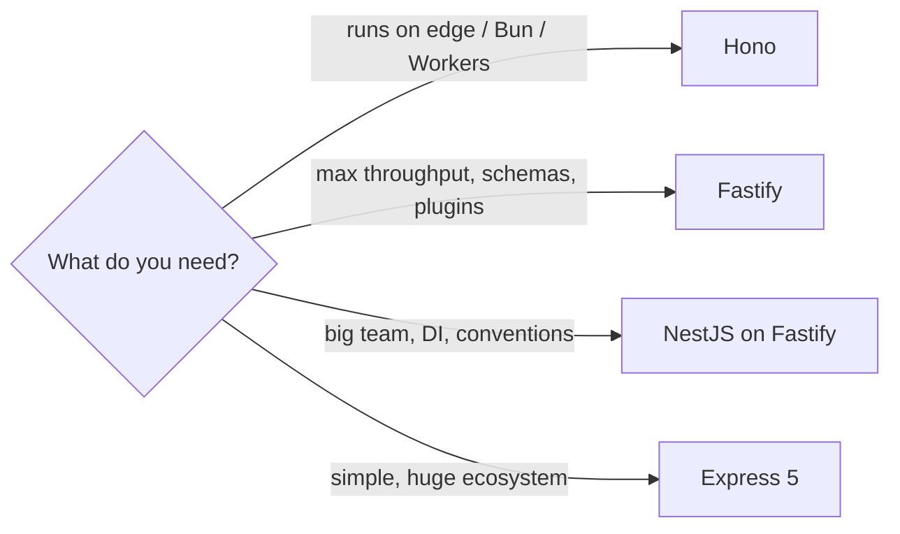

# Building HTTP Servers - Express, Fastify & Hono

> [!tldr] TL;DR
> Every Node web framework wraps `http.createServer` with **routing**, **middleware/hooks**, **body parsing**, and **error handling**. **Express** is the ubiquitous minimal choice (v5 is now the default). **Fastify** is faster and schema-driven (JSON Schema validation + fast serialization, plugin encapsulation). **Hono** is a tiny framework built on **Web Standards** (`Request`/`Response`) that runs on Node, Bun, Deno, Cloudflare Workers and other edge runtimes. **NestJS** adds an opinionated DI/module architecture on top of Express or Fastify.

## The same API in each

A `POST /users` that validates input, and a `GET /users/:id`.

### Plain Node (for comparison)
See [[Using Node API’s]] and [[Node with HTTP]]: you parse the URL, read the body stream and set headers yourself.

### Express 5

```js
import express from 'express';
import { z } from 'zod';

const app = express();
app.use(express.json({ limit: '100kb' }));

const User = z.object({ name: z.string().min(1), email: z.string().email() });

app.post('/users', async (req, res) => {
  const parsed = User.safeParse(req.body);
  if (!parsed.success) return res.status(400).json(parsed.error.flatten());
  const user = await db.users.create(parsed.data);    // rejected promise → error handler (Express 5)
  res.status(201).json(user);
});

app.get('/users/:id', async (req, res) => {
  const user = await db.users.find(req.params.id);
  if (!user) return res.sendStatus(404);
  res.json(user);
});

app.use((err, req, res, next) => {                    // error-handling middleware (4 args)
  req.log?.error(err);
  res.status(500).json({ error: 'Internal error' });
});

app.listen(3000);
```

### Fastify 5

```js
import Fastify from 'fastify';

const app = Fastify({ logger: true });   // pino logger built in

app.post('/users', {
  schema: {
    body: {
      type: 'object',
      required: ['name', 'email'],
      properties: { name: { type: 'string', minLength: 1 }, email: { type: 'string', format: 'email' } },
    },
    response: { 201: { type: 'object', properties: { id: { type: 'string' }, name: { type: 'string' } } } },
  },
}, async (req, reply) => {
  const user = await db.users.create(req.body);   // body already validated
  reply.code(201);
  return user;                                    // serialized with the response schema (fast, and strips extra fields)
});

app.get('/users/:id', async (req, reply) => {
  const user = await db.users.find(req.params.id);
  if (!user) return reply.code(404).send();
  return user;
});

await app.listen({ port: 3000 });
```

### Hono

```ts
import { Hono } from 'hono';
import { serve } from '@hono/node-server';
import { zValidator } from '@hono/zod-validator';
import { z } from 'zod';

const app = new Hono();

app.post('/users',
  zValidator('json', z.object({ name: z.string().min(1), email: z.string().email() })),
  async (c) => {
    const data = c.req.valid('json');
    const user = await db.users.create(data);
    return c.json(user, 201);
  });

app.get('/users/:id', async (c) => {
  const user = await db.users.find(c.req.param('id'));
  return user ? c.json(user) : c.notFound();
});

serve({ fetch: app.fetch, port: 3000 });   // on Bun/Deno/Workers: export default app
```

## Comparison

| | Express | Fastify | Hono | NestJS |
|---|---|---|---|---|
| Style | Minimal middleware chain | Plugins + lifecycle hooks, schema-first | Web-standard `Request`/`Response`, middleware | Opinionated modules, controllers, DI |
| Validation | Bring your own (zod, joi) | JSON Schema built in (Ajv); type providers for TS | Validator middleware (zod, valibot) | `class-validator` pipes |
| Performance | Slowest of the three (fine for most apps) | Very fast; schema-based serialization | Very fast, tiny | Depends on adapter (Express or Fastify) |
| Runtimes | Node | Node | Node, Bun, Deno, Workers, Lambda, edge | Node |
| Ecosystem | Largest | Large, official `@fastify/*` plugins | Growing | Large, enterprise |
| TypeScript | Types via `@types/express` | First-class | First-class, typed RPC client (`hc`) | First-class |
| Best for | Simple APIs, legacy, learning | High-throughput JSON APIs | Edge/serverless, multi-runtime | Large teams wanting structure (Spring-like) |



## Cross-cutting concerns every server needs
- **Validation** at the edge of the system (never trust `req.body`).
- **Error handling**: one error handler, consistent JSON error shape (RFC 9457 Problem Details is a good standard), no stack traces to clients.
- **Logging**: structured JSON logs (pino) with a request ID; see [[Node.js Performance & Debugging]].
- **Security**: helmet-style headers, CORS allow-list, rate limiting, body size limits. See [[Node.js Security Best Practices]].
- **Graceful shutdown**: handle `SIGTERM`, `server.close()`, drain keep-alive connections, close DB pools.
- **Health checks**: `/healthz` (liveness) and `/readyz` (readiness) for Kubernetes.
- **Timeouts**: `server.requestTimeout`, `headersTimeout`, and timeouts on outgoing calls (`AbortSignal.timeout(ms)` with `fetch`).

```js
// graceful shutdown sketch
const server = app.listen(3000);
process.on('SIGTERM', () => {
  server.close(async () => { await db.end(); process.exit(0); });
  setTimeout(() => process.exit(1), 10_000).unref();   // hard deadline
});
```

> [!info]+ 🆕 2025–2026
> - **Express 5.0** was released on **2024-10-15** (first major in ~10 years: async error handling, path-to-regexp v8 route syntax, removal of deprecated APIs, Node 18+). **Express 5.1.0** became the default `latest` on npm on **2025-03-31**, with an official LTS policy (v4 enters maintenance).
> - **Fastify v5** (GA 2024) requires **Node 20+**. A v6 is in pre-release (alpha builds on GitHub in 2026; not stable as of Sept 2026).
> - Node's own `http` server is unchanged, but Node 26 removed the deprecated `http.writeHeader()` (use `writeHead`).
> - Node's native TypeScript type stripping (stable in 24.12/25.2) lets you run a `.ts` server with plain `node server.ts` if you avoid enums/decorators. See [[Node.js 22 to 24+ - What's New]].

## Pitfalls
- Express 4 habits in Express 5: route strings like `'/*'` must become named wildcards (`'/*splat'`), and `req.body` is `undefined` (not `{}`) when no parser ran.
- Registering body parsers globally with no size limit (DoS risk).
- Fastify: forgetting plugin **encapsulation**: decorators/hooks registered inside a plugin don't leak to siblings unless wrapped with `fastify-plugin`.
- Running Hono on Node without `@hono/node-server` (it needs the adapter to turn Node's req/res into web `Request`/`Response`).
- Doing CPU work in handlers; see [[Node.js Event Loop & libuv]].

## Senior perspective
- The framework is rarely the bottleneck; database calls, serialization and logging are. Fastify's win comes from schema-compiled serializers and low overhead per request, which matters at tens of thousands of RPS.
- Prefer **schemas as the contract**: generate OpenAPI from them (Fastify swagger, zod-openapi, Hono's OpenAPI middleware) so docs and validation can't drift.
- For multi-runtime or edge deployment, Web-standard APIs (Hono, `fetch` handlers) keep you portable.
- In reviews ask: where's input validated? What's the error contract? Are timeouts set on every outbound call? Is shutdown graceful? Are logs structured with correlation IDs?

## Interview questions

> [!question]- Express vs Fastify?
> Both are Node HTTP frameworks. Express is minimal and middleware-based with the biggest ecosystem. Fastify is built for performance: JSON-Schema validation, compiled serializers, a plugin system with encapsulation, lifecycle hooks and pino logging built in. Fastify typically handles several times more requests per second.

> [!question]- What makes Hono different?
> It's built on Web Standard `Request`/`Response`, so the same app runs on Node, Bun, Deno, Cloudflare Workers, Lambda and other edge platforms. It's very small and fast, TypeScript-first, and offers a typed client for end-to-end types.

> [!question]- What changed in Express 5?
> Rejected promises from async handlers/middleware go to the error handler automatically, new path-matching syntax (path-to-regexp v8, named wildcards), removed deprecated methods (`res.send(status)`, `app.del`, etc.), Node 18+ required, `req.body` undefined when unparsed.

> [!question]- How would you implement graceful shutdown?
> On SIGTERM: fail readiness, stop accepting new connections with `server.close()`, let in-flight requests finish (with a deadline), close keep-alive sockets, drain queues and DB pools, then exit. Force exit after a timeout.

> [!question]- Where should validation happen?
> At the boundary, as soon as input enters: request body, params, query, headers, and also responses from third-party services. Use a schema library so types, validation and docs come from one source.

## Related
- [[Node.js Index]]
- [[Node with HTTP]] · [[Using Node API’s]] · [[Node.js Security Best Practices]] · [[Node.js Performance & Debugging]]
- [[Networking - HTTP, Caching & Real-time]] · [[GraphQL vs REST]]
- Java equivalent: [[Spring Boot Essentials]]

## Sources
- [Express blog: Introducing Express v5 (2024-10-15)](https://expressjs.com/en/blog/2024-10-15-v5-release/)
- [Express blog: Express 5.1.0 now the default on npm, with LTS timeline (2025-03-31)](https://expressjs.com/en/blog/2025-03-31-v5-1-latest-release/)
- [Express: Migrating to Express 5](https://expressjs.com/en/guide/migrating-5/)
- [Fastify docs](https://fastify.dev/docs/latest/) · [Fastify V5 migration guide](https://fastify.dev/docs/latest/Guides/Migration-Guide-V5/) · [Fastify releases](https://github.com/fastify/fastify/releases)
- [Hono docs](https://hono.dev/docs/)
- [NestJS docs](https://docs.nestjs.com/)
- [RFC 9457: Problem Details for HTTP APIs](https://www.rfc-editor.org/rfc/rfc9457)
- [Node.js 26.0.0 release notes](https://nodejs.org/en/blog/release/v26.0.0)
