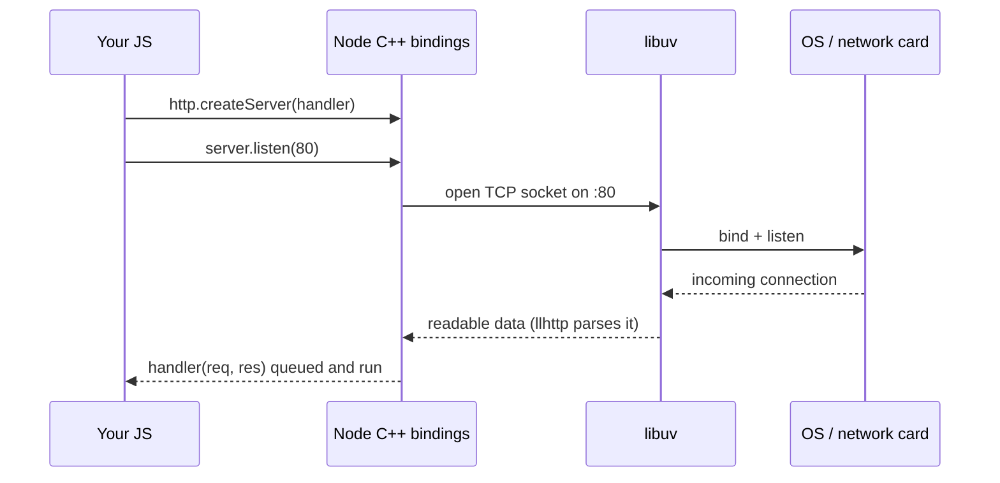

# Introduction to Node.js

> [!tldr] TL;DR
> Node.js is **JavaScript + C++**. JavaScript on its own can only do two things: **save data** and **run code that uses that data**. Everything else (network, files, timers) is done by Node's C++ layer, reached through built-in "labels" like `require('http')` or `require('fs')`. Node relies on **V8** to run JS and **libuv** to talk to the operating system without blocking.

*Part of [[The Hard Parts of Servers & Node.js]] (course notes).*

## Node = JS + C++ (a facade over the computer)

Node calls C++ to execute file-system and network work.

![[Screenshot_2023-04-28_at_1.26.30_AM.png]]

When you write `const fs = require('fs')` you are getting a **facade**: a JS object whose methods are thin wrappers ("bindings") over C++ code that can talk to the network card, the disk and the OS.

Node relies on several dependencies under the hood:

| Dependency | Job |
|---|---|
| **V8** | Google's JS engine: parses, compiles and runs your JS, manages the JS heap and GC. See [[V8 Engine - Ignition, TurboFan & Garbage Collection]] |
| **libuv** | Cross-platform C library for **non-blocking I/O**, the event loop and the thread pool |
| **llhttp** | HTTP/1.1 parser (replaced the older `http-parser` in Node 12) |
| **c-ares** | Asynchronous DNS resolution |
| **OpenSSL** | TLS and `crypto` |
| **zlib** | Compression (`node:zlib`) |
| **undici** | The HTTP client behind global `fetch` |

## libuv

**libuv** is a C library originally written for Node.js to abstract **non-blocking I/O** across operating systems (epoll on Linux, kqueue on macOS, IOCP on Windows).

- It gives Node an **event-driven asynchronous I/O model**: start an operation, get notified by a callback when it completes.
- While the OS waits on I/O, the CPU is free to do other work, so resources and the network are used efficiently.
- It also handles the **file system, DNS, network, child processes, pipes, signal handling, polling and streaming**.

**Example:** a program querying a database. With blocking I/O the thread sits idle until the query returns. With libuv, Node registers interest in the socket, keeps running other JS, and runs your callback when the result arrives.

### The thread pool

Some operations cannot be done asynchronously at the OS level (most file-system calls, `dns.lookup`, some `crypto` and `zlib` work). For those, libuv uses a **thread pool**:

- Tasks are assigned to a pool of worker threads, **4 by default**, configurable with the `UV_THREADPOOL_SIZE` environment variable (max 1024).
- All **callbacks** for completed tasks still run on the **main thread**.
- Network sockets do **not** use the thread pool; they use the OS's async notification mechanism directly.
- Since Node 10.5 (stable in 12), **worker threads** can run *JavaScript* in parallel. See [[Node.js Concurrency - Worker Threads, Cluster & Child Processes]].

```bash
UV_THREADPOOL_SIZE=8 node server.js   # set before the pool is first used
```

## What JavaScript can do by itself

The only **2 things JS can do by itself** are **saving data** and **using data** (running code on it).

- JS stores data in the **global variable environment** (memory): `const a = 'ali';`
- It saves a function's name and code in memory too; calling it creates a new **execution context**.

![[Screenshot_2023-04-28_at_1.53.36_AM.png]]

- **Thread of execution**: JS's ability to go line by line and execute.
- To run the code inside a function we need a new **execution context** (its own local memory + thread). See [[Execution Context & Call Stack]].

JS's other talent is **built-in labels that trigger Node features**. The Node feature that accesses the network is `net`, and a more specialised one is `http`.

## Worked example: opening a server

```js
const http = require('node:http');

const server = http.createServer((req, res) => {
  res.end('Hello from Node');
});
server.listen(80);
```

- `http.createServer(...)` runs in JS but sets up a C++ server object in Node and returns a JS object (with methods like `listen`) that references it.
- `server.listen(80)` calls into Node's C++ network code, which asks **libuv** to open a **socket** on port 80 through the OS. libuv is what lets the same JS run on any machine and links Node to the hardware.
- **Ports** are entry points: the OS routes incoming TCP traffic for port 80 to our Node process.
- When a request arrives, Node **auto-runs** the function you passed, filling in `req` and `res`. See [[Using Node API’s]].



> [!tip] Port 80 needs privileges
> On Linux/macOS, ports below 1024 need root. In development use `server.listen(3000)`.

## Interview questions

> [!question]- What is Node.js?
> A JavaScript runtime built on V8 plus a C++ layer and libuv. It adds APIs JS doesn't have on its own (network, file system, processes) and an event loop that lets a single JS thread handle many concurrent I/O operations.

> [!question]- What is libuv and why does Node need it?
> A C library that provides the event loop, non-blocking network I/O on every OS, and a thread pool for operations that can't be done asynchronously by the OS (most fs calls, dns.lookup, some crypto/zlib). Without it Node would block on every I/O call.

> [!question]- Does all async work in Node use the thread pool?
> No. Network I/O uses OS-level async mechanisms (epoll/kqueue/IOCP) on the main loop. The thread pool (default 4 threads, `UV_THREADPOOL_SIZE`) is used for fs, `dns.lookup`, and CPU-heavy crypto/zlib work.

## Related
- [[The Hard Parts of Servers & Node.js]] · [[Node.js Index]]
- [[Node JS Under the hood!]] · [[Node.js Event Loop & libuv]] · [[Using Node API’s]]
- [[Execution Context & Call Stack]]

## Sources
- [Node.js docs: About / dependencies](https://nodejs.org/en/learn/getting-started/introduction-to-nodejs)
- [Node.js: Don't block the event loop (thread pool)](https://nodejs.org/en/learn/asynchronous-work/dont-block-the-event-loop)
- [libuv design overview](https://docs.libuv.org/en/v1.x/design.html)
- [libuv thread pool docs (UV_THREADPOOL_SIZE)](https://docs.libuv.org/en/v1.x/threadpool.html)
- Frontend Masters, *The Hard Parts of Servers & Node.js* (Will Sentance)
