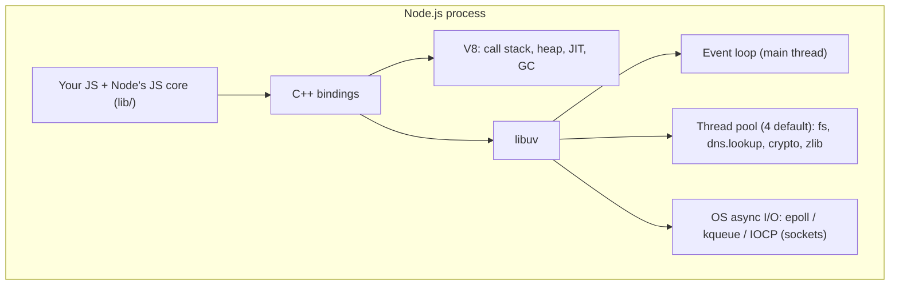

# Node JS Under the hood!

<Note>
**TL;DR**

Node.js is a **runtime**: the V8 engine (runs JS, owns the call stack and heap) plus **libuv** (event loop, async I/O, thread pool) plus C/C++ libraries for HTTP parsing, DNS, TLS and compression. The engine only executes; the **event loop** decides *when* each callback runs. After each callback Node drains the **microtask** queues (`process.nextTick`, then promises) before moving on. The V8 half of this note (compilers, bytecode, GC) now lives in [V8 Engine - Ignition, TurboFan & Garbage Collection](/Software%20Engineering/Backend/The%20Hard%20Parts%20of%20Servers%20%26%20Node.js/V8%20Engine%20-%20Ignition%2C%20TurboFan%20%26%20Garbage%20Collection).
</Note>

*Part of [The Hard Parts of Servers & Node.js](/Software%20Engineering/Backend/The%20Hard%20Parts%20of%20Servers%20%26%20Node.js/The%20Hard%20Parts%20of%20Servers%20%26%20Node.js) (course notes, supplemented with the "Node.js Under the Hood" article series). Split on 2026-09-27: V8 content moved to [V8 Engine - Ignition, TurboFan & Garbage Collection](/Software%20Engineering/Backend/The%20Hard%20Parts%20of%20Servers%20%26%20Node.js/V8%20Engine%20-%20Ignition%2C%20TurboFan%20%26%20Garbage%20Collection).*

## What Node.js is made of

Node.js is a runtime environment in which we can run JS outside the browser.


- **V8** engine
- **libuv** (C library)
- **llhttp** (HTTP parser; the older `http-parser` was replaced in Node 12)
- **c-ares** (async DNS)
- **OpenSSL** (TLS/crypto)
- **zlib** (compression)

V8 is mostly C++ (with parts of its built-ins written in its own Torque/CSA languages), while libuv is written almost entirely in C.

## What is the JS engine?

The JS engine is an **on-demand execution environment** for JS code. Everything around it (the environment, the event loop) is responsible for **scheduling** JS executions, which are called events.


The engine is only a small part of what makes JavaScript useful. The APIs that do I/O are provided by the **host**: in browsers these are **Web APIs** (`DOM`, `fetch`, `setTimeout`) supplied by the browser vendor; in Node they are Node's own APIs (`fs`, `http`, `net`, timers). That split is why the "same" JS can do different things in different runtimes.

### Call stack

*The call stack is not part of the JavaScript language; it's part of the engine (V8 here).*


JS is called **single-threaded** because each JS thread has a **single call stack**: it can only execute one thing at a time. Node itself is not single-threaded (libuv's pool, V8's compiler and GC threads), but **your JS** runs on one thread unless you use worker threads.

## libuv: an abstraction around key parts of every OS

### What is libuv and why do we need it?

libuv is an open-source library that handles the **thread pool**, signalling, inter-process communication and everything else needed to make asynchronous tasks work. It was originally developed for Node.js as an abstraction around `libev`; many other projects use it now (e.g. Julia, pyuv, Luvit).

Many people think libuv *is* the event loop. It implements a full-featured event loop, but it is also home to other key parts of Node:

- TCP and UDP sockets of the `net`/`dgram` packages
- Async DNS resolution (`dns.lookup` via the pool)
- Async file and file-system operations
- File-system events (`fs.watch`)
- IPC
- Child processes and shell control
- Thread pool
- Signal handling
- High-resolution clock



## The event loop

The event loop takes care of the **scheduling** part of asynchronous code: it calls into the engine to run a callback, and it queues the callbacks that completed operations hand back, to be called later.

Node's loop runs in **phases** (timers → pending → idle/prepare → poll → check → close). The detailed, current model is in [Node.js Event Loop & libuv](/Software%20Engineering/Backend/The%20Hard%20Parts%20of%20Servers%20%26%20Node.js/Node.js%20Event%20Loop%20%26%20libuv); the browser model is in [Event Loop - Microtasks & Macrotasks](/Software%20Engineering/Frontend/01%20JavaScript/Event%20Loop%20-%20Microtasks%20%26%20Macrotasks).

### Microtasks and macrotasks

Microtasks are a layer on top of the callback queue (which is then called the **macrotask queue**). You will meet them most often with Promises.

**Rule:** one macrotask runs; then **all** microtasks are drained before the next macrotask. Because microtasks can queue more microtasks, the queue is processed until empty.


| Microtasks | Macrotasks |
|---|---|
| `process.nextTick` (Node's own queue, drained **first**) | `setTimeout`, `setInterval` |
| Promise reactions (`.then`, `await` continuations) | `setImmediate` |
| `queueMicrotask` | any I/O callback |

<Warning>
**Starvation (corrected)**

A microtask can queue another microtask forever (a "microtask loop"), starving the program: I/O and timers never get a turn. It's the async equivalent of `while (true)`.
Older articles mention a `process.maxTickDepth` guard of 1000. That setting was **removed in Node 0.12** (2015); modern Node has **no** built-in protection. Recursive `process.nextTick` or promise chains will starve the loop. Use `setImmediate` to yield.
Also, `Object.observe`, sometimes listed as a microtask source, was **removed** from V8 years ago; ignore it.
</Warning>

```js
// starves the event loop: the timer never fires
function spin() { process.nextTick(spin); }
spin();
setTimeout(() => console.log('never'), 0);

// yields each iteration: the timer fires
function spinNicely() { setImmediate(spinNicely); }
```

## Senior perspective
- "Node is single-threaded" is only true for your JS. Capacity problems usually come from **CPU work on the main thread** (JSON of huge payloads, regex, sync crypto) or **thread-pool saturation**, not from "too many requests".
- Measure event-loop delay (`perf_hooks.monitorEventLoopDelay`) and pool usage before scaling out. See [Node.js Performance & Debugging](/Software%20Engineering/Backend/The%20Hard%20Parts%20of%20Servers%20%26%20Node.js/Node.js%20Performance%20%26%20Debugging).
- Know which APIs use the pool: an innocent `bcrypt`/`pbkdf2` per login can queue every `fs` call behind it.

## Interview questions

<Accordion title="What components make up Node.js?">
V8 (JS execution, heap, GC), libuv (event loop, async I/O, thread pool), Node's C++ bindings and JS core library, plus llhttp, c-ares, OpenSSL, zlib and undici.
</Accordion>

<Accordion title="Is libuv the event loop?">
libuv implements the event loop, but it also provides cross-platform sockets, file-system operations, the thread pool, child processes, signals, IPC and timers.
</Accordion>

<Accordion title="What is microtask starvation?">
When microtasks keep scheduling microtasks, the loop never reaches the next phase, so timers and I/O callbacks never run. Node has no depth limit; yield with `setImmediate`.
</Accordion>

## Related
- [The Hard Parts of Servers & Node.js](/Software%20Engineering/Backend/The%20Hard%20Parts%20of%20Servers%20%26%20Node.js/The%20Hard%20Parts%20of%20Servers%20%26%20Node.js) · [Node.js Index](/Software%20Engineering/Backend/The%20Hard%20Parts%20of%20Servers%20%26%20Node.js/Node.js%20Index)
- [V8 Engine - Ignition, TurboFan & Garbage Collection](/Software%20Engineering/Backend/The%20Hard%20Parts%20of%20Servers%20%26%20Node.js/V8%20Engine%20-%20Ignition%2C%20TurboFan%20%26%20Garbage%20Collection) · [Node.js Event Loop & libuv](/Software%20Engineering/Backend/The%20Hard%20Parts%20of%20Servers%20%26%20Node.js/Node.js%20Event%20Loop%20%26%20libuv) · [Introduction to Node.js](/Software%20Engineering/Backend/The%20Hard%20Parts%20of%20Servers%20%26%20Node.js/Introduction%20to%20Node.js)
- [Event Loop - Microtasks & Macrotasks](/Software%20Engineering/Frontend/01%20JavaScript/Event%20Loop%20-%20Microtasks%20%26%20Macrotasks) · [Execution Context & Call Stack](/Software%20Engineering/Frontend/01%20JavaScript/Execution%20Context%20%26%20Call%20Stack)

## Sources
- [Lucas Santos: Node.js Under the Hood (series)](https://dev.to/_staticvoid/node-js-under-the-hood-1-getting-to-know-our-tools-1465)
- [Node.js: The event loop, timers and process.nextTick](https://nodejs.org/en/learn/asynchronous-work/event-loop-timers-and-nexttick)
- [libuv design overview](https://docs.libuv.org/en/v1.x/design.html)
- [Node.js 0.12 changelog (maxTickDepth removed)](https://github.com/nodejs/node/blob/main/doc/changelogs/CHANGELOG_ARCHIVE.md)
