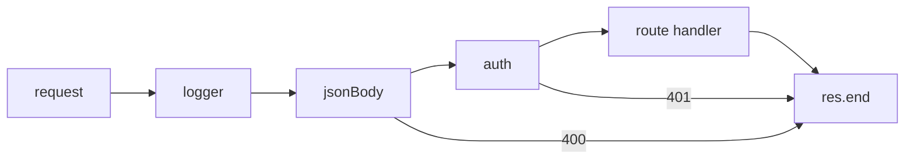

# Node with HTTP

> [!tldr] TL;DR
> A Node HTTP server is one handler function called once per request. As apps grow you split that function into **middleware**: small functions that each receive the Node-created `req` and `res` objects, inspect or change them, and then pass control to the **next** function. Express, Koa, Fastify and Hono are all variations on this idea.

*Part of [[The Hard Parts of Servers & Node.js]] (course notes).*

## Middleware

Middleware is just a way to **modularise** the one big handler: each function receives the Node-created `req` and `res`, analyses or changes them, and then hands them to the next middleware (or ends the response).

![[Screenshot_2023-04-30_at_12.10.27_AM.png]]

## Worked example: middleware from scratch

```js
const http = require('node:http');

// a tiny "framework": run middleware in order
function compose(middlewares) {
  return (req, res) => {
    let i = 0;
    const next = (err) => {
      if (err) { res.statusCode = 500; return res.end('Error'); }
      const fn = middlewares[i++];
      if (fn) fn(req, res, next);
    };
    next();
  };
}

const logger = (req, res, next) => {
  const start = Date.now();
  res.on('finish', () => console.log(req.method, req.url, res.statusCode, Date.now() - start, 'ms'));
  next();
};

const jsonBody = (req, res, next) => {
  if (req.method !== 'POST') return next();
  let raw = '';
  req.on('data', c => (raw += c));
  req.on('end', () => {
    try { req.body = JSON.parse(raw || '{}'); next(); }
    catch (e) { res.statusCode = 400; res.end('Bad JSON'); }
  });
};

const auth = (req, res, next) => {
  if (req.headers.authorization !== 'Bearer secret-dev-token') {
    res.statusCode = 401; return res.end('Unauthorized');
  }
  next();
};

const routes = (req, res) => {
  res.setHeader('Content-Type', 'application/json');
  res.end(JSON.stringify({ path: req.url, body: req.body ?? null }));
};

http.createServer(compose([logger, jsonBody, auth, routes])).listen(3000);
```



The same thing in Express:

```js
import express from 'express';
const app = express();
app.use(express.json());               // body-parsing middleware
app.use((req, res, next) => { console.log(req.method, req.url); next(); });
app.get('/health', (req, res) => res.json({ ok: true }));
app.listen(3000);
```

## The request/response cycle, briefly
- **Request**: method (`GET`, `POST`, ...), path, headers, optional body.
- **Response**: status code, headers, body. Headers must be sent before the body; once `res.end()` is called the response is finished.
- Order matters: a middleware that ends the response short-circuits everything after it.

## Pitfalls
- Calling `next()` **and** sending a response causes "headers already sent" errors.
- Forgetting `next()` hangs the request.
- Async errors: in Express 4 you had to call `next(err)`; Express 5 catches rejected promises from async handlers automatically.

## Interview questions

> [!question]- What is middleware?
> A function in the request pipeline that gets `req`, `res` and `next`. It can read or modify the request/response, end the response, or call `next()` to continue. It lets you compose cross-cutting concerns (logging, auth, parsing, CORS) separately from route logic.

> [!question]- How does error handling middleware work in Express?
> A middleware with four parameters `(err, req, res, next)` is treated as an error handler. Calling `next(err)` (or, in Express 5, throwing/rejecting in an async handler) skips normal middleware and jumps to it.

## Related
- [[The Hard Parts of Servers & Node.js]] · [[Node.js Index]]
- [[Using Node API’s]] · [[Building HTTP Servers - Express, Fastify & Hono]] · [[Node.js Security Best Practices]]

## Sources
- [Express: Using middleware](https://expressjs.com/en/guide/using-middleware.html)
- [Express: Writing middleware](https://expressjs.com/en/guide/writing-middleware.html)
- [Express 5 migration guide (async error handling)](https://expressjs.com/en/guide/migrating-5/)
- Frontend Masters, *The Hard Parts of Servers & Node.js* (Will Sentance)
