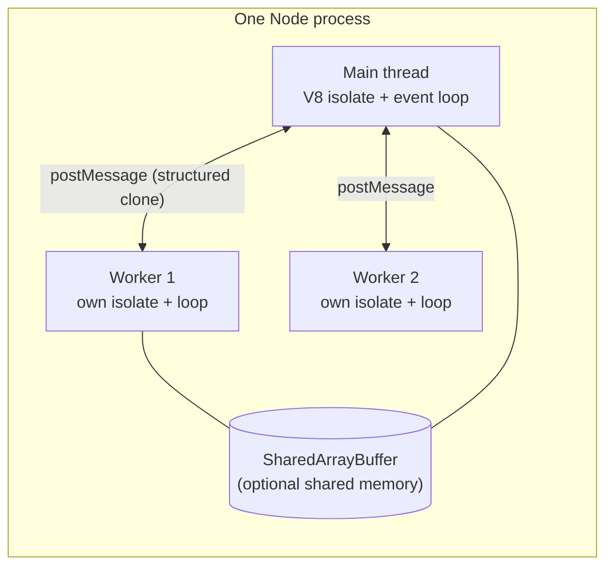

# Node.js Concurrency - Worker Threads, Cluster & Child Processes

> [!tldr] TL;DR
> Node handles **I/O concurrency** on one thread with the event loop. For **CPU parallelism** you have three tools: **`worker_threads`** (threads in the same process, each with its own V8 isolate and event loop; for CPU-heavy JS), **`cluster`** or multiple processes (one Node process per core sharing a port; for scaling stateless HTTP), and **`child_process`** (run other programs or isolated Node scripts). In containers the usual answer for scaling HTTP is "one process per container, more replicas", with workers for CPU hotspots.

## Concurrency vs parallelism in Node

| Kind of work | Right tool |
|---|---|
| Many slow I/O calls (DB, HTTP, files) | Just `async/await`; the event loop already overlaps them |
| CPU-heavy JS (image resize, parsing, hashing, compression) | `worker_threads` (usually via a pool like Piscina) |
| Use all cores for an HTTP server | `cluster`, PM2, or N container replicas behind a load balancer |
| Run another program (ffmpeg, git, python) | `child_process.spawn` / `execFile` |

See [[Concurrency And Parallelism]] for the general concepts.

## Worker threads



- Each worker has its **own heap**; objects are **copied** via the structured clone algorithm when posted. Transfer `ArrayBuffer`s to move them without copying; use `SharedArrayBuffer` + `Atomics` to truly share memory.
- Workers are relatively heavy (a new isolate, ~ms to start, MBs of memory): **pool** them, don't spawn one per request.

```js
// hash-worker.js
import { parentPort } from 'node:worker_threads';
import { scryptSync } from 'node:crypto';
parentPort.on('message', ({ id, password, salt }) => {
  parentPort.postMessage({ id, hash: scryptSync(password, salt, 64).toString('hex') });
});
```

```js
// main.js: minimal worker usage
import { Worker } from 'node:worker_threads';

const worker = new Worker(new URL('./hash-worker.js', import.meta.url));
const pending = new Map();
let nextId = 0;
worker.on('message', ({ id, hash }) => { pending.get(id)(hash); pending.delete(id); });

export function hash(password, salt) {
  return new Promise(resolve => {
    const id = nextId++;
    pending.set(id, resolve);
    worker.postMessage({ id, password, salt });
  });
}
```

With a pool (Piscina is maintained by Node collaborators):

```js
import Piscina from 'piscina';
const pool = new Piscina({ filename: new URL('./resize.js', import.meta.url).href });
app.post('/thumbnail', async (req, res) => {
  const png = await pool.run({ image: req.body });   // runs on a free worker thread
  res.type('png').send(png);
});
```

## Cluster

`cluster.fork()` starts copies of your process. The primary accepts connections and distributes them (round-robin by default except on Windows) to workers, all listening on the same port.

```js
import cluster from 'node:cluster';
import { availableParallelism } from 'node:os';
import http from 'node:http';

if (cluster.isPrimary) {
  for (let i = 0; i < availableParallelism(); i++) cluster.fork();
  cluster.on('exit', (w, code) => { console.log(`worker ${w.process.pid} died (${code}), restarting`); cluster.fork(); });
} else {
  http.createServer((req, res) => res.end(`hello from ${process.pid}\n`)).listen(3000);
}
```

- Processes **share nothing**: in-memory sessions, caches and rate-limit counters are per process. Move shared state to Redis/DB.
- In Kubernetes/ECS, prefer **one Node process per container** and scale replicas; the orchestrator already restarts, balances and limits resources. Set CPU limits so `availableParallelism()` matches.

## Child processes

| API | Shell? | Output | Use |
|---|---|---|---|
| `spawn(cmd, args)` | No | Streams | Long-running or large output (ffmpeg) |
| `execFile(file, args)` | No | Buffered | Short commands with known args |
| `exec(cmdString)` | **Yes** | Buffered | Avoid with user input (shell injection) |
| `fork(modulePath)` | No | IPC channel | Another Node script with `process.send` messaging |

```js
import { spawn } from 'node:child_process';
const ff = spawn('ffmpeg', ['-i', input, '-vf', 'scale=320:-1', output]);   // args array: no shell
ff.stderr.on('data', d => process.stderr.write(d));
ff.on('close', code => console.log('ffmpeg exited', code));
```

## Comparison

| | Worker threads | Cluster / processes | Child process |
|---|---|---|---|
| Isolation | Same process, separate isolates | Separate processes | Separate process (any program) |
| Memory sharing | Possible (`SharedArrayBuffer`) | No | No |
| Startup cost | Medium | High | High |
| Crash impact | Uncaught error kills the worker (can kill process if unhandled) | One worker dies, others continue | Child dies, parent continues |
| Communication | `postMessage`, `MessageChannel`, `BroadcastChannel` | IPC | stdio, IPC (fork) |

## Pitfalls
- Using workers for I/O: no benefit, only overhead. The event loop already does I/O concurrently.
- Posting huge objects to workers: structured clone cost can exceed the work saved. Transfer buffers instead.
- Unbounded `Promise.all(items.map(callApi))`: that's concurrency too, and it can overwhelm downstreams. Limit it (e.g. `p-limit`, or a simple semaphore).
- `exec` with interpolated user input = command injection. See [[Node.js Security Best Practices]].
- Cluster + WebSockets/sticky sessions: without sticky routing, a client's reconnection may land on another worker.

```js
// bounded concurrency without a library
async function mapLimit(items, limit, fn) {
  const results = []; let i = 0;
  const run = async () => { while (i < items.length) { const idx = i++; results[idx] = await fn(items[idx]); } };
  await Promise.all(Array.from({ length: limit }, run));
  return results;
}
```

## Senior perspective
- First question in review: **is this CPU-bound or I/O-bound?** Most Node latency problems are blocking CPU work on the main thread or unbounded fan-out, not "need more threads".
- For CPU-heavy services, consider whether Node is the right runtime at all, or whether the heavy part should be a separate service (Go, Rust, Java) or a WASM module.
- Size worker pools to cores **minus** the main thread, and remember the libuv pool (4) also competes for CPU.
- Observability: each worker has its own event loop; measure utilisation per worker (`performance.eventLoopUtilization` works in workers too).

> [!info]+ 🆕 2025–2026
> - The permission model's `--allow-worker` and `--allow-child-process` flags gate these APIs when running with `--permission` (stable since Node 23.5 / 22.13). See [[Node.js Security Best Practices]].
> - Node 24.0.0 (2025-05-06) runtime-deprecated passing `args` to `spawn`/`execFile` together with `shell: true` (the args were concatenated unescaped). Pass a single command string or avoid the shell.

## Interview questions

> [!question]- How do you use multiple cores in Node?
> For HTTP scaling run several processes (cluster, PM2, or more container replicas) behind a load balancer. For CPU-bound tasks inside one service, use worker threads via a pool.

> [!question]- Worker threads vs cluster?
> Workers are threads in one process with separate V8 isolates; they can share memory and are for CPU-heavy computation. Cluster forks whole processes that share a listening port; nothing is shared, and it's for scaling request handling.

> [!question]- How do worker threads communicate?
> `postMessage` with structured cloning (copy), transferable objects (move `ArrayBuffer`s/`MessagePort`s), or `SharedArrayBuffer` with `Atomics` for shared memory.

> [!question]- `spawn` vs `exec`?
> `spawn` runs a program directly with an args array and streams output; `exec` runs a command string in a shell and buffers output (with a max buffer). `exec` with user input risks shell injection; prefer `spawn`/`execFile`.

> [!question]- Would workers speed up an API that calls three databases?
> No. That's I/O-bound; `Promise.all` on the event loop already runs them concurrently. Workers help only when the JS itself burns CPU.

## Related
- [[Node.js Index]]
- [[Node.js Event Loop & libuv]] · [[Node.js Performance & Debugging]] · [[Node.js Security Best Practices]]
- [[Concurrency And Parallelism]] · [[Web Workers, Service Workers & PWAs]] (browser equivalent)
- Java comparison: [[Java Concurrency & Virtual Threads]]

## Sources
- [Node.js docs: Worker threads](https://nodejs.org/api/worker_threads.html)
- [Node.js docs: Cluster](https://nodejs.org/api/cluster.html)
- [Node.js docs: Child process](https://nodejs.org/api/child_process.html)
- [Node.js: Don't block the event loop](https://nodejs.org/en/learn/asynchronous-work/dont-block-the-event-loop)
- [Piscina](https://github.com/piscinajs/piscina)
- [Node.js 24.0.0 release notes](https://nodejs.org/en/blog/release/v24.0.0)
- [Node.js docs: Permissions](https://nodejs.org/api/permissions.html)
