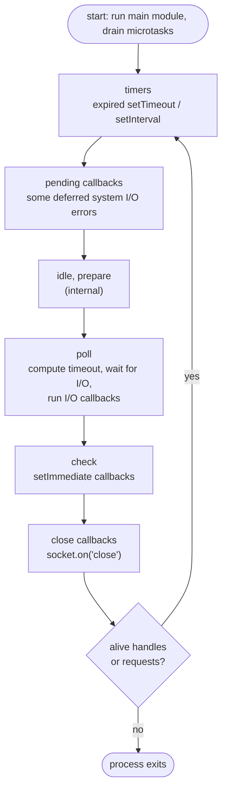
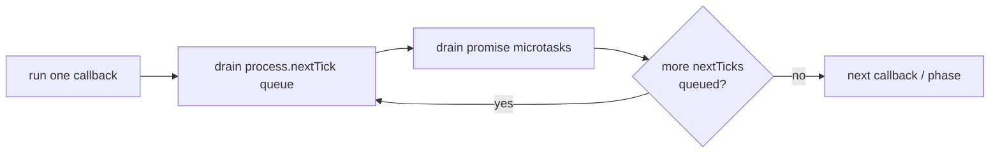

# Node.js Event Loop & libuv

<Note>
**TL;DR**

Node's event loop, implemented by **libuv**, cycles through **phases**: timers → pending callbacks → idle/prepare → **poll** (wait for and run I/O callbacks) → **check** (`setImmediate`) → close callbacks. After **every single callback** Node drains the `process.nextTick` queue and then the promise microtask queue. Your JS runs on one thread, so anything slow on it (CPU work, sync I/O) delays every other request. The browser event loop is covered in [Event Loop - Microtasks & Macrotasks](/Software%20Engineering/Frontend/01%20JavaScript/Event%20Loop%20-%20Microtasks%20%26%20Macrotasks); this note is the Node-specific, server-side view.
</Note>

## The idea

- Node is **event-driven**: you register interest ("call me when this socket has data", "in 100 ms"), then return. libuv watches the OS and queues your callback when something happens.
- The loop only runs a callback when the **call stack is empty**. No callback ever interrupts another.
- The process exits when the loop has **nothing left to wait for** (no active handles like servers/timers and no pending requests).

## The phases



Between **each callback** in any phase:



| Phase | What runs | Notes |
|---|---|---|
| **timers** | `setTimeout`/`setInterval` callbacks whose threshold passed | Threshold is a minimum, not a guarantee |
| **pending callbacks** | Some system errors deferred from the previous iteration (e.g. TCP `ECONNREFUSED`) | Rarely matters |
| **idle, prepare** | libuv internals | |
| **poll** | New I/O events and their callbacks (sockets, fs completions from the pool) | If nothing is queued, the loop **blocks here** waiting for I/O, but no longer than the next timer; leaves early if `setImmediate` callbacks exist |
| **check** | `setImmediate` callbacks | Always right after poll |
| **close** | `'close'` events of destroyed handles | |

<Note>
**libuv 1.45 / Node 20 detail**

Since libuv 1.45.0 (Node 20), timers are run **after** the poll phase in each iteration (plus once before the loop starts, for backwards compatibility). Earlier versions ran them before polling. This can change the relative order of timers and `setImmediate` in edge cases. Don't write code that depends on that order.
</Note>

## Microtasks in Node: `process.nextTick` vs promises vs `setImmediate`

| API | Queue | When it runs | Use for |
|---|---|---|---|
| `process.nextTick(fn)` | nextTick queue | Right after the current operation, **before** promises | Emitting events after a constructor returns; deferring an error callback so APIs are consistently async |
| `Promise.then` / `await` / `queueMicrotask` | microtask queue | After the nextTick queue is empty | Normal async code |
| `setImmediate(fn)` | check phase | Next iteration, after poll | Yielding to I/O; breaking up long work |
| `setTimeout(fn, 0)` | timers | Next timers phase, after ≥1 ms | Delays |

The Node docs say the names are backwards: `nextTick` fires more immediately than `setImmediate`. They recommend `setImmediate` in most cases because it's easier to reason about.

### Worked example: predict the output

```js
const fs = require('node:fs');

console.log('1 sync');
setTimeout(() => console.log('6 timeout'), 0);
setImmediate(() => console.log('7 immediate'));
Promise.resolve().then(() => console.log('4 promise'));
process.nextTick(() => console.log('3 nextTick'));
queueMicrotask(() => console.log('5 microtask'));
console.log('2 sync');

fs.readFile(__filename, () => {
  setTimeout(() => console.log('9 timeout in I/O'), 0);
  setImmediate(() => console.log('8 immediate in I/O')); // always before the timeout here
  process.nextTick(() => console.log('8a nextTick in I/O')); // before both
});
```

- `1, 2` sync, then `3` nextTick, then `4, 5` promise microtasks.
- `6`/`7`: from the main module the order of a 0 ms timeout and an immediate is **not deterministic** (depends on how fast the loop starts).
- Inside an I/O callback we're in the poll phase, so **check (`setImmediate`) always comes before the next timers phase**.

### Starvation

```js
// never lets the loop move on: I/O and timers starve
(function loop() { process.nextTick(loop); })();

// yields to the loop each time
(function loop() { setImmediate(loop); })();
```

## Blocking the loop

Everything on the main thread competes for the same loop. A 200 ms synchronous task adds 200 ms of latency to **every** in-flight request.

Common blockers:
- `JSON.parse`/`JSON.stringify` of multi-MB payloads
- catastrophic-backtracking **regex** (ReDoS) on user input
- `*Sync` fs/crypto/zlib calls in request handlers
- big loops, sorting huge arrays, image processing

```js
// Measure event loop delay
import { monitorEventLoopDelay } from 'node:perf_hooks';
const h = monitorEventLoopDelay({ resolution: 20 });
h.enable();
setInterval(() => {
  console.log('p99 loop delay ms', h.percentile(99) / 1e6);
  h.reset();
}, 5000);
```

Fixes: move CPU work to [worker threads](/Software%20Engineering/Backend/The%20Hard%20Parts%20of%20Servers%20%26%20Node.js/Node.js%20Concurrency%20-%20Worker%20Threads%2C%20Cluster%20%26%20Child%20Processes), chunk it with `setImmediate`, stream instead of buffering, or push it to a queue/other service.

### Partitioning long work

```js
async function sumLarge(arr) {
  let total = 0;
  for (let i = 0; i < arr.length; i++) {
    total += arr[i];
    if (i % 10_000 === 0) await new Promise(r => setImmediate(r)); // let I/O run
  }
  return total;
}
```

## The thread pool

libuv's pool (default **4** threads, `UV_THREADPOOL_SIZE` up to 1024) runs work that can't be done asynchronously by the OS:

| Uses the pool | Doesn't |
|---|---|
| Most `fs` APIs | TCP/UDP sockets, HTTP |
| `dns.lookup` (and so `http.get('hostname')` resolution) | `dns.resolve*` (c-ares, network) |
| `crypto.pbkdf2`, `scrypt`, `randomBytes` (async), some ciphers | Timers |
| `zlib` async APIs | Pipes, TTYs, signals |

Saturating the pool (e.g. many `bcrypt` hashes) delays unrelated file reads and DNS lookups. Raise the pool size or move the work to workers.

## Pitfalls
- Assuming `setTimeout(fn, 0)` runs "now": it runs in a later timers phase after microtasks and possibly I/O.
- Mixing `nextTick` and promises and expecting FIFO across both: nextTick always jumps ahead.
- Unhandled promise rejections **crash** the process (default `--unhandled-rejections=throw` since Node 15).
- Keeping the process alive by accident with an open handle (interval, server, DB pool). Use `timer.unref()` for background timers.

## Senior perspective
- Track **event-loop delay/utilisation** (`performance.eventLoopUtilization()`) as a first-class service metric next to latency; it's the earliest saturation signal in Node.
- Throughput in Node comes from **not blocking**. Code review questions: is there sync work proportional to input size? Unbounded `Promise.all` fan-out? Large JSON on the hot path?
- Use `AsyncLocalStorage` for request-scoped context (trace IDs) across async boundaries instead of passing it everywhere; Node 24 made it faster by default (`AsyncContextFrame`).
- Graceful shutdown: on `SIGTERM`, stop accepting connections (`server.close()`), let in-flight requests finish, close pools, then exit.

<Info>
**🆕 2025–2026**

- **Node 24.0.0** (2025-05-06): `AsyncLocalStorage` uses `AsyncContextFrame` by default (faster context propagation).
- libuv 1.45 timer ordering change (above) shipped with Node 20 (2023); the Node docs were updated to describe it.
- See [Node.js 22 to 24+ - What's New](/Software%20Engineering/Backend/The%20Hard%20Parts%20of%20Servers%20%26%20Node.js/Node.js%2022%20to%2024%2B%20-%20What's%20New) for the release timeline.
</Info>

## Interview questions

<Accordion title="Walk through the phases of the Node event loop.">
Timers (expired timeouts/intervals), pending callbacks, idle/prepare, poll (wait for and run I/O callbacks), check (`setImmediate`), close callbacks, then repeat while there are active handles. Between each callback, drain nextTick then promise microtasks.
</Accordion>

<Accordion title="`process.nextTick` vs `setImmediate` vs `Promise.then`?">
nextTick runs right after the current operation, before promise microtasks. Promise callbacks run next. `setImmediate` runs in the check phase of the loop, after I/O polling. Recursive nextTick can starve I/O; setImmediate cannot.
</Accordion>

<Accordion title="Why is `setTimeout(0)` vs `setImmediate` order non-deterministic?">
From the main module, whether the 1 ms timer has expired when the loop first checks timers depends on process performance. Inside an I/O callback the loop is in poll, so check (`setImmediate`) always comes before the next timers phase.
</Accordion>

<Accordion title="What blocks the event loop and how do you detect it?">
Synchronous CPU work or sync I/O on the main thread: big JSON, regex backtracking, sync crypto, heavy loops. Detect with `monitorEventLoopDelay`, `eventLoopUtilization`, CPU profiles (`--cpu-prof`, clinic.js). Fix with workers, chunking, streaming.
</Accordion>

<Accordion title="Which operations use libuv's thread pool?">
File system, `dns.lookup`, async crypto like pbkdf2/scrypt, and zlib. Network sockets don't. Default size 4, set with `UV_THREADPOOL_SIZE`.
</Accordion>

<Accordion title="When does a Node process exit?">
When the event loop has no active (ref'd) handles or pending requests left, or on `process.exit()` / an uncaught exception / unhandled rejection.
</Accordion>

## Related
- [Node.js Index](/Software%20Engineering/Backend/The%20Hard%20Parts%20of%20Servers%20%26%20Node.js/Node.js%20Index)
- [Event Loop - Microtasks & Macrotasks](/Software%20Engineering/Frontend/01%20JavaScript/Event%20Loop%20-%20Microtasks%20%26%20Macrotasks) (browser model, same microtask concepts) · [Promises, Async-Await & Cancellation](/Software%20Engineering/Frontend/01%20JavaScript/Promises%2C%20Async-Await%20%26%20Cancellation)
- [Node JS Under the hood!](/Software%20Engineering/Backend/The%20Hard%20Parts%20of%20Servers%20%26%20Node.js/Node%20JS%20Under%20the%20hood!) · [Node.js Hard Parts - Streams & Event Loop Queues](/Software%20Engineering/Backend/The%20Hard%20Parts%20of%20Servers%20%26%20Node.js/Node.js%20Hard%20Parts%20-%20Streams%20%26%20Event%20Loop%20Queues) · [Node.js Performance & Debugging](/Software%20Engineering/Backend/The%20Hard%20Parts%20of%20Servers%20%26%20Node.js/Node.js%20Performance%20%26%20Debugging)
- [Node.js Concurrency - Worker Threads, Cluster & Child Processes](/Software%20Engineering/Backend/The%20Hard%20Parts%20of%20Servers%20%26%20Node.js/Node.js%20Concurrency%20-%20Worker%20Threads%2C%20Cluster%20%26%20Child%20Processes)

## Sources
- [Node.js: The event loop, timers and process.nextTick](https://nodejs.org/en/learn/asynchronous-work/event-loop-timers-and-nexttick)
- [Node.js: Don't block the event loop (or the worker pool)](https://nodejs.org/en/learn/asynchronous-work/dont-block-the-event-loop)
- [libuv: Design overview](https://docs.libuv.org/en/v1.x/design.html)
- [Node.js docs: perf_hooks monitorEventLoopDelay](https://nodejs.org/api/perf_hooks.html)
- [Node.js 24.0.0 release notes](https://nodejs.org/en/blog/release/v24.0.0)
