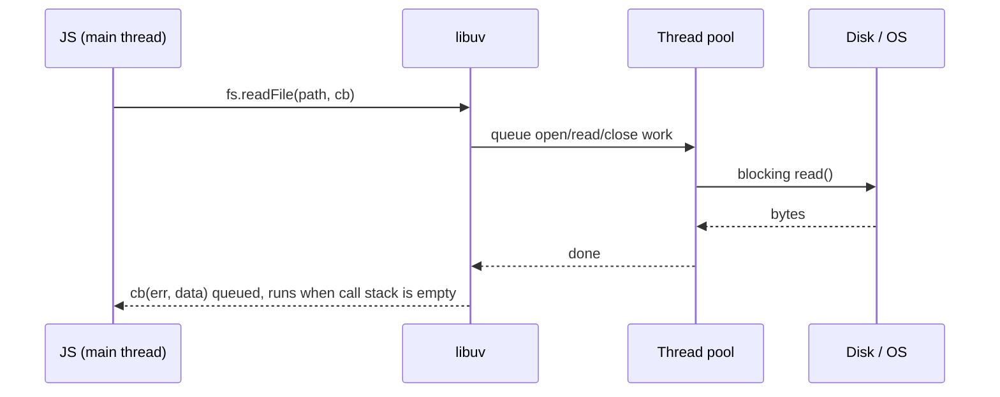

# Node.js Hard Parts - File System

<Note>
**TL;DR**

`fs` lets JS read and write files by handing the work to Node's C++ and **libuv**. Because most operating systems have no good async file API, libuv runs file operations on its **thread pool** and queues your callback when done. Use `fs/promises` (or streams for big files), never the `Sync` versions inside a server's request path.
</Note>

*Part of [The Hard Parts of Servers & Node.js](/Software%20Engineering/Backend/The%20Hard%20Parts%20of%20Servers%20%26%20Node.js/The%20Hard%20Parts%20of%20Servers%20%26%20Node.js) (course notes). Renamed from "File System".*

## Course notes

- Through libuv, Node keeps a channel open to the computer's internals (**threads of execution**) to move file content into Node.
- A **thread** is the computer's ability to do one thing (task) at a time.
- *Which I/O in Node sets up a dedicated thread through libuv?* `fs`: it uses a **thread-pool thread** to start reading the file (network sockets don't need one; they use OS async notifications).

**The call stack**: JS's way of tracking which function is currently running. There is always the global context at the bottom; functions are added when called and removed when they return. See [Execution Context & Call Stack](/Software%20Engineering/Frontend/01%20JavaScript/Execution%20Context%20%26%20Call%20Stack).

## Three API styles

```js
import fs from 'node:fs';
import { readFile } from 'node:fs/promises';

// 1. Callback (classic, error-first)
fs.readFile('tweets.json', 'utf8', (err, data) => {
  if (err) return console.error(err);
  console.log(JSON.parse(data).length);
});

// 2. Promise (preferred in modern code)
const data = await readFile('tweets.json', 'utf8');

// 3. Sync (blocks the event loop; fine in CLI scripts and at startup only)
const config = fs.readFileSync('config.json', 'utf8');
```

## What happens under the hood



- `readFile` loads the **whole file into memory**. For large files use `fs.createReadStream` (see [Node.js Hard Parts - Streams & Event Loop Queues](/Software%20Engineering/Backend/The%20Hard%20Parts%20of%20Servers%20%26%20Node.js/Node.js%20Hard%20Parts%20-%20Streams%20%26%20Event%20Loop%20Queues)).
- With 4 default pool threads, many concurrent file reads (plus `crypto.pbkdf2`, `zlib`, `dns.lookup`) queue behind each other. Tune `UV_THREADPOOL_SIZE` if profiling shows pool saturation.

## Useful modern fs APIs

| API | Use |
|---|---|
| `fs/promises` `readFile`, `writeFile`, `mkdir({ recursive: true })`, `rm({ recursive: true })` | Everyday file work |
| `fs.createReadStream` / `createWriteStream` | Large files, piping to HTTP responses |
| `fs.watch` | File change notifications |
| `fs.glob` / `fs.globSync` (Node 22+) | Pattern matching like `**/*.md` |
| `FileHandle` via `fs.promises.open` | Fine-grained reads/writes; close it explicitly (or with `await using`) |

<Info>
**🆕 2025–2026**

- Node 22 (Apr 2024) added `fs.glob`/`fs.globSync`.
- Node 25.0.0 (2025-10-15) removed the long-deprecated `fs.F_OK`/`R_OK`/`W_OK`/`X_OK` constants (use `fs.constants.F_OK`) and moved `fs.rmdir(path, { recursive })` to end-of-life (use `fs.rm`).
- With explicit resource management in V8 13.6 (Node 24), `await using fh = await fs.promises.open(...)` closes the handle automatically.
</Info>

## Pitfalls
- `readFileSync` in a request handler blocks every other request.
- Path traversal: never join user input into a path without normalising and checking it stays inside an allowed directory. See [Node.js Security Best Practices](/Software%20Engineering/Backend/The%20Hard%20Parts%20of%20Servers%20%26%20Node.js/Node.js%20Security%20Best%20Practices).
- Relative paths resolve against `process.cwd()`, not the file; use `import.meta.dirname` (Node 20.11+) or `__dirname`.

## Interview questions

<Accordion title="Why does Node use a thread pool for file I/O but not for network I/O?">
Operating systems offer efficient async readiness notifications for sockets (epoll, kqueue, IOCP) but not consistently for regular files, so libuv performs blocking file calls on pool threads and reports completion to the loop.
</Accordion>

<Accordion title="When is `readFileSync` acceptable?">
At startup (loading config) or in CLI scripts, where nothing else needs the event loop. Never in a hot request path.
</Accordion>

## Related
- [The Hard Parts of Servers & Node.js](/Software%20Engineering/Backend/The%20Hard%20Parts%20of%20Servers%20%26%20Node.js/The%20Hard%20Parts%20of%20Servers%20%26%20Node.js) · [Node.js Index](/Software%20Engineering/Backend/The%20Hard%20Parts%20of%20Servers%20%26%20Node.js/Node.js%20Index)
- [Introduction to Node.js](/Software%20Engineering/Backend/The%20Hard%20Parts%20of%20Servers%20%26%20Node.js/Introduction%20to%20Node.js) · [Node.js Hard Parts - Streams & Event Loop Queues](/Software%20Engineering/Backend/The%20Hard%20Parts%20of%20Servers%20%26%20Node.js/Node.js%20Hard%20Parts%20-%20Streams%20%26%20Event%20Loop%20Queues) · [Node.js Event Loop & libuv](/Software%20Engineering/Backend/The%20Hard%20Parts%20of%20Servers%20%26%20Node.js/Node.js%20Event%20Loop%20%26%20libuv)

## Sources
- [Node.js docs: File system](https://nodejs.org/api/fs.html)
- [Node.js 22 release announcement (fs.glob)](https://nodejs.org/en/blog/announcements/v22-release-announce)
- [Node.js 25.0.0 release notes](https://nodejs.org/en/blog/release/v25.0.0)
- [libuv: File system operations](https://docs.libuv.org/en/v1.x/fs.html)
- Frontend Masters, *The Hard Parts of Servers & Node.js* (Will Sentance)
