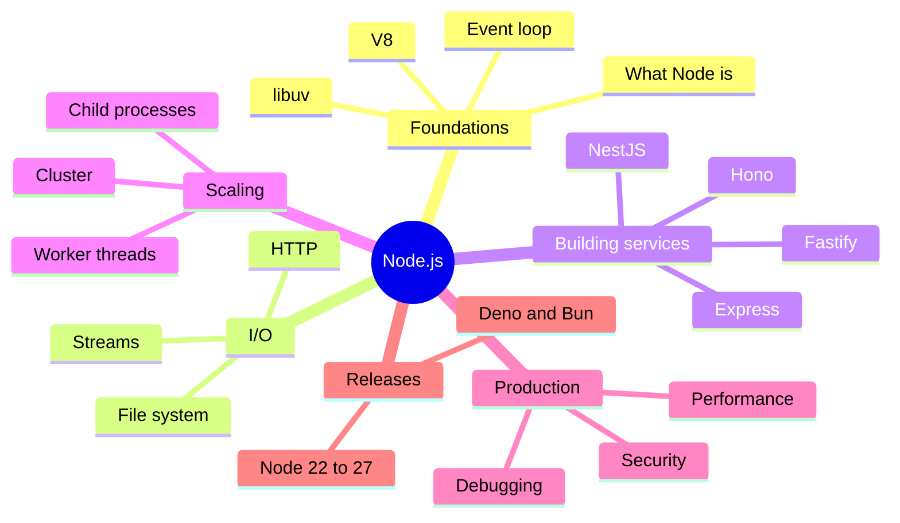

# Node.js Index

> [!tldr] Start here
> Entry point for all Node.js notes: the course notes from Will Sentance's *The Hard Parts of Servers & Node.js* (kept in course order in [[The Hard Parts of Servers & Node.js]]) plus topic notes that take you from "what is Node" to running Node services in production. Every topic note has worked examples, a 🆕 2025–2026 box where something changed, and interview questions.

## 🧭 Quick links
- 📚 Course: [[The Hard Parts of Servers & Node.js]]
- 🆕 [[Node.js 22 to 24+ - What's New]]: release timeline, native TypeScript, new schedule
- 🎯 Interview: [[Node.js Questions]] + the question sections of each topic note
- ⬆️ [[Backend Index]] · [[Software Engineering]]

## 1. Beginner: how Node works
| Note | What you learn |
|---|---|
| [[Introduction to Node.js]] | Node = JS + C++; V8, libuv, the thread pool; opening a socket |
| [[Using Node API’s]] | How Node auto-runs your handler with `req`/`res` |
| [[Node with HTTP]] | Routing and middleware from scratch |
| [[Node.js Hard Parts - File System]] | `fs` callback/promise/sync APIs and the thread pool |
| [[Node.js Hard Parts - Streams & Event Loop Queues]] | Chunks, highWaterMark, the queues, backpressure |

## 2. Intermediate: runtime internals and building services
| Note | What you learn |
|---|---|
| [[Node JS Under the hood!]] | Runtime anatomy, libuv's jobs, micro/macrotasks, starvation |
| [[Node.js Event Loop & libuv]] | Exact phases, `nextTick` vs promises vs `setImmediate`, blocking the loop |
| [[V8 Engine - Ignition, TurboFan & Garbage Collection]] | Bytecode, JIT tiers, hidden classes, inline caches, generational GC |
| [[Building HTTP Servers - Express, Fastify & Hono]] | Framework comparison, validation, errors, graceful shutdown |

## 3. Senior: scale, production and change
| Note | What you learn |
|---|---|
| [[Node.js Concurrency - Worker Threads, Cluster & Child Processes]] | CPU parallelism, pools, processes vs threads |
| [[Node.js Performance & Debugging]] | Profiling, heap snapshots, leaks, diagnostics, observability |
| [[Node.js Security Best Practices]] | Injection, traversal, prototype pollution, ReDoS, supply chain, permission model |
| [[Node.js 22 to 24+ - What's New]] | Versions, EOLs, new built-ins, upgrade playbook, Deno/Bun |
| [[Node.js Questions]] | Mixed interview Q&A |

## Suggested study path
> [!example]- 🔁 From zero to senior
> 1. Course notes in order: [[Introduction to Node.js]] → [[Using Node API’s]] → [[Node with HTTP]] → [[Node.js Hard Parts - File System]] → [[Node.js Hard Parts - Streams & Event Loop Queues]]
> 2. Internals: [[Node JS Under the hood!]] → [[Node.js Event Loop & libuv]] → [[V8 Engine - Ignition, TurboFan & Garbage Collection]]
> 3. Build: [[Building HTTP Servers - Express, Fastify & Hono]] → [[Node.js Security Best Practices]]
> 4. Operate: [[Node.js Performance & Debugging]] → [[Node.js Concurrency - Worker Threads, Cluster & Child Processes]]
> 5. Stay current: [[Node.js 22 to 24+ - What's New]]

> [!example]- 🎯 One week before an interview
> [[Node.js Event Loop & libuv]] (predict-the-output questions), [[Node.js Questions]], [[Node.js Concurrency - Worker Threads, Cluster & Child Processes]], [[Node.js Performance & Debugging]], [[Node.js Security Best Practices]], plus [[Event Loop - Microtasks & Macrotasks]] and [[Promises, Async-Await & Cancellation]] from the Frontend notes.

## 🆕 2025–2026 in this area
- **2025-03-25** V8 moves TurboFan's JS backend to Turboshaft (leaving Sea of Nodes): [[V8 Engine - Ignition, TurboFan & Garbage Collection]]
- **2025-03-31** Express 5.1 becomes npm `latest` with an LTS policy: [[Building HTTP Servers - Express, Fastify & Hono]]
- **2025-05-06** Node 24.0.0: V8 13.6, npm 11, `URLPattern` global, `--permission` flag, `AsyncLocalStorage` on AsyncContextFrame: [[Node.js 22 to 24+ - What's New]]
- **2025-09** npm supply-chain attacks (chalk/debug, Shai-Hulud) and npm's publishing hardening: [[Node.js Security Best Practices]]
- **2025-10-15** Node 25.0.0: `--allow-net`, Web Storage on, Corepack unbundled, `SlowBuffer` and `fs.F_OK` removed: [[Node.js 22 to 24+ - What's New]], [[Node.js Security Best Practices]]
- **2025-10-28** Node 24 LTS "Krypton": [[Node.js 22 to 24+ - What's New]]
- **2025-11-11** TypeScript type stripping stable in 25.2.0 (backported to 24.12.0 on 2025-12-10): [[Node.js 22 to 24+ - What's New]]
- **2026-01-19** `require(esm)` and the module compile cache stable (25.4.0): [[Node.js 22 to 24+ - What's New]]
- **2026-02-24** `node:sqlite` becomes a release candidate (25.7.0): [[Node.js 22 to 24+ - What's New]]
- **2026-03-10** New annual release schedule from Node 27, every release LTS: [[Node.js 22 to 24+ - What's New]]
- **2026-04** Node 20 end-of-life: [[Node.js 22 to 24+ - What's New]]
- **2026-05-05** Node 26.0.0: Temporal on by default, V8 14.6, legacy `_stream_*` modules removed: [[Node.js 22 to 24+ - What's New]], [[Node.js Hard Parts - Streams & Event Loop Queues]]
- **2026-10-28** (scheduled) Node 26 LTS; Node 27 alpha channel opens: [[Node.js 22 to 24+ - What's New]]

## Related
- [[Backend Index]] · [[Software Engineering]]
- [[Java & Spring Index]] (the other backend runtime in this vault)
- Deploying Node: [[Deploying Node.js Apps to Kubernetes]] · [[Kubernetes Delivery Platform - End to End]]
- Frontend: [[JavaScript Index]] · [[Event Loop - Microtasks & Macrotasks]] · [[Linting, Formatting, Package Managers & Runtimes]] · [[Supply Chain Security]]
