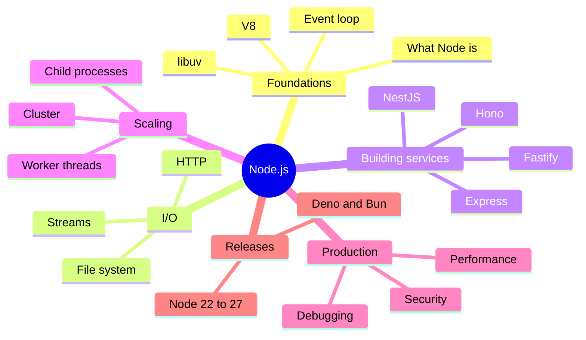

# Node.js Index

<Note>
**Start here**

Entry point for all Node.js notes: the course notes from Will Sentance's *The Hard Parts of Servers & Node.js* (kept in course order in [The Hard Parts of Servers & Node.js](/Software%20Engineering/Backend/The%20Hard%20Parts%20of%20Servers%20%26%20Node.js/The%20Hard%20Parts%20of%20Servers%20%26%20Node.js)) plus topic notes that take you from "what is Node" to running Node services in production. Every topic note has worked examples, a 🆕 2025–2026 box where something changed, and interview questions.
</Note>

## 🧭 Quick links
- 📚 Course: [The Hard Parts of Servers & Node.js](/Software%20Engineering/Backend/The%20Hard%20Parts%20of%20Servers%20%26%20Node.js/The%20Hard%20Parts%20of%20Servers%20%26%20Node.js)
- 🆕 [Node.js 22 to 24+ - What's New](/Software%20Engineering/Backend/The%20Hard%20Parts%20of%20Servers%20%26%20Node.js/Node.js%2022%20to%2024%2B%20-%20What's%20New): release timeline, native TypeScript, new schedule
- 🎯 Interview: [Node.js Questions](/Software%20Engineering/Backend/The%20Hard%20Parts%20of%20Servers%20%26%20Node.js/Node.js%20Questions) + the question sections of each topic note
- ⬆️ [Backend Index](/Software%20Engineering/Backend/Backend%20Index) · [Software Engineering](/Software%20Engineering/Software%20Engineering)

## 1. Beginner: how Node works
| Note | What you learn |
|---|---|
| [Introduction to Node.js](/Software%20Engineering/Backend/The%20Hard%20Parts%20of%20Servers%20%26%20Node.js/Introduction%20to%20Node.js) | Node = JS + C++; V8, libuv, the thread pool; opening a socket |
| [Using Node API’s](/Software%20Engineering/Backend/The%20Hard%20Parts%20of%20Servers%20%26%20Node.js/Using%20Node%20API%E2%80%99s) | How Node auto-runs your handler with `req`/`res` |
| [Node with HTTP](/Software%20Engineering/Backend/The%20Hard%20Parts%20of%20Servers%20%26%20Node.js/Node%20with%20HTTP) | Routing and middleware from scratch |
| [Node.js Hard Parts - File System](/Software%20Engineering/Backend/The%20Hard%20Parts%20of%20Servers%20%26%20Node.js/Node.js%20Hard%20Parts%20-%20File%20System) | `fs` callback/promise/sync APIs and the thread pool |
| [Node.js Hard Parts - Streams & Event Loop Queues](/Software%20Engineering/Backend/The%20Hard%20Parts%20of%20Servers%20%26%20Node.js/Node.js%20Hard%20Parts%20-%20Streams%20%26%20Event%20Loop%20Queues) | Chunks, highWaterMark, the queues, backpressure |

## 2. Intermediate: runtime internals and building services
| Note | What you learn |
|---|---|
| [Node JS Under the hood!](/Software%20Engineering/Backend/The%20Hard%20Parts%20of%20Servers%20%26%20Node.js/Node%20JS%20Under%20the%20hood!) | Runtime anatomy, libuv's jobs, micro/macrotasks, starvation |
| [Node.js Event Loop & libuv](/Software%20Engineering/Backend/The%20Hard%20Parts%20of%20Servers%20%26%20Node.js/Node.js%20Event%20Loop%20%26%20libuv) | Exact phases, `nextTick` vs promises vs `setImmediate`, blocking the loop |
| [V8 Engine - Ignition, TurboFan & Garbage Collection](/Software%20Engineering/Backend/The%20Hard%20Parts%20of%20Servers%20%26%20Node.js/V8%20Engine%20-%20Ignition%2C%20TurboFan%20%26%20Garbage%20Collection) | Bytecode, JIT tiers, hidden classes, inline caches, generational GC |
| [Building HTTP Servers - Express, Fastify & Hono](/Software%20Engineering/Backend/The%20Hard%20Parts%20of%20Servers%20%26%20Node.js/Building%20HTTP%20Servers%20-%20Express%2C%20Fastify%20%26%20Hono) | Framework comparison, validation, errors, graceful shutdown |

## 3. Senior: scale, production and change
| Note | What you learn |
|---|---|
| [Node.js Concurrency - Worker Threads, Cluster & Child Processes](/Software%20Engineering/Backend/The%20Hard%20Parts%20of%20Servers%20%26%20Node.js/Node.js%20Concurrency%20-%20Worker%20Threads%2C%20Cluster%20%26%20Child%20Processes) | CPU parallelism, pools, processes vs threads |
| [Node.js Performance & Debugging](/Software%20Engineering/Backend/The%20Hard%20Parts%20of%20Servers%20%26%20Node.js/Node.js%20Performance%20%26%20Debugging) | Profiling, heap snapshots, leaks, diagnostics, observability |
| [Node.js Security Best Practices](/Software%20Engineering/Backend/The%20Hard%20Parts%20of%20Servers%20%26%20Node.js/Node.js%20Security%20Best%20Practices) | Injection, traversal, prototype pollution, ReDoS, supply chain, permission model |
| [Node.js 22 to 24+ - What's New](/Software%20Engineering/Backend/The%20Hard%20Parts%20of%20Servers%20%26%20Node.js/Node.js%2022%20to%2024%2B%20-%20What's%20New) | Versions, EOLs, new built-ins, upgrade playbook, Deno/Bun |
| [Node.js Questions](/Software%20Engineering/Backend/The%20Hard%20Parts%20of%20Servers%20%26%20Node.js/Node.js%20Questions) | Mixed interview Q&A |

## Suggested study path
<Info>
**🔁 From zero to senior**

1. Course notes in order: [Introduction to Node.js](/Software%20Engineering/Backend/The%20Hard%20Parts%20of%20Servers%20%26%20Node.js/Introduction%20to%20Node.js) → [Using Node API’s](/Software%20Engineering/Backend/The%20Hard%20Parts%20of%20Servers%20%26%20Node.js/Using%20Node%20API%E2%80%99s) → [Node with HTTP](/Software%20Engineering/Backend/The%20Hard%20Parts%20of%20Servers%20%26%20Node.js/Node%20with%20HTTP) → [Node.js Hard Parts - File System](/Software%20Engineering/Backend/The%20Hard%20Parts%20of%20Servers%20%26%20Node.js/Node.js%20Hard%20Parts%20-%20File%20System) → [Node.js Hard Parts - Streams & Event Loop Queues](/Software%20Engineering/Backend/The%20Hard%20Parts%20of%20Servers%20%26%20Node.js/Node.js%20Hard%20Parts%20-%20Streams%20%26%20Event%20Loop%20Queues)
2. Internals: [Node JS Under the hood!](/Software%20Engineering/Backend/The%20Hard%20Parts%20of%20Servers%20%26%20Node.js/Node%20JS%20Under%20the%20hood!) → [Node.js Event Loop & libuv](/Software%20Engineering/Backend/The%20Hard%20Parts%20of%20Servers%20%26%20Node.js/Node.js%20Event%20Loop%20%26%20libuv) → [V8 Engine - Ignition, TurboFan & Garbage Collection](/Software%20Engineering/Backend/The%20Hard%20Parts%20of%20Servers%20%26%20Node.js/V8%20Engine%20-%20Ignition%2C%20TurboFan%20%26%20Garbage%20Collection)
3. Build: [Building HTTP Servers - Express, Fastify & Hono](/Software%20Engineering/Backend/The%20Hard%20Parts%20of%20Servers%20%26%20Node.js/Building%20HTTP%20Servers%20-%20Express%2C%20Fastify%20%26%20Hono) → [Node.js Security Best Practices](/Software%20Engineering/Backend/The%20Hard%20Parts%20of%20Servers%20%26%20Node.js/Node.js%20Security%20Best%20Practices)
4. Operate: [Node.js Performance & Debugging](/Software%20Engineering/Backend/The%20Hard%20Parts%20of%20Servers%20%26%20Node.js/Node.js%20Performance%20%26%20Debugging) → [Node.js Concurrency - Worker Threads, Cluster & Child Processes](/Software%20Engineering/Backend/The%20Hard%20Parts%20of%20Servers%20%26%20Node.js/Node.js%20Concurrency%20-%20Worker%20Threads%2C%20Cluster%20%26%20Child%20Processes)
5. Stay current: [Node.js 22 to 24+ - What's New](/Software%20Engineering/Backend/The%20Hard%20Parts%20of%20Servers%20%26%20Node.js/Node.js%2022%20to%2024%2B%20-%20What's%20New)
</Info>

<Info>
**🎯 One week before an interview**

[Node.js Event Loop & libuv](/Software%20Engineering/Backend/The%20Hard%20Parts%20of%20Servers%20%26%20Node.js/Node.js%20Event%20Loop%20%26%20libuv) (predict-the-output questions), [Node.js Questions](/Software%20Engineering/Backend/The%20Hard%20Parts%20of%20Servers%20%26%20Node.js/Node.js%20Questions), [Node.js Concurrency - Worker Threads, Cluster & Child Processes](/Software%20Engineering/Backend/The%20Hard%20Parts%20of%20Servers%20%26%20Node.js/Node.js%20Concurrency%20-%20Worker%20Threads%2C%20Cluster%20%26%20Child%20Processes), [Node.js Performance & Debugging](/Software%20Engineering/Backend/The%20Hard%20Parts%20of%20Servers%20%26%20Node.js/Node.js%20Performance%20%26%20Debugging), [Node.js Security Best Practices](/Software%20Engineering/Backend/The%20Hard%20Parts%20of%20Servers%20%26%20Node.js/Node.js%20Security%20Best%20Practices), plus [Event Loop - Microtasks & Macrotasks](/Software%20Engineering/Frontend/01%20JavaScript/Event%20Loop%20-%20Microtasks%20%26%20Macrotasks) and [Promises, Async-Await & Cancellation](/Software%20Engineering/Frontend/01%20JavaScript/Promises%2C%20Async-Await%20%26%20Cancellation) from the Frontend notes.
</Info>

## 🆕 2025–2026 in this area
- **2025-03-25** V8 moves TurboFan's JS backend to Turboshaft (leaving Sea of Nodes): [V8 Engine - Ignition, TurboFan & Garbage Collection](/Software%20Engineering/Backend/The%20Hard%20Parts%20of%20Servers%20%26%20Node.js/V8%20Engine%20-%20Ignition%2C%20TurboFan%20%26%20Garbage%20Collection)
- **2025-03-31** Express 5.1 becomes npm `latest` with an LTS policy: [Building HTTP Servers - Express, Fastify & Hono](/Software%20Engineering/Backend/The%20Hard%20Parts%20of%20Servers%20%26%20Node.js/Building%20HTTP%20Servers%20-%20Express%2C%20Fastify%20%26%20Hono)
- **2025-05-06** Node 24.0.0: V8 13.6, npm 11, `URLPattern` global, `--permission` flag, `AsyncLocalStorage` on AsyncContextFrame: [Node.js 22 to 24+ - What's New](/Software%20Engineering/Backend/The%20Hard%20Parts%20of%20Servers%20%26%20Node.js/Node.js%2022%20to%2024%2B%20-%20What's%20New)
- **2025-09** npm supply-chain attacks (chalk/debug, Shai-Hulud) and npm's publishing hardening: [Node.js Security Best Practices](/Software%20Engineering/Backend/The%20Hard%20Parts%20of%20Servers%20%26%20Node.js/Node.js%20Security%20Best%20Practices)
- **2025-10-15** Node 25.0.0: `--allow-net`, Web Storage on, Corepack unbundled, `SlowBuffer` and `fs.F_OK` removed: [Node.js 22 to 24+ - What's New](/Software%20Engineering/Backend/The%20Hard%20Parts%20of%20Servers%20%26%20Node.js/Node.js%2022%20to%2024%2B%20-%20What's%20New), [Node.js Security Best Practices](/Software%20Engineering/Backend/The%20Hard%20Parts%20of%20Servers%20%26%20Node.js/Node.js%20Security%20Best%20Practices)
- **2025-10-28** Node 24 LTS "Krypton": [Node.js 22 to 24+ - What's New](/Software%20Engineering/Backend/The%20Hard%20Parts%20of%20Servers%20%26%20Node.js/Node.js%2022%20to%2024%2B%20-%20What's%20New)
- **2025-11-11** TypeScript type stripping stable in 25.2.0 (backported to 24.12.0 on 2025-12-10): [Node.js 22 to 24+ - What's New](/Software%20Engineering/Backend/The%20Hard%20Parts%20of%20Servers%20%26%20Node.js/Node.js%2022%20to%2024%2B%20-%20What's%20New)
- **2026-01-19** `require(esm)` and the module compile cache stable (25.4.0): [Node.js 22 to 24+ - What's New](/Software%20Engineering/Backend/The%20Hard%20Parts%20of%20Servers%20%26%20Node.js/Node.js%2022%20to%2024%2B%20-%20What's%20New)
- **2026-02-24** `node:sqlite` becomes a release candidate (25.7.0): [Node.js 22 to 24+ - What's New](/Software%20Engineering/Backend/The%20Hard%20Parts%20of%20Servers%20%26%20Node.js/Node.js%2022%20to%2024%2B%20-%20What's%20New)
- **2026-03-10** New annual release schedule from Node 27, every release LTS: [Node.js 22 to 24+ - What's New](/Software%20Engineering/Backend/The%20Hard%20Parts%20of%20Servers%20%26%20Node.js/Node.js%2022%20to%2024%2B%20-%20What's%20New)
- **2026-04** Node 20 end-of-life: [Node.js 22 to 24+ - What's New](/Software%20Engineering/Backend/The%20Hard%20Parts%20of%20Servers%20%26%20Node.js/Node.js%2022%20to%2024%2B%20-%20What's%20New)
- **2026-05-05** Node 26.0.0: Temporal on by default, V8 14.6, legacy `_stream_*` modules removed: [Node.js 22 to 24+ - What's New](/Software%20Engineering/Backend/The%20Hard%20Parts%20of%20Servers%20%26%20Node.js/Node.js%2022%20to%2024%2B%20-%20What's%20New), [Node.js Hard Parts - Streams & Event Loop Queues](/Software%20Engineering/Backend/The%20Hard%20Parts%20of%20Servers%20%26%20Node.js/Node.js%20Hard%20Parts%20-%20Streams%20%26%20Event%20Loop%20Queues)
- **2026-10-28** (scheduled) Node 26 LTS; Node 27 alpha channel opens: [Node.js 22 to 24+ - What's New](/Software%20Engineering/Backend/The%20Hard%20Parts%20of%20Servers%20%26%20Node.js/Node.js%2022%20to%2024%2B%20-%20What's%20New)

## Related
- [Backend Index](/Software%20Engineering/Backend/Backend%20Index) · [Software Engineering](/Software%20Engineering/Software%20Engineering)
- [Java & Spring Index](/Software%20Engineering/Backend/Java/Java%20%26%20Spring%20Index) (the other backend runtime in this vault)
- Deploying Node: [Deploying Node.js Apps to Kubernetes](/Software%20Engineering/DevOps/Delivery%20Platform/Deploying%20Node.js%20Apps%20to%20Kubernetes) · [Kubernetes Delivery Platform - End to End](/Software%20Engineering/DevOps/Delivery%20Platform/Kubernetes%20Delivery%20Platform%20-%20End%20to%20End)
- Frontend: [JavaScript Index](/Software%20Engineering/Frontend/01%20JavaScript/JavaScript%20Index) · [Event Loop - Microtasks & Macrotasks](/Software%20Engineering/Frontend/01%20JavaScript/Event%20Loop%20-%20Microtasks%20%26%20Macrotasks) · [Linting, Formatting, Package Managers & Runtimes](/Software%20Engineering/Frontend/14%20Tooling/Linting%2C%20Formatting%2C%20Package%20Managers%20%26%20Runtimes) · [Supply Chain Security](/Software%20Engineering/Frontend/11%20Security/Supply%20Chain%20Security)
