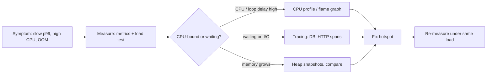

# Node.js Performance & Debugging

<Note>
**TL;DR**

Measure before optimising. For **latency/CPU** problems take a CPU profile (`--cpu-prof`, Chrome DevTools, flame graphs) and watch **event-loop delay**. For **memory** problems compare **heap snapshots** over time and look for growing retainers (caches, listeners, closures, timers). Debug with `node --inspect` + Chrome DevTools or VS Code. In production rely on structured logs, metrics (event-loop delay, heap, GC, p99 latency) and **OpenTelemetry** traces, and keep diagnostic reports and heap-snapshot-on-OOM ready.
</Note>

## A performance workflow



Load-test locally with `autocannon` (HTTP benchmarking in Node) or k6:

```bash
npx autocannon -c 100 -d 30 http://localhost:3000/users
```

## Debugging

```bash
node --inspect server.js          # open chrome://inspect, or attach VS Code
node --inspect-brk script.js      # break on first line
node --watch server.js            # restart on change (stable since Node 22)
NODE_DEBUG=http,net node app.js   # verbose core-module logs
```

- `debugger;` statements work when an inspector is attached.
- Async stack traces are on by default in DevTools; errors keep `cause` (`new Error('x', { cause })`).
- `node --trace-warnings`, `--trace-deprecation`, `--trace-uncaught` for noisy warnings and crashes.

## CPU profiling

```bash
node --cpu-prof --cpu-prof-dir=./profiles server.js    # writes .cpuprofile on exit
# open in Chrome DevTools > Performance (or Speedscope)

npx 0x server.js                                        # flame graph
npx clinic doctor -- node server.js                     # automated diagnosis (loop delay, GC, I/O)
npx clinic flame -- node server.js
```

Reading a flame graph: width = time on CPU. Look for wide frames in **your** code, JSON (de)serialization, regex, logging, crypto, and template rendering.

Common fixes:
- Avoid repeated `JSON.stringify` of big objects; use schema-based serializers (Fastify) or stream.
- Precompile regexes; avoid catastrophic backtracking.
- Cache expensive pure computations (bounded LRU).
- Move CPU work to a worker pool. See [Node.js Concurrency - Worker Threads, Cluster & Child Processes](/Software%20Engineering/Backend/The%20Hard%20Parts%20of%20Servers%20%26%20Node.js/Node.js%20Concurrency%20-%20Worker%20Threads%2C%20Cluster%20%26%20Child%20Processes).
- Use connection pooling and keep-alive for outbound HTTP (undici agents) and DBs.

## Memory: leaks and heap snapshots

Typical Node leaks:

| Leak | Example | Fix |
|---|---|---|
| Unbounded cache | `const cache = {}` keyed by user/request | LRU with max size + TTL; `WeakMap` for object keys |
| Event listeners | `emitter.on` per request, never removed | `once`, `off`, `AbortSignal` with `events.on/addEventListener` |
| Timers | `setInterval` per connection, never cleared | `clearInterval` on close; `unref()` |
| Closures | Callback retains big buffers | Null references; narrow what's captured. See [Closures & Memory Model](/Software%20Engineering/Frontend/01%20JavaScript/Closures%20%26%20Memory%20Model) |
| Global arrays/maps | Request logs pushed into an array | Ship to a log sink, don't hold in memory |
| Unconsumed streams / bodies | `fetch` response body not read | Always consume or `body.cancel()` |

```js
// Inspect memory
console.log(process.memoryUsage());      // rss, heapUsed, heapTotal, external, arrayBuffers
import v8 from 'node:v8';
v8.writeHeapSnapshot();                   // writes Heap-*.heapsnapshot (pauses the process!)
```

Technique: take snapshot A, apply load, force GC, take B, apply same load, take C. In DevTools compare B vs A and C vs B ("Comparison" view): objects whose count keeps growing, and their **retainers** chain, point to the leak.

```bash
node --heapsnapshot-near-heap-limit=2 server.js   # capture snapshots just before OOM
node --max-old-space-size=1536 server.js          # heap limit in MB (match container memory)
node --trace-gc server.js                         # log each GC
```

## Diagnostics in production

- **Diagnostic report**: a JSON snapshot of stacks, heap stats, libuv handles, env and more.
  ```bash
  node --report-on-fatalerror --report-uncaught-exception --report-on-signal server.js
  kill -USR2 <pid>    # writes a report
  ```
- **Metrics** to export (Prometheus `prom-client` default metrics or OpenTelemetry): event-loop delay/utilisation, heap used, GC pause time, active handles, RSS, request rate/latency/errors.
- **Tracing**: OpenTelemetry's Node SDK auto-instruments http, undici/fetch, pg, mysql, redis, express, fastify; export via OTLP.
- **Logging**: `pino` (fast, JSON). Include request IDs via `AsyncLocalStorage`. Avoid synchronous `console.log` floods in hot paths.
- `diagnostics_channel` and `performance` (`perf_hooks`) APIs let libraries publish timing without monkey-patching.

```js
// request-scoped context
import { AsyncLocalStorage } from 'node:async_hooks';
export const ctx = new AsyncLocalStorage();
app.use((req, res, next) => ctx.run({ requestId: req.headers['x-request-id'] ?? crypto.randomUUID() }, next));
// anywhere later: ctx.getStore()?.requestId
```

## Startup performance
- `NODE_COMPILE_CACHE=dir` (Node 22.1+) or `module.enableCompileCache()` (Node 22.8+) caches V8 compiled code between runs; speeds up CLIs and cold starts.
- Lazy-load heavy modules; avoid work at import time.
- Single executable applications (SEA) and snapshots (`--build-snapshot`) for CLIs.

<Info>
**🆕 2025–2026**

- **Node 22** (2024): `--watch` stable; Maglev JIT on by default (faster short-running programs).
- **Node 24.0.0** (2025-05-06): `AsyncLocalStorage` switched to `AsyncContextFrame` by default, cheaper context propagation for tracing/logging.
- **Node 25.0.0** (2025-10-15): **portable compile cache** and CPU-profiling improvements; V8 14.1 brought large `JSON.stringify` speed-ups.
- **Node 26.0.0** (2026-05-05): readable streams read one buffer at a time; `diagnostics_channel` `tracePromise` consistency fixes.
Details: [Node.js 22 to 24+ - What's New](/Software%20Engineering/Backend/The%20Hard%20Parts%20of%20Servers%20%26%20Node.js/Node.js%2022%20to%2024%2B%20-%20What's%20New).
</Info>

## Pitfalls
- Benchmarking in dev mode, with logging to a TTY, or with the debugger attached.
- Taking heap snapshots on a production instance serving traffic (it freezes the process and needs ~2× heap memory). Drain it first.
- Setting `--max-old-space-size` above the container memory limit: the kernel OOM-kills the process before V8 can GC.
- Micro-optimising code that isn't on the hot path.

## Senior perspective
- Define SLOs (p99 latency, error rate) and alert on **event-loop delay** and **heap growth trend**, not only CPU.
- Keep a runbook: how to get a CPU profile, heap snapshot and diagnostic report from a live pod (e.g. `--inspect` on a port reachable only via `kubectl port-forward`, or signals).
- In reviews: allocations in hot loops, sync APIs, unbounded caches/queues, missing timeouts, listener cleanup, N+1 DB calls.
- Capacity planning: Node is often limited by per-request CPU (serialization). Horizontal scaling is cheap; blocking bugs aren't fixed by it.

## Interview questions

<Accordion title="How do you find a memory leak in a Node service?">
Confirm with metrics (heap used keeps growing after GC). Reproduce under load, take several heap snapshots, compare them in DevTools, find object types whose counts grow and follow their retainers to the code holding them (caches, listeners, closures, timers). Fix, then verify the heap plateaus.
</Accordion>

<Accordion title="How do you profile CPU usage?">
Run with `--cpu-prof` or attach DevTools via `--inspect`, or use 0x/clinic flame to get a flame graph under realistic load. Look for wide frames and hot functions in your code or libraries.
</Accordion>

<Accordion title="What metrics matter most for a Node service?">
Request rate, error rate, latency percentiles, event-loop delay/utilisation, heap used vs limit, GC pause time, RSS, active handles, plus downstream latencies from traces.
</Accordion>

<Accordion title="What is `AsyncLocalStorage` used for?">
Carrying request-scoped context (request ID, user, trace span) across async calls without passing it through every function, for logging and tracing.
</Accordion>

<Accordion title="The process gets OOM-killed in Kubernetes but heap looks fine. Why?">
RSS includes more than the V8 heap: Buffers/ArrayBuffers (`external`), native addons, thread stacks, and code. Or `--max-old-space-size` is higher than the container limit. Check `process.memoryUsage()` fields and align limits.
</Accordion>

## Related
- [Node.js Index](/Software%20Engineering/Backend/The%20Hard%20Parts%20of%20Servers%20%26%20Node.js/Node.js%20Index)
- [Node.js Event Loop & libuv](/Software%20Engineering/Backend/The%20Hard%20Parts%20of%20Servers%20%26%20Node.js/Node.js%20Event%20Loop%20%26%20libuv) · [V8 Engine - Ignition, TurboFan & Garbage Collection](/Software%20Engineering/Backend/The%20Hard%20Parts%20of%20Servers%20%26%20Node.js/V8%20Engine%20-%20Ignition%2C%20TurboFan%20%26%20Garbage%20Collection) · [Node.js Concurrency - Worker Threads, Cluster & Child Processes](/Software%20Engineering/Backend/The%20Hard%20Parts%20of%20Servers%20%26%20Node.js/Node.js%20Concurrency%20-%20Worker%20Threads%2C%20Cluster%20%26%20Child%20Processes)
- [Memory Management & Garbage Collection](/Software%20Engineering/Frontend/01%20JavaScript/Memory%20Management%20%26%20Garbage%20Collection) · [Closures & Memory Model](/Software%20Engineering/Frontend/01%20JavaScript/Closures%20%26%20Memory%20Model)
- Java comparison: [JVM Internals - Memory & Garbage Collection](/Software%20Engineering/Backend/Java/JVM%20Internals%20-%20Memory%20%26%20Garbage%20Collection)

## Sources
- [Node.js: Profiling Node.js applications](https://nodejs.org/en/learn/getting-started/profiling)
- [Node.js: Diagnostics guides (memory, CPU, live debugging)](https://nodejs.org/en/learn/diagnostics/memory)
- [Node.js docs: Diagnostic report](https://nodejs.org/api/report.html)
- [Node.js docs: v8 module (heap snapshots)](https://nodejs.org/api/v8.html)
- [Node.js docs: AsyncLocalStorage](https://nodejs.org/api/async_context.html)
- [Chrome DevTools: Fix memory problems](https://developer.chrome.com/docs/devtools/memory-problems)
- [OpenTelemetry JS: Node.js getting started](https://opentelemetry.io/docs/languages/js/getting-started/nodejs/)
- [Node.js 25.0.0 release notes](https://nodejs.org/en/blog/release/v25.0.0) · [Node.js 26.0.0 release notes](https://nodejs.org/en/blog/release/v26.0.0)
