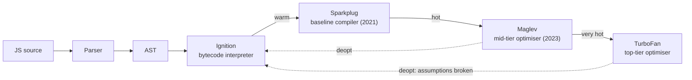

# V8 Engine - Ignition, TurboFan & Garbage Collection

<Note>
**TL;DR**

V8 parses JS into an **AST**, the **Ignition** interpreter turns it into compact **bytecode** and runs it while collecting type feedback, and hot functions are recompiled by faster tiers: **Sparkplug** (baseline), **Maglev** (mid-tier optimiser) and **TurboFan** (top optimiser). Objects get **hidden classes** (maps) so **inline caches** can make property access fast. Memory is managed by a **generational GC**: a fast **scavenger** for the young generation and a concurrent **mark-compact** for the old generation.
</Note>

*Split out of [Node JS Under the hood!](/Software%20Engineering/Backend/The%20Hard%20Parts%20of%20Servers%20%26%20Node.js/Node%20JS%20Under%20the%20hood!) on 2026-09-27 (course notes, supplemented with the "Node.js Under the Hood" article series). Historical content kept, with corrections marked.*

## What is V8

V8 is Google's open-source, high-performance JavaScript and WebAssembly engine, written in C++. It powers Chrome and Chromium-based browsers, Node.js, Deno, and more. It implements ECMAScript and WebAssembly and doesn't depend on a browser: it can be embedded in any C++ application.

- **Ignition** runs your code the first time as bytecode (fast startup, low memory).
- **JIT compilers** then use the feedback collected about how the code *actually* behaves to recompile hot code into optimised machine code.

V8 uses several threads:
- the **main thread** fetches, compiles and executes JS;
- background threads do **optimising compilation** so the main thread keeps running;
- background threads also do most **garbage-collection** work (marking, sweeping, compaction);
- a profiler thread samples the running program (when profiling is enabled).

### Abstract Syntax Trees

The first step of almost every compiler pipeline is building an **AST (Abstract Syntax Tree)**: a tree representation of the syntactic structure of the source code. Each node denotes a construct (a function, an `if`, a binary operation). V8 parses **lazily**: functions are only pre-parsed until they're first called.

### Hidden classes (maps)

In statically typed languages the compiler knows every object's layout, so each property sits at a fixed **offset** in memory and lookup is a single load. JS objects can gain properties at runtime, so V8 builds that knowledge dynamically with **hidden classes** (called **maps** inside V8).

- Every object points to a hidden class describing its shape (which properties, at which offsets).
- Adding a property creates a **transition** to a new hidden class.
- Hidden classes are fragile: objects that get the same properties **in a different order** end up with different hidden classes. If `{x, y}` and `{y, x}` are created, V8 needs separate classes C1/C2 because the offsets differ.

```js
function Point(x, y) { this.x = x; this.y = y; }   // all Points share one shape: good
const a = { x: 1, y: 2 };
const b = { y: 2, x: 1 };        // different shape from a
const c = { x: 1 }; c.y = 2;     // same final shape as a, via transitions
delete a.x;                      // may drop a into slow "dictionary mode"
```

Hidden classes are an implementation detail in **C++**; JavaScript itself is a prototype-based language with no real classes (the `class` keyword is syntax over prototypes).

## Old V8 pipeline (historical, before 2017)

V8 used to have the **full-codegen** compiler and the **Crankshaft** JIT, which had two parts, **Hydrogen** and **Lithium**.


### Full-codegen
A simple, very fast compiler that produced **unoptimised** machine code directly from the AST: fast to generate, slow to run. It also collected **type feedback** (types and usage of functions at runtime). V8 then watched for **hot** functions (called many times) versus **cold** ones and sent hot ones to Crankshaft.

### Crankshaft
The old optimising JIT. Using full-codegen's feedback it re-walked the AST of hot functions and generated optimised code, swapping it in with **on-stack replacement (OSR)**.

**Hydrogen** took the AST plus type feedback and produced a high-level intermediate representation (HIR): a control-flow graph (CFG) in **static single assignment (SSA)** form. For:

```javascript
function clamp (x, lower, upper) {
  if (x < lower) x = lower
  else if (x > upper) x = upper
  return x
}
```

the SSA form is:

```plain text
entry:
  x0, lower0, upper0 = args;
  goto b0;
b0:
  t0 = x0 < lower0;
  goto t0 ? b1 : b2;
b1:
  x1 = lower0;
  goto exit;
b2:
  t1 = x0 > upper0;
  goto t1 ? b3 : exit;
b3:
  x2 = upper0;
  goto exit;
exit:
  x4 = phi(x0, x1, x2);
  return x4;
```

In SSA, each variable is assigned exactly once. The code is split into **basic blocks** ending in a branch, and the `phi` function merges the values coming from different paths. Hydrogen applied optimisations such as constant folding and inlining on this graph.

**Lithium** translated the HIR into a machine-specific low-level IR (LIR), applied low-level optimisations, and emitted native instructions.

## The modern pipeline

Since **V8 5.9** (2017, Node 8.3), full-codegen and Crankshaft are gone. Ignition + TurboFan replaced them, and two more tiers were added later.




| Tier | Kind | Trade-off |
|---|---|---|
| Ignition | Bytecode interpreter | Starts instantly, compact, collects feedback |
| Sparkplug | Baseline compiler (bytecode → machine code, no optimisation) | Very fast to compile, modest speed-up |
| Maglev | Fast optimising compiler (CFG-based) | Good code quickly; enabled by default in Node 22 |
| TurboFan | Heavy optimising compiler | Best peak performance, slow to compile |

**Deoptimisation**: optimised code is built on assumptions from type feedback ("`x` is always a small integer"). If an assumption breaks, V8 throws the optimised code away and returns to bytecode.

### Ignition

Ignition is V8's **bytecode interpreter**. It was introduced mainly to **reduce memory**: machine code generated by full-codegen took a lot of heap (a big problem on low-memory phones), whereas bytecode is several times smaller.

<Note>
**Correction**

The original article said V8 "doesn't have a parser" and that Ignition "parses the whole script at once". That's not right: V8 has its own parser and still parses **lazily**. Ignition is not a parser; the **bytecode generator** walks the AST and emits bytecode, which then becomes the single source of truth for the optimising tiers (instead of re-parsing the AST each time).
</Note>

Old pipeline vs new:


Ignition turns code into bytecode like this:


It's a **register-based interpreter with an accumulator**. `r0` is a local variable or temporary stored on the stack frame (think of an unlimited register file allocated in the frame). `a0`, `a1`, `a2` are the function's arguments. The implicit **accumulator** register holds inputs/outputs of most operations.

```plain text
LdaSmi #100 -> load the small integer 100 into the accumulator
Sub a2      -> accumulator = a2 (c) - accumulator ... result in accumulator
Star r0     -> store the accumulator into r0
Ldar a1     -> load a1 (b) into the accumulator
Mul r0      -> accumulator = accumulator * r0
Add a0      -> accumulator = accumulator + a0 (a)
Return      -> return the accumulator
```

Before interpretation, the bytecode generator applies register optimisation, peephole optimisations and dead-code removal.


Ignition's handlers are generated with TurboFan's backend (the CodeStubAssembler), so one macro-assembler description compiles to every CPU architecture.

### TurboFan

TurboFan is the top-tier optimising JIT that replaced Crankshaft. It was designed to handle modern JS (ES2015+, `try/catch`, etc.) that Crankshaft couldn't optimise, and WebAssembly. It originally used a **Sea-of-Nodes** IR. At first it ran alongside Crankshaft:


That dual pipeline was complex, so it was replaced by the Ignition + TurboFan pipeline:


TurboFan is layered into a **frontend** (bytecode → graph), an **optimising layer**, and a **backend** (scheduling, register allocation, machine-code generation for each architecture). The clear separation reduced architecture-specific code by 29%.


<Info>
**🆕 2025–2026**

- **2025-03-25**: the V8 team announced it is leaving Sea of Nodes: TurboFan's JavaScript backend now uses **Turboshaft**, a conventional CFG-based IR, and WebAssembly uses Turboshaft for its whole pipeline; Maglev (also CFG-based) replaces the remaining JS frontend role over time.
- Node 22 (2024) enabled **Maglev** by default; Node 24 ships V8 13.6, Node 25 V8 14.1, Node 26 V8 14.6. See [Node.js 22 to 24+ - What's New](/Software%20Engineering/Backend/The%20Hard%20Parts%20of%20Servers%20%26%20Node.js/Node.js%2022%20to%2024%2B%20-%20What's%20New).
</Info>

### Understanding bytecodes

Bytecodes are an abstraction of machine code: between readable code and what the CPU executes. They are **machine-agnostic**, but compiling them to machine code is easier when the bytecode's computational model matches the CPU's. CPUs are stack-, register- or state-based; Ignition, like most real CPUs, is **register-based with an accumulator**.


Every operator has a bytecode: `typeof`, `Add`, `Sub`, property loads, `LdaSmi` for small integers, etc. The full list lives in V8's [bytecodes.h](https://github.com/v8/v8/blob/main/src/interpreter/bytecodes.h).

### Registers

Ignition uses registers `r0, r1, r2...` for bytecode inputs/outputs plus the accumulator (`acc`), which operands don't name. `Sub r0` means "subtract `r0` from the accumulator and leave the result in the accumulator".

Names starting with `Lda` or `Sta`: `a` = accumulator, `Ld` = load, `St` = store. `LdaSmi [99]` loads the small integer 99 into the accumulator; `Star r0` stores the accumulator into `r0`. Short names keep the bytecode small: *shorter bytecodes = less memory*.

```javascript
function multiplyXByY (obj) {
  return obj.x * obj.y
}
multiplyXByY({ x: 1, y: 2 })
```

> V8 compiles lazily: a function that never runs never gets bytecode.

```plain text
[generated bytecode for function: multiplyXByY]
Parameter count 2
Register count 1
Frame size 8
   22 E> 0x334a92de11fe @    0 : a5                StackCheck
   43 S> 0x334a92de11ff @    1 : 28 02 00 01       LdaNamedProperty a0, [0], [1]
         0x334a92de1203 @    5 : 26 fb             Star r0
   51 E> 0x334a92de1205 @    7 : 28 02 01 03       LdaNamedProperty a0, [1], [3]
   45 E> 0x334a92de1209 @   11 : 36 fb 00          Mul r0, [0]
   52 S> 0x334a92de120c @   14 : a9                Return
Constant pool (size = 2)
Handler Table (size = 0)
```

> Print bytecode yourself: `node --print-bytecode --print-bytecode-filter=multiplyXByY file.js`. On current V8 the output differs slightly (e.g. `LdaNamedProperty` is now `GetNamedProperty`, and `StackCheck` was folded into other bytecodes); the ideas are the same.

- **`LdaNamedProperty a0, [0], [1]`**: load a named property of `a0` (the first argument, `obj`) into the accumulator. `[0]` indexes the **constant pool**, which holds the property name:
  ```plain text
  0x263ab302cf21: [FixedArray] in OldSpace
   - map = 0x2ddf8367abce <Map(HOLEY_ELEMENTS)>
   - length: 2
             0: 0x2ddf8db91611 <String[1]: x>
             1: 0x2ddf8db67544 <String[1]: y>
  ```
  `[1]` is the slot in the **feedback vector**, where runtime type information is recorded for the optimisers.
- **`Star r0`**: store the accumulator (the value of `x`) into `r0`.
- **`LdaNamedProperty a0, [1], [3]`**: the same for index 1, `y`.
- **`Mul r0, [0]`**: multiply accumulator (`y`) by `r0` (`x`), result in the accumulator.
- **`Return`**: return the accumulator (`2`).

## Garbage collection

A garbage collector reclaims memory occupied by objects that are no longer used. The idea dates back to LISP (1959). Allocation happens automatically when you create values and memory is reclaimed automatically when no longer needed.

The GC decides "no longer needed" by **reachability**: starting from the **roots** (the global object, the current stack, handles held by Node), anything it can reach through references is alive; anything unreachable is garbage.


After the sweep, the two unreachable objects are gone:


The downside: GC costs CPU and can cause pauses. V8's **Orinoco** project made most of it parallel, concurrent and incremental to keep main-thread pauses short.

- **The stack**: local variables, pointers to objects and control flow (call frames). Small integers ("Smis") and references live here.
- **The heap**: objects, strings, closures, arrays.

```javascript
function Point (x, y) {
  this.x = x
  this.y = y
}
const point1 = new Point(1, 2)
```

```plain text
root -----------> point1
```

```javascript
const point1 = new Point(1, 2)
const point2 = new Point(2, 3)
const point3 = new Point(4, 4)
```

```plain text
     |-------------------> point1
root |-------------------> point2
     |-------------------> point3
```

If the GC ran now nothing would happen: every object is reachable from the root. Now add nested objects:

```javascript
function Chart (name) { this.name = name }
function Point (x, y, name) {
  this.x = x
  this.y = y
  this.name = new Chart(name)
}
let point1 = new Point(1, 2, 'Chart1')
let point2 = new Point(2, 3, 'Chart2')
let point3 = new Point(4, 4, 'Chart3')
```

```plain text
     |-------------------> point1 ----> Chart1
root |-------------------> point2 ----> Chart2
     |-------------------> point3 ----> Chart3
```

Set `point2 = undefined`:

```plain text
     |-------------------> point1 ----> Chart1
root |                     point2 ----> Chart2
     |-------------------> point3 ----> Chart3
```

`point2` (and its `Chart2`) can't be reached from the root any more, so the next GC removes them:

```plain text
     |-------------------> point1 ----> Chart1
root
     |-------------------> point3 ----> Chart3
```

### Generational GC: new space and old space

This is the method V8 (and therefore Node) uses, based on the **generational hypothesis**: most objects die young.

- **New space (young generation)**: where allocations happen. Small (a few MB up to tens of MB depending on configuration), collected very often and cheaply.
- **Old space (old generation)**: objects that survived two young-generation collections are **promoted** here. Collected less often, more expensive.

Roughly 20% or fewer of young objects survive, so old-space collection is needed far less often.

<Note>
**Correction: heap size limits**

Older notes say the old space is "around 512 MB". Since Node 12 the default heap limit is derived from available system memory (and container limits), commonly 2–4 GB on 64-bit machines. Set it explicitly with `--max-old-space-size=<MB>` (and `--max-semi-space-size` for the young generation). Check with `v8.getHeapStatistics().heap_size_limit`.
</Note>

### Scavenge and mark-sweep(-compact)

- **Scavenge** (young generation): a copying collector. Live objects are copied from one semi-space to the other (or promoted); everything left behind is garbage. Fast, cost proportional to *live* objects. Parallel in modern V8.
- **Mark-sweep-compact** (old generation):
  1. Start from the **roots** (in the browser the `window` object, in Node the `global` object, plus the stack and handles).
  2. **Mark** every object reachable from the roots as live. Modern V8 does most marking **concurrently** on background threads.
  3. **Sweep** unmarked objects, adding their memory to free lists; **compact** fragmented pages by moving live objects together.


See [Memory Management & Garbage Collection](/Software%20Engineering/Frontend/01%20JavaScript/Memory%20Management%20%26%20Garbage%20Collection) for leaks and tooling, [Node.js Performance & Debugging](/Software%20Engineering/Backend/The%20Hard%20Parts%20of%20Servers%20%26%20Node.js/Node.js%20Performance%20%26%20Debugging) for heap snapshots in Node, and [JVM Internals - Memory & Garbage Collection](/Software%20Engineering/Backend/Java/JVM%20Internals%20-%20Memory%20%26%20Garbage%20Collection) for the Java comparison.

## Compiler optimisations

All of the optimisations below are done while the compiler analyses code.

### On-stack replacement (OSR)
Replacing unoptimised code with optimised code **while it's running** (e.g. in the middle of a long loop). The current stack frame is swapped for an optimised one without losing state: changing the tyres mid-race.

### Constant folding
Compute constant expressions at compile time: `const j = 3 + 9` becomes `const j = 12`.

### Induction variable analysis
In a loop, if a variable is a linear function of the loop index (`const p = 4 * i + 1`), it can be updated incrementally each iteration. This is **strength reduction**: replacing a costly operation (multiplication) with cheaper ones (additions).

### Rematerialization
Recomputing a value instead of loading it from memory, to reduce memory accesses.

### Removing recursion
Tail-recursive functions can be turned into loops via **tail call optimisation (TCO)**, avoiding a new stack frame per call.

<Note>
**Correction**

ES2015 specifies proper tail calls, but **V8 does not implement them** (they were tried behind a flag and removed). Deep recursion in Node still overflows the stack; rewrite it as a loop. Safari's JavaScriptCore is the only major engine with PTC.
</Note>

### Peephole optimisations
Late in compilation, look at a few adjacent instructions (through a "peephole") and replace them with fewer/cheaper ones, e.g. multiplication by a power of two becomes a left shift (also strength reduction).

### Inline expansion (inlining)
Replace a call with the callee's body. Saves a stack frame and enables argument-specific optimisation, at the cost of code size. Best for hot, small functions called many times.

### Inline caching
Repeated calls at the same site tend to see objects of the **same type**. V8 caches, per call site/property access, the hidden class seen and the property offset. Next time, if the object has the same hidden class, it skips the lookup and loads directly from the offset.

| IC state | Meaning | Speed |
|---|---|---|
| Monomorphic | one shape seen | fastest |
| Polymorphic | 2–4 shapes | fast |
| Megamorphic | many shapes | slow, generic lookup |

This is why consistent object shapes (same properties, same order, initialised in the constructor) matter for hot code.

### Dead code elimination
Remove code that is never executed or whose results are never used.

### Code block reordering
Reorder basic blocks to reduce branches and improve **locality of reference** (the CPU reusing nearby memory/instructions).

### Jump threading
Merge consecutive conditional jumps on the same condition: `if (c) { foo; } if (c) { bar; }` becomes `if (c) { foo; bar; }`.

### Trampolines
Use short call instructions to small stubs ("trampolines") to save code space.

### Common subexpression elimination
In `(a+b) * 2 + (a+b)`, compute `a+b` once and reuse it, assuming it doesn't change in between.

## Senior perspective
- Micro-optimising for V8 internals rarely pays off in application code; measure with `--cpu-prof` first. It does matter in hot library code (parsers, serializers).
- Signs of JIT trouble in profiles: repeated deopts (`--trace-deopt`), megamorphic property access, functions that switch argument types.
- GC pressure (many short-lived allocations in hot paths) shows up as high p99 latency; heap limits in containers must be set consistently with the container's memory limit.

## Interview questions

<Accordion title="Describe V8's compilation pipeline.">
Parse to AST, generate Ignition bytecode and interpret it while collecting type feedback. Warm code is compiled by Sparkplug (baseline), hot code by Maglev and the hottest by TurboFan. If an optimised function's assumptions break, V8 deoptimises back to bytecode.
</Accordion>

<Accordion title="What are hidden classes and inline caches?">
Hidden classes (maps) describe an object's shape so properties live at fixed offsets. Inline caches remember the shape and offset seen at a property access site so subsequent accesses on same-shaped objects are a direct load. Inconsistent shapes make sites polymorphic/megamorphic and slower.
</Accordion>

<Accordion title="How does V8's garbage collector work?">
Generational: young objects are collected by a fast copying scavenger; survivors are promoted to old space, which is collected by mark-sweep-compact, mostly concurrently and incrementally. Objects are live if reachable from roots.
</Accordion>

<Accordion title="Does V8 do tail call optimisation?">
No. It's in the spec but V8 removed its experimental implementation; convert deep recursion to iteration.
</Accordion>

<Accordion title="Why was Ignition introduced?">
Mainly to cut memory usage (bytecode is much smaller than baseline machine code) and to give all optimising tiers one bytecode source of truth, which also sped up startup.
</Accordion>

## Related
- [Node JS Under the hood!](/Software%20Engineering/Backend/The%20Hard%20Parts%20of%20Servers%20%26%20Node.js/Node%20JS%20Under%20the%20hood!) · [The Hard Parts of Servers & Node.js](/Software%20Engineering/Backend/The%20Hard%20Parts%20of%20Servers%20%26%20Node.js/The%20Hard%20Parts%20of%20Servers%20%26%20Node.js) · [Node.js Index](/Software%20Engineering/Backend/The%20Hard%20Parts%20of%20Servers%20%26%20Node.js/Node.js%20Index)
- [Memory Management & Garbage Collection](/Software%20Engineering/Frontend/01%20JavaScript/Memory%20Management%20%26%20Garbage%20Collection) · [Closures & Memory Model](/Software%20Engineering/Frontend/01%20JavaScript/Closures%20%26%20Memory%20Model)
- [Node.js Performance & Debugging](/Software%20Engineering/Backend/The%20Hard%20Parts%20of%20Servers%20%26%20Node.js/Node.js%20Performance%20%26%20Debugging) · [JVM Internals - Memory & Garbage Collection](/Software%20Engineering/Backend/Java/JVM%20Internals%20-%20Memory%20%26%20Garbage%20Collection)

## Sources
- [V8 blog: Launching Ignition and TurboFan (V8 5.9)](https://v8.dev/blog/launching-ignition-and-turbofan)
- [V8 blog: Sparkplug, a non-optimizing JavaScript compiler](https://v8.dev/blog/sparkplug)
- [V8 blog: Maglev, V8's fastest optimizing JIT](https://v8.dev/blog/maglev)
- [V8 blog: Land ahoy, leaving the Sea of Nodes (2025-03-25)](https://v8.dev/blog/leaving-the-sea-of-nodes)
- [V8 blog: Trash talk, the Orinoco garbage collector](https://v8.dev/blog/trash-talk)
- [V8 docs: Ignition](https://v8.dev/docs/ignition)
- [Lucas Santos: Node.js Under the Hood (series)](https://dev.to/_staticvoid/node-js-under-the-hood-1-getting-to-know-our-tools-1465)
- [Node.js 22 announcement (Maglev default)](https://nodejs.org/en/blog/announcements/v22-release-announce)
