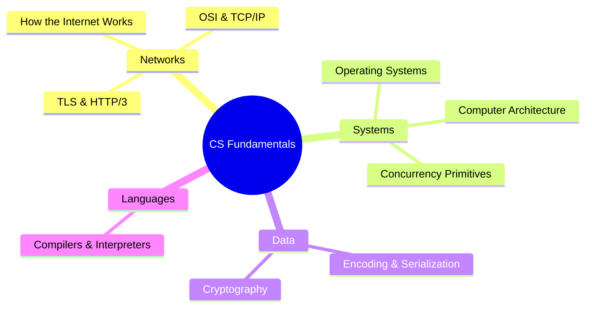

# CS Fundamentals Index

> [!tldr] Start here
> The computer science underneath everything else in this vault: how the internet and network protocols work, what the operating system does for your program, how CPUs and memory really behave, how concurrency goes wrong, how text and data are encoded, the cryptography you use every day, and how code gets compiled or interpreted. Each note has worked examples, a 🆕 2025–2026 box where something changed, and interview questions. Algorithms and data structures live in the DSA folder.

## 🟢 Beginner
| Note | What you learn |
|---|---|
| [[How the Internet Works]] | IP, TCP vs UDP, DNS resolution, what happens when you type a URL |
| [[Encoding, Serialization & Character Sets]] | ASCII, Unicode, UTF-8, Base64, JSON vs Protobuf vs Avro |
| [[Compilers & Interpreters Basics]] | Lexing, parsing, AST, JIT vs AOT |

## 🟡 Intermediate
| Note | What you learn |
|---|---|
| [[Networking - OSI, TCP-IP & Protocols]] | Layers, TCP handshake, congestion control, TLS 1.3, HTTP/1.1 vs 2 vs 3, QUIC |
| [[Operating Systems Essentials]] | Processes vs threads, scheduling, virtual memory, syscalls, epoll, io_uring |
| [[Cryptography Basics for Engineers]] | Hashing vs encryption, password hashing, signatures, TLS certs, post-quantum |

## 🔴 Senior
| Note | What you learn |
|---|---|
| [[Concurrency Primitives]] | Mutexes, semaphores, deadlocks, atomics, CAS, lock-free, memory ordering |
| [[Computer Architecture Basics]] | Memory hierarchy, cache lines, locality, false sharing, Amdahl's law |

Related elsewhere: [[Concurrency And Parallelism]] (Principles) · [[Networking - HTTP, Caching & Real-time]] (Frontend) · [[Event Loop - Microtasks & Macrotasks]] · [[Memory Management & Garbage Collection]] · [[Node JS Under the hood!]]

> [!example]- 🧭 Suggested study path
> 1. [[How the Internet Works]] → [[Networking - OSI, TCP-IP & Protocols]] → [[Networking - HTTP, Caching & Real-time]]
> 2. [[Operating Systems Essentials]] → [[Concurrency And Parallelism]] → [[Concurrency Primitives]]
> 3. [[Computer Architecture Basics]] (why locality beats big-O constants)
> 4. [[Encoding, Serialization & Character Sets]] → [[Cryptography Basics for Engineers]]
> 5. [[Compilers & Interpreters Basics]] → the JS engine notes
> 6. Then apply it all in [[System Design Index]]

## 🆕 2025–2026 in this area
- **Post-quantum TLS by default**: ML-KEM (FIPS 203, 2024-08-13); Chrome 131 hybrid X25519MLKEM768 (Nov 2024); OpenSSL 3.5 default key share (2025-04-08); 52% of human traffic on Cloudflare PQ-encrypted by end of 2025; NIST picks HQC (2025-03-11) → [[Cryptography Basics for Engineers]], [[Networking - OSI, TCP-IP & Protocols]]
- **Certificate lifetimes**: 200 days from 2026-03-15, 47 days by 2029 (CA/B Forum SC-081v3); Let's Encrypt ends OCSP (2025) and ships 6-day certs GA (Jan 2026) → [[Cryptography Basics for Engineers]]
- **HTTP/3** ~21% of Cloudflare requests in 2025 → [[Networking - OSI, TCP-IP & Protocols]], [[How the Internet Works]]
- **PostgreSQL 18** (2025-09-25) async I/O with io_uring; **JEP 491** (Java 24, March 2025) → [[Operating Systems Essentials]]
- **Python 3.14** (2025-10-07): free-threaded build officially supported, experimental JIT in official binaries → [[Concurrency Primitives]], [[Compilers & Interpreters Basics]]
- **Node.js type stripping** on by default (v23.6.0 / v22.18.0), stable in v25.2.0 / v24.12.0 → [[Compilers & Interpreters Basics]]
- **Unicode 17.0** (2025-09-09) → [[Encoding, Serialization & Character Sets]]
- DNS as a single point of failure: AWS us-east-1 (2025-10-20) → [[How the Internet Works]]

## Related
- [[Software Engineering]], the vault root
- [[System Design Index]] · [[Frontend Home]]
