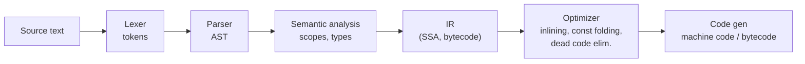

# Compilers & Interpreters Basics

> [!tldr] TL;DR
> Source code becomes something a machine can run through a pipeline: **lexing** (characters → tokens), **parsing** (tokens → **AST**), **semantic analysis** (types, scopes), **intermediate representation** and **optimization**, then **code generation**. A **compiler** does this ahead of time (**AOT**: C, Rust, Go); an **interpreter** executes the program (often as **bytecode**) directly; a **JIT** compiles hot code to machine code at runtime using profiling data (V8, JVM HotSpot, .NET). Most modern runtimes mix all three.

## The pipeline


```text
let total = price * 2;

Tokens: [let] [ident total] [=] [ident price] [*] [number 2] [;]

AST:
VariableDeclaration (let)
└─ VariableDeclarator
   ├─ id: Identifier "total"
   └─ init: BinaryExpression "*"
      ├─ Identifier "price"
      └─ NumericLiteral 2
```
Try it on [astexplorer.net](https://astexplorer.net/). ASTs power far more than compilers: **linters** (ESLint), **formatters** (Prettier), **transpilers** (Babel, SWC, TypeScript), **codemods**, bundlers and minifiers ([[Build Tools & Bundlers]]).

### Parsing in one minute
- Grammars (often written in BNF/EBNF) define valid syntax.
- **Recursive descent** parsers (hand-written functions per grammar rule) are used by most production compilers (V8, TypeScript, Go, Clang) for good error messages.
- Parser generators (ANTLR, yacc/bison, tree-sitter) generate parsers from grammars; tree-sitter does incremental parsing for editors.

## Compile vs interpret vs JIT
| | AOT compiler | Interpreter | JIT |
|---|---|---|---|
| When translated | Before running | While running, statement by statement or bytecode | At runtime, for hot code |
| Startup | Fast (already native) | Fast | Slower warm-up |
| Peak speed | High | Low | High, sometimes higher than AOT (uses runtime profile) |
| Portability | Per-target binary | Anywhere the interpreter runs | Anywhere the VM runs |
| Examples | C, C++, Rust, Go, Swift, GraalVM native-image | CPython (bytecode interpreter), Ruby (YARV), shell | V8, SpiderMonkey, JVM HotSpot, .NET RyuJIT, PyPy, LuaJIT |

**Transpiler / source-to-source compiler**: TypeScript → JavaScript, Sass → CSS, Babel (modern JS → older JS).

## How a JS engine does it (V8)
1. Parse to AST (lazily: inner functions pre-parsed until called).
2. **Ignition** interpreter generates and runs **bytecode**, collecting type feedback in inline caches.
3. Hot functions get compiled by **Sparkplug** (fast baseline compiler) and **Maglev** (mid-tier optimizing), and the hottest by **TurboFan** (optimizing compiler) using speculated types.
4. If a speculation fails (a function that always saw numbers gets a string), **deoptimize** back to bytecode.

Practical implications: keep object shapes consistent (hidden classes), keep functions monomorphic in hot paths, avoid changing types of variables. Runtime background: [[Execution Context & Call Stack]], [[Memory Management & Garbage Collection]], [[Event Loop - Microtasks & Macrotasks]], [[Node JS Under the hood!]].

## Common optimizations
| Optimization | Idea |
|---|---|
| Constant folding | `60 * 60 * 24` → `86400` at compile time |
| Inlining | Replace a call with the function body (enables further opts) |
| Dead code elimination | Remove unreachable/unused code (also "tree shaking" in bundlers) |
| Loop-invariant code motion | Hoist computations out of loops |
| Escape analysis | Allocate objects on the stack if they don't escape |
| Register allocation | Keep hot values in CPU registers |
| Vectorization | Use SIMD instructions ([[Computer Architecture Basics]]) |

## Senior perspective
- **Warm-up** matters in production: JIT runtimes are slow for the first requests after deploy (JVM, Node). Use warm-up traffic, class data sharing, or AOT options (GraalVM native image, CRaC/Leyden for Java) for fast-starting services and serverless.
- Benchmarks on JIT runtimes need warm-up iterations and care about dead-code elimination (use JMH, `benchmark.js`-style harnesses).
- Build-time transforms are compilers too: understand source maps, minification and why generated code differs from source when debugging.
- Language choice trades compile time, runtime speed, safety and ecosystem; compilers catch classes of bugs (types, borrow checker) that tests don't.

> [!info]+ 🆕 2025–2026
> - **Node.js type stripping**: Node runs `.ts` files directly by erasing type annotations (no type checking). Enabled by default since **v23.6.0 / v22.18.0**, and marked stable in **v25.2.0 / v24.12.0**. ([Node.js docs: TypeScript](https://nodejs.org/api/typescript.html))
> - **Python 3.14 (2025-10-07)**: official Windows and macOS binaries now include the **experimental JIT** compiler (off by default), and the free-threaded build is officially supported. ([What's new in Python 3.14](https://docs.python.org/3/whatsnew/3.14.html))
> - The TypeScript compiler is being ported to Go (TypeScript 7, "Project Corsa") for ~10× faster builds; see [[TypeScript 5.8 to 7.0]].

## Interview questions
> [!question]- What is an AST and where is it used?
> An Abstract Syntax Tree is the tree representation of the program's structure produced by the parser, without syntax noise like parentheses and semicolons. Compilers, linters, formatters, transpilers, bundlers and codemods all work on ASTs.

> [!question]- Compiler vs interpreter?
> A compiler translates the whole program to another form (usually machine code) before execution; an interpreter executes the program (or its bytecode) directly at runtime. Many languages do both: compile to bytecode, interpret it, and JIT-compile hot parts.

> [!question]- How can a JIT beat AOT-compiled code?
> It optimizes with real runtime information: observed types, hot paths, actual branch frequencies, and can inline across modules and speculate aggressively, deoptimizing if assumptions break.

> [!question]- Why does V8 deoptimize?
> Optimized code assumes types/shapes seen so far. When a new type or object shape arrives, the assumption is invalid, so execution falls back to bytecode and the function may be re-optimized later.

> [!question]- What's a transpiler?
> A source-to-source compiler that translates between languages at similar abstraction levels, e.g. TypeScript → JavaScript or modern JS → older JS (Babel, SWC, esbuild).

## Related
- [[CS Fundamentals Index]]
- [[Computer Architecture Basics]] · [[Operating Systems Essentials]]
- JS engine: [[Execution Context & Call Stack]] · [[Memory Management & Garbage Collection]] · [[Event Loop - Microtasks & Macrotasks]] · [[Node JS Under the hood!]] · [[Build Tools & Bundlers]] · [[TypeScript 5.8 to 7.0]]

## Sources
- Aho, Lam, Sethi & Ullman, *Compilers: Principles, Techniques, and Tools* ("Dragon Book")
- Robert Nystrom, [*Crafting Interpreters*](https://craftinginterpreters.com/) (free online)
- [V8 blog: Ignition and TurboFan](https://v8.dev/blog/launching-ignition-and-turbofan) · [Sparkplug](https://v8.dev/blog/sparkplug) · [Maglev](https://v8.dev/blog/maglev)
- [Node.js docs: Modules: TypeScript](https://nodejs.org/api/typescript.html)
- [What's new in Python 3.14](https://docs.python.org/3/whatsnew/3.14.html)
