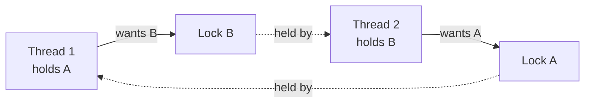

# Concurrency Primitives

<Note>
**TL;DR**

When threads share memory, **race conditions** happen whenever a read-modify-write isn't atomic. The tools: **mutexes/locks** (one thread at a time in a critical section), **read-write locks**, **semaphores** (N permits), **condition variables** (wait for a condition), **atomics** (CPU-level indivisible operations like compare-and-swap), and higher-level channels/actors. Locks bring **deadlocks** (four Coffman conditions), livelock, starvation and contention. **Lock-free** algorithms use CAS loops instead of locks but are hard to get right (ABA problem, memory ordering). Concepts of concurrency vs parallelism are in [Concurrency And Parallelism](/Software%20Engineering/Principles/Concurrency%20And%20Parallelism).
</Note>

## Race conditions
```python
counter = 0
def work():
    global counter
    for _ in range(1_000_000):
        counter += 1        # LOAD counter; ADD 1; STORE counter: three steps!
# Two threads → result often < 2,000,000 (lost updates)
```
```text
T1: load 5          T2: load 5
T1: add → 6         T2: add → 6
T1: store 6         T2: store 6     ← one increment lost
```
- **Data race**: concurrent access to the same memory, at least one write, no synchronization → undefined behavior in C/C++/Rust-unsafe, surprising results elsewhere.
- **Race condition** (broader): correctness depends on timing, e.g. check-then-act (`if not exists: create`), even across processes or services (the same bug with a database: use constraints or `SELECT ... FOR UPDATE`, see [Isolation Levels & Read Phenomena](/Software%20Engineering/Databases/Core%20Concepts/Isolation%20Levels%20%26%20Read%20Phenomena)).

## Primitives
| Primitive | What it does | Use for |
|---|---|---|
| **Mutex / lock** | Only the owner can enter the critical section | Protecting shared state |
| **Reentrant lock** | Same thread may lock again | Recursive code (Java `synchronized`, `ReentrantLock`) |
| **Read-write lock** | Many readers or one writer | Read-heavy shared data |
| **Spinlock** | Busy-waits instead of sleeping | Very short sections in kernels; wasteful in apps |
| **Semaphore** | Counter of permits; `acquire` blocks at 0 | Limit concurrency (10 DB connections), producer/consumer |
| **Condition variable** | Wait until notified, releasing the lock while waiting | "Queue not empty" signals |
| **Barrier / latch** | Wait until N threads arrive | Phased parallel work |
| **Atomic variables** | Indivisible load/store/increment/CAS | Counters, flags, lock-free structures |
| **Channels / queues** | Pass ownership of data between threads | Go channels, `BlockingQueue`, actors |

```java
// Mutex: fix the counter
private final ReentrantLock lock = new ReentrantLock();
void inc() { lock.lock(); try { counter++; } finally { lock.unlock(); } }

// Atomic: lock-free fix
private final AtomicLong counter = new AtomicLong();
void inc() { counter.incrementAndGet(); }

// Semaphore: at most 10 concurrent calls to a downstream
private final Semaphore permits = new Semaphore(10);
Response call() throws InterruptedException {
  permits.acquire();
  try { return client.send(); } finally { permits.release(); }
}
```

```go
// Go: share memory by communicating
jobs := make(chan Job, 100)          // bounded channel = backpressure
for w := 0; w < 8; w++ { go func() { for j := range jobs { process(j) } }() }
```

### Condition variable: producer/consumer
```python
import threading, collections
buf, cv, CAP = collections.deque(), threading.Condition(), 10
def produce(x):
    with cv:
        while len(buf) >= CAP: cv.wait()      # always wait in a loop (spurious wakeups)
        buf.append(x); cv.notify_all()
def consume():
    with cv:
        while not buf: cv.wait()
        x = buf.popleft(); cv.notify_all(); return x
```

## Deadlock
Four **Coffman conditions**, all required:
1. **Mutual exclusion**: resources can't be shared.
2. **Hold and wait**: a thread holds one resource while waiting for another.
3. **No preemption**: resources can't be forcibly taken.
4. **Circular wait**: T1 waits for T2, which waits for T1.


Break any one condition:
- **Lock ordering** (always acquire A before B): breaks circular wait. The most common fix.
- `tryLock` with **timeout** and back off: breaks hold-and-wait.
- Acquire all locks at once, or use a single coarser lock.
- Databases detect deadlocks (wait-for graph) and abort a victim transaction; applications must retry.

Related failures: **livelock** (threads keep reacting to each other, no progress), **starvation** (a thread never gets the lock; fair locks help), **priority inversion** (low-priority thread holds a lock needed by a high-priority one; fixed by priority inheritance).

## Atomics, CAS and memory ordering
- **Compare-and-swap (CAS)**: `CAS(addr, expected, new)` sets `new` only if the current value equals `expected`, atomically; returns success. The building block of lock-free code.
```java
long old, next;
do { old = value.get(); next = old * 2; } while (!value.compareAndSet(old, next));   // CAS loop
```
- **Memory model**: compilers and CPUs reorder memory operations; without synchronization another thread may see writes out of order or never. `volatile` (Java), `std::atomic` with acquire/release (C++), locks, and channels create **happens-before** edges that guarantee visibility.
- **False sharing**: two atomics on the same 64-byte cache line ping-pong between cores ([Computer Architecture Basics](/Software%20Engineering/CS%20Fundamentals/Computer%20Architecture%20Basics)); pad them apart.

## Lock-free basics
| Guarantee | Meaning |
|---|---|
| Blocking | A stalled thread can block others (locks) |
| **Lock-free** | Some thread always makes progress (CAS loops) |
| **Wait-free** | Every thread finishes in a bounded number of steps |

- Examples: `ConcurrentLinkedQueue` (Michael-Scott queue), `AtomicLong`, `LongAdder` (striped counters, less contention), RCU in the Linux kernel.
- **ABA problem**: value changes A → B → A between your read and CAS; CAS succeeds wrongly. Fix with version tags (stamped references) or safe memory reclamation (hazard pointers, epochs).
- Lock-free ≠ faster by default. Under low contention a mutex is cheap (~20 ns); measure.

## Senior perspective
- Prefer **not sharing**: immutable data, confinement (one owner thread), message passing, or a database/queue doing the coordination.
- Keep critical sections tiny; never do I/O or call unknown code while holding a lock.
- Use high-level concurrent collections and executors before hand-rolled primitives.
- Contention shows up as latency, not errors: profile lock wait time (JFR, `perf`, mutex profiles in Go).
- Distributed locks are a different beast (leases, fencing tokens): see [Consistency Models & Consensus](/Software%20Engineering/System%20Design/Consistency%20Models%20%26%20Consensus).
- Tools: ThreadSanitizer, Go race detector (`go test -race`), Java `jstack` for deadlocks.

<Info>
**🆕 2025–2026**

- **Python 3.14 (2025-10-07)**: the free-threaded (no-GIL) build became **officially supported** (still optional) under PEP 779, so Python threads can now run truly in parallel; pure-Python code that relied on the GIL for implicit atomicity must use locks explicitly. ([PEP 779](https://peps.python.org/pep-0779/), [What's new in 3.14](https://docs.python.org/3/whatsnew/3.14.html))
- **Java 24 (March 2025, JEP 491)**: virtual threads no longer pin their carrier thread when blocking inside `synchronized`, so the old advice to replace `synchronized` with `ReentrantLock` for virtual threads is largely obsolete. ([JEP 491](https://openjdk.org/jeps/491))
</Info>

## Interview questions
<Accordion title="Mutex vs semaphore?">
A mutex allows one owner in a critical section and is released by the thread that acquired it. A semaphore holds N permits, any thread can release, and it's used to limit concurrency or signal between threads. A binary semaphore resembles a mutex but lacks ownership.
</Accordion>

<Accordion title="What are the conditions for deadlock and how do you prevent it?">
Mutual exclusion, hold and wait, no preemption, circular wait. Prevent by breaking one, typically a global lock ordering, or timeouts with tryLock and retry, or acquiring all resources at once.
</Accordion>

<Accordion title="What is a race condition? Give an example outside threads.">
Behavior depends on timing of concurrent operations. Example: two requests check that a username is free and both insert it. Fix with a unique constraint or atomic insert-if-absent.
</Accordion>

<Accordion title="What is CAS and what's the ABA problem?">
Compare-and-swap atomically updates a value only if it still equals the expected one. ABA: another thread changes A→B→A, so CAS succeeds even though the state changed; fix with version counters or safe memory reclamation.
</Accordion>

<Accordion title="Why wait on a condition variable inside a while loop?">
Spurious wakeups can occur, and another thread may consume the condition between notify and reacquiring the lock, so you must recheck the predicate.
</Accordion>

<Accordion title="When is a lock-free structure a bad idea?">
When contention is low (a mutex is simpler and just as fast), when the team can't maintain it, or when CAS retry storms under high contention make it slower than a lock or a sharded design.
</Accordion>

## Related
- [CS Fundamentals Index](/Software%20Engineering/CS%20Fundamentals/CS%20Fundamentals%20Index)
- [Concurrency And Parallelism](/Software%20Engineering/Principles/Concurrency%20And%20Parallelism) · [Operating Systems Essentials](/Software%20Engineering/CS%20Fundamentals/Operating%20Systems%20Essentials) · [Computer Architecture Basics](/Software%20Engineering/CS%20Fundamentals/Computer%20Architecture%20Basics)
- [Consistency Models & Consensus](/Software%20Engineering/System%20Design/Consistency%20Models%20%26%20Consensus) · [Isolation Levels & Read Phenomena](/Software%20Engineering/Databases/Core%20Concepts/Isolation%20Levels%20%26%20Read%20Phenomena) · [Event Loop - Microtasks & Macrotasks](/Software%20Engineering/Frontend/01%20JavaScript/Event%20Loop%20-%20Microtasks%20%26%20Macrotasks)

## Sources
- Brian Goetz et al., *Java Concurrency in Practice*
- Herlihy & Shavit, *The Art of Multiprocessor Programming*
- Arpaci-Dusseau, [*OSTEP*: Concurrency chapters](https://pages.cs.wisc.edu/~remzi/OSTEP/)
- [Coffman, Elphick & Shoshani: System Deadlocks (1971)](https://dl.acm.org/doi/10.1145/356586.356588)
- [Preshing on Programming: Acquire and Release Semantics](https://preshing.com/20120913/acquire-and-release-semantics/)
- [PEP 779](https://peps.python.org/pep-0779/) · [JEP 491](https://openjdk.org/jeps/491)
